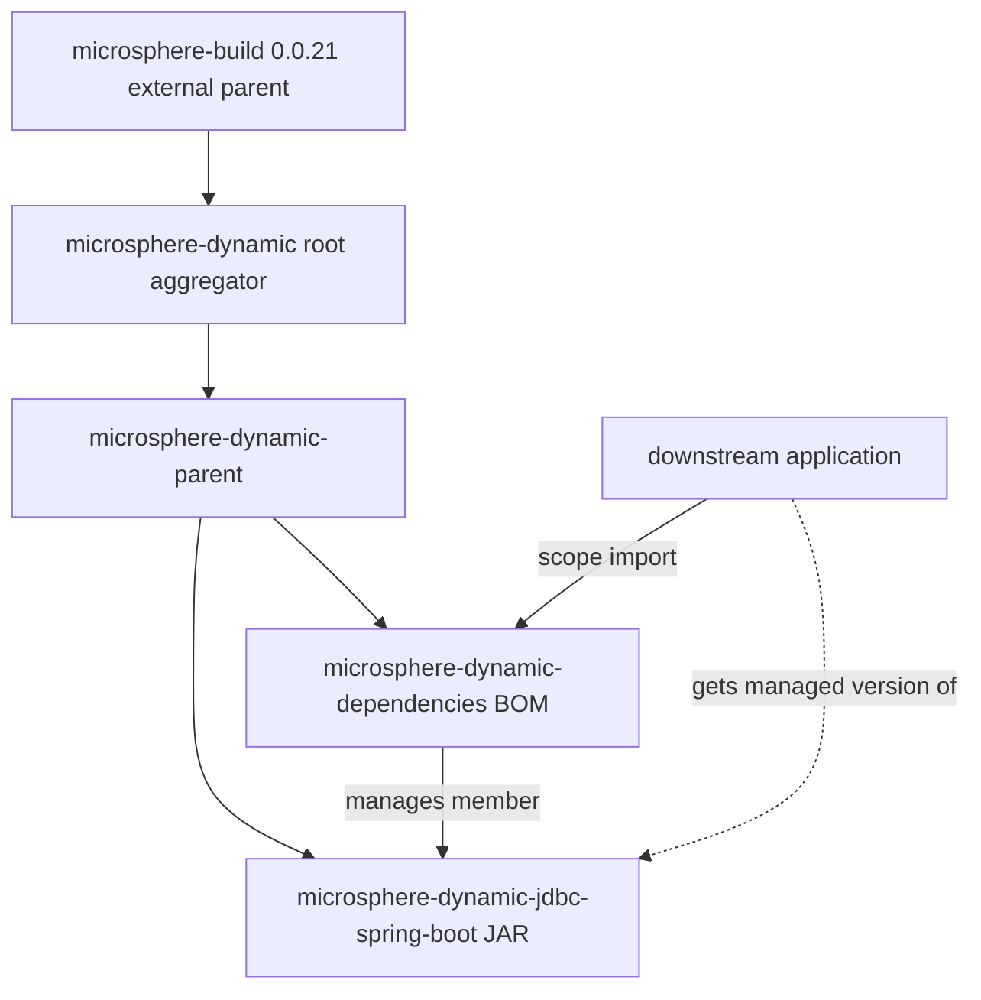

[中文](zh/microsphere-dynamic-dependencies.md)

# Developer Guide: `microsphere-dynamic-dependencies`

> **Documentation line note:** This repository has no `release` or `release-1.x` branch
> yet; the `current` documentation line is generated from `main` (revision
> `0.0.1-SNAPSHOT`). Everything in this guide reflects the state of the `main`
> branch only. Treat all version numbers and behaviour below as pre-1.0 and
> subject to change.

`microsphere-dynamic-dependencies` is the project **BOM** (Bill of Materials) — a
**POM-only module** (`<packaging>pom</packaging>`) that ships no source code and no JAR.
Its entire purpose is to be `<scope>import</scope>`ed by downstream applications so they
inherit a curated, version-aligned list of this project's published artifacts. This guide
covers it from the build/architecture angle: how a BOM differs from the parent module, the
behaviour of each POM section, what breaks on edits, and how a new managed member is added.

Companion docs:
[`microsphere-dynamic-parent.md`](microsphere-dynamic-parent.md) (the inheritance contract
this BOM is built on) and
[`microsphere-dynamic-jdbc-spring-boot.md`](microsphere-dynamic-jdbc-spring-boot.md)
(the only JAR, which is the managed member).

---

## 1. Purpose within the reactor

The reactor's three modules split cleanly into roles:

- `microsphere-dynamic-parent` — the **inheritance** contract (internal version/third-party
  management). See its doc.
- `microsphere-dynamic-dependencies` (**this module**) — the **import** contract (the public
  managed-member surface).
- `microsphere-dynamic-jdbc-spring-boot` — the only artifact that produces a JAR.

This BOM declares exactly one managed member today:

```xml
<dependencyManagement>
    <dependencies>
        <dependency>
            <groupId>io.github.microsphere-projects</groupId>
            <artifactId>microsphere-dynamic-jdbc-spring-boot</artifactId>
            <version>${revision}</version>
        </dependency>
    </dependencies>
</dependencyManagement>
```

### Why a separate BOM instead of just importing the parent?

A downstream Spring Boot application should **not** become a Maven *child* of
`microsphere-dynamic-parent`. Inheriting a parent pulls in that parent's build plugins,
properties, and third-party pins as if they were the consumer's own — which would leak
this repository's internal build choices (MyBatis-Plus pinning, MariaDB4j pinning, the
imported Spring Cloud/multi-active BOMs) into an unrelated consumer's dependency graph,
and would also force the consumer to inherit this project's `<parent>` chain
(`microsphere-dynamic` → `microsphere-build`).

A BOM avoids that. Importing a BOM only copies its **`dependencyManagement` entries** into
the consumer — no plugins, no properties, no parent, no build behaviour. So the design is:

- **Parent** = broad, internal, inheritance-based management (this project's own modules).
- **BOM** = narrow, external, import-based management (this project's *published artifacts*,
  presented as a version-alignment contract to the world).

The two are deliberately decoupled: the parent's many third-party pins do **not** appear in
the BOM. Consumers who want this project's artifacts get only the managed members the BOM
chooses to publish — currently just the JDBC starter.

### Why the BOM inherits the parent

```xml
<parent>
    <groupId>io.github.microsphere-projects</groupId>
    <artifactId>microsphere-dynamic-parent</artifactId>
    <version>${revision}</version>
    <relativePath>../microsphere-dynamic-parent/pom.xml</relativePath>
</parent>
```

The BOM lists `microsphere-dynamic-parent` as its own `<parent>`. This is **build-time
convenience for the reactor**, not something downstream inherits: it lets the BOM resolve
`${revision}` consistently and guarantees the parent is built before the BOM in the reactor.
Because a consumer *imports* the BOM (rather than inheriting it), the parent relationship
does not propagate to consumers. However, note that `flatten-maven-plugin` in this project
expands/interpolates the published BOM (see section 5), so what a consumer actually sees is
the flattened BOM, not the raw source POM.

---

## 2. Module dependency diagram



Read from this module's perspective: `microsphere-dynamic-dependencies` sits **between** the
internal parent (which it inherits at build time) and the outside world (applications that
`scope=import` it). Its single output edge is the "manages member" relationship to the JDBC
JAR, and its single consumer-facing role is the dashed "import" path used by downstream apps.

---

## 3. POM section analysis

### 3.1 Parent reference

As shown in section 1. The `<parent>` is `microsphere-dynamic-parent` via
`../microsphere-dynamic-parent/pom.xml`.

**What breaks if changed:** reparenting the BOM away from `microsphere-dynamic-parent` would
drop the shared `${revision}` handling and could break reactor ordering (the parent must build
first). Pointing `<parent>` directly at the raw aggregator instead would bypass the
third-party/BOM-import management that the parent provides, though the BOM itself only needs
`${revision}` — the practical risk is losing consistency with the rest of the reactor.

### 3.2 Coordinates and packaging

```xml
<groupId>io.github.microsphere-projects</groupId>
<artifactId>microsphere-dynamic-dependencies</artifactId>
<version>${revision}</version>
<packaging>pom</packaging>
```

- `packaging=pom` with a `dependencyManagement`-only body is the definition of a BOM.
- `artifactId=...-dependencies` follows the Microsphere naming convention for BOM modules.
- `version=${revision}` is the CI-friendly token, resolved by flatten at build time.

**What breaks if changed:** hard-coding the version decouples the BOM from `${revision}`; the
managed member's `${revision}` would then track the wrong line. Renaming the `artifactId`
breaks every downstream `import` coordinate.

### 3.3 `dependencyManagement` (the managed members)

The single entry manages `microsphere-dynamic-jdbc-spring-boot` at `${revision}` — i.e. the
same revision as the BOM itself, so the managed member and the BOM are always released in
lockstep.

**What breaks if changed:**
- Removing the entry leaves downstream apps with no managed version for the JDBC starter; they
  would have to specify versions by hand and lose the alignment guarantee.
- Pinning the member to a literal version (instead of `${revision}`) desynchronises it from
  the BOM's own version, which is exactly the drift this pattern is designed to prevent.
- Adding a managed entry for an artifact that is **not** built in this reactor (and not on a
  reachable repository) makes the BOM import fail to resolve.

---

## 4. Build-artifact caveat: `.flattened-pom.xml` and `.mvn/`

- **`.flattened-pom.xml`** (this module's and the repo's) is a generated
  `flatten-maven-plugin` output that is **git-ignored** (`.gitignore` lists
  `.flattened-pom.xml`). It is a local stale build artifact and must not be treated as
  authoritative. The tracked source of truth is this module's `pom.xml`.
- **`.mvn/wrapper/`** pins the build to **Maven `3.9.0`** (wrapper `3.1.1`) via
  `maven-wrapper.properties`, so the flatten step and the reactor build run on a reproducible
  Maven version (see section 5).

---

## 5. How `${revision}` and `flatten-maven-plugin` work here

The BOM's managed member is written as `${revision}`. For the BOM to be useful *externally*,
that token must be resolved to a concrete version in the published/installed POM; otherwise a
consumer importing the BOM would see an unresolvable `${revision}`.

This resolution is performed by **`flatten-maven-plugin`**, configured in the **external
`microsphere-build:0.0.21` parent** (not in this repository). The relevant parts of that
parent's real configuration:

| `flatten-maven-plugin` setting (from `microsphere-build` 0.0.21) | Value | Why it matters to the BOM |
|---|---|---|
| `flattenMode` | `resolveCiFriendliesOnly` | Resolves `${revision}` in the published BOM so the managed member becomes a concrete version. |
| `updatePomFile` | `true` | The flattened POM is what gets installed/deployed. |
| `pomElements/dependencyManagement` | `interpolate` | This is the setting that turns `${revision}` into the real version inside the BOM's managed member. |
| `pomElements/distributionManagement` | `remove` | `distributionManagement` is stripped so it is not carried into the BOM consumers inherit. |
| `pomElements/repositories` | `remove` | The snapshot repository entry is stripped from the flattened BOM. |

The `resolveCiFriendliesOnly` mode is deliberately conservative: it resolves only the CI
tokens and leaves the rest of the BOM's structure intact. Changing flatten behaviour requires
bumping the external `microsphere-build` version, which is **not** available inside this repo.

---

## 6. Version and release flow

### Local build commands

Maven Wrapper at the repo root (`./mvnw`, or `mvnw.cmd` on Windows), pinned to Maven `3.9.0`:

```bash
# Build the whole reactor (BOM included), default revision 0.0.1-SNAPSHOT
./mvnw clean install

# Build exactly as CI does
./mvnw --batch-mode --update-snapshots -Drevision=0.0.1 clean install
```

To validate the flattened, consumer-visible BOM in isolation:

```bash
./mvnw -pl microsphere-dynamic-dependencies -am clean install -Drevision=0.0.1
# inspect microsphere-dynamic-dependencies/.flattened-pom.xml afterwards (git-ignored, local only)
```

### Using the BOM from a downstream application

```xml
<dependencyManagement>
    <dependencies>
        <dependency>
            <groupId>io.github.microsphere-projects</groupId>
            <artifactId>microsphere-dynamic-dependencies</artifactId>
            <version>0.0.1-SNAPSHOT</version>
            <type>pom</type>
            <scope>import</scope>
        </dependency>
    </dependencies>
</dependencyManagement>
```

After the import, declare `microsphere-dynamic-jdbc-spring-boot` **without** a `<version>` and
Maven pulls the managed revision. (The `<version>` you use externally is whatever revision was
actually published; `0.0.1-SNAPSHOT` is only available from the snapshot repository.)

### `-Drevision`, deploy targets, CI

Identical to the rest of the reactor (defined by the root aggregator, not this module):

- `-Drevision` is reactor-wide; without it the default is `0.0.1-SNAPSHOT`, CI builds `0.0.1`.
- **Deploy targets** (`distributionManagement`, from the aggregator, stripped from the
  flattened BOM): Sonatype OSSRH `ossrh` snapshots repository
  `https://s01.oss.sonatype.org/content/repositories/snapshots` and staging repository
  `https://s01.oss.sonatype.org/service/local/staging/deploy/maven2/`.
- **CI matrix** (`.github/workflows/maven.yml`): `main` push + `main` PRs, `ubuntu-latest`,
  single JDK **Temurin `8`**, command `mvn --batch-mode --update-snapshots --file pom.xml
  -Drevision=0.0.1 clean install`. No deploy step in CI.

### Compatibility matrix (BOM view)

| Concern | Value | Provenance |
|---|---|---|
| BOM version | `${revision}` → `0.0.1-SNAPSHOT` default / `0.0.1` on CI | Root aggregator `pom.xml`. |
| Managed member version | `${revision}` (tracks the BOM exactly) | This module's `dependencyManagement`. |
| Java baseline for building | `8` | External `microsphere-build:0.0.21` (`java.version=8`); not declared in this repo. |
| Maven | `3.9.0` | `.mvn/wrapper/maven-wrapper.properties`. |
| Spring Boot / Spring Cloud | `2.7.18` / `2021.0.8` | **Not in the BOM.** These are NOT managed members here; they only affect the JDBC JAR transitively via the parent's imported external BOMs, whose external `microsphere-spring-cloud-parent` sets them. Listed for completeness only. |

---

## 7. Change-management guidance

### How to add a new managed module to the BOM

When you publish a second JAR module in this reactor and want it on the public managed surface:

1. Build the new module inheriting `microsphere-dynamic-parent` with `<version>${revision}</version>`
   and add it to the aggregator `<modules>`.
2. Add one `dependencyManagement` entry to **this** module:

   ```xml
   <dependency>
       <groupId>io.github.microsphere-projects</groupId>
       <artifactId>microsphere-dynamic-<new-module></artifactId>
       <version>${revision}</version>
   </dependency>
   ```

3. Keep the managed member at `${revision}` (not a literal) so it releases in lockstep with the BOM.
4. Only manage artifacts that are **published by this reactor** — do not use the BOM to pin
   third-party libraries; that is the parent's job. Mixing third-party pins into the BOM would
   export internal choices as a public contract.

### How to bump a pinned third-party version

A BOM edit is **not** how third-party versions change. Third-party pins live in
`microsphere-dynamic-parent` (see
[`microsphere-dynamic-parent.md`](microsphere-dynamic-parent.md)). This BOM only tracks
in-repo published artifacts at `${revision}`, so it rarely needs an edit unless the managed
member list changes.

### Reactor ordering constraints

`microsphere-build` (external) → `microsphere-dynamic-parent` → **`microsphere-dynamic-dependencies`**
and → `microsphere-dynamic-jdbc-spring-boot`. Because the BOM inherits the parent, the parent
must be installed/built before the BOM in the reactor; Maven enforces this through the parent
graph, and the aggregator `<modules>` order already lists parent first. If you add members to
the BOM that are built in-reactor, the managed JAR modules must also build so their coordinates
exist for the flatten step to reference — but importing the BOM does not force those members
to be built as part of the same reactor on a consumer's machine.

---

## 8. Maturity caveat

This BOM is at revision `0.0.1-SNAPSHOT`, and the repository has **no `release` or
`release-1.x` branch** and no tags — the `current` documentation line is generated from `main`.
It manages exactly one member today. The set of managed members is expected to grow and may
change without a semantic-versioning guarantee; do not treat the current single-member surface
as a frozen public contract.

---

## Related documentation

- Developer guide index: [Developer Guide](README.md)
- Repository README: [microsphere-dynamic](../../../README.md)
- Inheritance contract (parent): [microsphere-dynamic-parent](microsphere-dynamic-parent.md)
- The managed member (JAR): [microsphere-dynamic-jdbc-spring-boot](microsphere-dynamic-jdbc-spring-boot.md)

---

## 中文

本文件的简体中文版本：[microsphere-dynamic-dependencies 开发者指南](zh/microsphere-dynamic-dependencies.md)。
