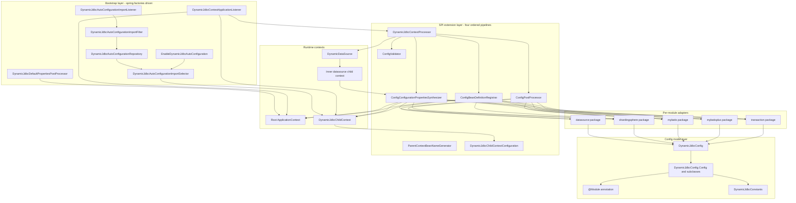
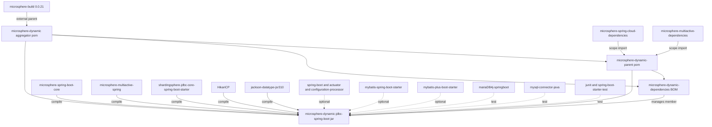
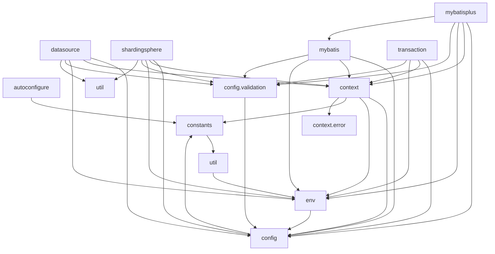
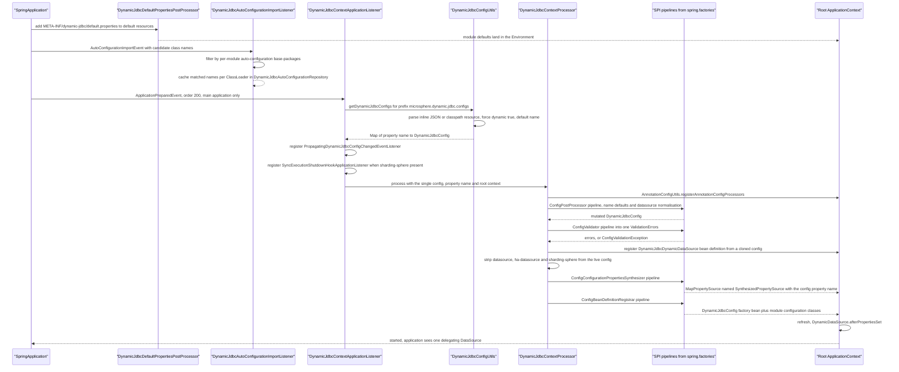
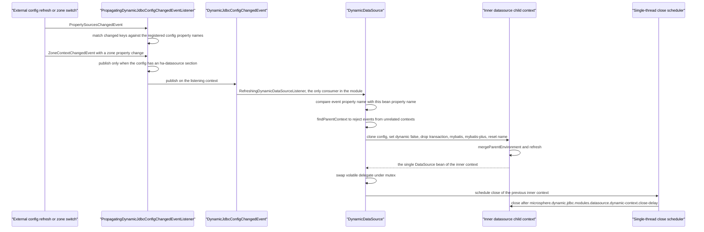
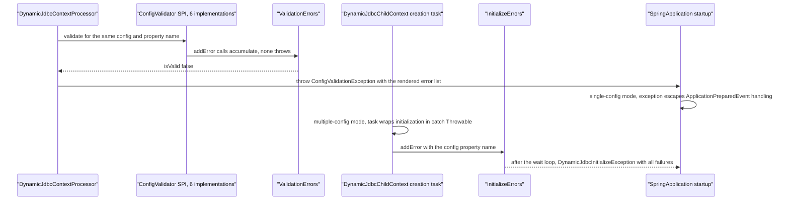
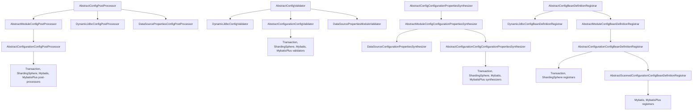

[中文](zh/microsphere-dynamic-jdbc-spring-boot.md)

# Developer Guide: `microsphere-dynamic-jdbc-spring-boot`

> **Documentation line note:** This repository has no `release` or `release-1.x` branch yet; the `current` documentation line is generated from `main` (revision `0.0.1-SNAPSHOT`).
> There are no Git tags. Every statement below describes the tree on `main` and must be
> treated as pre-1.0 and subject to change — including the Javadoc `@since 1.0.0` markers,
> which appear on every class in the module even though the reactor has never produced a
> `1.0.0` artifact.

This is the **only code-producing module** of the repository: 81 `src/main/java` classes
in package `io.microsphere.dynamic.jdbc.spring.boot`. It is a Spring Boot *library* (not a
starter with its own auto-configuration class): everything it does is driven through
`spring.factories` SPI registrations and a handful of `ApplicationContext` listeners.

This guide is a **source-analysis document**. Paths are relative to
`microsphere-dynamic-jdbc-spring-boot/` unless stated otherwise, and each design claim is
anchored to a class or a resource file you can open.

| Audience | Start here |
|---|---|
| I want to configure this library in an application | [User guide: `microsphere-dynamic-jdbc-spring-boot`](../../user-guide/microsphere-dynamic-jdbc-spring-boot.md) |
| I want to understand or change the reactor/POMs | [`microsphere-dynamic-parent.md`](microsphere-dynamic-parent.md), [`microsphere-dynamic-dependencies.md`](microsphere-dynamic-dependencies.md) |
| I want to add a new JDBC module adapter | [Section 6, Extension guide](#6-extension-guide-adding-a-new-module) |
| I want the index of all developer guides | [`README.md`](README.md) |
| Repository overview and build | [`../../../README.md`](../../../README.md) |

---

## 1. Architecture overview

### 1.1 Goals the code actually encodes

1. **A config model as the single source of truth.** A `DynamicJdbcConfig` instance is a
   JSON document bound to a property named
   `microsphere.dynamic.jdbc.configs.<name>`. `DynamicJdbcConfigUtils.getDynamicJdbcConfigs`
   scans the `Environment` for that prefix, reads either an inline JSON value or a
   `classpath:` resource location, and Jackson-deserialises it into `DynamicJdbcConfig`
   (`config/DynamicJdbcConfig.java`, `util/DynamicJdbcConfigUtils.java`). The model exposes
   exactly one field per supported module: `dataSource`, `highAvailabilityDataSource`,
   `transaction`, `shardingSphere`, `mybatis`, `mybatisPlus`, plus the flags `dynamic` and
   `primary`.
2. **Per-module isolated contexts.** When more than one config is present, the root
   context creates one `DynamicJdbcChildContext` (an `AnnotationConfigApplicationContext`)
   per config, so two datasources, two ShardingSphere rule sets and two `SqlSessionFactory`
   instances can coexist without class-name collisions (`context/DynamicJdbcChildContext.java`,
   `context/DynamicJdbcContextApplicationListener.java`).
3. **Isolation from the root context.** Third-party auto-configuration classes
   (`DataSourceAutoConfiguration`, `ShardingSphereAutoConfiguration`, MyBatis, MyBatis-Plus)
   must *not* run in the root context when several configs exist. The library re-implements
   them inside each child context by importing only the class names that fall under the
   per-module `auto-configuration.base-packages`, and by pushing the rest into
   `spring.autoconfigure.exclude` (`autoconfigure/*`, `env/DynamicJdbcDefaultPropertiesPostProcessor`,
   `META-INF/dynamic-jdbc/default.properties`).
4. **Hot reload of the datasource.** The `DataSource` bean seen by the application is always
   `DynamicDataSource`, a delegating `javax.sql.DataSource`. On a `DynamicJdbcConfigChangedEvent`
   it builds a *new* child context, swaps the `volatile delegate` under a mutex and schedules
   the old child context to close after a configurable delay (`datasource/DynamicDataSource.java`).
5. **Fail fast, with aggregated messages.** Parsing, normalisation and validation are separated:
   `ConfigValidator` implementations collect into `ValidationErrors`, and the processor throws
   `ConfigValidationException` only after all validators have run, so one startup reports every
   problem at once (`context/DynamicJdbcContextProcessor.java`, `config/validation/*`).

### 1.2 Package layering



Every arrow is traceable: `spring.factories` wires `DEF`, `ACIL` and `CAL`;
`DynamicJdbcContextProcessor.process()` calls the four pipelines in the order
post-process → validate → synthesize → register; the adapters plug into the pipelines via
the abstract hierarchies in [section 4](#4-source-analysis-by-package).

### 1.3 SPI registration counts (read from `META-INF/spring.factories`)

| SPI contract | Registered implementations | Count |
|---|---|---|
| `org.springframework.context.ApplicationListener` | `DynamicJdbcContextApplicationListener` | 1 |
| `org.springframework.boot.autoconfigure.AutoConfigurationImportListener` | `DynamicJdbcAutoConfigurationImportListener` | 1 |
| `io.microsphere.spring.boot.env.DefaultPropertiesPostProcessor` | `DynamicJdbcDefaultPropertiesPostProcessor` | 1 |
| `config.ConfigPostProcessor` | `DynamicJdbcConfigPostProcessor`, `DataSourcePropertiesConfigPostProcessor`, `TransactionConfigPostProcessor`, `ShardingSphereConfigPostProcessor`, `MybatisConfigPostProcessor`, `MybatisPlusConfigPostProcessor` | 6 |
| `config.validation.ConfigValidator` | `DynamicJdbcConfigValidator`, `DataSourcePropertiesModuleValidator`, `TransactionConfigValidator`, `ShardingSphereConfigValidator`, `MybatisConfigValidator`, `MybatisPlusConfigValidator` | 6 |
| `env.ConfigConfigurationPropertiesSynthesizer` | `TransactionConfigConfigurationPropertiesSynthesizer`, `ShardingSphereConfigConfigurationPropertiesSynthesizer`, `DataSourceConfigurationPropertiesSynthesizer`, `MybatisConfigConfigurationPropertiesSynthesizer`, `MybatisPlusConfigConfigurationPropertiesSynthesizer` | 5 |
| `context.ConfigBeanDefinitionRegistrar` | `DynamicJdbcConfigBeanDefinitionRegistrar`, `TransactionConfigurationConfigBeanDefinitionRegistrar`, `ShardingSphereConfigurationConfigBeanDefinitionRegistrar`, `MybatisConfigurationConfigBeanDefinitionRegistrar`, `MybatisPlusConfigurationConfigBeanDefinitionRegistrar` | 5 |
| `context.ParentContextBeanNameGenerator` | `PlatformTransactionManagerBeanNameGenerator` | 1 |

Two asymmetries are deliberate and visible in the file: `datasource` has **no** registrar
(it relies purely on `DataSourceAutoConfiguration` being imported into the child context),
and there is **no** `ha-datasource` implementation of any SPI — the HA variant reuses every
`datasource` class and only differs in the JSON shape plus `DynamicJdbcConfig` accessors.

---

## 2. Module dependency diagrams

### 2.1 Reactor level



`microsphere-dynamic-jdbc-spring-boot/pom.xml` declares **no version** for any dependency:
`shardingsphere.version`, `mybatis-starter.version`, `mybatis-plus.version`,
`mysql-connector-java.version` and `mariadb4j.version` are properties of
`microsphere-dynamic-parent`, and the Spring Boot line itself is not declared in this
repository at all (see [section 8](#8-version--compatibility)).

### 2.2 Intra-module package flow



Notes that make the graph verifiable rather than aspirational:

- `mybatisplus.env.MybatisPlusConfigConfigurationPropertiesSynthesizer` statically imports
  `synthesizeBasePackagesConfigurationProperties` from the `mybatis` sibling — the only
  cross-adapter call in the module (`MBP --> MYB`).
- `context` depends on `config.validation` through `DynamicJdbcContextProcessor`, which
  imports `ConfigValidationException` and `ValidationErrors`; the arrow is drawn from
  `CTX` to `CFG` because `config.validation` is a sub-package of `config`.
- `env.ConfigurationPropertiesFlatter` is used by `util.DynamicJdbcUtils`, so `util` sits
  *above* `env` for that one call — a genuine cycle risk between `env` and `util` worth
  knowing before you refactor (see [section 7](#7-complexity-coupling-and-known-constraints)).

---

## 3. Bootstrap and runtime flows

### 3.1 Startup — single `DynamicJdbcConfig` (the common path)



The single-config path deliberately runs **in the root context**: `DynamicJdbcContextApplicationListener.processDynamicJdbcContext`
is only reached when `dynamicJdbcConfigSize == 1`, and it calls
`new DynamicJdbcContextProcessor().process(..., context)` with that root context.

Ordering fact worth pinning: the `DynamicDataSource` bean definition is registered *before*
the datasource sections are stripped, and `DynamicJdbcContextProcessor` clones the config
first — so the dynamic datasource receives the full topology (datasource plus
`sharding-sphere`) while the root context keeps only `transaction`, `mybatis`,
`mybatis-plus` and the property synthesis.

### 3.2 Startup — several configs: child contexts and parent bean exposure

```mermaid
sequenceDiagram
    participant APL as "DynamicJdbcContextApplicationListener"
    participant POOL as "Fixed thread pool, one thread per config"
    participant CHD as "DynamicJdbcChildContext"
    participant PRC as "DynamicJdbcContextProcessor"
    participant LCL as "DynamicJdbcChildContextRefreshedListener"
    participant PAR as "ParentContextBeanNameGenerator SPI"
    participant ROOT as "Root ApplicationContext"

    APL->>APL : size greater than 1, multiple context mode
    APL->>ROOT : add excluded auto-config classes for multiple-context
    APL->>POOL : submit initializeDynamicJdbcChildContext per entry
    POOL->>CHD : new DynamicJdbcChildContext with DynamicJdbcChildContextIdGenerator.DEFAULT
    CHD->>CHD : setId from DynamicJdbcChildContext[config name]
    POOL->>CHD : registerParentBeans
    POOL->>CHD : mergeParentEnvironment
    CHD->>CHD : remove inherited SynthesizedPropertySource entries and re-attach configuration sources
    POOL->>CHD : refresh
    CHD->>PRC : postProcessBeanFactory then process
    CHD->>CHD : register DynamicJdbcChildContextConfiguration, annotated EnableDynamicJdbcAutoConfiguration
    CHD->>CHD : import cached auto-configuration class names through the selector
    CHD->>LCL : addApplicationListener during postProcessBeanFactory
    PRC-->>CHD : synthesized properties, validators, registrars, module beans
    CHD-->>LCL : ContextRefreshedEvent
    LCL->>ROOT : add a ContextClosedEvent listener that closes this child
    LCL->>PAR : find a generator whose child bean type matches
    PAR-->>LCL : bean name such as the transaction name, or null
    LCL->>ROOT : register each non-infrastructure bean, default name is child id plus $ plus child bean name
    LCL->>ROOT : mark primary when config primary and class is in the primary list
    POOL-->>APL : all tasks completed
    APL-->>APL : throw DynamicJdbcInitializeException when InitializeErrors has entries
```

Three mechanisms are visible only in the source, so they are called out here:

- **Bean-name control.** `DynamicJdbcChildContextRefreshedListener.generateDefaultParentBeanName`
  yields `<childContextId>$<childBeanName>`; a `ParentContextBeanNameGenerator` registered
  in `spring.factories` can override it. Today exactly one exists:
  `PlatformTransactionManagerBeanNameGenerator`, which returns `DynamicJdbcConfig.Transaction.getName()`,
  which is why `DynamicJdbcContextApplicationListenerMultipleContextTest` can autowire a
  transaction manager named `myTransaction` from the root context.
- **Exposure filter.** Only beans assignable to a class listed in
  `microsphere.dynamic.jdbc.multiple-context.bean-classes.expose` — `DataSource`,
  `PlatformTransactionManager`, `TransactionManagerCustomizers`, `SqlSessionFactory` — are
  registered as real singletons in the parent; every other exported bean goes through
  `BeanRegistrar.registerFactoryBean`.
- **Auto-configuration isolation.** `DynamicJdbcContextProcessor.addExclusionAutoConfigurationPropertySource`
  copies the internal exclusion property into a property source named
  `SynthesizedPropertySource[spring.autoconfigure.exclude]`, and `DynamicJdbcChildContext.mergeParentEnvironment`
  removes the parent's synthesised sources before the child builds its own.

### 3.3 Dynamic config change — what actually gets rebuilt



Verified scope, and it matters: `DynamicJdbcConfigChangedEvent` has **one** consumer in the
whole module — `DynamicDataSource.RefreshingDynamicDataSourceListener`. A config change
therefore rebuilds the **datasource child context only**. The `DynamicJdbcChildContext`
created per config in multiple-context mode is *not* refreshed or replaced, and neither are
its MyBatis/MyBatis-Plus/ShardingSphere-rule beans. `DynamicJdbcContextProcessor.processDynamic()`
says the same thing in code: `// TODO support more dynamic features`. Do not document or
design against "full context hot reload"; the observable contract is hot datasource swap.

Related details you can check without guessing:

- `getDynamicJdbcConfig` **forces** `dynamic` to `true` (`logger.warn("Force dynamic true...")`),
  so `dynamic: false` in a config document is ignored at load time. The inner clone sets it
  back to `false` to stop recursion.
- The close delay comes from `DynamicJdbcPropertyUtils.getDynamicDataSourceChildContextCloseDelay`
  with a `Duration` default of 60 seconds; the integration tests override it to `3s`.
- `getDataSource(...)` throws `IllegalStateException` if the inner context holds more than
  one `DataSource` bean — a useful diagnostic when a module leaks a second datasource.

### 3.4 Validation failure path



The two branches differ because `DynamicJdbcContextApplicationListener.initializeDynamicJdbcChildContext`
is called inside a `try { ... } catch (Throwable t)` block per pool task, while the
single-config call has no guard. Consequence: in single-config mode the first invalid config
kills startup immediately; in multiple-config mode **all** configs are attempted, then one
aggregate `DynamicJdbcInitializeException` is thrown.

Validator inventory (each class contributes a distinct failure mode):

| Validator | What it rejects |
|---|---|
| `DynamicJdbcConfigValidator` | missing `name`; a config with none of the six modules |
| `DataSourcePropertiesModuleValidator` | `datasource` and `ha-datasource` both present; fewer than 2 zones or a missing `defaultZone`; missing required datasource properties; `type`/`driverClassName` classes not on the classpath; missing JDBC URL under any of `url`, `jdbc-url`, `jdbcUrl`; duplicated `name` or `url` between datasource entries |
| `TransactionConfigValidator` | `transaction.name` already used as a bean definition name; `customizers` entries that are absent or not `PlatformTransactionManagerCustomizer` |
| `ShardingSphereConfigValidator` | blank `config-resource`, or a resource that does not resolve |
| `MybatisConfigValidator` | `mybatis` present together with `mybatis-plus` |
| `MybatisPlusConfigValidator` | `mybatis-plus` present together with `mybatis` |

`AbstractConfigurationConfigValidator.validate()` is `final` and always runs
`validateConfiguration` (name, `configurations` class names, properties) before `doValidate`,
which is why a typo in `configurations` is caught even by a module validator that does not
check it explicitly.

---

## 4. Source analysis by package

### 4.1 The four parallel abstract hierarchies

The module's extensibility rests on four structurally identical ladders. Each root
declares a single public method, each middle class makes it `final` and adds a
`supports()` gate plus a `module` parameter, and each leaf adds generic access to the
`DynamicJdbcConfig.Config` subclass it manages.



Why `AbstractConfigPostProcessor` appears twice in the ladder: `datasource` is a
`List<Map<String,Object>>` in the model, not a `Config` subclass, so
`DataSourcePropertiesConfigPostProcessor` and `DataSourceConfigurationPropertiesSynthesizer`
extend the *module-level* or *root-level* abstract classes and hard-code `getModule()`.
`DataSourcePropertiesConfigPostProcessor` overrides the whole post-process step
(`extends AbstractConfigPostProcessor`) because it must iterate a list, apply
previous-entry inheritance and call `JdbcURLAssembler`.

`ConfigurationCapable<C>` is the glue of the third level: `getConfigurationClass()` resolves
the actual type argument of `C`, `getConfiguration(DynamicJdbcConfig)` finds the matching
no-arg getter on `DynamicJdbcConfig` by return type using `ReflectionUtils.doWithMethods`,
and `getModule()` reads the `@Module` value from `C`. Adding a module therefore needs no
`getModule()` override as long as the nested `Config` class carries `@Module`.

### 4.2 `autoconfigure` — making third-party auto-configuration importable *inside* a child context

| Class | Responsibility and key members |
|---|---|
| `EnableDynamicJdbcAutoConfiguration` | `@Import(DynamicJdbcAutoConfigurationImportSelector.class)`; carries vestigial `exclude`/`excludeName` members commented `// Always empty` |
| `DynamicJdbcAutoConfigurationImportFilter` | Package-private singleton `INSTANCE`; `setEnvironment` loads all module `auto-configuration.base-packages`; `match(String)` is a `startsWith` test; the `match(String[], AutoConfigurationMetadata)` override additionally demands `isPresent` |
| `DynamicJdbcAutoConfigurationImportListener` | Registered in `spring.factories`; on the first `AutoConfigurationImportEvent` it filters all candidates and caches the survivors; returns early when the classloader is already cached |
| `DynamicJdbcAutoConfigurationRepository` | `static Map<ClassLoader, String[]> cache`; three `getAutoConfigurationClassNames` overloads, one of which prefix-filters into a `TreeSet`; the private `LoadingConfiguration` class annotated `@EnableDynamicJdbcAutoConfiguration` is the fallback that forces a fresh selector run when nothing is cached |
| `DynamicJdbcAutoConfigurationImportSelector` | Package-private, extends `AutoConfigurationImportSelector`, overrides `getAnnotationClass` and `getAutoConfigurationImportFilters`; `selectImports` returns the cache, or triggers `super.selectImports` and re-reads it; `destroy` clears the cache |

The listener exists purely as a **pre-warm shortcut** — its Javadoc says it "uses
`DynamicJdbcAutoConfigurationImportFilter` to reduce the duplicated loading calculation of
`DynamicJdbcAutoConfigurationImportSelector`". The cache is `static` and keyed by
`ClassLoader`, so all child contexts in one JVM share one filtered list; this is what makes
per-config isolation cheap and what makes `clear()` on bean destruction a cross-context side
effect worth knowing about.

### 4.3 `config` and `config.validation` — the model and its guards

`DynamicJdbcConfig` is a Jackson-bound POJO (`@JsonProperty` names are the module ids from
`DynamicJdbcConstants`), and it does three jobs beyond holding data:

- **Flattening on write.** `setDataSource` / `setHighAvailabilityDataSource` immediately
  run the nested maps through `DynamicJdbcUtils.flatProperties*`, so downstream code only ever
  sees `Map<String,String>` property bags.
- **Zone resolution.** `getDataSourcePropertiesList()` picks the HA list for the current
  `ZoneContext.getZone()`, falling back to `DEFAULT_ZONE`, and the `ZoneContext` itself is
  resolved from the injected `BeanFactory` (`ZONE_CONTEXT_BEAN_NAME`) or the thread-local.
  This is why `DynamicJdbcConfig` implements `BeanFactoryAware` and why the processor hands a
  `BeanFactory` to the cloned dynamic config.
- **Derived predicates** used as gates everywhere: `hasDataSource`, `hasOnlySingleDataSource`,
  `hasHighAvailabilityDataSource`, `hasShardingDataSource`, `hasMybatis`, `hasMybatisPlus`,
  `getDataSourcePropertiesMap` keyed by datasource `name`.

`equals`/`hashCode` use `reflectionEquals`/`reflectionHashCode` with `EXCLUDE_FIELDS`
(`dataSourcePropertiesList`, `highAvailabilityDataSourcePropertiesMap`) so that two configs
that describe the same topology compare equal regardless of flattening order.

`DynamicJdbcConfigPostProcessor` is the pipeline's first element and does two things: it
defaults `name` from the property-name suffix, and it calls
`invokeAwareInterfaces(dynamicJdbcConfig, context)` — the point where the POJO receives
`BeanFactory` and therefore becomes zone-aware.

### 4.4 `context` — the runtime engine

- `DynamicJdbcContextProcessor` (package-private) is the orchestrator described in
  section 3: `process()` = `registerAnnotationConfigProcessors` → `postProcessDynamicJdbcConfig`
  → `validateDynamicJdbcConfig` → optional `processDynamic` →
  `processDynamicJdbcConfigurationProperties` → `registerDynamicJdbcConfigBeanDefinitions`.
  The four SPI lists are lazily loaded once per processor instance via
  `SpringFactoriesLoaderUtils.loadFactories(context, X.class)` and cached in fields.
- `DynamicJdbcChildContext` extends `AnnotationConfigApplicationContext` and overrides
  `postProcessBeanFactory` as `final` — the template that sets the parent classloader,
  attaches `ConfigurationPropertySources`, registers the refreshed-listener, registers
  `DynamicJdbcChildContextConfiguration`, calls the overridable `customizeBeanFactory`, and
  runs the processor. `setupConfigurationClasses` is the documented extension hook for a
  subclass.
- `DynamicJdbcChildContextIdGenerator` is an interface whose `DEFAULT` constant is an
  anonymous implementation; ids look like `DynamicJdbcChildContext[<config name>]`, and the
  inner datasource contexts use `Dynamic#<that id>#datasource`.
- `DynamicJdbcChildContextRefreshedListener` (package-private) does the parent export, and
  also registers, on the **parent**, a `ContextClosedEvent` listener that closes the child —
  that is the lifecycle link that keeps children from outliving the root context.
- `PropagatingDynamicJdbcConfigChangedEventListener` (package-private `SmartApplicationListener`)
  supports exactly two event types and is the only producer of `DynamicJdbcConfigChangedEvent`.
- `ModuleProperties` is a `@ConfigurationProperties`-style binding model with
  `dynamic.enabled`, `auto-configuration.base-packages` and `banned-modules`.
  `DataSourceModuleProperties` is the **only** subclass in `src/main/java`, it is never
  registered as a bean by the library itself, and all runtime property reads go through
  `DynamicJdbcPropertyUtils` on the raw `Environment`. Treat it as metadata/documentation
  (plus a `spring-configuration-metadata` contributor) rather than as the live path.
- `context.error` holds `InitializeErrors` (a `ConcurrentHashMap<String, Throwable>` with a
  readable `toString`) and `DynamicJdbcInitializeException`.
- `env.SyncExecutionShutdownHookApplicationListener` + `shardingsphere.context.ShardingSphereShutdownHookThreadFilter`
  solve a specific shutdown bug: threads named `DelayedShutdownHook-for-*` registered by
  ShardingSphere are captured at `ApplicationStartedEvent` and re-`run()` synchronously on
  `ContextClosedEvent`, instead of racing the JVM shutdown hooks that child contexts leave
  behind.

### 4.5 `datasource` — the dynamic leaf

`DynamicDataSource` implements `DataSource, InitializingBean, DisposableBean, BeanFactoryAware`
and delegates every `DataSource` method to a `volatile DataSource delegate`. It is a
hand-written dynamic proxy: `getDelegate()` lazily initialises, `afterPropertiesSet` guards
double initialisation, `initializeDataSource` builds the inner context, swaps under `mutex`,
and `destroy` closes the inner context synchronously and shuts the scheduler down.
`findParentContext` distinguishes the two topologies by identity comparison, which is how
one bean avoids reacting to an event meant for a different config in multiple-context mode.

`JdbcURLAssembler` (pure function of the `Environment`) strips or adds the `jdbc:` prefix,
applies `url.default-scheme`, and appends any missing `url.default-query-params.*` entries.
Its two unit tests pin the behaviour: a full URL gains the three default query parameters,
and a bare `127.0.0.1:3306/demo_ds?...` is normalised to `jdbc:mysql://...` while explicit
parameters win over defaults.

### 4.6 `shardingsphere`, `mybatis`, `mybatisplus`, `transaction`

| Package | Config post-processor | Synthesizer | Registrar | Validator | Extras |
|---|---|---|---|---|---|
| `shardingsphere` | empty hook | Writes `spring.shardingsphere.datasource.names`, one `spring.shardingsphere.datasource.<name>.<prop>` per datasource, the YAML `props` as `spring.shardingsphere.props.*`, and merges `microsphere.dynamic.jdbc.modules.sharding-sphere.default-properties.datasource.*` for Hikari-typed datasources | Loads the `config-resource` YAML through `YamlEngine`, swaps `ModeConfiguration` and each `RuleConfiguration` into factory beans named `<config name>.<short type>` | Requires a resolvable `config-resource` | `ShardingSphereShutdownHookThreadFilter` |
| `mybatis` | empty hook | Publishes `microsphere.dynamic.jdbc.modules.mybatis.base-packages` from the config | Extends the *scanned* registrar: `scanBasePackages` then registers `MybatisMapperScanConfiguration` | Rejects coexistence with `mybatis-plus` | `MybatisMapperScanConfiguration` is a package-private `@MapperScan(basePackages = "${...mybatis.base-packages}")` class that also contributes a `ConfigurationCustomizer` registering `EnumTypeHandler` for enums found under the base packages |
| `mybatisplus` | empty hook | Same contract for `...mybatis-plus.base-packages`, reusing the `mybatis` helper method | Same scanned registrar + `MybatisPlusMapperScanConfiguration` | Rejects coexistence with `mybatis` | Type-handler/enums variant preferring `MybatisPlusProperties.getTypeEnumsPackage()` |
| `transaction` | empty hook | Declares `TransactionProperties` as the target `@ConfigurationProperties` class but synthesizes nothing extra | Registers `transaction.name` as aliases for `PlatformTransactionManager` beans and registers `customizers` classes as configuration classes | Checks the bean-name collision and `customizers` type | `PlatformTransactionManagerBeanNameGenerator` is the only `ParentContextBeanNameGenerator` |

**The most important cross-component contract in the module.** `MybatisMapperScanConfiguration`
cannot see `DynamicJdbcConfig.Mybatis.basePackages`; it only knows a placeholder. The value
appears because `MybatisConfigConfigurationPropertiesSynthesizer` writes
`microsphere.dynamic.jdbc.modules.mybatis.base-packages` into the synthesised property source
during `processDynamicJdbcConfigurationProperties`, which runs *before*
`registerDynamicJdbcConfigBeanDefinitions` in `DynamicJdbcContextProcessor.process()`. Swap
the two steps and every mapper scan breaks with an unresolved placeholder. The same indirection
explains why `base-packages` appears both as a *module* property in `default.properties` and as
a *config* field in the JSON.

Four empty post-processors (`TransactionConfigPostProcessor`, `ShardingSphereConfigPostProcessor`,
`MybatisConfigPostProcessor`, `MybatisPlusConfigPostProcessor`) exist only to occupy a slot in
the pipeline — today their inherited `processName` is the entire behaviour. If you add a
module, expect to write a real `postProcess` rather than another empty body.

---

## 5. Design patterns inventory

Every row was checked against the code; nothing below is a "the name sounds like a pattern" claim.

| Pattern | Where it is real | Evidence in the source |
|---|---|---|
| **Template Method** (the dominant pattern) | `AbstractModuleConfigPostProcessor.postProcess` is `final` and calls `supports` then `postProcess(..., module)`; `AbstractConfigurationConfigValidator.validate` is `final` and calls `validateConfiguration` then `doValidate`; `AbstractModuleConfigBeanDefinitionRegistrar.register` is `final` and calls `supports` then `register(..., module)`; `AbstractScannedConfigurationConfigBeanDefinitionRegistrar.register` is `final` and calls `getBasePackages`, `shouldScanBasePackages`, then the abstract `register`; `AbstractModuleConfigConfigurationPropertiesSynthesizer.synthesize` is `final` | `final` modifiers plus abstract hooks with default `supports()` returning `true` |
| **Strategy over an SPI list** | The four `spring.factories` contracts (`ConfigPostProcessor`, `ConfigValidator`, `ConfigConfigurationPropertiesSynthesizer`, `ConfigBeanDefinitionRegistrar`) and `ParentContextBeanNameGenerator`; `DynamicJdbcChildContextRefreshedListener.findParentContextBeanNameGenerator` selects by `getChildBeanType().isAssignableFrom(childBeanType)` | `DynamicJdbcContextProcessor.getConfigPostProcessors` and friends; `ParentContextBeanNameGenerator.getChildBeanType` resolves the generic parameter |
| **Ordered pipeline (chain of processors)** | Each pipeline iterates **all** implementations; the element itself no-ops through `supports()`, so the "chain" is a mutating pipeline over a shared `DynamicJdbcConfig` / `Map<String,Object>` rather than a short-circuiting responsibility chain | `configPostProcessors.forEach(...)`, `configValidators.forEach(...)`, `beanDefinitionRegistrars.forEach(...)`; `ConfigPostProcessor extends Ordered` with `AbstractConfigPostProcessor.setOrder(int)` defaulting to 0 |
| **Observer / Event-driven** | `DynamicJdbcContextApplicationListener` (`ApplicationPreparedEvent`), `PropagatingDynamicJdbcConfigChangedEventListener` (`SmartApplicationListener` on `PropertySourcesChangedEvent`, `ZoneContextChangedEvent`), `DynamicJdbcConfigChangedEvent`, `DynamicDataSource.RefreshingDynamicDataSourceListener`, `DynamicJdbcChildContextRefreshedListener` (`ContextRefreshedEvent` and, indirectly, `ContextClosedEvent`), `SyncExecutionShutdownHookApplicationListener` (`ApplicationStartedEvent`) | `context.addApplicationListener(...)` and `context.publishEvent(...)` call sites |
| **Delegating Proxy with hot swap** | `DynamicDataSource` implements the whole `javax.sql.DataSource` surface by forwarding to `getDelegate()`; replacement happens atomically enough for callers to keep using the same bean | every method body is `return getDelegate().x(...)`; `volatile DataSource delegate`, `synchronized (mutex)` swap |
| **Factory Method / Factory** | `DynamicJdbcContextProcessor.registerDynamicDataSourceBeanDefinition` builds a `BeanDefinition` with `genericBeanDefinition(...).addConstructorArgValue(...)`; `DynamicJdbcChildContextIdGenerator` is an id factory with a `DEFAULT` instance; `DynamicJdbcAutoConfigurationRepository.loadAutoConfigurationClassNames` constructs the selector on demand | `BeanDefinitionBuilder`, `DynamicJdbcChildContextIdGenerator.DEFAULT` |
| **Facade** | `DynamicJdbcUtils` (YAML loading + property flattening + host/cluster-id resolution), `DynamicJdbcConfigUtils` (parsing, cloning, naming, datasource-property accessors), `DynamicJdbcPropertyUtils` (every `microsphere.dynamic.jdbc.*` read), `FunctionUtils` | all three are `abstract` classes with `private` constructors and only static members |
| **Adapter / Translator** | `ConfigConfigurationPropertiesSynthesizer` translates the module-neutral JSON model into third-party `@ConfigurationProperties` prefixes: `DataSourceProperties`, `TransactionProperties`, `MybatisProperties`, `MybatisPlusProperties`, `SpringBootPropertiesConfiguration`; `ConfigurationPropertiesFlatter` adapts nested maps into flat key/value properties; `AbstractConfigConfigurationPropertiesSynthesizer.resolvePropertyNamePrefix` reads the prefix off the target class | `getConfigurationPropertiesClassName()` returning a class-name *string* that is then resolved reflectively so the module stays optional |
| **Singleton** | `ConfigurationPropertiesFlatter.getInstance()` (static field), `DynamicJdbcAutoConfigurationImportFilter.INSTANCE`, `DynamicJdbcChildContextIdGenerator.DEFAULT`, the `static` classloader-keyed cache | the filter's constructor is `private` |
| **Specification / Guard, convention over configuration** | `ModuleCapable.getModule()` plus `@Module` on the nested `Config` classes; `ConfigurationCapable.getConfiguration` finds the accessor by return type; `DynamicJdbcPropertyUtils.getModuleExclusionAutoConfigurationClassNames` turns `banned-modules` into a concrete exclusion set | `DynamicJdbcConfigUtils.getModule` throws if `@Module` is missing, making the convention enforced |

Not claimed, deliberately: no Builder (no chained builder exists), no Decorator (the
`DataSource` wrapper is a proxy, not a decorator that adds behaviour), no Registry pattern
in the classic sense (the "repository" is a cache), and no AOP/interception.

---

## 6. Extension guide: adding a new module

The example adds a hypothetical `clickhouse` module. Steps 1–3 are the model, 4–7 are the
five SPI touchpoints, 8–9 are wiring and defaults. The order matters because steps 4–7
depend on `@Module` existing.

**1. Extend the config model.** `DynamicJdbcConfig` is a closed POJO: a new module needs a
nested class, a field, a getter, a setter, an `@JsonProperty` module id and a `hasX()`
predicate, mirroring `Mybatis`.

```java
// config/DynamicJdbcConfig.java
@Module(DynamicJdbcConstants.CLICKHOUSE_MODULE)          // "clickhouse"
public static class ClickHouse extends Config {

    @JsonProperty("config-resource")
    private @Nullable String configResource;

    public @Nullable String getConfigResource() {
        return configResource;
    }

    public void setConfigResource(@Nullable String configResource) {
        this.configResource = configResource;
    }
}
```

**2. Add the constant and the predicate**, `CLICKHOUSE_MODULE = "clickhouse"` in
`constants/DynamicJdbcConstants`, plus `private @Nullable ClickHouse clickHouse` with
`getClickHouse()` / `setClickHouse()` and `hasClickHouse()` on `DynamicJdbcConfig`. Also add
the module to the `modules` list in `DynamicJdbcConfigValidator` — otherwise a config
containing *only* ClickHouse is rejected as "must contain one of modules".

**3. Implement the post-processor** (optional body; the template already assigns a default
`<config name>.clickhouse` name).

```java
package io.microsphere.dynamic.jdbc.spring.boot.clickhouse.config;

import io.microsphere.dynamic.jdbc.spring.boot.config.AbstractConfigurationConfigPostProcessor;
import io.microsphere.dynamic.jdbc.spring.boot.config.DynamicJdbcConfig;

public class ClickHouseConfigPostProcessor
        extends AbstractConfigurationConfigPostProcessor<DynamicJdbcConfig.ClickHouse> {

    @Override
    protected void postProcess(DynamicJdbcConfig dynamicJdbcConfig, String dynamicJdbcConfigPropertyName,
                               String module, DynamicJdbcConfig.ClickHouse configuration) {
        // no normalisation required yet
    }
}
```

**4. Implement the validator** — this is where you get the "fail fast with all messages" behaviour.

```java
public class ClickHouseConfigValidator
        extends AbstractConfigurationConfigValidator<DynamicJdbcConfig.ClickHouse> {

    @Override
    protected void doValidate(DynamicJdbcConfig dynamicJdbcConfig, DynamicJdbcConfig.ClickHouse clickHouse,
                              ValidationErrors errors) {
        if (!StringUtils.hasText(clickHouse.getConfigResource())) {
            errors.addError("'{}' modules' 'config-resource' attribute must not be blank", getModule());
        }
    }
}
```

`getModule()` needs no override: `ConfigurationCapable` reads it from `@Module`, and
`AbstractConfigurationConfigValidator` already validated `name`, `configurations` and
`properties` before `doValidate` runs.

**5. Implement the synthesizer** — adapt the module's properties onto the third-party
`@ConfigurationProperties` prefix. Return the class name as a **string** so the dependency can
stay `optional`; returning `null`/an absent class makes `supports()` skip the module.

```java
public class ClickHouseConfigConfigurationPropertiesSynthesizer
        extends AbstractConfigurationConfigConfigurationPropertiesSynthesizer<DynamicJdbcConfig.ClickHouse> {

    @Override
    protected String getConfigurationPropertiesClassName() {
        return "com.example.clickhouse.boot.ClickHouseProperties";
    }

    @Override
    protected void synthesize(DynamicJdbcConfig dynamicJdbcConfig, String module,
                              DynamicJdbcConfig.ClickHouse configuration, Class<?> configurationPropertiesClass,
                              Map<String, Object> properties) {
        // properties.put(joinPropertyName(prefix, "url"), ...); configuration.getProperties()
        // is already flattened and prefixed by the template method
    }
}
```

**6. Implement the registrar.** Pick the ladder level that matches the need:
`AbstractConfigurationConfigBeanDefinitionRegistrar` (register `configurations` classes and
your own beans) or `AbstractScannedConfigurationConfigBeanDefinitionRegistrar` (add a
`base-packages` scan, as MyBatis does).

```java
public class ClickHouseConfigBeanDefinitionRegistrar
        extends AbstractConfigurationConfigBeanDefinitionRegistrar<DynamicJdbcConfig.ClickHouse> {

    @Override
    protected void register(DynamicJdbcConfig dynamicJdbcConfig, String dynamicJdbcConfigPropertyName, String module,
                            DynamicJdbcConfig.ClickHouse configuration, BeanDefinitionRegistry registry) {
        if (logger.isDebugEnabled()) {
            logger.debug("Registering ClickHouse beans for module '{}'", module);
        }
        // registerBeans(registry, ...) / registerFactoryBean(registry, name, instance)
    }
}
```

**7. Optionally implement `ParentContextBeanNameGenerator<YourBean>`** if, in
multiple-context mode, the parent must see your bean under a stable name instead of
`<childContextId>$<childBeanName>` — the transaction manager is the model to copy. Remember
that a bean is only exposed as a real parent bean when its type is listed in
`multiple-context.bean-classes.expose`, and only becomes `primary` when it is listed in
`...primary` **and** the config sets `primary: true`.

**8. Register everything in `src/main/resources/META-INF/spring.factories`** — this file is
the composition root; nothing is component-scanned.

```
io.microsphere.dynamic.jdbc.spring.boot.config.ConfigPostProcessor=\
io.microsphere.dynamic.jdbc.spring.boot.clickhouse.config.ClickHouseConfigPostProcessor

io.microsphere.dynamic.jdbc.spring.boot.config.validation.ConfigValidator=\
io.microsphere.dynamic.jdbc.spring.boot.clickhouse.validation.ClickHouseConfigValidator

io.microsphere.dynamic.jdbc.spring.boot.env.ConfigConfigurationPropertiesSynthesizer=\
io.microsphere.dynamic.jdbc.spring.boot.clickhouse.env.ClickHouseConfigConfigurationPropertiesSynthesizer

io.microsphere.dynamic.jdbc.spring.boot.context.ConfigBeanDefinitionRegistrar=\
io.microsphere.dynamic.jdbc.spring.boot.clickhouse.context.ClickHouseConfigBeanDefinitionRegistrar
```

**9. Add the module defaults** to `META-INF/dynamic-jdbc/default.properties`, then make sure
the root context cannot pick up your auto-configuration classes:

```
### ClickHouse Module
microsphere.dynamic.jdbc.modules.clickhouse.auto-configuration.base-packages = com.example.clickhouse.
microsphere.dynamic.jdbc.modules.clickhouse.auto-configuration.banned-modules = sharding-sphere
microsphere.dynamic.jdbc.multiple-context.auto-configuration.exclude = ... add your auto-config class names
```

`base-packages` is what `DynamicJdbcAutoConfigurationImportFilter` matches and therefore what
becomes importable inside a `DynamicJdbcChildContext`; `banned-modules` is what
`AbstractModuleConfigConfigurationPropertiesSynthesizer.excludeModuleAutoConfigurationProperty`
writes into the internal exclusion property when your module is *not* supported by a config.
Skipping the `exclude` line is the classic failure mode where the root context creates a
second, non-dynamic version of your beans.

---

## 7. Complexity, coupling and known constraints

**Structural complexity**

- `DynamicJdbcConfig` is a hub: 6 module fields, 8 derived predicates, zone resolution, a
  `BeanFactory` reference and reflection-based `equals`. It is read by all four pipelines and
  mutated by two of them (post-processors normalise, `processDynamicDataSource` strips).
  Any change to it ripples across `config`, `env`, `context`, `datasource` and every adapter.
- Four parallel abstract hierarchies with three levels each means a new module touches
  4–6 classes plus two resources. The empty `ShardingSphereConfigPostProcessor` /
  `TransactionConfigPostProcessor` / `MybatisConfigPostProcessor` / `MybatisPlusConfigPostProcessor`
  bodies show the cost: pipeline slots kept "for symmetry" rather than for behaviour.
- Statics everywhere: `DynamicJdbcAutoConfigurationRepository.cache` is a JVM-wide
  `static ConcurrentHashMap<ClassLoader, String[]>`, cleared by `DynamicJdbcAutoConfigurationImportSelector.destroy()`;
  `ConfigurationPropertiesFlatter.getInstance()` is a shared singleton. Both are invisible in
  a per-context dependency graph and both matter when contexts are created in parallel.

**Coupling to watch**

- **Property-name coupling between components.** Synthesizers write properties that registrars
  consume through placeholders (`${microsphere.dynamic.jdbc.modules.mybatis.base-packages}`),
  and `default.properties` is the authority on those names. There is no compile-time link.
- **Ordering coupling inside `DynamicJdbcContextProcessor.process()`** — clone-before-strip,
  synthesize-before-register, validate-after-post-process. None of it is declared; it is only
  the method body.
- **SPI instances are not beans.** They are instantiated by `SpringFactoriesLoader` and then
  handed Aware callbacks (`invokeBeanInterfaces`), which is why the abstract classes implement
  `ApplicationContextAware`/`EnvironmentAware`/`BeanClassLoaderAware`/`BeanFactoryAware` and
  keep `protected` fields. Consequences: no constructor injection, no `@Value`, no proxying,
  no per-instance lifecycle, and mutable shared state if a subclass adds fields.
- **Only `ConfigPostProcessor` extends `Ordered`** (`AbstractConfigPostProcessor` exposes
  `setOrder`, default `0`). `ConfigValidator`, the synthesizer and the registrar contracts have
  no ordering hook, so the effective sequence is what `spring.factories` and the external
  loader return — treat declaration order as meaningful and do not rely on reordering by
  annotation.
- **Module ↔ vendor coupling.** `ShardingSphereConfigurationConfigBeanDefinitionRegistrar`
  talks directly to ShardingSphere 5.1.1 internals (`YamlRootConfiguration`,
  `ModeConfigurationYamlSwapper`, `YamlRuleConfigurationSwapperEngine`), and
  `DynamicJdbcUtils.loadShardingSphereYamlRootConfiguration` hard-imports `YamlEngine`, which
  is why `shardingsphere-jdbc-core-spring-boot-starter` is a **compile** (not optional)
  dependency while MyBatis and MyBatis-Plus are `optional`.

**Behavioural constraints (each verifiable in `default.properties` or the code)**

- **Mutual banning.** `datasource` and `ha-datasource` ban `sharding-sphere`; `sharding-sphere`
  bans `datasource`; `mybatis` bans `mybatis-plus` and vice versa. `transaction` declares base
  packages only. Consequence: a ShardingSphere config never produces `spring.datasource.*`
  properties — `DataSourceConfigurationPropertiesSynthesizer.supports()` returns `false` as
  soon as `hasShardingDataSource()`, and the exclusion for the `datasource` module is emitted
  instead.
- **`datasource` base-packages are class-name prefixes, not packages.**
  `microsphere.dynamic.jdbc.modules.datasource.auto-configuration.base-packages` lists
  `...DataSourceAutoConfiguration` and `...DataSourceConfiguration`, matched by `startsWith`,
  which is how nested `DataSourceConfiguration$Hikari`-style classes are swept in.
- **13 auto-configuration classes are excluded from the root context in multiple-context mode**
  (`microsphere.dynamic.jdbc.multiple-context.auto-configuration.exclude`); if that property is
  empty at runtime, `appendExclusionAutoConfigurationProperty` falls back to
  `getAllModulesAutoConfigurationClassNames(context)`.
- **`dynamic: false` is ignored at load time.** `DynamicJdbcConfigUtils.getDynamicJdbcConfig`
  forces it to `true` with a warning, so every config always produces a `DynamicDataSource`
  wrapper; only the cloned inner config disables recursion.
- **HA datasource requires 2+ zones including `defaultZone`**, and a zone switch only has an
  effect for configs that contain an `ha-datasource` section (`onZoneContextChangedEvent`
  filters on `hasHighAvailabilityDataSource()`).
- **`sharding-sphere.dynamic.enabled = true` and `spring.datasource.dynamic.enabled = false`**
  in `default.properties` are module-property defaults consumed by the generic `ModuleProperties`
  shape and by the baomidou starter respectively; they are not read by any class in this module.
- **Thread-pool shutdown on the failure path.** When child-context initialization fails,
  `DynamicJdbcInitializeException` is thrown before `executorService.shutdownNow()`, and the
  completion wait is a 1-second `awaitTermination` poll loop — correct in practice because the
  application aborts, but it is not a clean resource path.
- **Known documentation/code drift.** `DynamicJdbcConfigPostProcessor`'s Javadoc calls it a
  `BeanPostProcessor` although it extends `AbstractConfigPostProcessor`; `DynamicJdbcConfigChangedEvent`'s
  constructor Javadoc documents parameters without names; `AbstractMariaDB4jTest` carries
  `@see TODO`. Some test expectations are also ahead of or behind `default.properties` — e.g.
  `DynamicJdbcPropertyUtilsTest` asserts a `socketTimeout` default query parameter and a
  datasource module with no `base-packages`, neither of which matches the file on `main`.

---

## 8. Version & compatibility

Provenance is the whole point of this table: **only the right-hand column's "declared in
this repository" rows are yours to change here.**

| Concern | Value | Provenance, exactly where it is written |
|---|---|---|
| Project revision | `0.0.1-SNAPSHOT` | Declared here: root `pom.xml` `<properties><revision>`; overridden to `0.0.1` by CI |
| Java baseline | JDK 8 | **Inherited**, not declared here: `microsphere-build:0.0.21` is the parent of the root aggregator; CI matrix `java: ['8']` is declared here in `.github/workflows/maven.yml` |
| Maven | 3.9.0, wrapper 3.1.1 | Declared here: `.mvn/wrapper/maven-wrapper.properties`, with `mvnw` / `mvnw.cmd` at the repo root |
| Spring Boot | 2.7.18 line | **Not declared anywhere in this repository.** It arrives through the `microsphere-spring-cloud-dependencies` BOM imported by `microsphere-dynamic-parent` (an external chain; the `2.7.18` figure is documented in [`microsphere-dynamic-parent.md`](microsphere-dynamic-parent.md)) |
| `microsphere-spring-boot-core` | version unmanaged here | Declared without a `<version>` in the module POM; the version is supplied by the external imported BOMs |
| `microsphere-multiactive-spring` | version unmanaged here | Same — declared without `<version>`, supplies `ZoneContextChangedEvent` / `ZoneContext` used by the change-propagation listener |
| ShardingSphere JDBC | `5.1.1` | Declared here: `shardingsphere.version` in `microsphere-dynamic-parent/pom.xml`, consumed version-less by the module POM, `compile` scope |
| MyBatis Spring Boot starter | `2.3.1` | Declared here: `mybatis-starter.version` in the parent; `optional` in the module POM |
| MyBatis core | `3.5.15` | Declared here: `mybatis.version` in the parent; managed only, not a direct module dependency |
| MyBatis-Plus starter | `3.3.0` | Declared here: `mybatis-plus.version` in the parent; `optional` |
| HikariCP | version unmanaged here | Declared version-less in the module POM (`compile`); pinned by the external Spring Boot managed line |
| MySQL driver | `8.0.28` | Declared here: `mysql-connector-java.version` in the parent; `test` scope |
| MariaDB4j | `2.5.3` | Declared here: `mariadb4j.version` in the parent; `mariaDB4j-springboot` in `test` scope |
| `spring-boot`, actuator, configuration-processor | version unmanaged here | Declared version-less and `optional` in the module POM |
| Javadoc `@since` | `1.0.0` on every class | Declared here, **but no `1.0.0` artifact exists** in this repository or in any branch/tag |

**Revision scheme.** One reactor-wide `${revision}` token, defaulting to `0.0.1-SNAPSHOT` in
the aggregator; parent, BOM and this module all resolve it, as do the two imported external
BOM coordinates (they alias `${revision}`). Flatten/interpolation behaviour is configured in
the external `microsphere-build` parent — see [`microsphere-dynamic-parent.md`](microsphere-dynamic-parent.md).

**CI command**, from `.github/workflows/maven.yml`, run from the repository root:

```bash
mvn --batch-mode --update-snapshots --file pom.xml -Drevision=0.0.1 clean install
```

Because that command includes `clean install` for the whole reactor, it *does* run this
module's tests on CI. Any claim about "CI skips the integration tests" is not supported by
the workflow file; conversely, nothing in the workflow deploys artifacts.

---

## 9. Development setup

### Build and run the tests

```bash
# from the repository root, uses the Maven Wrapper pinned to Maven 3.9.0
./mvnw clean install                     # full reactor, revision 0.0.1-SNAPSHOT
./mvnw -Drevision=0.0.1 clean install    # exactly what CI does

# this module only, after the parent/BOM are installed
./mvnw -pl microsphere-dynamic-jdbc-spring-boot -am clean install

# single test classes
./mvnw -pl microsphere-dynamic-jdbc-spring-boot test -Dtest=SingleDataSourceTest
./mvnw -pl microsphere-dynamic-jdbc-spring-boot test -Dtest=DynamicJdbcConfigUtilsTest
```

Windows users invoke `mvnw.cmd` with the same arguments.

### What the tests actually need

- **A reachable MySQL-protocol server at `127.0.0.1:3306`.** The fixture configs use
  `127.0.0.1:3306/demo_ds`, `demo_ds_0`, `demo_ds_1`, `demo_write_ds_*`, credentials
  `root` / `123456` (injected as
  `microsphere.dynamic.jdbc.modules.datasource.default-user-name` / `.default-password`).
  Schemas are in `src/test/resources/META-INF/mysql/manual_schema.sql`.
- **MariaDB4j is on the test classpath but is switched off by default.**
  `META-INF/spring-boot/test-default.properties` (registered through the test-only
  `META-INF/spring.factories` → `SpringBootTestDefaultPropertiesPostProcessor`, ordered
  `HIGHEST_PRECEDENCE`) adds `ch.vorburger.mariadb4j.springboot.autoconfigure.MariaDB4jSpringConfiguration`
  and its `DataSourceAutoConfiguration` to `spring.autoconfigure.exclude`.
  `AbstractMariaDB4jTest` is the standalone, no-Spring demonstration of starting the
  embedded DB on port 3306 with `DBConfigurationBuilder` + `DB.newEmbeddedDB(...)` — run that
  first if you want a local database without installing one.
- **Unit tests that need no database** are `config/JdbcURLAssemblerTest`,
  `config/DynamicJdbcConfigTest`, `config/validation/DynamicJdbcConfigValidatorTest`,
  `datasource/DataSourceModulePropertiesTest`, `datasource/validation/DataSourcePropertiesModuleValidatorTest`,
  `env/ConfigurationPropertiesFlatterTest`, `util/DynamicJdbc*Test`,
  `config/AbstractConfigPostProcessorTest` and `shardingsphere/config/YamlRootConfigurationTest`.
  They load `classpath:/META-INF/dynamic-jdbc/default.properties` explicitly via
  `@TestPropertySource`, which is how you reproduce property-defaulting behaviour in isolation.
- **Context tests that need the database** are `context/DynamicJdbcContextApplicationListenerTest`
  (single config, asserts the `DynamicJdbcConfigBean[primary].sharding-tables-config` bean
  name, four `@Mapper` beans, and that republishing a `PropertySourcesChangedEvent` changes the
  unwrapped datasource class), `context/DynamicJdbcContextApplicationListenerMultipleContextTest`
  (three configs, twelve `@Mapper` beans, one `myTransaction` manager), and
  `test/ShardingSphere*Test` + `test/SingleDataSourceTest` (each adds a `zone` property source
  named `test-zone` and sleeps several seconds so the async rebuild and the delayed close are
  observable). These tests assert on elapsed state through `Thread.sleep`, so expect them to be
  timing-sensitive.
- The `shardingsphere/examples/**` tree (`ExampleService`, `*Repository`, entities, MyBatis
  mappers under `META-INF/mybatis/mappers`) is the workload those tests run, not production code.

### Fixture map

| Path | Role |
|---|---|
| `src/test/resources/META-INF/dynamic-jdbc/single-config.properties` | one config, HA datasource + sharding-sphere + transaction + mybatis |
| `src/test/resources/META-INF/dynamic-jdbc/multiple-configs.properties` | three configs, the multiple-context / primary / zone-mix case |
| `src/test/resources/META-INF/dynamic-jdbc/sharding-tables-config.json`, `test-config.json`, `test.properties` | JSON fixtures parsed by `DynamicJdbcConfigUtilsTest` and friends |
| `src/test/resources/META-INF/sharding-sphere/*.properties` | one line each: `microsphere.dynamic.jdbc.configs.<name> = classpath:/META-INF/sharding-sphere/<name>.json` |
| `src/test/resources/META-INF/sharding-sphere/*.json` | the `DynamicJdbcConfig` documents, showing `jdbcUrl` / `jdbc-url` alias usage |
| `src/test/resources/META-INF/sharding-sphere/config/*.yaml` | ShardingSphere rule YAML referenced by `config-resource` |
| `src/test/resources/META-INF/mybatis/`, `META-INF/mysql/` | mapper XML, `mybatis-config.xml`, schema DDL |

### Debugging a child context

- **Enable the library's debug logs.** Almost every decision is logged at `debug` or `info`
  by a `protected final Logger logger = LoggerFactory.getLogger(getClass())` in the abstract
  classes: `io.microsphere.dynamic.jdbc` at `DEBUG` shows matched base-packages, per-module
  synthesized properties, `supports()` rejections and the assembled JDBC URLs.
- **Read the property source, not the config object.** Synthesized sources are named
  `SynthesizedPropertySource[<config property name>]` and
  `SynthesizedPropertySource[spring.autoconfigure.exclude]` — dumping
  `environment.getPropertySources()` in a breakpoint inside
  `DynamicJdbcContextProcessor.processDynamicJdbcConfigurationProperties` shows exactly what
  the child context will bind.
- **Identify contexts by id.** `DynamicJdbcChildContext[<name>]` for a module context and
  `Dynamic#DynamicJdbcChildContext[<name>]#datasource` for the dynamic datasource context;
  `DynamicJdbcConfigUtils.resolveDynamicJdbcConfigName` reverses the first form, and exported
  parent bean names start with the child id plus `$`.
- **A module that silently produced no beans** is almost always a `supports()` return of
  `false`: an absent `@ConfigurationProperties` class, `hasShardingDataSource()`, or a
  `banned-modules` interaction. The log line is
  `"... module '<x>' is not supported"` from `AbstractModuleConfigConfigurationPropertiesSynthesizer`.
- **Startup failures** are aggregated: look for `DynamicJdbcConfig[name : ...] Validation Errors : [...]`
  from `ValidationErrors.toString()` or `DynamicJdbcConfig[name : ...] Initialize Error : [...]`
  from `InitializeErrors.toString()` rather than the first stack trace.

---

## 10. Where to go next

- Configuration-facing reference: [User guide](../../user-guide/microsphere-dynamic-jdbc-spring-boot.md)
- Version management and inheritance: [`microsphere-dynamic-parent.md`](microsphere-dynamic-parent.md)
- Published managed members: [`microsphere-dynamic-dependencies.md`](microsphere-dynamic-dependencies.md)
- All guides in this line: [`README.md`](README.md)
- Repository root: [`../../../README.md`](../../../README.md)

## 中文

本文件的简体中文版本：[microsphere-dynamic-jdbc-spring-boot 开发者指南](zh/microsphere-dynamic-jdbc-spring-boot.md)。
