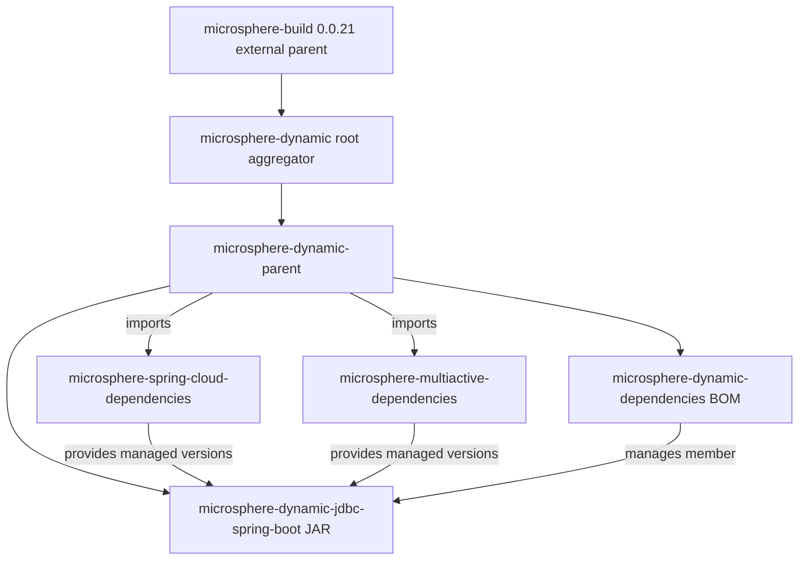

[中文](zh/microsphere-dynamic-parent.md)

# Developer Guide: `microsphere-dynamic-parent`

> **Documentation line note:** This repository has no `release` or `release-1.x` branch
> yet; the `current` documentation line is generated from `main` (revision
> `0.0.1-SNAPSHOT`). Everything in this guide reflects the state of the `main`
> branch only. Treat all version numbers and behaviour below as pre-1.0 and
> subject to change.

`microsphere-dynamic-parent` is a **POM-only module** (`<packaging>pom</packaging>`) —
it ships no source code, no JAR, and no compiled artifacts. Its entire job is to be
*inherited from*. This guide describes it from the build/architecture side: why it
exists as a separate module, how each POM section behaves, what breaks when you edit
it, and how it fits into the reactor and the release flow.

For the runtime/functional behaviour of the only JAR-producing module, see the
sibling guide [`microsphere-dynamic-jdbc-spring-boot.md`](microsphere-dynamic-jdbc-spring-boot.md).
For how this module is used as a version-alignment contract by downstream
applications, see [`microsphere-dynamic-dependencies.md`](microsphere-dynamic-dependencies.md).

---

## 1. Purpose within the reactor

The repository is a Maven reactor driven by the root aggregator
`microsphere-dynamic` (a POM at the repo root). The aggregator itself inherits an
**external** build parent, `io.github.microsphere-projects:microsphere-build:0.0.21`,
which is **not in this repository** and lives only in the local/remote Maven
repository. That external parent is what pins the Java baseline and wires the
build plugins; this repository's own modules layer domain version management on
top of it.

`microsphere-dynamic-parent` sits between the raw build parent and the
artifact-producing modules. It is the **single centralisation point for version
properties** and **third-party dependency pinning** for everything in the
`microsphere-dynamic` project. It is `BOM-less` in the sense that it does **not**
publish a managed-member surface for consumers — instead it exists to be the
`<parent>` of the other modules so they all inherit the same coordinate versions.

Concretely, its responsibilities are:

1. **Version property centralisation** — define `${revision}`-aligned properties
   for the sibling Microsphere BOMs and human-readable `*.version` properties for
   third-party libraries, so no module below it hard-codes a literal version.
2. **Third-party pinning** — declare a `dependencyManagement` block that pins the
   exact versions of MySQL, MyBatis, MyBatis Starter, MyBatis-Plus, ShardingSphere
   and MariaDB4j.
3. **External BOM imports** — `scope=import` two external Microsphere BOMs
   (`microsphere-spring-cloud-dependencies` and `microsphere-multiactive-dependencies`)
   so their managed entries flow into every child module.
4. **Provide a common parent coordinate** — modules declare
   `microsphere-dynamic-parent` as their `<parent>` rather than the raw aggregator,
   so the version-management contract is explicit and reusable.

### Why a separate parent instead of folding this into the aggregator?

The root aggregator `microsphere-dynamic` deliberately carries almost no
dependency metadata of its own (it inherits `microsphere-build` and only defines
`${revision}`, the `<modules>` list, `distributionManagement`, and a snapshot
`<repositories>` entry). Keeping the version/third-party management in a *dedicated*
parent module rather than the aggregator means:

- The management contract is a **named, addressable artifact**
  (`microsphere-dynamic-parent`) that any module can inherit without depending on
  the aggregator's aggregator-role.
- The BOM module (`microsphere-dynamic-dependencies`) can inherit the *same*
  management by listing `microsphere-dynamic-parent` as its own parent, which is
  exactly what it does — see
  [`microsphere-dynamic-dependencies.md`](microsphere-dynamic-dependencies.md).
- New JAR modules can be added by pointing their `<parent>` at this parent and
  getting every pin for free.

### Why a parent *and* a separate BOM?

This is the key design distinction in the reactor:

- **Parent (`microsphere-dynamic-parent`)** = *inheritance* contract. You become a
  child of it (`<parent>`), and you receive its properties and `dependencyManagement`
  as if they were declared in your own POM. Its managed entries are an **implementation
  detail of this repository**, not a published version-alignment surface.
- **BOM (`microsphere-dynamic-dependencies`)** = *import* contract. A downstream
  application `<scope>import</scope>`s it in its own `dependencyManagement` and gets a
  **public, curated list of managed members** (currently just the JDBC starter) without
  having to inherit this repository's build plugins or third-party pins.

In short: the parent centralises "how we build our modules"; the BOM publishes "which of
our artifacts you can depend on and at what version". They are intentionally decoupled so
that the internal third-party pinning of the parent does not leak into the public managed
surface of the BOM.

---

## 2. Module dependency diagram

The diagram below shows how `microsphere-dynamic-parent` relates to the external
build parent, the aggregator, the sibling modules, and the external BOMs it imports.



Reading the graph in terms of this module: `microsphere-dynamic-parent` is the node
that both **inherits structural build behaviour** (upward, toward `microsphere-build`
via the aggregator) and **distributes version management** (downward, to the BOM and
the JDBC module, plus the two imported external BOMs that feed the JDBC module's
managed dependency versions).

---

## 3. POM section analysis

Each subsection annotates a real block of `microsphere-dynamic-parent/pom.xml` with
what it does and **what breaks if you change it**. Line references point at the
current file on `main`.

### 3.1 Parent chain

```xml
<parent>
    <groupId>io.github.microsphere-projects</groupId>
    <artifactId>microsphere-dynamic</artifactId>
    <version>${revision}</version>
    <relativePath>../pom.xml</relativePath>
</parent>
```

- The parent is the **root aggregator `microsphere-dynamic`**, resolved from
  `../pom.xml` on disk (`relativePath`). The aggregator in turn inherits
  `microsphere-build:0.0.21`, so the effective plugin/property set of this module
  comes from a three-level chain: `microsphere-build` → `microsphere-dynamic` →
  `microsphere-dynamic-parent`.
- The `<version>${revision}</version>` keeps the parent coordinate locked to the
  reactor-wide revision token.

**What breaks if changed:** pointing `<parent>` elsewhere, or editing `relativePath`,
detaches this module from the reactor and from the `microsphere-build` plugin wiring.
You would lose `flatten-maven-plugin`, the Java 8 compiler baseline, and the
source/jar plugin configuration inherited from `microsphere-build`, and the reactor
would no longer order this module correctly.

### 3.2 Coordinates and packaging

```xml
<groupId>io.github.microsphere-projects</groupId>
<artifactId>microsphere-dynamic-parent</artifactId>
<version>${revision}</version>
<packaging>pom</packaging>
```

- `packaging=pom` is what makes this a "no source, no JAR" module.
- `version=${revision}` means the *deployed* parent coordinate is the CI-friendly
  token, which `flatten-maven-plugin` rewrites at build time (see section 5).

**What breaks if changed:** hard-coding a literal version here decouples the parent
from `${revision}` and produces version skew against the JDBC module and BOM that
also use `${revision}`; the reactor will build mismatched coordinates and the BOM's
`${revision}` member entries will resolve to the wrong parent line.

### 3.3 Properties block

```xml
<properties>
    <microsphere-spring-cloud.version>${revision}</microsphere-spring-cloud.version>
    <microsphere-multiactive.version>${revision}</microsphere-multiactive.version>
    <!-- Third-party versions -->
    <mysql-connector-java.version>8.0.28</mysql-connector-java.version>
    <mybatis.version>3.5.15</mybatis.version>
    <mybatis-starter.version>2.3.1</mybatis-starter.version>
    <mybatis-plus.version>3.3.0</mybatis-plus.version>
    <shardingsphere.version>5.1.1</shardingsphere.version>
    <mariadb4j.version>2.5.3</mariadb4j.version>
</properties>
```

Every property, its current value, and its consumers:

| Property | Current value | Declared here as | Consumed by / effect |
|---|---|---|---|
| `revision` | `0.0.1-SNAPSHOT` (default, defined in the root aggregator `pom.xml`, not in this module) | Inherited token | Becomes the `${revision}` version of the parent itself, the BOM, the JDBC module, the two imported BOM coordinates below, and the BOM's managed member. Overridden on CI to `0.0.1` via `-Drevision`. |
| `microsphere-spring-cloud.version` | `${revision}` (so `0.0.1-SNAPSHOT` locally, `0.0.1` on CI) | Aliased to the reactor revision | Version of the imported `microsphere-spring-cloud-dependencies` BOM, which supplies Spring Boot / Spring Cloud managed versions to the JDBC module. |
| `microsphere-multiactive.version` | `${revision}` | Aliased to the reactor revision | Version of the imported `microsphere-multiactive-dependencies` BOM, supplying multi-active managed versions to the JDBC module. |
| `mysql-connector-java.version` | `8.0.28` | Literal pin | Pins `mysql:mysql-connector-java`, consumed by the JDBC module in `test` scope. |
| `mybatis.version` | `3.5.15` | Literal pin | Pins `org.mybatis:mybatis` core for transitive alignment under the JDBC module. |
| `mybatis-starter.version` | `2.3.1` | Literal pin | Pins `org.mybatis.spring.boot:mybatis-spring-boot-starter`, consumed by the JDBC module as `optional`. |
| `mybatis-plus.version` | `3.3.0` | Literal pin | Pins `com.baomidou:mybatis-plus-boot-starter`, consumed by the JDBC module as `optional`. |
| `shardingsphere.version` | `5.1.1` | Literal pin | Pins `org.apache.shardingsphere:shardingsphere-jdbc-core-spring-boot-starter`, consumed by the JDBC module at compile scope. |
| `mariadb4j.version` | `2.5.3` | Literal pin | Pins both `ch.vorburger.mariaDB4j:mariaDB4j` and `mariaDB4j-springboot`; the springboot variant is consumed by the JDBC module in `test` scope. |

> **Provenance note:** `microsphere-spring-cloud.version` and
> `microsphere-multiactive.version` are *aliased to `${revision}`*, so they do **not**
> have their own independent numbers in this module — they track whatever revision the
> reactor is built with. There is no `java.version`, `spring-boot.version`, or
> `spring-cloud.version` property defined here; those originate from the external
> `microsphere-build` parent and the external `microsphere-spring-cloud-parent`
> respectively (see sections 5 and 6). They are intentionally **not** re-declared here,
> so changing them here has no effect.

**What breaks if changed:**

- Bumping a `*.version` literal (e.g. `shardingsphere.version`) silently changes the
  resolved dependency of the JDBC module without the JDBC POM showing any version
  (the JDBC module declares the dependency *without* a version, relying on this pin).
  A wrong bump can break the JDBC module's compile or its integration tests with no
  diff in the module that actually consumes it.
- Removing an alias like `microsphere-multiactive.version` would make the corresponding
  `import` block unresolvable (`${...}` would evaluate to empty) and fail the build at
  dependency resolution.

### 3.4 `dependencyManagement`: external BOM imports

```xml
<dependency>
    <groupId>io.github.microsphere-projects</groupId>
    <artifactId>microsphere-spring-cloud-dependencies</artifactId>
    <version>${microsphere-spring-cloud.version}</version>
    <type>pom</type>
    <scope>import</scope>
</dependency>
<dependency>
    <groupId>io.github.microsphere-projects</groupId>
    <artifactId>microsphere-multiactive-dependencies</artifactId>
    <version>${microsphere-multiactive.version}</version>
    <type>pom</type>
    <scope>import</scope>
</dependency>
```

- These pull the full managed dependency lists of two external Microsphere BOMs into
  every child of this parent. This is how the JDBC module ends up with Spring Boot
  `2.7.18` / Spring Cloud `2021.0.8` coordinates even though this module never names
  Spring Boot explicitly.
- Because both are keyed to `${revision}`, their resolved coordinates depend on the
  revision override at build time.

**What breaks if changed:** reordering these imports relative to the explicit pins below
changes precedence — in Maven, the **first** declaration of a `groupId:artifactId` in a
`dependencyManagement` wins. The explicit third-party pins in this module are written
*after* the imports, so for any artifact also managed by the external BOMs, the external
BOM value currently takes precedence. Moving a pin *before* the imports flips who wins;
this is a subtle but real source of version drift. Removing an import strips Spring
Boot/Spring Cloud/multi-active managed versions from the JDBC module and the build fails
on unversioned dependencies.

### 3.5 `dependencyManagement`: third-party pins

The remaining entries pin `mysql-connector-java`, `mybatis`, `mybatis-spring-boot-starter`,
`mybatis-plus-boot-starter`, `shardingsphere-jdbc-core-spring-boot-starter`, and the two
`mariaDB4j` artifacts to the `*.version` properties in section 3.3.

**What breaks if changed:** dropping one of these pins means the JDBC module (which
declares that dependency without a version) has no managed version and the reactor build
fails immediately with a "version not specified" error. The two `mariaDB4j` entries share
`${mariadb4j.version}`; changing the property moves both at once.

---

## 4. Build-artifact caveat: `.flattened-pom.xml` and `.mvn/`

Two files at the repository root relate to the build but are easy to misread:

- **`.flattened-pom.xml`** — a generated `flatten-maven-plugin` output that lives in the
  **working tree but is git-ignored** (`.gitignore` contains `.flattened-pom.xml`). It is
  a local, stale build artifact, **not** the authoritative POM. On the current working
  copy it even shows `microsphere-build` `0.0.6` while the tracked `pom.xml` declares
  `0.0.21`, and it shows `microsphere-spring-cloud.version` already interpolated to `0.0.1`
  — both signs of a previous local `-Drevision=0.0.1` build rather than the source of
  truth. **Do not read design intent from it.** The four real, tracked POMs are the root
  `pom.xml`, this module's `pom.xml`, the BOM's `pom.xml`, and the JDBC module's
  `pom.xml`.
- **`.mvn/wrapper/`** — the Maven Wrapper. `maven-wrapper.properties` pins
  `distributionUrl` to **Apache Maven `3.9.0`** and `wrapperUrl` to maven-wrapper
  **`3.1.1`**. Together with `mvnw` / `mvnw.cmd` at the repo root, this means a
  reproducible Maven version is available without a system install (see section 6).

**What breaks if changed:** regenerating or hand-editing `.flattened-pom.xml` has no
effect on the build (it is produced, not consumed, and ignored by git). Editing
`maven-wrapper.properties` changes the Maven version every contributor and CI pulls.

---

## 5. How `${revision}` and `flatten-maven-plugin` work here

The reactor uses the **CI-friendly `${revision}` pattern**: every module's `<version>` and
every intra-reactor coordinate reference is written as `${revision}`, and the value is
supplied at build time (`-Drevision=...`) or defaults to `0.0.1-SNAPSHOT` as defined in the
root aggregator's `<properties>`.

The problem this creates — a POM published with a literal `${revision}` in its coordinates
would be unresolvable by consumers — is solved by **`flatten-maven-plugin`**, which is
**configured in the external `microsphere-build:0.0.21` parent, not in this repository**.
Reading that parent's real configuration:

| `flatten-maven-plugin` setting (from `microsphere-build` 0.0.21) | Value | Effect |
|---|---|---|
| plugin version | `1.6.0` | The flatten plugin pulled in. |
| `flattenMode` | `resolveCiFriendliesOnly` | Only the CI-friendly tokens (`${revision}`, `${sha1}`, `${changelist}`) are resolved in the published/installed POM; everything else is left as-is. |
| `updatePomFile` | `true` | The build uses the flattened POM as the effective published POM. |
| `pomElements/parent` | `expand` | The parent coordinate is written expanded. |
| `pomElements/properties` | `keep` | Properties are preserved in the flattened POM. |
| `pomElements/dependencyManagement` | `interpolate` | Managed versions are interpolated (this is why you see `${revision}` replaced by the real version in the flattened BOM output). |
| `pomElements/dependencies` | `resolve` | Resolved dependency versions are written out. |
| `pomElements/distributionManagement` | `remove` | `distributionManagement` is stripped from the flattened POM (so consumers do not inherit this project's deploy targets). |
| `pomElements/repositories` | `remove` | The snapshot `<repositories>` block is stripped from the flattened POM. |
| execution phase | `process-resources` (goal `flatten`) | Flattening runs during `process-resources`. |

So the mechanism is: `${revision}` stays in the *source* POMs for developer readability and
reactor consistency; at build time `flatten-maven-plugin` (bound in `microsphere-build`)
produces a flattened POM where `${revision}` is replaced by the actual version, while
`distributionManagement`/`repositories` are removed so they do not leak to consumers.
**This configuration lives in the external parent** — you cannot change flatten behaviour
from inside this repository without bumping the `microsphere-build` version, which is not
present in this repo.

---

## 6. Version and release flow

### Local build commands

Maven Wrapper is available at the repo root (`./mvnw` on macOS/Linux, `mvnw.cmd` on
Windows), pinned to Maven `3.9.0`:

```bash
# Full reactor build from the repo root (uses the default revision 0.0.1-SNAPSHOT)
./mvnw clean install

# Explicit revision, matching CI
./mvnw --batch-mode --update-snapshots -Drevision=0.0.1 clean install
```

### `-Drevision` semantics

- **Without** `-Drevision`, the root aggregator's default `<revision>0.0.1-SNAPSHOT</revision>`
  applies to every module and every `${revision}` reference, including the two imported
  external BOM coordinates.
- **With** `-Drevision=0.0.1` (what CI does), the entire reactor is built and versioned as
  the release-style coordinate `0.0.1`, and because the external BOM aliases are
  `${revision}`, they also resolve to `0.0.1` for that run.
- The revision token is reactor-wide: you cannot version one module differently without
  breaking the inheritance chain, because the parent, BOM, and JDBC module all reference
  the same `${revision}`.

### Deploy targets (`distributionManagement`)

Defined in the root aggregator (not in this module), inherited project-wide, and — per the
flatten config in section 5 — **removed from the flattened POM** so downstream consumers do
not inherit them. Both repositories use server id `ossrh` (Sonatype OSSRH):

| Target | URL |
|---|---|
| `snapshotRepository` | `https://s01.oss.sonatype.org/content/repositories/snapshots` |
| release `repository` (staging) | `https://s01.oss.sonatype.org/service/local/staging/deploy/maven2/` |

A `-SNAPSHOT` revision deploys straight to the snapshot repository; a non-SNAPSHOT revision
goes through the staging URL. Note that `microsphere-build:0.0.21` also wires a
`nexus-staging-maven-plugin` (`serverId=ossrh`, `autoReleaseAfterClose=true`) into its
`release` profile, so the actual staging release automation lives in the external parent.

### CI matrix

`.github/workflows/maven.yml` ("Java CI with Maven"):

- **Triggers:** `push` to `main` and `pull_request` targeting `main`.
- **Runner:** `ubuntu-latest`.
- **Matrix:** `java: ['8']` — a **single** JDK entry, Temurin `8`. There is no multi-JDK
  matrix yet.
- **Command:** `mvn --batch-mode --update-snapshots --file pom.xml -Drevision=0.0.1 clean install`.
- **No deploy step** is configured in the workflow — CI only builds and installs locally on
  the runner. Publishing to OSSRH is not part of `maven.yml`.

### Compatibility matrix

| Concern | Value | Provenance |
|---|---|---|
| Java source/target baseline | `8` (`java.version=8`) | Inherited from external `microsphere-build:0.0.21` (it sets `maven.compiler.source`/`target` to `${java.version}=8`). Not defined in this repository. |
| Maven for the build | `3.9.0` | `.mvn/wrapper/maven-wrapper.properties` in this repo. |
| Spring Boot line | `2.7.18` | Not declared in this repository. It arrives transitively via the imported `microsphere-spring-cloud-dependencies` BOM, whose external `microsphere-spring-cloud-parent` sets `spring-boot.version=2.7.18`. Marked as external/inherited. |
| Spring Cloud line | `2021.0.8` | Same external chain (`spring-cloud-dependencies.version=2021.0.8` in `microsphere-spring-cloud-parent`). Not a value you can see in this repo's POMs. |
| Project revision | `0.0.1-SNAPSHOT` (default) | Root aggregator `pom.xml`; overridden to `0.0.1` on CI. |

---

## 7. Change-management guidance

### Bumping a pinned third-party version

1. Edit **only** the relevant `*.version` property in section 3.3 of this module's
   `dependencyManagement`-supporting `<properties>`. Do not hand-edit the `<version>`
   element inside the pin (it references the property by design).
2. Rebuild the reactor from the root (`./mvnw clean install`) so the JDBC module re-resolves
   against the new pin.
3. Verify the JDBC module still compiles and its tests pass — a pin change here has no
   visible trace in the consuming POM, so the build is your only signal.

### Reordering / adding an external BOM import

- Add the version as a property aliased to `${revision}` (or a literal) in section 3.3, then
  add an `<scope>import</scope>` `<type>pom</type>` entry.
- Remember Maven's "first declaration wins" rule for `dependencyManagement`: keep the
  relationship between the import order and the explicit pins deliberate. If a newly imported
  BOM must not override a local pin, place the local pin **before** the import.

### Adding a new managed module to the reactor

- A new **JAR module**: give it `<parent>microsphere-dynamic-parent</parent>`
  (`relativePath` to `../microsphere-dynamic-parent/pom.xml`), `<version>${revision}</version>`,
  list it under the aggregator's `<modules>`, and declare its dependencies without versions,
  relying on this parent's pins/imports. Add its coordinate to the BOM
  (see [`microsphere-dynamic-dependencies.md`](microsphere-dynamic-dependencies.md)) if it
  should be publicly managed.
- A new **third-party pin**: add a `*.version` property and a matching
  `dependencyManagement` entry in this module so consumers never hard-code it.

### Reactor ordering constraints (parent → BOM → JAR)

Because the BOM and the JDBC module both declare `microsphere-dynamic-parent` as their
`<parent>`, Maven must build this parent **before** its children. The root aggregator's
`<modules>` list (`microsphere-dynamic-parent`, then `microsphere-dynamic-dependencies`,
then `microsphere-dynamic-jdbc-spring-boot`) already expresses that order, and Maven's
reactor also enforces it via the parent/`dependencyManagement` graph, so a mis-ordered
`<modules>` list still yields a correct build — but keeping it explicit avoids surprises.
The dependency chain that *must* resolve first is: `microsphere-build` (external) →
`microsphere-dynamic-parent` → { `microsphere-dynamic-dependencies`, `microsphere-dynamic-jdbc-spring-boot` }.

### When to touch this module at all

Changes here ripple to **every** module. Prefer changing this module only for: a new/updated
third-party pin, a new external BOM import, or a revision-alias adjustment. Runtime code and
public managed-member surface belong to the JDBC module and the BOM respectively.

---

## 8. Maturity caveat

`microsphere-dynamic-parent` is at revision `0.0.1-SNAPSHOT`. There is **no `release` or
`release-1.x` branch** in the repository and no tags; the `current` documentation line is
generated from `main`. Version management here is functional but pre-1.0: pinned third-party
versions, external BOM coordinates, and the inherited Spring Boot/Spring Cloud lines may all
move without a semantic-versioning guarantee. Do not treat the property table above as a
stable public contract — the stable public contract, when it is used downstream, is the
BOM, not this parent.

---

## Related documentation

- Developer guide index: [Developer Guide](README.md)
- Repository README: [microsphere-dynamic](../../../README.md)
- Managed-member surface (BOM): [microsphere-dynamic-dependencies](microsphere-dynamic-dependencies.md)
- The only JAR module: [microsphere-dynamic-jdbc-spring-boot](microsphere-dynamic-jdbc-spring-boot.md)

---

## 中文

本文件的简体中文版本：[microsphere-dynamic-parent 开发者指南](zh/microsphere-dynamic-parent.md)。
