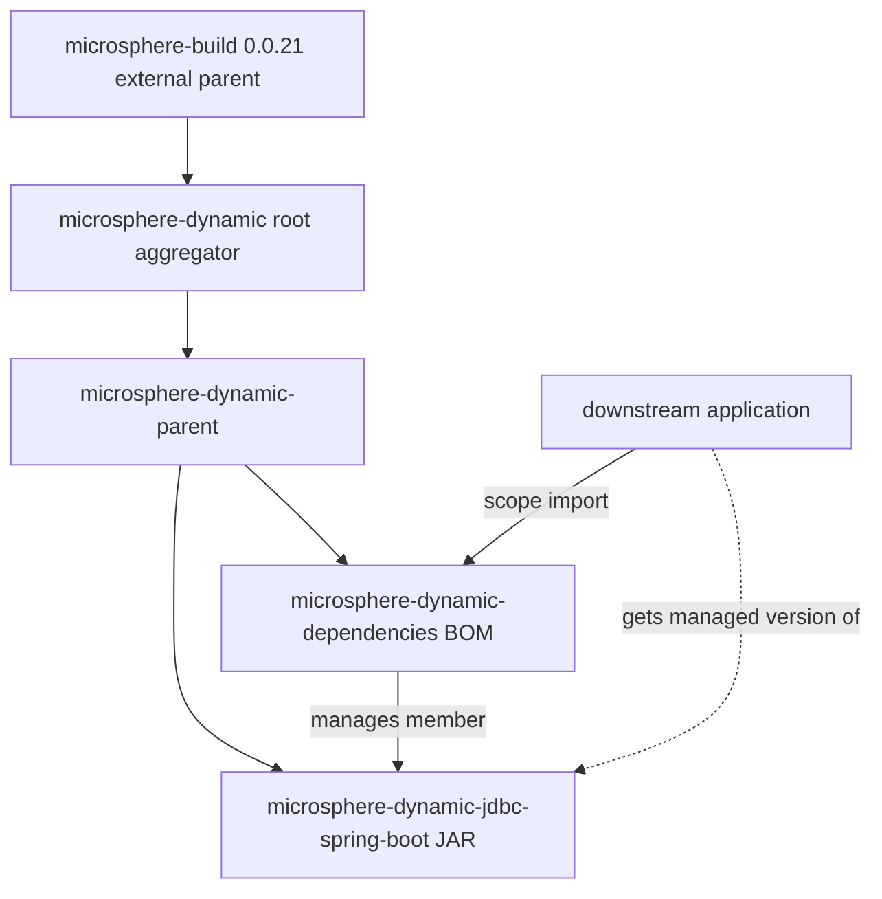

[English](../microsphere-dynamic-dependencies.md)

# 开发者指南：`microsphere-dynamic-dependencies`

> **文档线说明：** 本仓库目前尚无 `release` 或 `release-1.x` 分支；
> `current` 文档线由 `main` 分支生成（revision 为 `0.0.1-SNAPSHOT`）。本指南所
> 述内容仅反映 `main` 分支的状态。请将下文中所有版本号与行为视为 1.0 之前、
> 随时可能变动的内容。

`microsphere-dynamic-dependencies` 是本项目的 **BOM**（Bill of Materials，物料清单）——
一个**纯 POM 模块**（`<packaging>pom</packaging>`），不发布任何源码也不产出 JAR。它的全部
意义就在于被下游应用 `<scope>import</scope>`，从而继承一份经过精选、版本对齐的本项目已
发布制品清单。本指南从构建/架构角度讲述：BOM 与父 POM 模块有何不同、POM 各区块的行为、
改动后会破坏什么，以及如何新增一个受管成员。

相关文档：
[`microsphere-dynamic-parent.md`](../microsphere-dynamic-parent.md)（本 BOM 建立其上的继承
契约）与 [`microsphere-dynamic-jdbc-spring-boot.md`](../microsphere-dynamic-jdbc-spring-boot.md)
（唯一的 JAR，即受管成员）。

---

## 1. 在 reactor 中的定位

reactor 的三个模块按角色清晰划分：

- `microsphere-dynamic-parent` —— **继承**契约（内部的版本/第三方管理）。见其文档。
- `microsphere-dynamic-dependencies`（**本模块**）—— **导入**契约（公开的受管成员面）。
- `microsphere-dynamic-jdbc-spring-boot` —— 唯一产出 JAR 的制品。

本 BOM 目前恰好声明一个受管成员：

```xml
<dependencyManagement>
    <dependencies>
        <dependency>
            <groupId>io.github.microsphere-projects</groupId>
            <artifactId>microsphere-dynamic-jdbc-spring-boot</artifactId>
            <version>${revision}</version>
        </dependency>
    </dependencies>
</dependencyManagement>
```

### 为什么是独立 BOM，而不是直接导入父 POM？

下游 Spring Boot 应用**不应**成为 `microsphere-dynamic-parent` 的 Maven *子模块*。继承一个
父 POM 会把该父 POM 的构建插件、属性与第三方锁定项如同消费者自己声明一般拉入进来——这会把
本仓库的内部构建选择（MyBatis-Plus 锁定、MariaDB4j 锁定、所导入的 Spring Cloud/多活 BOM）
泄漏进一个无关消费者的依赖图，还会迫使消费者继承本项目的 `<parent>` 链（`microsphere-dynamic`
→ `microsphere-build`）。

BOM 避免了这一点。导入 BOM 只把它的 **`dependencyManagement` 条目**复制给消费者——不含插件、
不含属性、不含父 POM、不含构建行为。所以设计是：

- **父 POM** = 宽泛、内部、基于继承的管理（本项目自己的模块）。
- **BOM** = 窄、对外、基于导入的管理（本项目的*已发布制品*，作为版本对齐契约呈现给外界）。

二者刻意解耦：父 POM 的众多第三方锁定项**不会**出现在 BOM 中。想要本项目制品的消费者只会拿到
BOM 选择发布的那些受管成员——目前仅为 JDBC starter。

### 为什么 BOM 继承父 POM

```xml
<parent>
    <groupId>io.github.microsphere-projects</groupId>
    <artifactId>microsphere-dynamic-parent</artifactId>
    <version>${revision}</version>
    <relativePath>../microsphere-dynamic-parent/pom.xml</relativePath>
</parent>
```

本 BOM 把 `microsphere-dynamic-parent` 列为自身 `<parent>`。这是**构建期为 reactor 提供的便利**，
并非下游会继承的东西：它让 BOM 一致地解析 `${revision}`，并保证在 reactor 中父 POM 先于 BOM 构建。
因为消费者是*导入* BOM（而非继承它），父级关系不会传播给消费者。不过请注意，本项目的
`flatten-maven-plugin` 会展开/插值已发布的 BOM（见第 5 节），所以消费者实际看到的是扁平化后的
 BOM，而非原始源 POM。

---

## 2. 模块依赖图



从本模块视角解读：`microsphere-dynamic-dependencies` 位于内部父 POM（构建期继承它）与外界
（`scope=import` 它的应用）*之间*。它唯一指向内的输出边是到 JDBC JAR 的 "manages member" 关系，
而它面向消费者的唯一角色是下游应用使用的虚线 "import" 路径。

---

## 3. POM 区块逐段分析

### 3.1 父 POM 引用

如第 1 节所示。`<parent>` 是通过 `../microsphere-dynamic-parent/pom.xml` 指向的
`microsphere-dynamic-parent`。

**改动后会破坏什么：** 把 BOM 的父级从 `microsphere-dynamic-parent` 移开，会丢掉共享的
`${revision}` 处理，并可能破坏 reactor 排序（父 POM 必须先构建）。若把 `<parent>` 直接指向原始
聚合器，则会绕过父 POM 提供的第三方/BOM 导入管理——尽管 BOM 本身只需要 `${revision}`——实际
风险是与 reactor 其余部分失去一致性。

### 3.2 坐标与打包方式

```xml
<groupId>io.github.microsphere-projects</groupId>
<artifactId>microsphere-dynamic-dependencies</artifactId>
<version>${revision}</version>
<packaging>pom</packaging>
```

- `packaging=pom` 加上仅含 `dependencyManagement` 的主体，就是 BOM 的定义。
- `artifactId=...-dependencies` 遵循 Microsphere 对 BOM 模块的命名约定。
- `version=${revision}` 是 CI 友好令牌，由 flatten 在构建时解析。

**改动后会破坏什么：** 硬编码版本会使 BOM 与 `${revision}` 解耦；受管成员的 `${revision}` 届时
会追踪到错误的链路线上。重命名 `artifactId` 会破坏每个下游 `import` 坐标。

### 3.3 `dependencyManagement`（受管成员）

唯一那条条目把 `microsphere-dynamic-jdbc-spring-boot` 锁定在 `${revision}`——即与 BOM 自身相同的
revision，所以受管成员与 BOM 始终以锁步方式发布。

**改动后会破坏什么：**
- 删除该条目会使下游应用对 JDBC starter 没有受管版本；它们不得不手填版本并失去对齐保证。
- 把成员锁定为字面版本（而非 `${revision}`）会使它与 BOM 自身版本脱钩，而这正是本模式意在
  防止的漂移。
- 为一个**不**由本 reactor 构建（且不在可达仓库上）的制品添加受管条目，会使 BOM 导入解析失败。

---

## 4. 构建产物注意事项：`.flattened-pom.xml` 与 `.mvn/`

- **`.flattened-pom.xml`**（本模块的与仓库根的）是由 `flatten-maven-plugin` 生成、被 **git 忽略**
  的输出（`.gitignore` 列有 `.flattened-pom.xml`）。它是本地的过期构建产物，不可视为权威。受跟踪
  的事实来源是本模块的 `pom.xml`。
- **`.mvn/wrapper/`** 通过 `maven-wrapper.properties` 把构建锁定到 **Maven `3.9.0`**（wrapper
  `3.1.1`），因此 flatten 步骤与 reactor 构建运行在可复现的 Maven 版本上（见第 5 节）。

---

## 5. `${revision}` 与 `flatten-maven-plugin` 如何协作

BOM 的受管成员写成 `${revision}`。要让 BOM 在*外部*有用，该令牌必须在已发布/安装的 POM 中被解析
为具体版本；否则导入 BOM 的消费者会看到无法解析的 `${revision}`。

这一解析由 **`flatten-maven-plugin`** 完成，它配置在**外部 `microsphere-build:0.0.21` 父 POM 中
**（不在本仓库）。该父 POM 真实配置中相关的部分：

| `flatten-maven-plugin` 设置（来自 `microsphere-build` 0.0.21） | 值 | 对 BOM 的意义 |
|---|---|---|
| `flattenMode` | `resolveCiFriendliesOnly` | 在已发布 BOM 中解析 `${revision}`，使受管成员成为具体版本。 |
| `updatePomFile` | `true` | 被安装/部署的是扁平化后的 POM。 |
| `pomElements/dependencyManagement` | `interpolate` | 正是此设置把 BOM 受管成员内的 `${revision}` 变成真实版本。 |
| `pomElements/distributionManagement` | `remove` | 剥离 `distributionManagement`，使其不进入消费者继承的 BOM。 |
| `pomElements/repositories` | `remove` | 从扁平化 BOM 中剥离快照仓库条目。 |

`resolveCiFriendliesOnly` 模式是刻意保守的：它只解析 CI 令牌，保持 BOM 其余结构不变。要改变 flatten
行为需要提升外部 `microsphere-build` 版本，而它**不**存在于本仓库中。

---

## 6. 版本与发布流程

### 本地构建命令

仓库根目录提供 Maven Wrapper（`./mvnw`，Windows 用 `mvnw.cmd`），锁定 Maven `3.9.0`：

```bash
# Build the whole reactor (BOM included), default revision 0.0.1-SNAPSHOT
./mvnw clean install

# Build exactly as CI does
./mvnw --batch-mode --update-snapshots -Drevision=0.0.1 clean install
```

要单独验证扁平化后、消费者可见的 BOM：

```bash
./mvnw -pl microsphere-dynamic-dependencies -am clean install -Drevision=0.0.1
# inspect microsphere-dynamic-dependencies/.flattened-pom.xml afterwards (git-ignored, local only)
```

### 下游应用如何使用本 BOM

```xml
<dependencyManagement>
    <dependencies>
        <dependency>
            <groupId>io.github.microsphere-projects</groupId>
            <artifactId>microsphere-dynamic-dependencies</artifactId>
            <version>0.0.1-SNAPSHOT</version>
            <type>pom</type>
            <scope>import</scope>
        </dependency>
    </dependencies>
</dependencyManagement>
```

导入之后，声明 `microsphere-dynamic-jdbc-spring-boot` 时**不要**带 `<version>`，Maven 会拉入受管
revision。（对外使用的 `<version>` 取决于实际发布了哪个 revision；`0.0.1-SNAPSHOT` 只能从快照仓库
获得。）

### `-Drevision`、部署目标、CI

与 reactor 其余部分完全一致（由根聚合器定义，不在本模块）：

- `-Drevision` 贯穿整个 reactor；不带时默认为 `0.0.1-SNAPSHOT`，CI 构建 `0.0.1`。
- **部署目标**（`distributionManagement`，来自聚合器，并从扁平化 BOM 中剥离）：Sonatype OSSRH
  `ossrh` 快照仓库 `https://s01.oss.sonatype.org/content/repositories/snapshots` 与 staging 仓库
  `https://s01.oss.sonatype.org/service/local/staging/deploy/maven2/`。
- **CI 矩阵**（`.github/workflows/maven.yml`）：`main` 推送 + 指向 `main` 的 PR，`ubuntu-latest`，
  单个 JDK **Temurin `8`**，命令 `mvn --batch-mode --update-snapshots --file pom.xml
  -Drevision=0.0.1 clean install`。CI 中无部署步骤。

### 兼容性矩阵（BOM 视角）

| 关注点 | 值 | 来源 |
|---|---|---|
| BOM 版本 | `${revision}` → 默认 `0.0.1-SNAPSHOT` / CI 上 `0.0.1` | 根聚合器 `pom.xml`。 |
| 受管成员版本 | `${revision}`（精确跟随 BOM） | 本模块的 `dependencyManagement`。 |
| 构建用 Java 基线 | `8` | 外部 `microsphere-build:0.0.21`（`java.version=8`）；本仓库未声明。 |
| Maven | `3.9.0` | `.mvn/wrapper/maven-wrapper.properties`。 |
| Spring Boot / Spring Cloud | `2.7.18` / `2021.0.8` | **不在 BOM 中。** 它们在此并非受管成员；仅经由父 POM 导入的外部 BOM 传递地影响 JDBC JAR，其外部 `microsphere-spring-cloud-parent` 设定了它们。此处列出仅为完整性。 |

---

## 7. 变更管理指引

### 如何向 BOM 新增一个受管模块

当你在此 reactor 中发布第二个 JAR 模块，并希望它进入公开受管面时：

1. 让新模块继承 `microsphere-dynamic-parent`、`<version>${revision}</version>`，并加入聚合器的
   `<modules>`。
2. 向**本**模块添加一条 `dependencyManagement` 条目：

   ```xml
   <dependency>
       <groupId>io.github.microsphere-projects</groupId>
       <artifactId>microsphere-dynamic-<new-module></artifactId>
       <version>${revision}</version>
   </dependency>
   ```

3. 把受管成员保持在 `${revision}`（而非字面值），使其与 BOM 锁步发布。
4. 只管理**由本 reactor 发布**的制品——不要用 BOM 去锁定第三方库；那是父 POM 的职责。把第三方
   锁定项混进 BOM 会把内部选择导出为公开契约。

### 如何提升一个被锁定的第三方版本

改 BOM **不是**改变第三方版本的方式。第三方锁定项位于 `microsphere-dynamic-parent`（见
[`microsphere-dynamic-parent.md`](../microsphere-dynamic-parent.md)）。本 BOM 只以 `${revision}`
追踪仓库内已发布制品，所以除非受管成员清单变化，它很少需要改动。

### reactor 排序约束

`microsphere-build`（外部）→ `microsphere-dynamic-parent` → **`microsphere-dynamic-dependencies`**
以及 → `microsphere-dynamic-jdbc-spring-boot`。因为 BOM 继承父 POM，在 reactor 中父 POM 必须先于
BOM 被安装/构建；Maven 通过父级图强制这一点，且聚合器 `<modules>` 顺序已把父 POM 列在首位。若你把
由 reactor 构建的成员加入 BOM，被管理的 JAR 模块也必须构建，使 flatten 步骤能引用到它们的坐标——
但导入 BOM 并不会迫使这些成员在消费者机器上作为同一 reactor 的一部分被构建。

---

## 8. 成熟度注意事项

本 BOM 处于 revision `0.0.1-SNAPSHOT`，且仓库**没有 `release` 或 `release-1.x` 分支**也没有标签
——`current` 文档线由 `main` 生成。它目前恰好管理一个成员。受管成员集合预计会增长，且可能在无
语义化版本保证的情况下变化；不要把当前单成员面视为冻结的公开契约。

---

## 相关文档

- 开发者指南索引：[开发者指南](../README.md)
- 仓库根 README：[microsphere-dynamic](../../../../README.md)
- 继承契约（父 POM）：[microsphere-dynamic-parent](../microsphere-dynamic-parent.md)
- 受管成员（JAR）：[microsphere-dynamic-jdbc-spring-boot](../microsphere-dynamic-jdbc-spring-boot.md)

---

## English

本文件的英文版本：[microsphere-dynamic-dependencies Developer Guide](../microsphere-dynamic-dependencies.md)。
