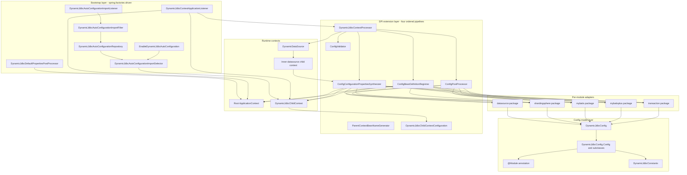
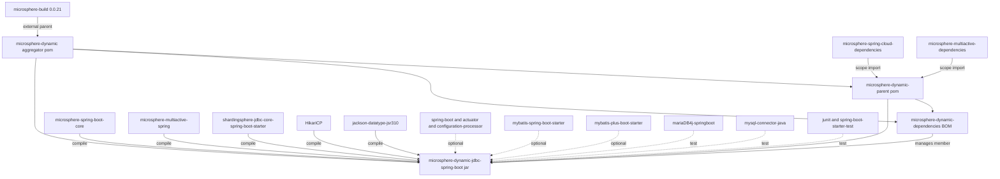
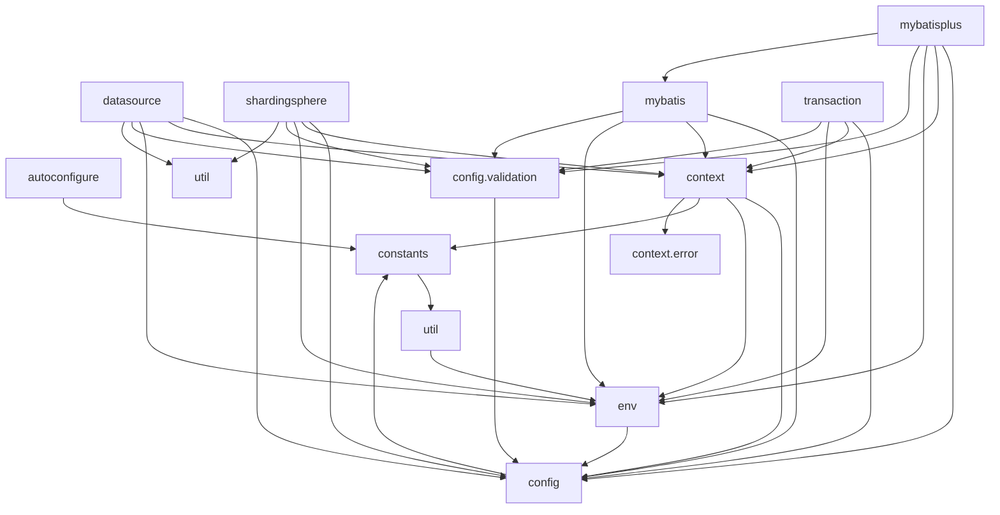
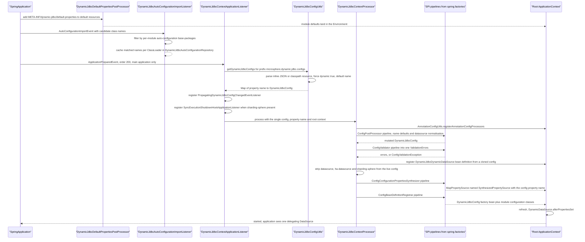
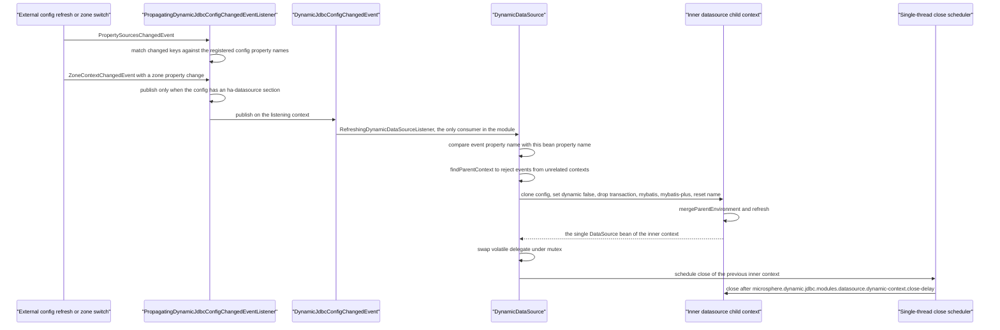
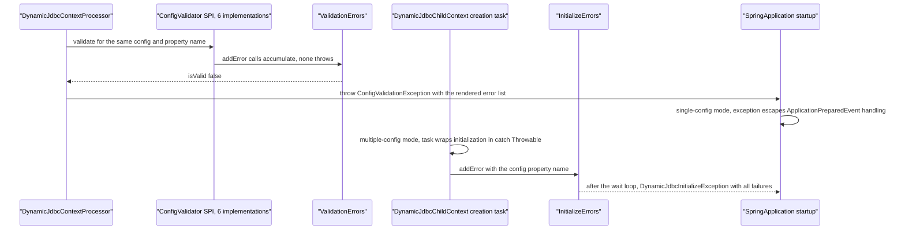
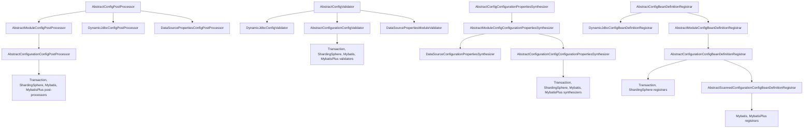

[English](../microsphere-dynamic-jdbc-spring-boot.md)

# 开发者指南：`microsphere-dynamic-jdbc-spring-boot`

> **文档线说明：** This repository has no `release` or `release-1.x` branch yet; the `current` documentation line is generated from `main` (revision `0.0.1-SNAPSHOT`).
> 本仓库目前尚无 `release` 或 `release-1.x` 分支；`current` 文档线由 `main` 分支生成
> （revision 为 `0.0.1-SNAPSHOT`），仓库里也没有任何 Git 标签。下文每一条陈述描述的都是
> `main` 上的代码树，必须被当作 1.0 之前、随时可能变动的内容来对待——包括该模块每个类上
> 都存在的 Javadoc `@since 1.0.0` 标记，尽管这个 reactor 从未产出过 `1.0.0` 制品。

本模块是仓库中**唯一产出代码的模块**：包 `io.microsphere.dynamic.jdbc.spring.boot` 下有
81 个 `src/main/java` 类。它是一个 Spring Boot *库*（不是自带自动配置类的 starter）：
它所做的一切都由 `spring.factories` 中的 SPI 注册以及少量 `ApplicationContext` 监听器驱动。

本指南是一份**源码分析文档**。除特别说明外，路径都相对于
`microsphere-dynamic-jdbc-spring-boot/`，每一条设计论断都锚定在你能够打开的一个类或一个
资源文件上。

| 读者目标 | 从这里开始 |
|---|---|
| 我要在应用里配置这个库 | [用户指南：`microsphere-dynamic-jdbc-spring-boot`](../../../user-guide/zh/microsphere-dynamic-jdbc-spring-boot.md) |
| 我要理解或修改 reactor/POM | [`microsphere-dynamic-parent.md`](../microsphere-dynamic-parent.md)、[`microsphere-dynamic-dependencies.md`](../microsphere-dynamic-dependencies.md) |
| 我要新增一个 JDBC 模块适配器 | 第 6 节「扩展指南：新增一个模块」 |
| 我要所有开发者指南的索引 | [`README.md`](../README.md) |
| 仓库总览与构建 | [`../../../../README.md`](../../../../README.md) |

---

## 1. 架构总览

### 1.1 代码真正编码出来的目标

1. **以配置模型作为唯一事实来源。** 一个 `DynamicJdbcConfig` 实例就是一份 JSON 文档，绑定到名为
   `microsphere.dynamic.jdbc.configs.<name>` 的属性上。`DynamicJdbcConfigUtils.getDynamicJdbcConfigs`
   在 `Environment` 中按该前缀扫描，读取内联 JSON 值或 `classpath:` 资源位置，并用 Jackson
   反序列化为 `DynamicJdbcConfig`（`config/DynamicJdbcConfig.java`、`util/DynamicJdbcConfigUtils.java`）。
   该模型为每个被支持的模块恰好暴露一个字段：`dataSource`、`highAvailabilityDataSource`、
   `transaction`、`shardingSphere`、`mybatis`、`mybatisPlus`，外加 `dynamic` 与 `primary` 两个开关。
2. **按模块隔离的上下文。** 当存在多个配置时，根上下文为每个配置创建一个
   `DynamicJdbcChildContext`（一个 `AnnotationConfigApplicationContext` 子类），于是两个数据源、
   两套 ShardingSphere 规则与两个 `SqlSessionFactory` 实例可以在不发生类名冲突的前提下共存
   （`context/DynamicJdbcChildContext.java`、`context/DynamicJdbcContextApplicationListener.java`）。
3. **与根上下文隔离。** 当存在多个配置时，第三方自动配置类（`DataSourceAutoConfiguration`、
   `ShardingSphereAutoConfiguration`、MyBatis、MyBatis-Plus）**不能**在根上下文中运行。
   库在每个子上下文内部重新实现它们：只导入落在按模块的 `auto-configuration.base-packages`
   之下的类名，其余全部推进 `spring.autoconfigure.exclude`
   （`autoconfigure/*`、`env/DynamicJdbcDefaultPropertiesPostProcessor`、
   `META-INF/dynamic-jdbc/default.properties`）。
4. **数据源热切换。** 应用看到的 `DataSource` bean 永远是 `DynamicDataSource`，一个委派式的
   `javax.sql.DataSource`。收到 `DynamicJdbcConfigChangedEvent` 时，它会构建一个*新的*子上下文，
   在互斥锁保护下替换 `volatile delegate`，并把旧的子上下文调度为在可配置的延迟之后关闭
   （`datasource/DynamicDataSource.java`）。
5. **快速失败，且消息聚合。** 解析、归一化与校验是分离的：`ConfigValidator` 的实现把问题累积进
   `ValidationErrors`，处理器只有在全部校验器都执行完之后才抛出 `ConfigValidationException`，
   因此一次启动就能报告所有问题（`context/DynamicJdbcContextProcessor.java`、`config/validation/*`）。

### 1.2 包分层



每条箭头都可追溯：`spring.factories` 装配了 `DEF`、`ACIL` 与 `CAL`；
`DynamicJdbcContextProcessor.process()` 按 post-process → validate → synthesize → register
的顺序调用四条流水线；各适配器通过第 4 节「按包源码分析」中的抽象继承体系接入流水线。

### 1.3 SPI 注册数量（从 `META-INF/spring.factories` 本身读取）

| SPI 契约 | 已注册实现 | 数量 |
|---|---|---|
| `org.springframework.context.ApplicationListener` | `DynamicJdbcContextApplicationListener` | 1 |
| `org.springframework.boot.autoconfigure.AutoConfigurationImportListener` | `DynamicJdbcAutoConfigurationImportListener` | 1 |
| `io.microsphere.spring.boot.env.DefaultPropertiesPostProcessor` | `DynamicJdbcDefaultPropertiesPostProcessor` | 1 |
| `config.ConfigPostProcessor` | `DynamicJdbcConfigPostProcessor`、`DataSourcePropertiesConfigPostProcessor`、`TransactionConfigPostProcessor`、`ShardingSphereConfigPostProcessor`、`MybatisConfigPostProcessor`、`MybatisPlusConfigPostProcessor` | 6 |
| `config.validation.ConfigValidator` | `DynamicJdbcConfigValidator`、`DataSourcePropertiesModuleValidator`、`TransactionConfigValidator`、`ShardingSphereConfigValidator`、`MybatisConfigValidator`、`MybatisPlusConfigValidator` | 6 |
| `env.ConfigConfigurationPropertiesSynthesizer` | `TransactionConfigConfigurationPropertiesSynthesizer`、`ShardingSphereConfigConfigurationPropertiesSynthesizer`、`DataSourceConfigurationPropertiesSynthesizer`、`MybatisConfigConfigurationPropertiesSynthesizer`、`MybatisPlusConfigConfigurationPropertiesSynthesizer` | 5 |
| `context.ConfigBeanDefinitionRegistrar` | `DynamicJdbcConfigBeanDefinitionRegistrar`、`TransactionConfigurationConfigBeanDefinitionRegistrar`、`ShardingSphereConfigurationConfigBeanDefinitionRegistrar`、`MybatisConfigurationConfigBeanDefinitionRegistrar`、`MybatisPlusConfigurationConfigBeanDefinitionRegistrar` | 5 |
| `context.ParentContextBeanNameGenerator` | `PlatformTransactionManagerBeanNameGenerator` | 1 |

文件中可以看到两处不对称是刻意为之：`datasource` **没有**注册器（它完全依赖
`DataSourceAutoConfiguration` 被导入子上下文），并且任何 SPI 都**没有** `ha-datasource`
实现——高可用变体复用 `datasource` 的全部类，只在 JSON 形状以及 `DynamicJdbcConfig`
的访问方法上有所不同。

---

## 2. 模块依赖图

### 2.1 reactor 层级



`microsphere-dynamic-jdbc-spring-boot/pom.xml` 不为任何依赖声明**版本**：
`shardingsphere.version`、`mybatis-starter.version`、`mybatis-plus.version`、
`mysql-connector-java.version` 与 `mariadb4j.version` 都是 `microsphere-dynamic-parent`
的属性，而 Spring Boot 版本线本身根本不在此仓库中声明（见第 8 节「版本与兼容性」）。

### 2.2 模块内部的包间流向



让这张图「可验证」而不是「一厢情愿」的几点说明：

- `mybatisplus.env.MybatisPlusConfigConfigurationPropertiesSynthesizer` 静态导入了
  `mybatis` 兄弟包中的 `synthesizeBasePackagesConfigurationProperties`——这是模块里唯一的
  跨适配器调用（`MBP --> MYB`）。
- `context` 通过 `DynamicJdbcContextProcessor` 依赖 `config.validation`，后者导入了
  `ConfigValidationException` 与 `ValidationErrors`；箭头从 `CTX` 画向 `CFG`，因为
  `config.validation` 是 `config` 的子包。
- `env.ConfigurationPropertiesFlatter` 被 `util.DynamicJdbcUtils` 使用，因此对这一次调用而言
  `util` 位于 `env` *之上*——这是 `env` 与 `util` 之间真实存在的环风险，重构前值得知道
  （见第 7 节「复杂度、耦合与已知约束」）。

---

## 3. 引导与运行时流程

### 3.1 启动 —— 单个 `DynamicJdbcConfig`（常见路径）



单配置路径是**刻意在根上下文中运行**的：`DynamicJdbcContextApplicationListener.processDynamicJdbcContext`
只有在 `dynamicJdbcConfigSize == 1` 时才会到达，并且它用那个根上下文调用
`new DynamicJdbcContextProcessor().process(..., context)`。

一个值得钉死的顺序事实：`DynamicDataSource` 的 bean 定义是在数据源相关配置段被剥离*之前*
注册的，而且 `DynamicJdbcContextProcessor` 会先克隆配置——所以动态数据源拿到的是完整拓扑
（`datasource` 加上 `sharding-sphere`），而根上下文只保留 `transaction`、`mybatis`、
`mybatis-plus` 以及属性合成结果。

### 3.2 启动 —— 多个配置：子上下文与父 bean 暴露

```mermaid
sequenceDiagram
    participant APL as "DynamicJdbcContextApplicationListener"
    participant POOL as "Fixed thread pool, one thread per config"
    participant CHD as "DynamicJdbcChildContext"
    participant PRC as "DynamicJdbcContextProcessor"
    participant LCL as "DynamicJdbcChildContextRefreshedListener"
    participant PAR as "ParentContextBeanNameGenerator SPI"
    participant ROOT as "Root ApplicationContext"

    APL->>APL : size greater than 1, multiple context mode
    APL->>ROOT : add excluded auto-config classes for multiple-context
    APL->>POOL : submit initializeDynamicJdbcChildContext per entry
    POOL->>CHD : new DynamicJdbcChildContext with DynamicJdbcChildContextIdGenerator.DEFAULT
    CHD->>CHD : setId from DynamicJdbcChildContext[config name]
    POOL->>CHD : registerParentBeans
    POOL->>CHD : mergeParentEnvironment
    CHD->>CHD : remove inherited SynthesizedPropertySource entries and re-attach configuration sources
    POOL->>CHD : refresh
    CHD->>PRC : postProcessBeanFactory then process
    CHD->>CHD : register DynamicJdbcChildContextConfiguration, annotated EnableDynamicJdbcAutoConfiguration
    CHD->>CHD : import cached auto-configuration class names through the selector
    CHD->>LCL : addApplicationListener during postProcessBeanFactory
    PRC-->>CHD : synthesized properties, validators, registrars, module beans
    CHD-->>LCL : ContextRefreshedEvent
    LCL->>ROOT : add a ContextClosedEvent listener that closes this child
    LCL->>PAR : find a generator whose child bean type matches
    PAR-->>LCL : bean name such as the transaction name, or null
    LCL->>ROOT : register each non-infrastructure bean, default name is child id plus $ plus child bean name
    LCL->>ROOT : mark primary when config primary and class is in the primary list
    POOL-->>APL : all tasks completed
    APL-->>APL : throw DynamicJdbcInitializeException when InitializeErrors has entries
```

有三种机制只在源码里才看得到，因此在此点明：

- **bean 名称控制。** `DynamicJdbcChildContextRefreshedListener.generateDefaultParentBeanName`
  产出 `<childContextId>$<childBeanName>`；注册在 `spring.factories` 里的
  `ParentContextBeanNameGenerator` 可以覆盖它。目前恰好只有一个实现：
  `PlatformTransactionManagerBeanNameGenerator`，它返回 `DynamicJdbcConfig.Transaction.getName()`，
  这正是 `DynamicJdbcContextApplicationListenerMultipleContextTest` 能从根上下文按 `myTransaction`
  这个名字注入事务管理器的原因。
- **暴露过滤器。** 只有可赋值给 `microsphere.dynamic.jdbc.multiple-context.bean-classes.expose`
  中所列类的 bean——`DataSource`、`PlatformTransactionManager`、`TransactionManagerCustomizers`、
  `SqlSessionFactory`——才会作为真实单例注册到父上下文；其余每个导出的 bean 都经由
  `BeanRegistrar.registerFactoryBean` 注册。
- **自动配置隔离。** `DynamicJdbcContextProcessor.addExclusionAutoConfigurationPropertySource`
  把内部排除属性复制进一个名为 `SynthesizedPropertySource[spring.autoconfigure.exclude]`
  的属性源，而 `DynamicJdbcChildContext.mergeParentEnvironment` 会在子上下文构建自己的属性源之前
  移除父上下文的合成属性源。

### 3.3 动态配置变更 —— 实际被重建的是什么



已核实的范围，而且这一点很重要：`DynamicJdbcConfigChangedEvent` 在整个模块里只有**一个**
消费者——`DynamicDataSource.RefreshingDynamicDataSourceListener`。因此一次配置变更**只**重建
**数据源子上下文**。多上下文模式下按配置创建的 `DynamicJdbcChildContext` 并**不会**被刷新或替换，
它的 MyBatis/MyBatis-Plus/ShardingSphere 规则 bean 同样不会。
`DynamicJdbcContextProcessor.processDynamic()` 在代码里说的是同一件事：
`// TODO support more dynamic features`。不要按「上下文整体热重载」来写文档或做设计；
可观测的契约是**数据源热切换**。

相关的、无需猜测即可核对的细节：

- `getDynamicJdbcConfig` **强制**把 `dynamic` 置为 `true`（`logger.warn("Force dynamic true...")`），
  所以配置文档里写的 `dynamic: false` 在加载时会被忽略。内部克隆体会把它重新置为 `false`
  以阻止递归。
- 关闭延迟来自 `DynamicJdbcPropertyUtils.getDynamicDataSourceChildContextCloseDelay`，
  `Duration` 默认值为 60 秒；集成测试把它覆盖为 `3s`。
- 若内部上下文中含有多于一个 `DataSource` bean，`getDataSource(...)` 会抛 `IllegalStateException`
  ——当某个模块泄漏了第二个数据源时，这是很有用的诊断信号。

### 3.4 校验失败路径



两个分支之所以不同，是因为 `DynamicJdbcContextApplicationListener.initializeDynamicJdbcChildContext`
在每个线程池任务里被 `try { ... } catch (Throwable t)` 包裹，而单配置那条调用没有保护。
后果是：单配置模式下第一个无效配置会立刻终止启动；多配置模式下**所有**配置都会被尝试，
然后抛出一个聚合的 `DynamicJdbcInitializeException`。

校验器清单（每个类贡献一种不同的失败模式）：

| 校验器 | 它会拒绝什么 |
|---|---|
| `DynamicJdbcConfigValidator` | 缺少 `name`；一个配置六个模块都不存在 |
| `DataSourcePropertiesModuleValidator` | `datasource` 与 `ha-datasource` 同时存在；zone 少于 2 个或缺少 `defaultZone`；缺少必需的数据源属性；`type`/`driverClassName` 类不在 classpath 上；`url`、`jdbc-url`、`jdbcUrl` 三种写法下都缺少 JDBC URL；数据源条目之间 `name` 或 `url` 重复 |
| `TransactionConfigValidator` | `transaction.name` 已被用作某个 bean 定义名；`customizers` 条目不存在或不是 `PlatformTransactionManagerCustomizer` |
| `ShardingSphereConfigValidator` | `config-resource` 为空白，或该资源无法解析 |
| `MybatisConfigValidator` | `mybatis` 与 `mybatis-plus` 同时存在 |
| `MybatisPlusConfigValidator` | `mybatis-plus` 与 `mybatis` 同时存在 |

`AbstractConfigurationConfigValidator.validate()` 是 `final` 的，并且总是在 `doValidate`
之前执行 `validateConfiguration`（`name`、`configurations` 类名、`properties`），这就是为什么
`configurations` 里的拼写错误即使遇到不显式检查它的模块校验器也能被捕获。

---

## 4. 按包源码分析

### 4.1 四条并行的抽象继承体系

模块的扩展性建立在四条结构完全相同的阶梯之上。每个根类只声明一个公开方法，每个中间类把它
变成 `final` 并加上一个 `supports()` 门控以及一个 `module` 参数，每个叶子类则增加对其所管理的
`DynamicJdbcConfig.Config` 子类的泛型访问。



`AbstractConfigPostProcessor` 之所以在阶梯中出现两次：`datasource` 在模型里是一个
`List<Map<String,Object>>`，而不是 `Config` 子类，所以
`DataSourcePropertiesConfigPostProcessor` 与 `DataSourceConfigurationPropertiesSynthesizer`
继承的是*模块级*或*根级*抽象类，并把 `getModule()` 硬编码。
`DataSourcePropertiesConfigPostProcessor` 覆写了整个 post-process 步骤
（`extends AbstractConfigPostProcessor`），因为它必须遍历一个列表、应用「继承前一条目」的规则，
并调用 `JdbcURLAssembler`。

`ConfigurationCapable<C>` 是第三级的粘合剂：`getConfigurationClass()` 解析 `C` 的真实类型参数，
`getConfiguration(DynamicJdbcConfig)` 借助 `ReflectionUtils.doWithMethods` 按返回类型在
`DynamicJdbcConfig` 上找到匹配的无参 getter，`getModule()` 则从 `C` 上读取 `@Module` 的值。
因此新增模块时只要嵌套的 `Config` 类带上 `@Module`，就无需覆写 `getModule()`。

### 4.2 `autoconfigure` —— 让第三方自动配置可以在子上下文*内部*被导入

| 类 | 职责与关键成员 |
|---|---|
| `EnableDynamicJdbcAutoConfiguration` | `@Import(DynamicJdbcAutoConfigurationImportSelector.class)`；带有 `exclude`/`excludeName` 两个已废弃成员，注释写着 `// Always empty` |
| `DynamicJdbcAutoConfigurationImportFilter` | 包私有单例 `INSTANCE`；`setEnvironment` 加载所有模块的 `auto-configuration.base-packages`；`match(String)` 是一个 `startsWith` 测试；`match(String[], AutoConfigurationMetadata)` 覆写版本额外要求 `isPresent` |
| `DynamicJdbcAutoConfigurationImportListener` | 注册在 `spring.factories` 中；在第一个 `AutoConfigurationImportEvent` 上过滤全部候选并把存活者缓存下来；若该 classloader 已在缓存中则提前返回 |
| `DynamicJdbcAutoConfigurationRepository` | `static Map<ClassLoader, String[]> cache`；三个 `getAutoConfigurationClassNames` 重载，其中一个按前缀过滤进 `TreeSet`；标注了 `@EnableDynamicJdbcAutoConfiguration` 的私有 `LoadingConfiguration` 类是兜底，在缓存为空时强制重跑一次选择器 |
| `DynamicJdbcAutoConfigurationImportSelector` | 包私有，继承 `AutoConfigurationImportSelector`，覆写 `getAnnotationClass` 与 `getAutoConfigurationImportFilters`；`selectImports` 返回缓存，或触发 `super.selectImports` 后重新读取缓存；`destroy` 清空缓存 |

这个监听器纯粹是一个**预热捷径**——它的 Javadoc 说它「使用
`DynamicJdbcAutoConfigurationImportFilter` 以减少
`DynamicJdbcAutoConfigurationImportSelector` 的重复加载计算」。缓存是 `static` 的并以
`ClassLoader` 为键，所以同一个 JVM 中所有子上下文共享同一份过滤后的列表；这既让按配置隔离
变得廉价，也让 bean 销毁时的 `clear()` 成为一个值得知道的跨上下文副作用。

### 4.3 `config` 与 `config.validation` —— 模型及其守卫

`DynamicJdbcConfig` 是一个由 Jackson 绑定的 POJO（`@JsonProperty` 名称就是
`DynamicJdbcConstants` 里的模块 id），除了承载数据它还做三件事：

- **写入时扁平化。** `setDataSource` / `setHighAvailabilityDataSource` 会立刻把嵌套的 map
  过一遍 `DynamicJdbcUtils.flatProperties*`，因此下游代码只会看到 `Map<String,String>`
  形式的属性袋。
- **zone 解析。** `getDataSourcePropertiesList()` 为当前 `ZoneContext.getZone()` 选取高可用列表，
  回退到 `DEFAULT_ZONE`；而 `ZoneContext` 本身从注入的 `BeanFactory`（`ZONE_CONTEXT_BEAN_NAME`）
  或线程局部变量解析而来。这就是 `DynamicJdbcConfig` 实现 `BeanFactoryAware` 的原因，也是处理器
  会把一个 `BeanFactory` 交给克隆出的动态配置的原因。
- **派生断言**，在各处被当作门控使用：`hasDataSource`、`hasOnlySingleDataSource`、
  `hasHighAvailabilityDataSource`、`hasShardingDataSource`、`hasMybatis`、`hasMybatisPlus`，
  以及以数据源 `name` 为键的 `getDataSourcePropertiesMap`。

`equals`/`hashCode` 使用带 `EXCLUDE_FIELDS`（`dataSourcePropertiesList`、
`highAvailabilityDataSourcePropertiesMap`）的 `reflectionEquals`/`reflectionHashCode`，
因此描述同一拓扑的两个配置无论扁平化顺序如何都相等。

`DynamicJdbcConfigPostProcessor` 是流水线的第一个元素，它做两件事：从属性名后缀为 `name`
填默认值，并调用 `invokeAwareInterfaces(dynamicJdbcConfig, context)`——这个 POJO 正是在这里
拿到 `BeanFactory`、从而变成 zone 感知的。

### 4.4 `context` —— 运行时引擎

- `DynamicJdbcContextProcessor`（包私有）就是第 3 节描述的那个编排者：`process()` =
  `registerAnnotationConfigProcessors` → `postProcessDynamicJdbcConfig` →
  `validateDynamicJdbcConfig` → 可选的 `processDynamic` →
  `processDynamicJdbcConfigurationProperties` → `registerDynamicJdbcConfigBeanDefinitions`。
  四个 SPI 列表通过 `SpringFactoriesLoaderUtils.loadFactories(context, X.class)`
  在每个处理器实例上惰性加载一次并缓存在字段里。
- `DynamicJdbcChildContext` 继承 `AnnotationConfigApplicationContext`，并把
  `postProcessBeanFactory` 覆写为 `final`——这个模板方法会设置父级 classloader、附加
  `ConfigurationPropertySources`、注册 refreshed 监听器、注册
  `DynamicJdbcChildContextConfiguration`、调用可覆写的 `customizeBeanFactory`，然后运行处理器。
  `setupConfigurationClasses` 是为子类保留的、有文档记载的扩展钩子。
- `DynamicJdbcChildContextIdGenerator` 是一个接口，其 `DEFAULT` 常量是一个匿名实现；id 形如
  `DynamicJdbcChildContext[<config name>]`，而内部数据源上下文用 `Dynamic#<that id>#datasource`。
- `DynamicJdbcChildContextRefreshedListener`（包私有）负责向父上下文导出，并且还在**父上下文**上
  注册一个 `ContextClosedEvent` 监听器来关闭该子上下文——正是这条生命周期链接保证子上下文不会
  比根上下文活得更久。
- `PropagatingDynamicJdbcConfigChangedEventListener`（包私有 `SmartApplicationListener`）
  只支持两种事件类型，是 `DynamicJdbcConfigChangedEvent` 的唯一生产者。
- `ModuleProperties` 是一个 `@ConfigurationProperties` 风格的绑定模型，含
  `dynamic.enabled`、`auto-configuration.base-packages` 与 `banned-modules`。
  `DataSourceModuleProperties` 是 `src/main/java` 中**唯一**的子类，库自身从不把它注册为 bean，
  而且所有运行时属性读取都通过 `DynamicJdbcPropertyUtils` 直接作用于原始 `Environment`。
  把它当作元数据/文档（以及一个 `spring-configuration-metadata` 贡献者），而不是当作实际执行路径。
- `context.error` 包含 `InitializeErrors`（一个 `ConcurrentHashMap<String, Throwable>`，
  带可读的 `toString`）与 `DynamicJdbcInitializeException`。
- `env.SyncExecutionShutdownHookApplicationListener` + `shardingsphere.context.ShardingSphereShutdownHookThreadFilter`
  解决一个具体的关闭期问题：ShardingSphere 注册的、名为 `DelayedShutdownHook-for-*` 的线程会在
  `ApplicationStartedEvent` 时被捕获，并在 `ContextClosedEvent` 时被同步地重新 `run()`，
  而不是与子上下文遗留下来的 JVM 关闭钩子互相竞态。

### 4.5 `datasource` —— 动态那片叶子

`DynamicDataSource` 实现 `DataSource, InitializingBean, DisposableBean, BeanFactoryAware`，
并把每个 `DataSource` 方法都委派给一个 `volatile DataSource delegate`。它是一个手写的动态代理：
`getDelegate()` 惰性初始化，`afterPropertiesSet` 防止重复初始化，`initializeDataSource`
构建内部上下文、在 `mutex` 下完成替换，`destroy` 同步关闭内部上下文并关掉调度器。
`findParentContext` 通过身份比较区分两种拓扑，这就是同一个 bean 在多上下文模式下不会响应
属于另一个配置的事件的原因。

`JdbcURLAssembler`（`Environment` 的纯函数）会去掉或加上 `jdbc:` 前缀，应用
`url.default-scheme`，并追加所有缺失的 `url.default-query-params.*` 条目。
它的两个单元测试钉住了该行为：一个完整 URL 会获得三个默认查询参数，而裸写的
`127.0.0.1:3306/demo_ds?...` 会被归一化为 `jdbc:mysql://...`，同时显式参数优先于默认值。

### 4.6 `shardingsphere`、`mybatis`、`mybatisplus`、`transaction`

| 包 | 配置后处理器 | 合成器 | 注册器 | 校验器 | 其它 |
|---|---|---|---|---|---|
| `shardingsphere` | 空钩子 | 写入 `spring.shardingsphere.datasource.names`，每个数据源写一条 `spring.shardingsphere.datasource.<name>.<prop>`，把 YAML 的 `props` 写成 `spring.shardingsphere.props.*`，并为 Hikari 类型的数据源合并 `microsphere.dynamic.jdbc.modules.sharding-sphere.default-properties.datasource.*` | 通过 `YamlEngine` 加载 `config-resource` YAML，把 `ModeConfiguration` 与每个 `RuleConfiguration` 转换成名为 `<config name>.<short type>` 的工厂 bean | 要求一个可解析的 `config-resource` | `ShardingSphereShutdownHookThreadFilter` |
| `mybatis` | 空钩子 | 从配置发布 `microsphere.dynamic.jdbc.modules.mybatis.base-packages` | 继承*扫描型*注册器：先 `scanBasePackages`，再注册 `MybatisMapperScanConfiguration` | 拒绝与 `mybatis-plus` 共存 | `MybatisMapperScanConfiguration` 是一个包私有的 `@MapperScan(basePackages = "${...mybatis.base-packages}")` 类，它还贡献一个 `ConfigurationCustomizer`，为基本包下找到的枚举注册 `EnumTypeHandler` |
| `mybatisplus` | 空钩子 | 对 `...mybatis-plus.base-packages` 提供同样的契约，复用 `mybatis` 的辅助方法 | 同样的扫描型注册器 + `MybatisPlusMapperScanConfiguration` | 拒绝与 `mybatis` 共存 | 类型处理器/枚举的变体，优先使用 `MybatisPlusProperties.getTypeEnumsPackage()` |
| `transaction` | 空钩子 | 声明 `TransactionProperties` 为目标 `@ConfigurationProperties` 类，但不额外合成任何属性 | 把 `transaction.name` 作为 `PlatformTransactionManager` bean 的别名注册，并把 `customizers` 类注册为配置类 | 检查 bean 名冲突以及 `customizers` 类型 | `PlatformTransactionManagerBeanNameGenerator` 是唯一的 `ParentContextBeanNameGenerator` |

**模块中最重要的跨组件契约。** `MybatisMapperScanConfiguration` 看不到
`DynamicJdbcConfig.Mybatis.basePackages`，它只知道一个占位符。该值之所以存在，是因为
`MybatisConfigConfigurationPropertiesSynthesizer` 在 `processDynamicJdbcConfigurationProperties`
期间把 `microsphere.dynamic.jdbc.modules.mybatis.base-packages` 写进了合成属性源，而该步骤在
`DynamicJdbcContextProcessor.process()` 中*先于* `registerDynamicJdbcConfigBeanDefinitions` 执行。
把这两步调换顺序，每一次 mapper 扫描都会因为占位符无法解析而失败。同一层间接性也解释了为什么
`base-packages` 既作为*模块*属性出现在 `default.properties` 中，又作为*配置*字段出现在 JSON 里。

四个空的 post-processor（`TransactionConfigPostProcessor`、`ShardingSphereConfigPostProcessor`、
`MybatisConfigPostProcessor`、`MybatisPlusConfigPostProcessor`）存在的唯一意义是占住流水线里的
一个槽位——如今它们继承来的 `processName` 就是全部行为。如果你要新增模块，请预期写一个真正的
`postProcess`，而不是再写一个空实现。

---

## 5. 设计模式清单

下面每一行都对照代码核实过；没有任何一条是「名字听起来像某种模式」的论断。

| 模式 | 它真实存在于何处 | 源码中的证据 |
|---|---|---|
| **模板方法**（主导模式） | `AbstractModuleConfigPostProcessor.postProcess` 是 `final` 的，先调 `supports` 再调 `postProcess(..., module)`；`AbstractConfigurationConfigValidator.validate` 是 `final` 的，先调 `validateConfiguration` 再调 `doValidate`；`AbstractModuleConfigBeanDefinitionRegistrar.register` 是 `final` 的，先调 `supports` 再调 `register(..., module)`；`AbstractScannedConfigurationConfigBeanDefinitionRegistrar.register` 是 `final` 的，依次调 `getBasePackages`、`shouldScanBasePackages`，再调抽象的 `register`；`AbstractModuleConfigConfigurationPropertiesSynthesizer.synthesize` 是 `final` 的 | `final` 修饰符，加上默认返回 `true` 的抽象 `supports()` 钩子 |
| **面向 SPI 列表的策略** | 四个 `spring.factories` 契约（`ConfigPostProcessor`、`ConfigValidator`、`ConfigConfigurationPropertiesSynthesizer`、`ConfigBeanDefinitionRegistrar`）以及 `ParentContextBeanNameGenerator`；`DynamicJdbcChildContextRefreshedListener.findParentContextBeanNameGenerator` 通过 `getChildBeanType().isAssignableFrom(childBeanType)` 选择 | `DynamicJdbcContextProcessor.getConfigPostProcessors` 及同类方法；`ParentContextBeanNameGenerator.getChildBeanType` 解析泛型参数 |
| **有序流水线（处理器链）** | 每条流水线都会遍历**全部**实现；元素本身通过 `supports()` 空转，所以这里的「链」是围绕共享的 `DynamicJdbcConfig` / `Map<String,Object>` 的变更型流水线，而不是会短路的责任链 | `configPostProcessors.forEach(...)`、`configValidators.forEach(...)`、`beanDefinitionRegistrars.forEach(...)`；`ConfigPostProcessor extends Ordered`，`AbstractConfigPostProcessor.setOrder(int)` 默认为 0 |
| **观察者 / 事件驱动** | `DynamicJdbcContextApplicationListener`（`ApplicationPreparedEvent`）、`PropagatingDynamicJdbcConfigChangedEventListener`（以 `SmartApplicationListener` 响应 `PropertySourcesChangedEvent`、`ZoneContextChangedEvent`）、`DynamicJdbcConfigChangedEvent`、`DynamicDataSource.RefreshingDynamicDataSourceListener`、`DynamicJdbcChildContextRefreshedListener`（`ContextRefreshedEvent`，并间接涉及 `ContextClosedEvent`）、`SyncExecutionShutdownHookApplicationListener`（`ApplicationStartedEvent`） | `context.addApplicationListener(...)` 与 `context.publishEvent(...)` 的调用点 |
| **可热替换的委派代理** | `DynamicDataSource` 通过转发给 `getDelegate()` 实现整个 `javax.sql.DataSource` 接口面；替换发生得足够原子，调用方可以继续使用同一个 bean | 每个方法体都是 `return getDelegate().x(...)`；`volatile DataSource delegate`，`synchronized (mutex)` 下的替换 |
| **工厂方法 / 工厂** | `DynamicJdbcContextProcessor.registerDynamicDataSourceBeanDefinition` 用 `genericBeanDefinition(...).addConstructorArgValue(...)` 构建 `BeanDefinition`；`DynamicJdbcChildContextIdGenerator` 是一个带 `DEFAULT` 实例的 id 工厂；`DynamicJdbcAutoConfigurationRepository.loadAutoConfigurationClassNames` 按需构造选择器 | `BeanDefinitionBuilder`、`DynamicJdbcChildContextIdGenerator.DEFAULT` |
| **外观** | `DynamicJdbcUtils`（YAML 加载 + 属性扁平化 + host/cluster-id 解析）、`DynamicJdbcConfigUtils`（解析、克隆、命名、数据源属性访问）、`DynamicJdbcPropertyUtils`（每一次 `microsphere.dynamic.jdbc.*` 读取）、`FunctionUtils` | 前三者都是 `abstract` 类，带 `private` 构造器且只有静态成员 |
| **适配器 / 翻译器** | `ConfigConfigurationPropertiesSynthesizer` 把模块中立的 JSON 模型翻译成第三方 `@ConfigurationProperties` 前缀：`DataSourceProperties`、`TransactionProperties`、`MybatisProperties`、`MybatisPlusProperties`、`SpringBootPropertiesConfiguration`；`ConfigurationPropertiesFlatter` 把嵌套 map 适配为扁平键值属性；`AbstractConfigConfigurationPropertiesSynthesizer.resolvePropertyNamePrefix` 从目标类上读取前缀 | `getConfigurationPropertiesClassName()` 返回的是一个类名*字符串*，随后通过反射解析，从而让这个依赖可以保持 optional |
| **单例** | `ConfigurationPropertiesFlatter.getInstance()`（静态字段）、`DynamicJdbcAutoConfigurationImportFilter.INSTANCE`、`DynamicJdbcChildContextIdGenerator.DEFAULT`，以及以 classloader 为键的 `static` 缓存 | 该 filter 的构造器是 `private` 的 |
| **规范/门控，约定优于配置** | `ModuleCapable.getModule()` 加上嵌套 `Config` 类上的 `@Module`；`ConfigurationCapable.getConfiguration` 按返回类型找到访问方法；`DynamicJdbcPropertyUtils.getModuleExclusionAutoConfigurationClassNames` 把 `banned-modules` 变成一组具体的排除项 | `DynamicJdbcConfigUtils.getModule` 在缺少 `@Module` 时抛异常，使该约定被强制执行 |

有意**不**声称的：没有 Builder（不存在链式构建器）、没有 Decorator（`DataSource`
的包装类是代理，不是新增行为的装饰器）、经典意义上没有 Registry 模式（那个
「repository」其实是一个缓存），也没有 AOP/拦截。

---

## 6. 扩展指南：新增一个模块

下面的示例新增一个假设的 `clickhouse` 模块。步骤 1–3 属于模型，步骤 4–7 属于五个 SPI
触点，步骤 8–9 属于装配与默认值。顺序很重要，因为步骤 4–7 依赖 `@Module` 已经存在。

**1. 扩展配置模型。** `DynamicJdbcConfig` 是一个封闭的 POJO：新模块需要一个嵌套类、
一个字段、一个 getter、一个 setter、一个带 `@JsonProperty` 的模块 id 以及一个 `hasX()`
断言，完全照搬 `Mybatis` 的写法。

```java
// config/DynamicJdbcConfig.java
@Module(DynamicJdbcConstants.CLICKHOUSE_MODULE)          // "clickhouse"
public static class ClickHouse extends Config {

    @JsonProperty("config-resource")
    private @Nullable String configResource;

    public @Nullable String getConfigResource() {
        return configResource;
    }

    public void setConfigResource(@Nullable String configResource) {
        this.configResource = configResource;
    }
}
```

**2. 增加常量与断言**：在 `constants/DynamicJdbcConstants` 里加 `CLICKHOUSE_MODULE = "clickhouse"`，
在 `DynamicJdbcConfig` 上加 `private @Nullable ClickHouse clickHouse` 以及
`getClickHouse()` / `setClickHouse()` 和 `hasClickHouse()`。同时把该模块加入
`DynamicJdbcConfigValidator` 的 `modules` 列表——否则一个*只*含 ClickHouse 的配置会被拒绝，
报「must contain one of modules」。

**3. 实现 post-processor**（方法体可选；模板本身已经赋默认的
`<config name>.clickhouse` 名字）。

```java
package io.microsphere.dynamic.jdbc.spring.boot.clickhouse.config;

import io.microsphere.dynamic.jdbc.spring.boot.config.AbstractConfigurationConfigPostProcessor;
import io.microsphere.dynamic.jdbc.spring.boot.config.DynamicJdbcConfig;

public class ClickHouseConfigPostProcessor
        extends AbstractConfigurationConfigPostProcessor<DynamicJdbcConfig.ClickHouse> {

    @Override
    protected void postProcess(DynamicJdbcConfig dynamicJdbcConfig, String dynamicJdbcConfigPropertyName,
                               String module, DynamicJdbcConfig.ClickHouse configuration) {
        // no normalisation required yet
    }
}
```

**4. 实现 validator**——「快速失败并给出全部消息」的行为就是在这里获得的。

```java
public class ClickHouseConfigValidator
        extends AbstractConfigurationConfigValidator<DynamicJdbcConfig.ClickHouse> {

    @Override
    protected void doValidate(DynamicJdbcConfig dynamicJdbcConfig, DynamicJdbcConfig.ClickHouse clickHouse,
                              ValidationErrors errors) {
        if (!StringUtils.hasText(clickHouse.getConfigResource())) {
            errors.addError("'{}' modules' 'config-resource' attribute must not be blank", getModule());
        }
    }
}
```

`getModule()` 无需覆写：`ConfigurationCapable` 从 `@Module` 读取它，而
`AbstractConfigurationConfigValidator` 在 `doValidate` 之前已经校验过 `name`、`configurations`
和 `properties`。

**5. 实现 synthesizer**——把模块的属性适配到第三方 `@ConfigurationProperties` 前缀上。
类名要以**字符串**形式返回，这样依赖才能保持 `optional`；返回 `null` 或一个不存在的类会让
`supports()` 跳过该模块。

```java
public class ClickHouseConfigConfigurationPropertiesSynthesizer
        extends AbstractConfigurationConfigConfigurationPropertiesSynthesizer<DynamicJdbcConfig.ClickHouse> {

    @Override
    protected String getConfigurationPropertiesClassName() {
        return "com.example.clickhouse.boot.ClickHouseProperties";
    }

    @Override
    protected void synthesize(DynamicJdbcConfig dynamicJdbcConfig, String module,
                              DynamicJdbcConfig.ClickHouse configuration, Class<?> configurationPropertiesClass,
                              Map<String, Object> properties) {
        // properties.put(joinPropertyName(prefix, "url"), ...); configuration.getProperties()
        // is already flattened and prefixed by the template method
    }
}
```

**6. 实现 registrar。** 选择与需求匹配的阶梯层级：
`AbstractConfigurationConfigBeanDefinitionRegistrar`（注册 `configurations` 类和你自己的 bean）
或 `AbstractScannedConfigurationConfigBeanDefinitionRegistrar`（像 MyBatis 那样增加一个
`base-packages` 扫描）。

```java
public class ClickHouseConfigBeanDefinitionRegistrar
        extends AbstractConfigurationConfigBeanDefinitionRegistrar<DynamicJdbcConfig.ClickHouse> {

    @Override
    protected void register(DynamicJdbcConfig dynamicJdbcConfig, String dynamicJdbcConfigPropertyName, String module,
                            DynamicJdbcConfig.ClickHouse configuration, BeanDefinitionRegistry registry) {
        if (logger.isDebugEnabled()) {
            logger.debug("Registering ClickHouse beans for module '{}'", module);
        }
        // registerBeans(registry, ...) / registerFactoryBean(registry, name, instance)
    }
}
```

**7. 按需实现 `ParentContextBeanNameGenerator<YourBean>`**：如果在多上下文模式下父上下文
必须以稳定名字看到你的 bean，而不是 `<childContextId>$<childBeanName>`，那就照抄事务管理器。
请记住：只有类型出现在 `multiple-context.bean-classes.expose` 中的 bean 才会作为真实父 bean
暴露，也只有同时出现在 `...primary` 列表中**且**配置写了 `primary: true` 时它才会变成 `primary`。

**8. 在 `src/main/resources/META-INF/spring.factories` 中注册所有内容**——这个文件就是组合根；
没有任何东西是被组件扫描进来的。

```
io.microsphere.dynamic.jdbc.spring.boot.config.ConfigPostProcessor=\
io.microsphere.dynamic.jdbc.spring.boot.clickhouse.config.ClickHouseConfigPostProcessor

io.microsphere.dynamic.jdbc.spring.boot.config.validation.ConfigValidator=\
io.microsphere.dynamic.jdbc.spring.boot.clickhouse.validation.ClickHouseConfigValidator

io.microsphere.dynamic.jdbc.spring.boot.env.ConfigConfigurationPropertiesSynthesizer=\
io.microsphere.dynamic.jdbc.spring.boot.clickhouse.env.ClickHouseConfigConfigurationPropertiesSynthesizer

io.microsphere.dynamic.jdbc.spring.boot.context.ConfigBeanDefinitionRegistrar=\
io.microsphere.dynamic.jdbc.spring.boot.clickhouse.context.ClickHouseConfigBeanDefinitionRegistrar
```

**9. 在 `META-INF/dynamic-jdbc/default.properties` 中补齐模块默认值**，然后确保根上下文
不可能拾取你的自动配置类：

```
### ClickHouse Module
microsphere.dynamic.jdbc.modules.clickhouse.auto-configuration.base-packages = com.example.clickhouse.
microsphere.dynamic.jdbc.modules.clickhouse.auto-configuration.banned-modules = sharding-sphere
microsphere.dynamic.jdbc.multiple-context.auto-configuration.exclude = ... add your auto-config class names
```

`base-packages` 是 `DynamicJdbcAutoConfigurationImportFilter` 用来匹配的东西，因此也就是可以在
`DynamicJdbcChildContext` 内部被导入的东西；`banned-modules` 是当某个配置*不*支持你的模块时，
`AbstractModuleConfigConfigurationPropertiesSynthesizer.excludeModuleAutoConfigurationProperty`
写入内部排除属性的东西。漏掉 `exclude` 那一行是典型的失败方式：根上下文会创建出你那些 bean 的
第二份、非动态版本。

---

## 7. 复杂度、耦合与已知约束

**结构复杂度**

- `DynamicJdbcConfig` 是一个枢纽：6 个模块字段、8 个派生断言、zone 解析、一个 `BeanFactory`
  引用，以及基于反射的 `equals`。四条流水线都会读它，其中两条会改它（post-processor 做归一化，
  `processDynamicDataSource` 做剥离）。对它的任何改动都会波及 `config`、`env`、`context`、
  `datasource` 以及每一个适配器。
- 四条各有三层的并行抽象继承体系，意味着一个新模块要动 4–6 个类外加两个资源。空的
  `ShardingSphereConfigPostProcessor` / `TransactionConfigPostProcessor` /
  `MybatisConfigPostProcessor` / `MybatisPlusConfigPostProcessor` 方法体正好展示了这个代价：
  为了「对称」而不是为了行为而保留的流水线槽位。
- 到处都是静态状态：`DynamicJdbcAutoConfigurationRepository.cache` 是一个 JVM 级别的
  `static ConcurrentHashMap<ClassLoader, String[]>`，由 `DynamicJdbcAutoConfigurationImportSelector.destroy()`
  清除；`ConfigurationPropertiesFlatter.getInstance()` 是一个共享单例。这两者在按上下文的依赖图里
  都不可见，而当上下文被并行创建时两者都会产生影响。

**需要警惕的耦合**

- **组件之间的属性名耦合。** synthesizer 写出的属性会被 registrar 通过占位符消费
  （`${microsphere.dynamic.jdbc.modules.mybatis.base-packages}`），而 `default.properties`
  才是这些名字的权威来源。它们之间没有任何编译期联系。
- **`DynamicJdbcContextProcessor.process()` 内部的顺序耦合**——先克隆后剥离、先合成后注册、
  先 post-process 后校验。这些约束没有任何一处被声明出来，它们只存在于方法体里。
- **SPI 实例不是 bean。** 它们由 `SpringFactoriesLoader` 实例化，然后被回调 Aware 接口
  （`invokeBeanInterfaces`），这就是抽象类实现 `ApplicationContextAware`/`EnvironmentAware`/
  `BeanClassLoaderAware`/`BeanFactoryAware` 并保留 `protected` 字段的原因。后果是：没有构造器注入、
  没有 `@Value`、没有代理、没有按实例的生命周期，而且如果子类增加字段就会变成可变的共享状态。
- **只有 `ConfigPostProcessor` 继承 `Ordered`**（`AbstractConfigPostProcessor` 暴露 `setOrder`，
  默认 `0`）。`ConfigValidator`、synthesizer 与 registrar 三个契约都没有排序钩子，所以实际顺序就是
  `spring.factories` 与外部加载器返回的顺序——请把声明顺序视为有意义的，不要指望靠注解重排。
- **模块与厂商的耦合。** `ShardingSphereConfigurationConfigBeanDefinitionRegistrar`
  直接调用 ShardingSphere 5.1.1 的内部 API（`YamlRootConfiguration`、
  `ModeConfigurationYamlSwapper`、`YamlRuleConfigurationSwapperEngine`），而
  `DynamicJdbcUtils.loadShardingSphereYamlRootConfiguration` 硬导入 `YamlEngine`，
  这就是 `shardingsphere-jdbc-core-spring-boot-starter` 是 **compile**（而非 optional）依赖、
  而 MyBatis 与 MyBatis-Plus 是 `optional` 的原因。

**行为约束（每一条都能在 `default.properties` 或代码中核实）**

- **相互禁用。** `datasource` 与 `ha-datasource` 禁用 `sharding-sphere`；`sharding-sphere`
  禁用 `datasource`；`mybatis` 禁用 `mybatis-plus`，反之亦然。`transaction` 只声明 base packages。
  后果是：一个 ShardingSphere 配置永远不会产生 `spring.datasource.*` 属性——只要
  `hasShardingDataSource()` 成立，`DataSourceConfigurationPropertiesSynthesizer.supports()`
  就返回 `false`，取而代之的是发出针对 `datasource` 模块的排除项。
- **`datasource` 的 base-packages 是类名前缀，不是包名。**
  `microsphere.dynamic.jdbc.modules.datasource.auto-configuration.base-packages` 列出
  `...DataSourceAutoConfiguration` 与 `...DataSourceConfiguration`，由 `startsWith` 匹配，
  这就是 `DataSourceConfiguration$Hikari` 这类嵌套类被一并纳入的方式。
- **多上下文模式下有 13 个自动配置类被从根上下文排除**
  （`microsphere.dynamic.jdbc.multiple-context.auto-configuration.exclude`）；如果该属性在运行时为空，
  `appendExclusionAutoConfigurationProperty` 会回退到
  `getAllModulesAutoConfigurationClassNames(context)`。
- **`dynamic: false` 在加载时被忽略。** `DynamicJdbcConfigUtils.getDynamicJdbcConfig` 会带着警告
  强制置为 `true`，所以每个配置总会产出一个 `DynamicDataSource` 包装体；只有克隆出的内部配置
  才关掉递归。
- **高可用数据源要求 2 个及以上 zone 且包含 `defaultZone`**，而且 zone 切换只对含有
  `ha-datasource` 段的配置有效（`onZoneContextChangedEvent` 用 `hasHighAvailabilityDataSource()`
  做过滤）。
- **`default.properties` 中的 `sharding-sphere.dynamic.enabled = true` 与
  `spring.datasource.dynamic.enabled = false`** 分别是被通用的 `ModuleProperties` 形状和被
  baomidou starter 消费的模块属性默认值；本模块中没有任何类读取它们。
- **失败路径上的线程池关闭。** 当子上下文初始化失败时，`DynamicJdbcInitializeException`
  在 `executorService.shutdownNow()` 之前抛出，而等待完成的方式是一个 1 秒的 `awaitTermination`
  轮询循环——实践中没问题，因为应用会中止，但这不是一条干净的资源回收路径。
- **已知的文档/代码漂移。** `DynamicJdbcConfigPostProcessor` 的 Javadoc 称自己是一个
  `BeanPostProcessor`，尽管它继承的是 `AbstractConfigPostProcessor`；
  `DynamicJdbcConfigChangedEvent` 构造器的 Javadoc 记录参数却没有参数名；`AbstractMariaDB4jTest`
  带着 `@see TODO`。一些测试期望与 `default.properties` 也存在超前或滞后的关系——例如
  `DynamicJdbcPropertyUtilsTest` 断言存在一个 `socketTimeout` 默认查询参数、以及一个没有
  `base-packages` 的 datasource 模块，这两者都与 `main` 上的文件不符。

---

## 8. 版本与兼容性

来源（provenance）正是这张表的全部意义：**只有右列标注为「在本仓库中声明」的那些行才是
你可以在这里改动的。**

| 关注点 | 取值 | 来源，具体写在哪里 |
|---|---|---|
| 项目 revision | `0.0.1-SNAPSHOT` | 本仓库声明：根 `pom.xml` 的 `<properties><revision>`；CI 将其覆盖为 `0.0.1` |
| Java 基线 | JDK 8 | **继承而来**，此处未声明：`microsphere-build:0.0.21` 是根聚合器的父 POM；CI 矩阵 `java: ['8']` 是在本仓库的 `.github/workflows/maven.yml` 中声明的 |
| Maven | 3.9.0，wrapper 3.1.1 | 本仓库声明：`.mvn/wrapper/maven-wrapper.properties`，`mvnw` / `mvnw.cmd` 位于仓库根目录 |
| Spring Boot | 2.7.18 线 | **本仓库中任何地方都没有声明。** 它经由 `microsphere-dynamic-parent` 导入的 `microsphere-spring-cloud-dependencies` BOM 而来（一条外部链；`2.7.18` 这个数字记录在 [`microsphere-dynamic-parent.md`](../microsphere-dynamic-parent.md) 中） |
| `microsphere-spring-boot-core` | 版本不在此处管理 | 在模块 POM 中不带 `<version>` 声明；版本由外部导入的 BOM 提供 |
| `microsphere-multiactive-spring` | 版本不在此处管理 | 同上——不带 `<version>` 声明，为变更传播监听器提供 `ZoneContextChangedEvent` / `ZoneContext` |
| ShardingSphere JDBC | `5.1.1` | 本仓库声明：`microsphere-dynamic-parent/pom.xml` 中的 `shardingsphere.version`，模块 POM 无版本引用，`compile` 作用域 |
| MyBatis Spring Boot starter | `2.3.1` | 本仓库声明：父 POM 中的 `mybatis-starter.version`；在模块 POM 中为 `optional` |
| MyBatis 核心 | `3.5.15` | 本仓库声明：父 POM 中的 `mybatis.version`；仅被管理，不是模块的直接依赖 |
| MyBatis-Plus starter | `3.3.0` | 本仓库声明：父 POM 中的 `mybatis-plus.version`；`optional` |
| HikariCP | 版本不在此处管理 | 在模块 POM 中无版本声明（`compile`）；由外部 Spring Boot 管理线钉定 |
| MySQL 驱动 | `8.0.28` | 本仓库声明：父 POM 中的 `mysql-connector-java.version`；`test` 作用域 |
| MariaDB4j | `2.5.3` | 本仓库声明：父 POM 中的 `mariadb4j.version`；`mariaDB4j-springboot` 处于 `test` 作用域 |
| `spring-boot`、actuator、configuration-processor | 版本不在此处管理 | 在模块 POM 中无版本声明且为 `optional` |
| Javadoc `@since` | 每个类上都是 `1.0.0` | 本仓库声明，**但 `1.0.0` 制品并不存在**，在本仓库或任何分支/标签中都不存在 |

**版本方案。** 整个 reactor 共用一个 `${revision}` 令牌，在聚合器中默认为 `0.0.1-SNAPSHOT`；
父 POM、BOM 与本模块都解析它，两个被导入的外部 BOM 坐标也一样（它们以别名方式引用
`${revision}`）。flatten/插值行为是在外部的 `microsphere-build` 父 POM 中配置的——参见
[`microsphere-dynamic-parent.md`](../microsphere-dynamic-parent.md)。

**CI 命令**，取自 `.github/workflows/maven.yml`，在仓库根目录执行：

```bash
mvn --batch-mode --update-snapshots --file pom.xml -Drevision=0.0.1 clean install
```

由于该命令对整个 reactor 执行 `clean install`，它*确实*会在 CI 上运行本模块的测试。
「CI 跳过集成测试」这类说法在工作流文件里找不到支持；反过来，工作流里也没有任何部署制品的步骤。

---

## 9. 开发环境搭建

### 构建与运行测试

```bash
# from the repository root, uses the Maven Wrapper pinned to Maven 3.9.0
./mvnw clean install                     # full reactor, revision 0.0.1-SNAPSHOT
./mvnw -Drevision=0.0.1 clean install    # exactly what CI does

# this module only, after the parent/BOM are installed
./mvnw -pl microsphere-dynamic-jdbc-spring-boot -am clean install

# single test classes
./mvnw -pl microsphere-dynamic-jdbc-spring-boot test -Dtest=SingleDataSourceTest
./mvnw -pl microsphere-dynamic-jdbc-spring-boot test -Dtest=DynamicJdbcConfigUtilsTest
```

Windows 用户使用相同的参数调用 `mvnw.cmd`。

### 测试实际需要什么

- **一个可达的、`127.0.0.1:3306` 上的 MySQL 协议服务。** 夹具配置使用
  `127.0.0.1:3306/demo_ds`、`demo_ds_0`、`demo_ds_1`、`demo_write_ds_*`，凭据为
  `root` / `123456`（通过
  `microsphere.dynamic.jdbc.modules.datasource.default-user-name` / `.default-password` 注入）。
  建库脚本在 `src/test/resources/META-INF/mysql/manual_schema.sql`。
- **MariaDB4j 在测试 classpath 上，但默认是关闭的。**
  `META-INF/spring-boot/test-default.properties`（通过测试专属的 `META-INF/spring.factories`
  注册为 `SpringBootTestDefaultPropertiesPostProcessor`，顺序为 `HIGHEST_PRECEDENCE`）会把
  `ch.vorburger.mariadb4j.springboot.autoconfigure.MariaDB4jSpringConfiguration` 以及它的
  `DataSourceAutoConfiguration` 加入 `spring.autoconfigure.exclude`。
  `AbstractMariaDB4jTest` 是一个独立的、不启动 Spring 的示例，用 `DBConfigurationBuilder` +
  `DB.newEmbeddedDB(...)` 在 3306 端口拉起内嵌数据库——如果你想在不安装数据库的情况下获得一个
  本地库，先跑它。
- **不需要数据库的单元测试**有 `config/JdbcURLAssemblerTest`、
  `config/DynamicJdbcConfigTest`、`config/validation/DynamicJdbcConfigValidatorTest`、
  `datasource/DataSourceModulePropertiesTest`、`datasource/validation/DataSourcePropertiesModuleValidatorTest`、
  `env/ConfigurationPropertiesFlatterTest`、`util/DynamicJdbc*Test`、
  `config/AbstractConfigPostProcessorTest` 与 `shardingsphere/config/YamlRootConfigurationTest`。
  它们通过 `@TestPropertySource` 显式加载 `classpath:/META-INF/dynamic-jdbc/default.properties`，
  这也是你在隔离状态下复现属性默认化行为的方式。
- **需要数据库的上下文测试**有 `context/DynamicJdbcContextApplicationListenerTest`
  （单配置，断言 `DynamicJdbcConfigBean[primary].sharding-tables-config` 这个 bean 名、
  四个 `@Mapper` bean，以及重新发布一个 `PropertySourcesChangedEvent` 后未被解包的数据源类会变化）、
  `context/DynamicJdbcContextApplicationListenerMultipleContextTest`（三个配置、十二个 `@Mapper`
  bean、一个名为 `myTransaction` 的管理器），以及 `test/ShardingSphere*Test` +
  `test/SingleDataSourceTest`（每个测试都增加一个名为 `test-zone` 的属性源，并睡眠数秒，
  以便异步重建与延迟关闭可被观测到）。这些测试通过 `Thread.sleep` 对时间相关的状态做断言，
  因此请预期它们对时序敏感。
- `shardingsphere/examples/**` 目录树（`ExampleService`、`*Repository`、实体、
  `META-INF/mybatis/mappers` 下的 MyBatis mapper）是这些测试所运行的负载，不是生产代码。

### 测试夹具地图

| 路径 | 作用 |
|---|---|
| `src/test/resources/META-INF/dynamic-jdbc/single-config.properties` | 单个配置：高可用数据源 + sharding-sphere + transaction + mybatis |
| `src/test/resources/META-INF/dynamic-jdbc/multiple-configs.properties` | 三个配置，覆盖多上下文 / primary / zone 混合场景 |
| `src/test/resources/META-INF/dynamic-jdbc/sharding-tables-config.json`、`test-config.json`、`test.properties` | 由 `DynamicJdbcConfigUtilsTest` 等解析的 JSON 夹具 |
| `src/test/resources/META-INF/sharding-sphere/*.properties` | 每项一行：`microsphere.dynamic.jdbc.configs.<name> = classpath:/META-INF/sharding-sphere/<name>.json` |
| `src/test/resources/META-INF/sharding-sphere/*.json` | 即 `DynamicJdbcConfig` 文档，展示了 `jdbcUrl` / `jdbc-url` 两种写法的并用 |
| `src/test/resources/META-INF/sharding-sphere/config/*.yaml` | 被 `config-resource` 引用的 ShardingSphere 规则 YAML |
| `src/test/resources/META-INF/mybatis/`、`META-INF/mysql/` | mapper XML、`mybatis-config.xml`、建表 DDL |

### 调试一个子上下文

- **打开本库的 debug 日志。** 几乎每一个决策都会由抽象类里的
  `protected final Logger logger = LoggerFactory.getLogger(getClass())` 以 `debug` 或 `info`
  记录：把 `io.microsphere.dynamic.jdbc` 设为 `DEBUG` 可以看到匹配到的 base-packages、
  按模块合成的属性、`supports()` 拒绝原因以及拼装出的 JDBC URL。
- **读属性源，而不是读配置对象。** 合成出的属性源命名为
  `SynthesizedPropertySource[<config property name>]` 与
  `SynthesizedPropertySource[spring.autoconfigure.exclude]`——在
  `DynamicJdbcContextProcessor.processDynamicJdbcConfigurationProperties` 内部打断点并打印
  `environment.getPropertySources()`，就能准确看到子上下文将要绑定的内容。
- **用 id 识别上下文。** 模块上下文是 `DynamicJdbcChildContext[<name>]`，动态数据源上下文是
  `Dynamic#DynamicJdbcChildContext[<name>]#datasource`；`DynamicJdbcConfigUtils.resolveDynamicJdbcConfigName`
  可以反解第一种形式，而导出到父上下文的 bean 名以子上下文 id 加 `$` 开头。
- **某个模块静默地没有产出任何 bean**，几乎总是因为 `supports()` 返回了 `false`：
  缺少 `@ConfigurationProperties` 类、`hasShardingDataSource()` 成立，或者与 `banned-modules`
  发生了相互作用。日志行是
  `"... module '<x>' is not supported"`，来自 `AbstractModuleConfigConfigurationPropertiesSynthesizer`。
- **启动失败**是聚合呈现的：去找 `ValidationErrors.toString()` 产生的
  `DynamicJdbcConfig[name : ...] Validation Errors : [...]`，或 `InitializeErrors.toString()`
  产生的 `DynamicJdbcConfig[name : ...] Initialize Error : [...]`，而不是只看第一段堆栈。

---

## 10. 下一步

- 面向配置的参考文档：[用户指南](../../../user-guide/zh/microsphere-dynamic-jdbc-spring-boot.md)（英文版：[User guide](../../../user-guide/microsphere-dynamic-jdbc-spring-boot.md)）
- 版本管理与继承：[`microsphere-dynamic-parent.md`](../microsphere-dynamic-parent.md)
- 已发布的受管成员：[`microsphere-dynamic-dependencies.md`](../microsphere-dynamic-dependencies.md)
- 本文档线的全部指南：[`README.md`](../README.md)
- 仓库根目录：[`../../../../README.md`](../../../../README.md)

## English

本文件的英文版本：[Developer Guide: `microsphere-dynamic-jdbc-spring-boot`](../microsphere-dynamic-jdbc-spring-boot.md)。
