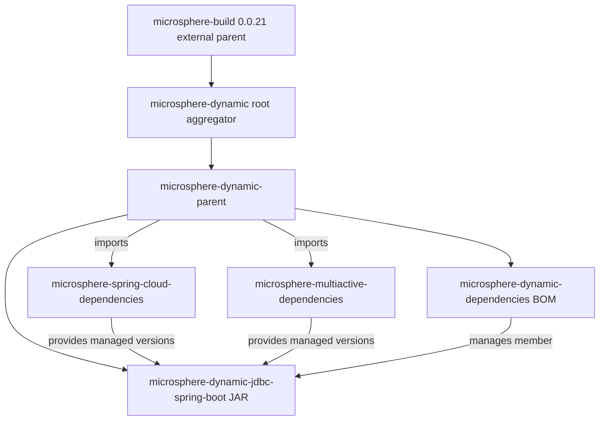

[English](../microsphere-dynamic-parent.md)

# 开发者指南：`microsphere-dynamic-parent`

> **文档线说明：** 本仓库目前尚无 `release` 或 `release-1.x` 分支；
> `current` 文档线由 `main` 分支生成（revision 为 `0.0.1-SNAPSHOT`）。本指南所
> 述内容仅反映 `main` 分支的状态。请将下文中所有版本号与行为视为 1.0 之前、
> 随时可能变动的内容。

`microsphere-dynamic-parent` 是一个**纯 POM 模块**（`<packaging>pom</packaging>`）——
它不发布任何源码、不产出 JAR、也没有任何编译产物。它唯一的作用就是被*继承*。本指南
从构建/架构视角描述它：它为何要作为独立模块存在、POM 各区块如何工作、改动后会破坏
什么，以及它在 reactor 与发布流程中的位置。

如需了解唯一产出 JAR 模块的运行时/功能行为，请参阅姊妹文档
[`microsphere-dynamic-jdbc-spring-boot.md`](../microsphere-dynamic-jdbc-spring-boot.md)。
如需了解本模块如何作为版本对齐契约被下游应用使用，请参阅
[`microsphere-dynamic-dependencies.md`](../microsphere-dynamic-dependencies.md)。

---

## 1. 在 reactor 中的定位

本仓库是一个由根聚合器 `microsphere-dynamic`（位于仓库根目录的 POM）驱动的 Maven
reactor。该聚合器自身继承了一个**外部**构建父 POM
`io.github.microsphere-projects:microsphere-build:0.0.21`，它**不在本仓库内**，只存在
于本地/远端 Maven 仓库中。正是这个外部父 POM 锁定了 Java 基线并接好了构建插件；本
仓库自身的模块在其之上叠加领域层面的版本管理。

`microsphere-dynamic-parent` 介于原始构建父 POM 与产出制品的模块之间。它是整个
`microsphere-dynamic` 项目中**版本属性的集中定义点**以及**第三方依赖锁定**点。说它
`BOM-less`，是指它**不**对外发布供消费者使用的受管成员面——相反，它存在的意义是作为
其它模块的 `<parent>`，让所有模块继承到同一套坐标版本。

具体而言，它的职责是：

1. **版本属性集中化** —— 为同级的 Microsphere BOM 定义与 `${revision}` 对齐的属性，
   并为第三方库定义可读的 `*.version` 属性，使其下方任何模块都不硬编码字面版本。
2. **第三方依赖锁定** —— 声明一段 `dependencyManagement`，精确锁定 MySQL、MyBatis、
   MyBatis Starter、MyBatis-Plus、ShardingSphere 与 MariaDB4j 的版本。
3. **外部 BOM 导入** —— 以 `scope=import` 导入两个外部 Microsphere BOM
   （`microsphere-spring-cloud-dependencies` 与 `microsphere-multiactive-dependencies`），
   使其受管条目流入每个子模块。
4. **提供公共父坐标** —— 各模块将 `<parent>` 指向 `microsphere-dynamic-parent` 而非原始
   聚合器，使版本管理契约显式且可复用。

### 为什么是独立父 POM，而不是并入聚合器？

根聚合器 `microsphere-dynamic` 刻意几乎不携带任何自身的依赖元数据（它继承
`microsphere-build`，仅定义了 `${revision}`、`<modules>` 列表、`distributionManagement`
以及一条快照 `<repositories>` 条目）。把版本/第三方管理放在一个*专用的*父模块中，
而非聚合器里，意味着：

- 该管理契约是一个**具名、可寻址的制品**（`microsphere-dynamic-parent`），任何模块都可
  继承它，而无需依赖聚合器的"聚合"角色。
- BOM 模块（`microsphere-dynamic-dependencies`）可以通过把 `microsphere-dynamic-parent`
  列为自身父 POM 来继承*同一套*管理——这正是它的做法，参见
  [`microsphere-dynamic-dependencies.md`](../microsphere-dynamic-dependencies.md)。
- 新增 JAR 模块只需把 `<parent>` 指向本父 POM，即可免费获得所有锁定项。

### 为什么既有父 POM *又*有独立 BOM？

这是 reactor 中关键的设计区分：

- **父 POM（`microsphere-dynamic-parent`）** = *继承*契约。你成为它的子模块（`<parent>`），
  便会如同在自己 POM 中声明一样收到它的属性与 `dependencyManagement`。它的受管条目是本
  仓库的**实现细节**，并非对外的版本对齐面。
- **BOM（`microsphere-dynamic-dependencies`）** = *导入*契约。下游应用在自己的
  `dependencyManagement` 中 `<scope>import</scope>` 它，即可获得一份**公开的、精选的受管
  成员清单**（目前仅为 JDBC starter），而无需继承本项目的构建插件或第三方锁定项。

简言之：父 POM 集中管理"我们如何构建自己的模块"；BOM 发布"你可以依赖我们的哪些制品、
用什么版本"。二者被刻意解耦，以使父 POM 的内部第三方锁定不会泄漏进 BOM 的公开受管面。

---

## 2. 模块依赖图

下图展示 `microsphere-dynamic-parent` 与外部构建父 POM、聚合器、同级模块，以及它所导入
的外部 BOM 之间的关系。



就本模块而言解读此图：`microsphere-dynamic-parent` 是那个**向上继承结构化的构建行为**
（经由聚合器指向 `microsphere-build`）、同时**向下分发版本管理**（分发给 BOM 与 JDBC 模块，
以及那两个喂给 JDBC 模块受管依赖版本的外部导入 BOM）的节点。

---

## 3. POM 区块逐段分析

每一小节都注释了 `microsphere-dynamic-parent/pom.xml` 中真实存在的区块，说明其作用以及
**改动后会破坏什么**。行号引用指向 `main` 上的当前文件。

### 3.1 父 POM 链

```xml
<parent>
    <groupId>io.github.microsphere-projects</groupId>
    <artifactId>microsphere-dynamic</artifactId>
    <version>${revision}</version>
    <relativePath>../pom.xml</relativePath>
</parent>
```

- 父 POM 是**根聚合器 `microsphere-dynamic`**，通过磁盘上的 `../pom.xml`（`relativePath`）
  解析。聚合器又继承 `microsphere-build:0.0.21`，因此本模块的有效插件/属性集合来自一条
  三级链：`microsphere-build` → `microsphere-dynamic` → `microsphere-dynamic-parent`。
- `<version>${revision}</version>` 使父坐标锁定到贯穿 reactor 的 revision 令牌。

**改动后会破坏什么：** 把 `<parent>` 指向别处，或修改 `relativePath`，会使本模块脱离 reactor
并脱离 `microsphere-build` 的插件接线。你会失去 `flatten-maven-plugin`、Java 8 编译器基线，
以及从 `microsphere-build` 继承的 source/jar 插件配置，且 reactor 将无法正确排布本模块的顺序。

### 3.2 坐标与打包方式

```xml
<groupId>io.github.microsphere-projects</groupId>
<artifactId>microsphere-dynamic-parent</artifactId>
<version>${revision}</version>
<packaging>pom</packaging>
```

- `packaging=pom` 正是本模块"无源码、无 JAR"的原因。
- `version=${revision}` 意味着*部署出去*的父坐标是那个 CI 友好令牌，由 `flatten-maven-plugin`
  在构建时重写（见第 5 节）。

**改动后会破坏什么：** 在此硬编码字面版本会使父 POM 与 `${revision}` 解耦，并与同样使用
`${revision}` 的 JDBC 模块和 BOM 产生版本错位；reactor 会构建出不匹配的坐标，BOM 的
`${revision}` 受管成员也会解析到错误的父级链路线上。

### 3.3 属性区块

```xml
<properties>
    <microsphere-spring-cloud.version>${revision}</microsphere-spring-cloud.version>
    <microsphere-multiactive.version>${revision}</microsphere-multiactive.version>
    <!-- Third-party versions -->
    <mysql-connector-java.version>8.0.28</mysql-connector-java.version>
    <mybatis.version>3.5.15</mybatis.version>
    <mybatis-starter.version>2.3.1</mybatis-starter.version>
    <mybatis-plus.version>3.3.0</mybatis-plus.version>
    <shardingsphere.version>5.1.1</shardingsphere.version>
    <mariadb4j.version>2.5.3</mariadb4j.version>
</properties>
```

每个属性、当前值及其消费者：

| 属性 | 当前值 | 在此声明形式 | 消费者 / 作用 |
|---|---|---|---|
| `revision` | `0.0.1-SNAPSHOT`（默认值，定义在根聚合器 `pom.xml`，不在本模块） | 继承令牌 | 成为父 POM 自身、BOM、JDBC 模块、下面两个导入的外部 BOM 坐标，以及 BOM 受管成员的 `${revision}` 版本。CI 上通过 `-Drevision` 覆盖为 `0.0.1`。 |
| `microsphere-spring-cloud.version` | `${revision}`（本地为 `0.0.1-SNAPSHOT`，CI 上为 `0.0.1`） | 别名为 reactor revision | 导入的 `microsphere-spring-cloud-dependencies` BOM 的版本，为 JDBC 模块提供 Spring Boot / Spring Cloud 受管版本。 |
| `microsphere-multiactive.version` | `${revision}` | 别名为 reactor revision | 导入的 `microsphere-multiactive-dependencies` BOM 的版本，为 JDBC 模块提供多活受管版本。 |
| `mysql-connector-java.version` | `8.0.28` | 字面锁定 | 锁定 `mysql:mysql-connector-java`，被 JDBC 模块以 `test` 作用域消费。 |
| `mybatis.version` | `3.5.15` | 字面锁定 | 锁定 `org.mybatis:mybatis` 核心，用于 JDBC 模块下的传递对齐。 |
| `mybatis-starter.version` | `2.3.1` | 字面锁定 | 锁定 `org.mybatis.spring.boot:mybatis-spring-boot-starter`，被 JDBC 模块以 `optional` 消费。 |
| `mybatis-plus.version` | `3.3.0` | 字面锁定 | 锁定 `com.baomidou:mybatis-plus-boot-starter`，被 JDBC 模块以 `optional` 消费。 |
| `shardingsphere.version` | `5.1.1` | 字面锁定 | 锁定 `org.apache.shardingsphere:shardingsphere-jdbc-core-spring-boot-starter`，被 JDBC 模块以 compile 作用域消费。 |
| `mariadb4j.version` | `2.5.3` | 字面锁定 | 锁定 `ch.vorburger.mariaDB4j:mariaDB4j` 与 `mariaDB4j-springboot` 两个制品；其中 springboot 变体被 JDBC 模块以 `test` 作用域消费。 |

> **来源说明：** `microsphere-spring-cloud.version` 与 `microsphere-multiactive.version`
> *别名为 `${revision}`*，因此在本模块中它们**没有**各自独立的版本号——它们跟随 reactor
> 构建时使用的那个 revision。本模块中没有定义 `java.version`、`spring-boot.version` 或
> `spring-cloud.version` 属性；它们分别来自外部 `microsphere-build` 父 POM 与外部
> `microsphere-spring-cloud-parent`（见第 5、6 节）。它们是刻意*不*在此重新声明的，
> 所以在此改动它们毫无作用。

**改动后会破坏什么：**

- 提升某个 `*.version` 字面值（例如 `shardingsphere.version`）会在 JDBC 模块 POM 完全不显示
  任何版本的情况下悄悄改变其解析到的依赖（JDBC 模块声明依赖时*不带*版本，依赖此处的锁定）。
  一次错误的提升可能在真正消费它的模块没有任何 diff 的情况下破坏 JDBC 模块的编译或其集成测试。
- 删除一个别名（如 `microsphere-multiactive.version`）会使对应的 `import` 区块无法解析
  （`${...}` 会求值为空），并在依赖解析阶段直接导致构建失败。

### 3.4 `dependencyManagement`：外部 BOM 导入

```xml
<dependency>
    <groupId>io.github.microsphere-projects</groupId>
    <artifactId>microsphere-spring-cloud-dependencies</artifactId>
    <version>${microsphere-spring-cloud.version}</version>
    <type>pom</type>
    <scope>import</scope>
</dependency>
<dependency>
    <groupId>io.github.microsphere-projects</groupId>
    <artifactId>microsphere-multiactive-dependencies</artifactId>
    <version>${microsphere-multiactive.version}</version>
    <type>pom</type>
    <scope>import</scope>
</dependency>
```

- 这些导入会把两个外部 Microsphere BOM 的完整受管依赖列表拉入本父 POM 的每个子模块。这正是
  JDBC 模块即便从未显式点名 Spring Boot，也最终获得 Spring Boot `2.7.18` / Spring Cloud
  `2021.0.8` 坐标的原因。
- 因为二者都以 `${revision}` 为键，它们解析到的坐标取决于构建时传入的 revision 覆盖值。

**改动后会破坏什么：** 相对于下方显式锁定项改变这些导入的顺序会改变优先级——在 Maven 中，
`dependencyManagement` 里对某个 `groupId:artifactId` 的**第一个**声明胜出。本模块的显式第三方
锁定项写在导入*之后*，所以对于任何同时被外部 BOM 管理的制品，目前外部 BOM 的值优先。把某个
锁定项移到导入*之前*会翻转谁胜出；这是一个微妙但真实存在的版本漂移来源。删除某个导入会剥掉
JDBC 模块的 Spring Boot/Spring Cloud/多活受管版本，导致构建在未指定版本的依赖上失败。

### 3.5 `dependencyManagement`：第三方锁定项

其余条目把 `mysql-connector-java`、`mybatis`、`mybatis-spring-boot-starter`、
`mybatis-plus-boot-starter`、`shardingsphere-jdbc-core-spring-boot-starter`，以及两个
`mariaDB4j` 制品锁定到第 3.3 节的 `*.version` 属性。

**改动后会破坏什么：** 删除其中某个锁定项，意味着（不带版本声明该依赖的）JDBC 模块将没有受管
版本，reactor 构建立刻以 "version not specified" 错误失败。两个 `mariaDB4j` 条目共享
`${mariadb4j.version}`；修改该属性会同时移动两者。

---

## 4. 构建产物注意事项：`.flattened-pom.xml` 与 `.mvn/`

仓库根目录下有两个与构建相关、但容易被误读的文件：

- **`.flattened-pom.xml`** —— 一个由 `flatten-maven-plugin` 生成的输出，位于**工作树中但被
  git 忽略**（`.gitignore` 含 `.flattened-pom.xml`）。它是本地的、过期的构建产物，**并非**权威
  POM。在当前工作副本中，它甚至显示 `microsphere-build` 为 `0.0.6`，而受跟踪的 `pom.xml` 声明
  的是 `0.0.21`；并且显示 `microsphere-spring-cloud.version` 已被插值为 `0.0.1`——这两点都是
  上一次本地 `-Drevision=0.0.1` 构建的迹象，而非事实来源。**不要从中读取设计意图。** 四个真实的、
  受跟踪的 POM 是根 `pom.xml`、本模块的 `pom.xml`、BOM 的 `pom.xml`，以及 JDBC 模块的 `pom.xml`。
- **`.mvn/wrapper/`** —— Maven Wrapper。`maven-wrapper.properties` 把 `distributionUrl` 锁定为
  **Apache Maven `3.9.0`**，`wrapperUrl` 锁定为 maven-wrapper **`3.1.1`**。配合仓库根目录的
  `mvnw` / `mvnw.cmd`，这意味着无需系统安装即可获得可复现的 Maven 版本（见第 6 节）。

**改动后会破坏什么：** 重新生成或手工编辑 `.flattened-pom.xml` 对构建毫无影响（它被产出而非被
消费，并被 git 忽略）。修改 `maven-wrapper.properties` 会改变每个贡献者和 CI 拉取的 Maven 版本。

---

## 5. `${revision}` 与 `flatten-maven-plugin` 如何协作

reactor 使用 **CI 友好的 `${revision}` 模式**：每个模块的 `<version>` 与每个 reactor 内部的坐标
引用都写成 `${revision}`，其值在构建时传入（`-Drevision=...`），或默认为根聚合器 `<properties>`
中定义的 `0.0.1-SNAPSHOT`。

这样做带来一个问题——若发布的 POM 坐标中仍带着字面 `${revision}`，消费者将无法解析——由
**`flatten-maven-plugin`** 解决，该插件**配置在外部 `microsphere-build:0.0.21` 父 POM 中，而非本
仓库内**。读取该父 POM 的真实配置：

| `flatten-maven-plugin` 设置（来自 `microsphere-build` 0.0.21） | 值 | 作用 |
|---|---|---|
| 插件版本 | `1.6.0` | 引入的 flatten 插件版本。 |
| `flattenMode` | `resolveCiFriendliesOnly` | 在发布/安装的 POM 中只解析 CI 友好令牌（`${revision}`、`${sha1}`、`${changelist}`）；其余原样保留。 |
| `updatePomFile` | `true` | 构建把扁平化后的 POM 作为有效发布 POM。 |
| `pomElements/parent` | `expand` | 父坐标以展开形式写出。 |
| `pomElements/properties` | `keep` | 属性在扁平化 POM 中被保留。 |
| `pomElements/dependencyManagement` | `interpolate` | 受管版本被插值（这就是为何你在扁平化 BOM 输出中看到 `${revision}` 被替换成真实版本）。 |
| `pomElements/dependencies` | `resolve` | 写出已解析的依赖版本。 |
| `pomElements/distributionManagement` | `remove` | 从扁平化 POM 中剥离 `distributionManagement`（使消费者不会继承本项目的部署目标）。 |
| `pomElements/repositories` | `remove` | 从扁平化 POM 中剥离快照 `<repositories>` 区块。 |
| 执行阶段 | `process-resources`（goal `flatten`） | 扁平化在 `process-resources` 阶段运行。 |

因此机制是：`${revision}` 留在*源* POM 中以供开发者阅读并保持 reactor 一致；构建时由
`flatten-maven-plugin`（绑定在 `microsphere-build` 中）产出扁平化 POM，把 `${revision}` 替换为
实际版本，同时移除 `distributionManagement`/`repositories` 以免泄漏给消费者。**此配置位于外部
父 POM** —— 若不提升 `microsphere-build` 版本，你无法从本仓库内部改变 flatten 行为，而该版本并
不存在于本仓库中。

---

## 6. 版本与发布流程

### 本地构建命令

仓库根目录提供 Maven Wrapper（macOS/Linux 用 `./mvnw`，Windows 用 `mvnw.cmd`），锁定 Maven `3.9.0`：

```bash
# Full reactor build from the repo root (uses the default revision 0.0.1-SNAPSHOT)
./mvnw clean install

# Explicit revision, matching CI
./mvnw --batch-mode --update-snapshots -Drevision=0.0.1 clean install
```

### `-Drevision` 语义

- **不带** `-Drevision` 时，根聚合器的默认 `<revision>0.0.1-SNAPSHOT</revision>` 会应用到每个
  模块及每个 `${revision}` 引用，包括下面两个外部导入 BOM 坐标。
- **带上** `-Drevision=0.0.1`（CI 即如此），整个 reactor 以发布风格坐标 `0.0.1` 构建并定版；
  又因两个外部 BOM 别名都是 `${revision}`，它们在该次运行中也解析为 `0.0.1`。
- revision 令牌贯穿整个 reactor：在不破坏继承链的情况下你无法给某个模块定不同的版本，因为父 POM、
  BOM 与 JDBC 模块都引用同一个 `${revision}`。

### 部署目标（`distributionManagement`）

定义在根聚合器（不在本模块），全项目继承，并且——如第 5 节 flatten 配置所述——**从扁平化 POM
中移除**，以免下游继承它们。两个仓库都使用 server id `ossrh`（Sonatype OSSRH）：

| 目标 | URL |
|---|---|
| `snapshotRepository` | `https://s01.oss.sonatype.org/content/repositories/snapshots` |
| release `repository`（staging） | `https://s01.oss.sonatype.org/service/local/staging/deploy/maven2/` |

`-SNAPSHOT` revision 直接部署到快照仓库；非 SNAPSHOT revision 走 staging URL。注意
`microsphere-build:0.0.21` 还把 `nexus-staging-maven-plugin`（`serverId=ossrh`、
`autoReleaseAfterClose=true`）接入了它的 `release` profile，因此真正的 staging 发布自动化在外部
父 POM 中。

### CI 矩阵

`.github/workflows/maven.yml`（"Java CI with Maven"）：

- **触发条件：** 推送到 `main` 以及指向 `main` 的 `pull_request`。
- **运行器：** `ubuntu-latest`。
- **矩阵：** `java: ['8']` —— **单个** JDK 条目，Temurin `8`。目前还没有多 JDK 矩阵。
- **命令：** `mvn --batch-mode --update-snapshots --file pom.xml -Drevision=0.0.1 clean install`。
- 工作流中**未配置部署步骤**——CI 只在运行器本地构建并 install。发布到 OSSRH 不属于 `maven.yml`。

### 兼容性矩阵

| 关注点 | 值 | 来源 |
|---|---|---|
| Java source/target 基线 | `8`（`java.version=8`） | 继承自外部 `microsphere-build:0.0.21`（它把 `maven.compiler.source`/`target` 设为 `${java.version}=8`）。本仓库未定义。 |
| 构建用 Maven 版本 | `3.9.0` | 本仓库 `.mvn/wrapper/maven-wrapper.properties`。 |
| Spring Boot 线 | `2.7.18` | 未在本仓库声明。它经由导入的 `microsphere-spring-cloud-dependencies` BOM 传递而来，该 BOM 的外部 `microsphere-spring-cloud-parent` 设定 `spring-boot.version=2.7.18`。标记为外部/继承。 |
| Spring Cloud 线 | `2021.0.8` | 同一条外部链（`microsphere-spring-cloud-parent` 中 `spring-cloud-dependencies.version=2021.0.8`）。不是你能在本仓库 POM 中看到的值。 |
| 项目 revision | `0.0.1-SNAPSHOT`（默认） | 根聚合器 `pom.xml`；CI 上覆盖为 `0.0.1`。 |

---

## 7. 变更管理指引

### 提升一个被锁定的第三方版本

1. **只**编辑本模块 `dependencyManagement` 配套 `<properties>` 中第 3.3 节里相关的那个
   `*.version` 属性。不要手改锁定项内的 `<version>` 元素（它按设计通过属性引用）。
2. 从根目录重建 reactor（`./mvnw clean install`），使 JDBC 模块针对新锁定项重新解析。
3. 确认 JDBC 模块仍能编译且测试通过——此处的锁定项变化在真正消费的 POM 中毫无可见痕迹，
   构建是你唯一的信号。

### 重排 / 新增一个外部 BOM 导入

- 在第 3.3 节把版本加为一个别名为 `${revision}`（或字面值）的属性，然后加一条
  `<scope>import</scope>` 的 `<type>pom</type>` 条目。
- 牢记 Maven 对 `dependencyManagement` 的"第一个声明胜出"规则：让导入顺序与显式锁定项之间的
  关系保持有意为之。如果某个新导入的 BOM 不得覆盖某个本地锁定项，就把该本地锁定项放在导入**之前**。

### 向 reactor 新增一个受管模块

- 新增 **JAR 模块**：把它的 `<parent>` 指向 `microsphere-dynamic-parent`（`relativePath` 为
  `../microsphere-dynamic-parent/pom.xml`），`<version>${revision}</version>`，在聚合器的
  `<modules>` 下列出它，并不带版本地声明它的依赖，依赖本父 POM 的锁定/导入。若它应被公开受管，
  把它的坐标加入 BOM（见
  [`microsphere-dynamic-dependencies.md`](../microsphere-dynamic-dependencies.md)）。
- 新增 **第三方锁定项**：在本模块加一个 `*.version` 属性及匹配的 `dependencyManagement` 条目，
  使消费者永不硬编码它。

### reactor 排序约束（父 POM → BOM → JAR）

因为 BOM 与 JDBC 模块都把 `microsphere-dynamic-parent` 声明为 `<parent>`，Maven 必须**先**构建本
父 POM 再构建其子模块。根聚合器的 `<modules>` 列表（`microsphere-dynamic-parent`，接着
`microsphere-dynamic-dependencies`，接着 `microsphere-dynamic-jdbc-spring-boot`）已表达了该顺序，
且 Maven reactor 也通过父/`dependencyManagement` 图强制之，所以即便 `<modules>` 顺序写错仍会得到
正确的构建——但保持显式顺序可避免意外。*必须*先解析的依赖链是：`microsphere-build`（外部）→
`microsphere-dynamic-parent` → { `microsphere-dynamic-dependencies`, `microsphere-dynamic-jdbc-spring-boot` }。

### 何时才应改动本模块

本模块的改动会波及**每个**模块。只在以下情况改动它：新增/更新第三方锁定项、新增外部 BOM 导入，
或调整 revision 别名。运行时代码与公开的受管成员面分别属于 JDBC 模块与 BOM。

---

## 8. 成熟度注意事项

`microsphere-dynamic-parent` 处于 revision `0.0.1-SNAPSHOT`。仓库中**没有 `release` 或
`release-1.x` 分支**，也没有标签；`current` 文档线由 `main` 生成。此处的版本管理可用但尚在
1.0 之前：被锁定的第三方版本、外部 BOM 坐标，以及继承而来的 Spring Boot/Spring Cloud 线都可能
在无语义版本保证的情况下移动。不要把上面的属性表视为稳定的公共契约——当被下游使用时，稳定的
公共契约是 BOM，而非本父 POM。

---

## 相关文档

- 开发者指南索引：[开发者指南](../README.md)
- 仓库根 README：[microsphere-dynamic](../../../../README.md)
- 受管成员面（BOM）：[microsphere-dynamic-dependencies](../microsphere-dynamic-dependencies.md)
- 唯一产出 JAR 的模块：[microsphere-dynamic-jdbc-spring-boot](../microsphere-dynamic-jdbc-spring-boot.md)

---

## English

本文档的英文版本：[microsphere-dynamic-parent Developer Guide](../microsphere-dynamic-parent.md)。
