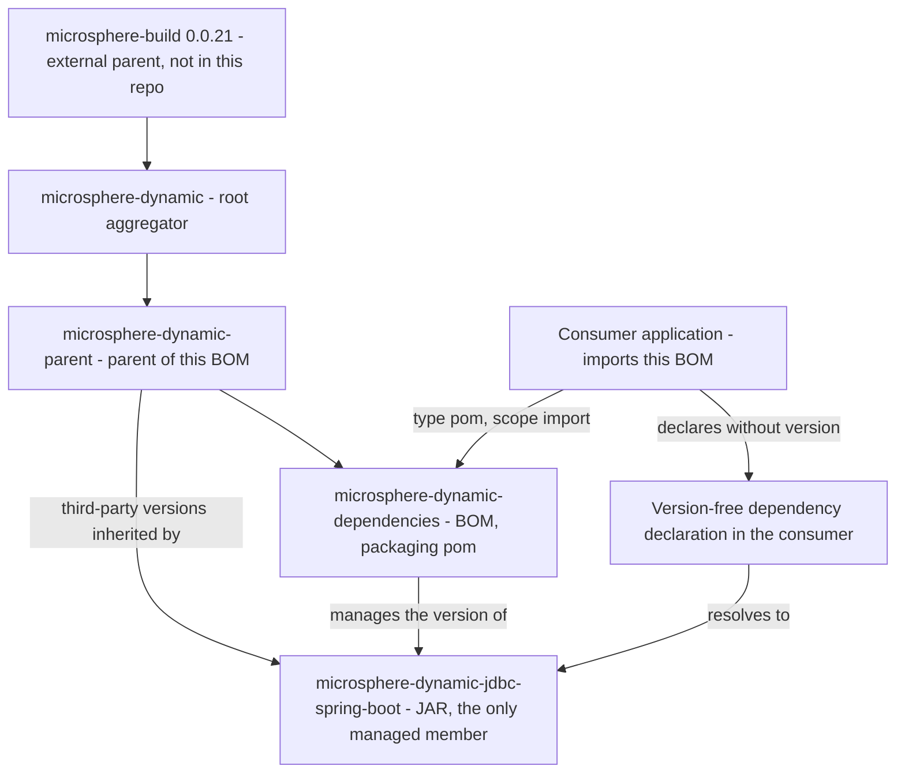

# microsphere-dynamic-dependencies

[中文](zh/microsphere-dynamic-dependencies.md)

> **Documentation line: `current`.**
> This repository has no `release` or `release-1.x` branch yet; the `current` documentation line is generated from `main` (revision `0.0.1-SNAPSHOT`).

`microsphere-dynamic-dependencies` is the **bill of materials (BOM)** of the `microsphere-dynamic` project: a
`pom`-packaged artifact whose `<dependencyManagement>` lists the project's *own* modules and their versions, so that
consumers can add those modules without writing a version number and keep them consistent with each other.

It manages **exactly one** member today: `microsphere-dynamic-jdbc-spring-boot`. Everything else a consumer may need
(the MySQL driver, MyBatis, ShardingSphere, and friends) is managed by its parent,
[`microsphere-dynamic-parent`](microsphere-dynamic-parent.md).

---

## 1. Maven coordinates

| Coordinate | Value | Notes |
| --- | --- | --- |
| `groupId` | `io.github.microsphere-projects` | Declared in `microsphere-dynamic-dependencies/pom.xml` |
| `artifactId` | `microsphere-dynamic-dependencies` | |
| `version` | `${revision}` — default `0.0.1-SNAPSHOT` | `revision` is defined in the **root** POM `pom.xml` |
| `packaging` | `pom` | BOM: no `<modules>`, no `<build>`, no `<properties>`, no sources |
| Name | `Microsphere :: Dynamic :: Dependencies` | |
| Source file | `microsphere-dynamic-dependencies/pom.xml` | |
| License | Apache License, Version 2.0 | Inherited from the root POM |

Its parent, verbatim from the source file, is the convention parent rather than the aggregator:

```xml
<parent>
    <groupId>io.github.microsphere-projects</groupId>
    <artifactId>microsphere-dynamic-parent</artifactId>
    <version>${revision}</version>
    <relativePath>../microsphere-dynamic-parent/pom.xml</relativePath>
</parent>
```

That single choice is the most important thing about this artifact: because it inherits from
`microsphere-dynamic-parent`, which inherits from the root aggregator, which inherits from the external
`microsphere-build:0.0.21`, the BOM is a *complete* view of the project's managed world — not only its own module.

---

## 2. Where this artifact sits in the build and consumption graph



Reading the diagram: the BOM sits between the parent (which supplies all third-party management) and the consumer
(which only ever names artifacts). Adding a dependency at the `LIB` node resolves to a concrete artifact at the
`JDBC` node thanks to the single managed entry.

---

## 3. How to consume it

### 3.1 As an imported BOM in `<dependencyManagement>` (the primary usage)

```xml
<project xmlns="http://maven.apache.org/POM/4.0.0">
    <modelVersion>4.0.0</modelVersion>

    <groupId>com.example</groupId>
    <artifactId>my-dynamic-jdbc-app</artifactId>
    <version>1.0.0</version>

    <dependencyManagement>
        <dependencies>
            <dependency>
                <groupId>io.github.microsphere-projects</groupId>
                <artifactId>microsphere-dynamic-dependencies</artifactId>
                <version>0.0.1-SNAPSHOT</version>
                <type>pom</type>
                <scope>import</scope>
            </dependency>
        </dependencies>
    </dependencyManagement>

    <dependencies>
        <!-- Version comes from the imported BOM -->
        <dependency>
            <groupId>io.github.microsphere-projects</groupId>
            <artifactId>microsphere-dynamic-jdbc-spring-boot</artifactId>
        </dependency>
    </dependencies>
</project>
```

`<type>pom</type>` and `<scope>import</scope>` are both mandatory and must appear inside `<dependencyManagement>`.
Importing a BOM never adds a dependency to your project: it only makes versions available to be picked up, which is
why the `<dependencies>` block above still has to name the artifact.

Because the default version is a snapshot and the published POMs of this repository carry no `<repositories>`
section (the flatten configuration in the external `microsphere-build` POM removes it), resolving
`0.0.1-SNAPSHOT` requires you to declare the snapshot repository yourself:

```xml
<repositories>
    <repository>
        <id>snapshot</id>
        <url>https://s01.oss.sonatype.org/content/repositories/snapshots</url>
        <snapshots><enabled>true</enabled></snapshots>
        <releases><enabled>false</enabled></releases>
    </repository>
</repositories>
```

### 3.2 As a `<parent>`

A BOM can be used as a parent, and doing so also hands you its inherited `dependencyManagement`. It works, but it
occupies your single `<parent>` slot and drags in the whole chain (`microsphere-dynamic-parent` →
`microsphere-dynamic` → external `microsphere-build:0.0.21`, which is where the JDK 8 baseline comes from):

```xml
<parent>
    <groupId>io.github.microsphere-projects</groupId>
    <artifactId>microsphere-dynamic-dependencies</artifactId>
    <version>0.0.1-SNAPSHOT</version>
    <relativePath/> <!-- lookup parent from repository -->
</parent>

<groupId>com.example</groupId>
<artifactId>my-internal-bom</artifactId>
<version>1.0.0</version>
<packaging>pom</packaging>
```

Prefer this only when you are building your own organisation-wide BOM layered on top of this project. For an
ordinary application module, import it (section 3.1) and keep `<parent>` for your own conventions or for
`spring-boot-starter-parent`.

### 3.3 The recommended pairing

The BOM and the parent are complementary, and this repository's own modules demonstrate the split: the parent supplies
third-party versions and build conventions, the BOM supplies the project's own module versions.

| You consume | You get | You do **not** get |
| --- | --- | --- |
| `microsphere-dynamic-parent` as `<parent>` | Third-party managed versions, inherited build configuration | A managed `microsphere-dynamic-jdbc-spring-boot` version |
| `microsphere-dynamic-dependencies` as imported BOM | A managed `microsphere-dynamic-jdbc-spring-boot` version, plus the third-party versions reachable through its parent chain | Build configuration, plugin versions, the JDK 8 baseline |

---

## 4. Complete managed dependency list

The BOM's own `<dependencyManagement>` contains one entry, verbatim:

| `groupId` | `artifactId` | Managed version | Packaging | Notes |
| --- | --- | --- | --- | --- |
| `io.github.microsphere-projects` | `microsphere-dynamic-jdbc-spring-boot` | `${revision}` | `jar` | The only member this BOM declares |

There are no `<properties>` in this POM: `${revision}` is defined in the root POM of the repository
(`0.0.1-SNAPSHOT` by default) and reaches the BOM through its parent chain.

### Versions you also receive through the parent chain

`microsphere-dynamic-dependencies` inherits the nine `dependencyManagement` entries of
`microsphere-dynamic-parent`. Listing them makes the BOM's real reach legible, though they are **not declared in this
POM** — see [`microsphere-dynamic-parent`](microsphere-dynamic-parent.md) for the authoritative table:

| `groupId` | `artifactId` | Managed version | Provenance |
| --- | --- | --- | --- |
| `io.github.microsphere-projects` | `microsphere-spring-cloud-dependencies` | `${microsphere-spring-cloud.version}` → `${revision}` | Inherited from the parent, BOM import |
| `io.github.microsphere-projects` | `microsphere-multiactive-dependencies` | `${microsphere-multiactive.version}` → `${revision}` | Inherited from the parent, BOM import |
| `mysql` | `mysql-connector-java` | `8.0.28` | Inherited from the parent, declared in this repository |
| `org.mybatis.spring.boot` | `mybatis-spring-boot-starter` | `2.3.1` | Inherited from the parent, declared in this repository |
| `org.mybatis` | `mybatis` | `3.5.15` | Inherited from the parent, declared in this repository |
| `com.baomidou` | `mybatis-plus-boot-starter` | `3.3.0` | Inherited from the parent, declared in this repository |
| `org.apache.shardingsphere` | `shardingsphere-jdbc-core-spring-boot-starter` | `5.1.1` | Inherited from the parent, declared in this repository |
| `ch.vorburger.mariaDB4j` | `mariaDB4j` | `2.5.3` | Inherited from the parent, declared in this repository |
| `ch.vorburger.mariaDB4j` | `mariaDB4j-springboot` | `2.5.3` | Inherited from the parent, declared in this repository |

Whether a given managed entry reaches *your* project depends on Maven resolving the imported POM as a complete model
including its parent chain. Verify your own case rather than trusting the table:
`mvn help:effective-pom` and `mvn dependency:tree` are enough.

---

## 5. Version information

| Item | Value | Where it is declared |
| --- | --- | --- |
| CI-friendly placeholder property | `revision` | `pom.xml` (root aggregator) |
| Default value | `0.0.1-SNAPSHOT` | `pom.xml` (root aggregator) |
| Version of this BOM | `${revision}` | `microsphere-dynamic-dependencies/pom.xml` |
| Managed member version | `${revision}` | Same placeholder — the BOM and its member always move together |
| Version used by CI | `-Drevision=0.0.1` | `.github/workflows/maven.yml` |
| Maven version pinned by the wrapper | `3.9.0` | `.mvn/wrapper/maven-wrapper.properties` |

Because both the BOM and the member it manages use `${revision}`, the pairing is guaranteed consistent inside one
reactor build: there is no way to publish a `0.0.2` BOM that manages a `0.0.1` module from this repository.

**CI.** `.github/workflows/maven.yml` runs on `ubuntu-latest` for `main`, JDK `8` (Temurin, single-entry matrix),
with `mvn --batch-mode --update-snapshots --file pom.xml -Drevision=0.0.1 clean install`. It builds `0.0.1`; a plain
local `mvn install` produces `0.0.1-SNAPSHOT`. Only `install` is run — no `deploy`.

**Publishing.** `<distributionManagement>` lives in the root POM of this repository, server id `ossrh`:

| Artifact type | Target repository |
| --- | --- |
| `*-SNAPSHOT` | `https://s01.oss.sonatype.org/content/repositories/snapshots` |
| Releases | `https://s01.oss.sonatype.org/service/local/staging/deploy/maven2/` |

For this BOM that means two artifacts must always exist together in the repository: the BOM POM itself and the POM of
its parent chain (`microsphere-dynamic-parent`, `microsphere-dynamic`), since the published BOM keeps a `<parent>`
reference and `${revision}` is only defined in the root POM.

> **Release branch note.** This repository has no `release` or `release-1.x` branch yet; the `current` documentation
> line is generated from `main` (revision `0.0.1-SNAPSHOT`). `git tag` is empty, so no released version of this BOM
> exists yet; `0.0.1-SNAPSHOT` is what you will resolve.

---

## 6. Version compatibility

This BOM declares no third-party versions itself, so its compatibility surface is the versions it reaches through
inheritance plus the module it manages:

| Aspect | Version | Provenance |
| --- | --- | --- |
| JDK / bytecode baseline for consumers using it as a parent | `8` | **Inherited from `microsphere-build` 0.0.21** — an external POM, not declared in this repository; a BOM import does not transmit it |
| Spring Boot | `2.7.18` | **External, inherited** through the `microsphere-spring-cloud-dependencies` import (`microsphere-spring-cloud-parent` 0.0.1 pins it). Not a promise made by this repository |
| Spring Cloud | `2021.0.8` | **External, inherited**, same chain as Spring Boot |
| `microsphere-dynamic-jdbc-spring-boot` | `${revision}` (default `0.0.1-SNAPSHOT`) | **Declared in this BOM** — its only managed member |
| `mysql-connector-java` | `8.0.28` | Inherited from `microsphere-dynamic-parent`, declared in this repository |
| `shardingsphere-jdbc-core-spring-boot-starter` | `5.1.1` | Inherited from `microsphere-dynamic-parent`, declared in this repository |
| `mybatis` | `3.5.15` | Inherited from `microsphere-dynamic-parent`, declared in this repository |
| `mybatis-spring-boot-starter` | `2.3.1` | Inherited from `microsphere-dynamic-parent`, declared in this repository |
| `mybatis-plus-boot-starter` | `3.3.0` | Inherited from `microsphere-dynamic-parent`, declared in this repository |
| `mariaDB4j`, `mariaDB4j-springboot` | `2.5.3` | Inherited from `microsphere-dynamic-parent`, declared in this repository; test scope in this project |

---

## 7. FAQ and pitfalls

**Q. My build fails with `Could not find artifact io.github.microsphere-projects:microsphere-dynamic-dependencies:pom:0.0.1-SNAPSHOT`.**
That is the expected consequence of the `current` documentation line: `main` carries `0.0.1-SNAPSHOT` and no release
branch or tag exists. Snapshots are published to the Sonatype OSSRH snapshot repository, which is *not* declared in
the published POM, so add the `<repositories>` block from section 3.1 yourself.

**Q. I imported the BOM but Maven still asks me for a version on `microsphere-dynamic-jdbc-spring-boot`.**
Check three things: that the import lives inside `<dependencyManagement>` (not `<dependencies>`), that both
`<type>pom</type>` and `<scope>import</scope>` are present, and that the `groupId`/`artifactId` you depend on match
the managed entry exactly. Without `type`/`scope`, Maven treats the entry as an ordinary JAR dependency and no
version management happens at all.

**Q. `${revision}` still appears literally inside the installed BOM POM. Is that a bug?**
It is the observed, documented behaviour of this project's build. The published POM is produced by
`flatten-maven-plugin` (version 1.6.0, mode `resolveCiFriendliesOnly`, `updatePomFile=true`), all of which come from
the **external** `microsphere-build:0.0.21` POM and are not configured in this repository. That mode rewrites the
CI-friendly placeholder in the project's own `<version>` and in its `<parent>` version, while leaving the
`${revision}` inside `dependencyManagement` untouched — the value is then resolved for you when Maven reads the BOM
together with its parent chain, where the root POM defines `<revision>0.0.1-SNAPSHOT</revision>`. Practical
consequence: **do not** copy the published BOM POM into your own project and expect `${revision}` to survive; keep the
parent chain resolvable, or pin the concrete version yourself.

**Q. The published BOM POM still contains `<relativePath>`. Should I worry?**
The flattened POM keeps the parent's `<relativePath>../microsphere-dynamic-parent/pom.xml</relativePath>`. When
Maven resolves the artifact from a repository, a relative path that does not exist on your disk is simply ignored and
the repository is used. It becomes a trap only if a POM happens to exist at that path relative to your project —
Maven would then read that local file instead of the published one. Use `<relativePath/>` when you adopt any POM of
this project as your own parent.

**Q. Does this BOM manage Spring Boot or MyBatis versions for me?**
Only indirectly. It declares nothing itself; the third-party versions come from
[`microsphere-dynamic-parent`](microsphere-dynamic-parent.md), and the Spring Boot / Spring Cloud line comes from the
`microsphere-spring-cloud-dependencies` BOM import, which is external to this repository. Run
`mvn help:effective-pom` in your own project to see what actually landed in your `dependencyManagement`.

**Q. Two BOMs manage the same artifact — which version wins?**
Maven applies first-declaration-wins *across* imported BOMs, and your project's own `dependencyManagement` entries
always beat imported ones. So if you import both `microsphere-dynamic-dependencies` and, say,
`spring-boot-dependencies`, the order in your `<dependencyManagement>` block decides. Pin the ones you care about
explicitly if the order is not obvious.

**Q. Where does `revision` come from, and can I build this repository without Maven?**
`revision` is a plain Maven property — a CI-friendly placeholder recognised by Maven 3.5+. The repository pins Maven
`3.9.0` via `.mvn/wrapper/maven-wrapper.properties`, so `./mvnw` works without a pre-installed Maven. To build the
reactor yourself, run from the root so that every `<relativePath>` resolves:
`./mvnw --batch-mode -Drevision=0.0.1 clean install`.

**Q. If I add a second module to this project, is it managed automatically?**
No. `microsphere-dynamic-dependencies` lists its members by hand — currently the single
`microsphere-dynamic-jdbc-spring-boot` entry. A new module must be added to that `<dependencyManagement>` explicitly.

---

## 8. Related documents

- [microsphere-dynamic-parent](microsphere-dynamic-parent.md) — where the third-party versions are managed
- [microsphere-dynamic-jdbc-spring-boot](microsphere-dynamic-jdbc-spring-boot.md) — the JAR this BOM manages
- [User guide index](README.md)
- [Repository README](../../../README.md)

## 中文

- [中文文档：microsphere-dynamic-dependencies](zh/microsphere-dynamic-dependencies.md)
