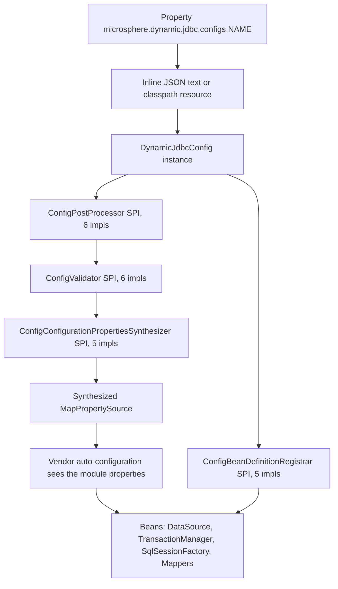
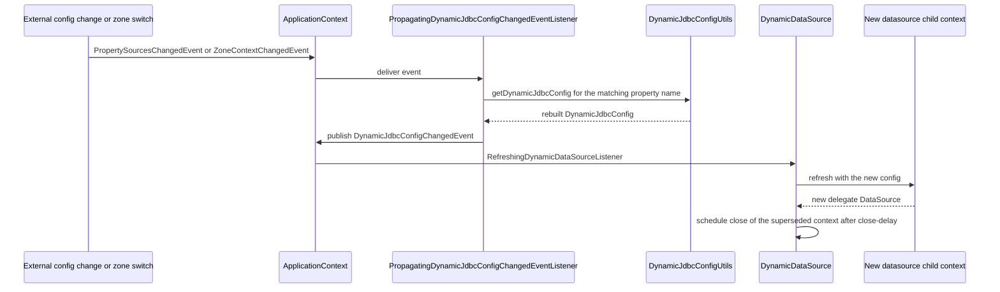

# microsphere-dynamic-jdbc-spring-boot

[中文](zh/microsphere-dynamic-jdbc-spring-boot.md)

> **Documentation line: `current`.**
> This repository has no `release` or `release-1.x` branch yet; the `current` documentation line is generated from `main` (revision `0.0.1-SNAPSHOT`).

`microsphere-dynamic-jdbc-spring-boot` is the only code module of this repository and the only JAR it produces. It lets a
Spring Boot application describe its **JDBC topology as data** — one or more named configuration blocks holding datasource
lists, transaction managers, ShardingSphere rules and MyBatis / MyBatis-Plus mapper scans — and then have that topology built
into Spring `ApplicationContext` beans at runtime, and **rebuilt without a restart** when the configuration changes.

The source root is
`microsphere-dynamic-jdbc-spring-boot/src/main/java/io/microsphere/dynamic/jdbc/spring/boot/`, containing **81 top-level classes**
across the packages `autoconfigure`, `config` (+ `annotation`, `validation`), `constants`, `context` (+ `error`), `datasource`
(+ `config`, `env`, `validation`, `constants`), `env`, `mybatis`, `mybatisplus`, `shardingsphere`, `transaction` and `util`.

---

## 1. Overview

### 1.1 The problem it solves

Ordinary Spring Boot wires one `spring.datasource` into one `DataSource`, one `SqlSessionFactory`, one
`PlatformTransactionManager`, all decided at build/startup time. That breaks down when you need to:

- run **several independent JDBC topologies in one JVM** — e.g. a plain single database *and* a sharded cluster *and* a
  read/write-splitting cluster, each with its own MyBatis mapper tree;
- keep ShardingSphere rules and datasource lists **outside the code**, in a config centre, and change them while the process
  is up;
- route a datasource choice by **availability zone** (multi-active deployment) and switch zone at runtime;
- shorten a JDBC URL down to `127.0.0.1:3306/demo_ds` and let the framework supply the driver, the scheme, the credentials
  and the query parameters.

This module answers by giving each configuration block its **own child `ApplicationContext`** (`DynamicJdbcChildContext`),
built from the auto-configuration classes that block's modules need, and then selectively re-exporting the resulting beans to
the parent context.

### 1.2 Feature list, as implemented

| Capability | Where it lives |
| --- | --- |
| Declare one or many named JDBC configs via `microsphere.dynamic.jdbc.configs.*` | `DynamicJdbcConfigUtils.getDynamicJdbcConfigs`, `DynamicJdbcConstants.CONFIGS_PROPERTY_NAME` |
| Config as inline JSON **or** as a `classpath:` resource location | `DynamicJdbcConfigUtils.getDynamicJdbcConfigContent` |
| Six config modules: `datasource`, `ha-datasource`, `transaction`, `sharding-sphere`, `mybatis`, `mybatis-plus` | `DynamicJdbcConfig` + `DynamicJdbcConstants` |
| One child context per config, built in parallel | `DynamicJdbcContextApplicationListener.processDynamicJdbcChildContexts`, `DynamicJdbcChildContext` |
| Reuse the real vendor auto-configuration instead of reimplementing it | per-module `auto-configuration.base-packages`, `DynamicJdbcAutoConfigurationImportFilter` |
| Mutual exclusion between incompatible modules (`datasource` vs `sharding-sphere`, `mybatis` vs `mybatis-plus`) | `auto-configuration.banned-modules`, `DynamicJdbcPropertyUtils.getModuleExclusionAutoConfigurationClassNames` |
| Selected child beans re-exported to the parent, optionally as `primary` | `multiple-context.bean-classes.expose` / `.primary`, `DynamicJdbcChildContextRefreshedListener` |
| Hot reload: `DynamicDataSource` rebuilds its delegate on config change | `DynamicDataSource.RefreshingDynamicDataSourceListener` |
| Zone-driven datasource switching | `ha-datasource` + `DynamicJdbcConfig.getDataSourcePropertiesList`, `ZoneContext` |
| JDBC URL normalisation: default scheme, default query params, driver deduction | `JdbcURLAssembler`, `DataSourcePropertiesConfigPostProcessor` |
| Property-name tolerance: `url` / `jdbcUrl` / `jdbc-url` are aliases | `modules.datasource.property-name-aliases.*` |
| Fail-fast structural validation before any context is refreshed | `ConfigValidator` SPI, `ValidationErrors`, `ConfigValidationException` |
| Sharded-pool defaults so Hikari settings need not be repeated | `modules.sharding-sphere.default-properties.datasource.*` |

### 1.3 Explicitly not there yet

The javadoc-free extension point is honest in the source: `DynamicJdbcContextProcessor.processDynamic` carries the comment
`// TODO support more dynamic features`, and its only implementation path is `processDynamicDataSource`. **Only the
`DataSource` can be swapped at runtime today.** Transaction managers and `SqlSessionFactory` beans are rebuilt only when a
whole child context is recreated, not by the dynamic-refresh path. `DynamicJdbcConfig.isDynamic()` javadoc says the same:
"For now, it only supports `DataSource` bean was wrapped to be `DynamicDataSource` instance".

Also note that `@EnableDynamicJdbcAutoConfiguration.exclude()` and `excludeName()` are annotated in the source with the
comment `// Always empty` — do not rely on them as a filtering API.

---

## 2. Installation

### 2.1 Coordinates

| Field | Value | Source |
| --- | --- | --- |
| `groupId` | `io.github.microsphere-projects` | module `pom.xml` |
| `artifactId` | `microsphere-dynamic-jdbc-spring-boot` | module `pom.xml` |
| `version` | `${revision}` — default `0.0.1-SNAPSHOT` | `<revision>` in the root `pom.xml`; CI builds with `-Drevision=0.0.1` |
| `packaging` | `jar` | module `pom.xml` |
| Name | `Microsphere :: Dynamic :: JDBC :: Spring Boot` | module `pom.xml` |
| Parent | `microsphere-dynamic-parent:${revision}` → root `microsphere-dynamic:${revision}` → external `microsphere-build:0.0.21` | POM chain |
| License | Apache License, Version 2.0 | inherited from the root POM |

### 2.2 Direct dependency

```xml
<dependency>
    <groupId>io.github.microsphere-projects</groupId>
    <artifactId>microsphere-dynamic-jdbc-spring-boot</artifactId>
    <version>0.0.1-SNAPSHOT</version>
</dependency>
```

### 2.3 Via the project BOM

`microsphere-dynamic-dependencies` manages exactly this one artifact, so the version can be dropped:

```xml
<dependencyManagement>
    <dependencies>
        <dependency>
            <groupId>io.github.microsphere-projects</groupId>
            <artifactId>microsphere-dynamic-dependencies</artifactId>
            <version>0.0.1-SNAPSHOT</version>
            <type>pom</type>
            <scope>import</scope>
        </dependency>
    </dependencies>
</dependencyManagement>

<dependencies>
    <dependency>
        <groupId>io.github.microsphere-projects</groupId>
        <artifactId>microsphere-dynamic-jdbc-spring-boot</artifactId>
    </dependency>
</dependencies>
```

See [microsphere-dynamic-dependencies](microsphere-dynamic-dependencies.md) for the BOM's own contract, and
[microsphere-dynamic-parent](microsphere-dynamic-parent.md) for the third-party versions it pins.

### 2.4 Snapshots repository

`0.0.1-SNAPSHOT` is not on Maven Central. The root `pom.xml` publishes snapshots to Sonatype OSSRH and declares the matching
resolution repository; because the published POM drops `<repositories>`, declare it yourself:

```xml
<repositories>
    <repository>
        <id>snapshot</id>
        <url>https://s01.oss.sonatype.org/content/repositories/snapshots</url>
        <snapshots>
            <enabled>true</enabled>
        </snapshots>
        <releases>
            <enabled>false</enabled>
        </releases>
    </repository>
</repositories>
```

### 2.5 What lands on your classpath

From the module `pom.xml` — **compile** (transitive, you get them for free):
`microsphere-spring-boot-core`, `microsphere-multiactive-spring`, `shardingsphere-jdbc-core-spring-boot-starter`,
`HikariCP`, `jackson-datatype-jsr310`.

**Optional** (add the ones you actually use — this is how the MyBatis paths stay cheap):
`spring-boot`, `spring-boot-actuator`, `spring-boot-configuration-processor`, `mybatis-spring-boot-starter`,
`mybatis-plus-boot-starter`.

**Test-only in this repository**: `mysql-connector-java`, `mariaDB4j-springboot`, `junit`, `spring-boot-starter-test`. You
still need your own JDBC driver at runtime — the MySQL driver is *not* a compile dependency here.

---

## 3. Quick start

### 3.1 Two ways to turn it on

**A. Do nothing explicit — the `spring.factories` route (recommended).**
`DynamicJdbcContextApplicationListener` is registered as a `org.springframework.context.ApplicationListener` in
`src/main/resources/META-INF/spring.factories`, so simply having the JAR on the classpath and declaring
`microsphere.dynamic.jdbc.configs.*` is enough. A standard `@SpringBootApplication` / `@EnableAutoConfiguration` bootstrap
picks it up; that is exactly how every test in this module boots. Set `microsphere.dynamic.jdbc.enabled=false` to switch the
whole feature off for a context.

**B. Import the auto-configuration set explicitly.**
`@EnableDynamicJdbcAutoConfiguration` (`io.microsphere.dynamic.jdbc.spring.boot.autoconfigure`) is
`@Import(DynamicJdbcAutoConfigurationImportSelector.class)` — it pulls in the auto-configuration classes belonging to the
declared module base-packages and caches them per `ClassLoader` in `DynamicJdbcAutoConfigurationRepository`. Child contexts
use it internally (`DynamicJdbcChildContextConfiguration` is annotated with it).

```java
@EnableDynamicJdbcAutoConfiguration
@SpringBootApplication
public class Application {
    public static void main(String[] args) {
        SpringApplication.run(Application.class, args);
    }
}
```

### 3.2 Minimal single-datasource example

This is `SingleDataSourceTest` plus its two fixtures, reduced to the essentials.

`src/test/java/io/microsphere/dynamic/jdbc/spring/boot/test/SingleDataSourceTest.java`:

```java
@RunWith(SpringRunner.class)
@SpringBootTest(classes = SingleDataSourceTest.class, webEnvironment = SpringBootTest.WebEnvironment.NONE)
@TestPropertySource(locations = "classpath:/META-INF/sharding-sphere/single-datasource.properties",
        properties = {"spring.shardingsphere.enabled=false", "microsphere.dynamic.jdbc.modules.datasource.dynamic-context.close-delay=3s"})
@ComponentScan(basePackages = "io.microsphere.dynamic.jdbc.spring.boot.shardingsphere.examples.mybatis")
@EnableAutoConfiguration
public class SingleDataSourceTest {

    @Autowired
    private List<ExampleService> exampleServices;

    @Autowired
    @Qualifier("my-tx")
    private DataSourceTransactionManager dataSourceTransactionManager;

    @Test
    public void test() throws Throwable {
        for (ExampleService exampleService : exampleServices) {
            ExampleExecuteTemplate.run(exampleService);
        }
    }
}
```

`src/test/resources/META-INF/sharding-sphere/single-datasource.properties` — the property points at a JSON *resource*:

```properties
microsphere.dynamic.jdbc.configs.single-database = classpath:/META-INF/sharding-sphere/single-datasource.json

microsphere.dynamic.jdbc.modules.datasource.default-user-name = root

microsphere.dynamic.jdbc.modules.datasource.default-password = 123456
```

`src/test/resources/META-INF/sharding-sphere/single-datasource.json` — the config body:

```json
{
  "name": "single-database",
  "ha-datasource": {
    "defaultZone": [
      {
        "name": "ds",
        "jdbcUrl": "127.0.0.1:3306/demo_ds",
        "maxLifetime": 10000,
        "connectionTimeout": 1000,
        "validationTimeout": 500,
        "idleTimeout": 2000,
        "maxPoolSize": 10
      }
    ],
    "test-zone": [
      {
        "name": "ds-0",
        "jdbc-url": "127.0.0.1:3306/demo_ds_0"
      }
    ]
  },
  "transaction": {
    "name": "my-tx"
  },
  "mybatis": {
    "base-packages": "io.microsphere.dynamic.jdbc.spring.boot.shardingsphere.examples.mybatis.repository",
    "properties": {
      "checkConfigLocation": true,
      "configLocation": "classpath:/META-INF/mybatis/mybatis-config.xml"
    }
  }
}
```

Three things happen that are worth noticing:

1. `jdbcUrl: "127.0.0.1:3306/demo_ds"` has no `jdbc:` prefix, no scheme and no query string. `JdbcURLAssembler` prepends the
   configured default scheme and appends the default query params; `DataSourcePropertiesConfigPostProcessor` then deduces
   `driverClassName` from the assembled URL via Spring Boot's `DatabaseDriver`.
2. `username` / `password` are absent on the entry — they are filled from
   `modules.datasource.default-user-name` / `default-password`.
3. `transaction.name = "my-tx"` is why the test can `@Qualifier("my-tx")` the `DataSourceTransactionManager` from the
   *parent* context even though the bean was built in a child context.

### 3.3 Startup flow



The `ConfigValidator` pass is fatal-fast: `DynamicJdbcContextProcessor.validateDynamicJdbcConfig` collects all
`ValidationErrors` and throws `ConfigValidationException` before any refresh continues.

---

## 4. Configuration reference

All property names below are quoted verbatim from
`microsphere-dynamic-jdbc-spring-boot/src/main/resources/META-INF/dynamic-jdbc/default.properties`, which is installed as
default properties through `DynamicJdbcDefaultPropertiesPostProcessor` (registered as
`io.microsphere.spring.boot.env.DefaultPropertiesPostProcessor`). Override any of them in your own configuration; you do not
have to restate them.

### 4.1 Global switch and config registry

| Property | Default | Meaning |
| --- | --- | --- |
| `microsphere.dynamic.jdbc.enabled` | `true` (`DEFAULT_DYNAMIC_JDBC_ENABLED_PROPERTY_VALUE`) | When `false`, `DynamicJdbcContextApplicationListener` skips the whole Dynamic JDBC preparation for that context |
| `microsphere.dynamic.jdbc.configs.<name>` | none | One config block. Value is either the JSON document itself or a resource location starting with `classpath:` |

`DynamicJdbcConstants.DEFAULT_PROPERTIES_LOCATION` is `META-INF/dynamic-jdbc/default.properties`.

### 4.2 Modules — `datasource`

| Property (verbatim) | Default value |
| --- | --- |
| `microsphere.dynamic.jdbc.modules.datasource.auto-configuration.base-packages` | `org.springframework.boot.autoconfigure.jdbc.DataSourceAutoConfiguration,org.springframework.boot.autoconfigure.jdbc.DataSourceConfiguration` |
| `microsphere.dynamic.jdbc.modules.datasource.auto-configuration.banned-modules` | `sharding-sphere` |
| `microsphere.dynamic.jdbc.modules.datasource.property-name-aliases.url` | `jdbcUrl,jdbc-url` |
| `microsphere.dynamic.jdbc.modules.datasource.property-name-aliases.jdbcUrl` | `url,jdbc-url` |
| `microsphere.dynamic.jdbc.modules.datasource.property-name-aliases.jdbc-url` | `url,jdbcUrl` |
| `microsphere.dynamic.jdbc.modules.datasource.url.default-scheme` | `mysql://` (escaped as `mysql\://` in the file) |
| `microsphere.dynamic.jdbc.modules.datasource.url.default-query-params.characterEncoding` | `utf-8` |
| `microsphere.dynamic.jdbc.modules.datasource.url.default-query-params.useSSL` | `false` |
| `microsphere.dynamic.jdbc.modules.datasource.url.default-query-params.useUnicode` | `true` |

Two further `datasource` properties are read by the code but ship **without** a default, so you must set them yourself:

| Property | Read by | Default | Purpose |
| --- | --- | --- | --- |
| `microsphere.dynamic.jdbc.modules.datasource.default-user-name` | `DynamicJdbcPropertyUtils.getDataSourceDefaultUserName` | none | Fallback `username` for datasource entries that omit it |
| `microsphere.dynamic.jdbc.modules.datasource.default-password` | `DynamicJdbcPropertyUtils.getDataSourceDefaultPassword` | none | Fallback `password` for datasource entries that omit it |
| `microsphere.dynamic.jdbc.modules.datasource.dynamic-context.close-delay` | `DynamicJdbcPropertyUtils.getDynamicDataSourceChildContextCloseDelay` | `60s` (`Duration.ofSeconds(60)`) | Delay before the superseded datasource child context is closed after a hot swap |

### 4.3 Modules — `ha-datasource`, `transaction`

| Property (verbatim) | Default value |
| --- | --- |
| `microsphere.dynamic.jdbc.modules.ha-datasource.auto-configuration.banned-modules` | `sharding-sphere` |
| `microsphere.dynamic.jdbc.modules.transaction.auto-configuration.base-packages` | `org.springframework.boot.autoconfigure.transaction.,org.springframework.boot.autoconfigure.jdbc.DataSourceTransactionManagerAutoConfiguration` |

`transaction` declares no `banned-modules`, so nothing is excluded for it.

### 4.4 Modules — `sharding-sphere`

| Property (verbatim) | Default value |
| --- | --- |
| `microsphere.dynamic.jdbc.modules.sharding-sphere.dynamic.enabled` | `true` |
| `microsphere.dynamic.jdbc.modules.sharding-sphere.auto-configuration.base-packages` | `org.apache.shardingsphere.` |
| `microsphere.dynamic.jdbc.modules.sharding-sphere.auto-configuration.banned-modules` | `datasource` |
| `microsphere.dynamic.jdbc.modules.sharding-sphere.default-properties.datasource.maxLifetime` | `1800000` |
| `microsphere.dynamic.jdbc.modules.sharding-sphere.default-properties.datasource.idleTimeout` | `600000` |
| `microsphere.dynamic.jdbc.modules.sharding-sphere.default-properties.datasource.connectionTimeout` | `30000` |
| `microsphere.dynamic.jdbc.modules.sharding-sphere.default-properties.datasource.validationTimeout` | `10000` |
| `microsphere.dynamic.jdbc.modules.sharding-sphere.default-properties.datasource.maxPoolSize` | `10` |
| `microsphere.dynamic.jdbc.modules.sharding-sphere.default-properties.datasource.minPoolSize` | `10` |

`minPoolSize` carries the in-file comment `# minIdle for Hikari`. These `default-properties.datasource.*` values are applied
only when a datasource entry's `type` is `com.zaxxer.hikari.HikariDataSource`
(`ShardingSphereConfigConfigurationPropertiesSynthesizer.synthesizeShardingSphereDataSourceDefaultProperties`), and they are
merged as `spring.shardingsphere.datasource.<name>.<key>` alongside the `spring.shardingsphere.names` list built from the
config's datasource names.

### 4.5 Modules — `mybatis` and `mybatis-plus`

| Property (verbatim) | Default value |
| --- | --- |
| `microsphere.dynamic.jdbc.modules.mybatis.auto-configuration.base-packages` | `org.mybatis.spring.boot.` |
| `microsphere.dynamic.jdbc.modules.mybatis.auto-configuration.banned-modules` | `mybatis-plus` |
| `microsphere.dynamic.jdbc.modules.mybatis-plus.auto-configuration.base-packages` | `com.baomidou.` |
| `microsphere.dynamic.jdbc.modules.mybatis-plus.auto-configuration.banned-modules` | `mybatis` |

Note the module key is `mybatis-plus` in properties, matching `DynamicJdbcConstants.MYBATIS_PLUS_MODULE`.

### 4.6 Third-party defaults also shipped

| Property (verbatim) | Default value | Purpose |
| --- | --- | --- |
| `spring.shardingsphere.mode.type` | `Memory` | ShardingSphere mode for the built child contexts |
| `spring.shardingsphere.rules.sql-parser.sql-comment-parse-enabled` | `false` | In-file comment: "Keep the same behavior from YamlSQLParserRuleConfiguration.sqlCommentParseEnabled" |
| `spring.datasource.dynamic.enabled` | `false` | In-file comment "baomidou Dynamic DataSource" — switches off the baomidou dynamic-datasource starter so it cannot fight this module |

### 4.7 Multiple-context behaviour

When **more than one** `microsphere.dynamic.jdbc.configs.*` block exists, `DynamicJdbcContextApplicationListener` creates one
`DynamicJdbcChildContext` per block *and* strips the JDBC auto-configuration from the parent context so the parent does not
build a competing `DataSource`.

| Property (verbatim) | Default |
| --- | --- |
| `microsphere.dynamic.jdbc.multiple-context.auto-configuration.exclude` | 13 classes: `DataSourceAutoConfiguration`, `MybatisAutoConfiguration`, `MybatisLanguageDriverAutoConfiguration`, `MybatisPlusAutoConfiguration`, `MybatisPlusLanguageDriverAutoConfiguration`, `DatabaseDiscoveryRuleSpringbootConfiguration`, `EncryptRuleSpringBootConfiguration`, `SQLParserRuleSpringBootConfiguration`, `ReadwriteSplittingRuleSpringbootConfiguration`, `ShadowRuleSpringBootConfiguration`, `ShardingRuleSpringBootConfiguration`, `ShardingSphereAutoConfiguration`, `DataSourceTransactionManagerAutoConfiguration` (full FQCNs are in `default.properties`, lines 57–70) |
| `microsphere.dynamic.jdbc.multiple-context.bean-classes.expose` | `javax.sql.DataSource`, `org.springframework.transaction.PlatformTransactionManager`, `org.springframework.boot.autoconfigure.transaction.TransactionManagerCustomizers`, `org.apache.ibatis.session.SqlSessionFactory` |
| `microsphere.dynamic.jdbc.multiple-context.bean-classes.primary` | the same four types |

Semantics, straight from `DynamicJdbcChildContextRefreshedListener`:

- **exclude** — if you leave this empty, `appendExclusionAutoConfigurationProperty` falls back to
  `getAllModulesAutoConfigurationClassNames(context)`, i.e. every auto-configuration class matched by your module
  base-packages. Set it explicitly when you want a narrower exclusion than the shipped default.
- **expose** — a child bean assignable to one of these types is registered in the parent as a **direct bean instance**
  (`BeanRegistrar.registerBean`). Any other child bean is registered through a **FactoryBean**, so the parent can see it
  without eagerly coupling to the child lifecycle.
- **primary** — being in this list is necessary but *not* sufficient. `isPrimaryBean` requires
  `dynamicJdbcConfig.isPrimary()` **and** a matching primary class. So you mark one config `"primary": true` in its JSON and
  only that config's `DataSource` / `PlatformTransactionManager` / `SqlSessionFactory` become `@Primary` in the parent.
- **parent bean naming** — the default parent bean name is `<childContextId>$<childBeanName>`.
  `ParentContextBeanNameGenerator` overrides it per type; the single registered implementation,
  `PlatformTransactionManagerBeanNameGenerator`, names it after `transaction.name`. Infrastructure beans are never re-exported.

### 4.8 The module concept

`io.microsphere.dynamic.jdbc.spring.boot.config.annotation.Module` is a `@Target({TYPE, METHOD, FIELD})`, `@Inherited`
runtime annotation with a single `String value()` — javadoc: "The Configuration module interface". It tags the class that
owns a module name. Verified usages (5 annotated classes):

| Module name (`DynamicJdbcConstants`) | Annotated class |
| --- | --- |
| `datasource` | `DataSourceModuleProperties` |
| `transaction` | `DynamicJdbcConfig.Transaction` |
| `sharding-sphere` | `DynamicJdbcConfig.ShardingSphere` |
| `mybatis` | `DynamicJdbcConfig.Mybatis` |
| `mybatis-plus` | `DynamicJdbcConfig.MybatisPlus` |

`ha-datasource` has a constant and JSON key but **no `@Module`-annotated class** — it is handled inside the datasource
validators/post-processors, not as a standalone annotated module.

`DynamicJdbcConfigUtils.getModule(...)` throws `IllegalArgumentException` for a `Config` subclass lacking the annotation, which
is what `getModule(DynamicJdbcConfig.Config.class)` asserts in `DynamicJdbcConfigUtilsTest`.

### 4.9 Config sources: properties vs JSON

Both shapes are used in this module's tests.

**Inline JSON in a properties file** — `src/test/resources/META-INF/dynamic-jdbc/multiple-configs.properties` (three blocks,
lines 1–106) — note the backslash line continuations:

```properties
microsphere.dynamic.jdbc.configs.sharding-databases=\
{ \
    "name": "sharding-databases", \
    "datasource": [ \
        { \
            "name": "ds-0", \
            "jdbcUrl": "127.0.0.1:3306/demo_ds_0", \
            "username": "root", \
            "password": "123456" \
        }, \
        { \
            "name": "ds-1", \
            "jdbcUrl": "127.0.0.1:3306/demo_ds_1" \
        }\
    ],\
    "sharding-sphere": { \
        "config-resource": "classpath:/META-INF/sharding-sphere/config/sharding-databases.yaml" \
    }, \
    "mybatis-plus": { \
        "base-packages": "io.microsphere.dynamic.jdbc.spring.boot.shardingsphere.examples.mybatis.repository", \
        "properties" : { \
            "checkConfigLocation" : true, \
            "configLocation" : "classpath:/META-INF/mybatis/mybatis-config.xml" \
        } \
    } \
}

microsphere.dynamic.jdbc.modules.datasource.default-user-name = root

microsphere.dynamic.jdbc.modules.datasource.default-password = 123456
```

**A `classpath:` pointer** — `src/test/resources/META-INF/sharding-sphere/sharding-databases.properties`:

```properties
microsphere.dynamic.jdbc.configs.sharding-databases=classpath:/META-INF/sharding-sphere/sharding-databases.json
```

`DynamicJdbcConfigUtils.getDynamicJdbcConfigContent` branches on `ResourceUtils.CLASSPATH_URL_PREFIX`, so a value beginning
with `classpath:` is read as a resource; anything else is parsed as JSON directly. An empty value is skipped with a warning
("The json content of DynamicJdbcConfig is empty"). A non-malformed JSON document throws `IllegalArgumentException` whose
message includes the property name and Jackson's original message.

### 4.10 JSON schema of one config block

| Key | Java type | Notes |
| --- | --- | --- |
| `name` | `String` | Optional. Defaults to the `configs.<suffix>` suffix (`DynamicJdbcConfigPostProcessor.processName`) |
| `dynamic` | `boolean` | Default `true`. **Forced back to `true`** if you set `false`, with the log line `Force dynamic true. propertyName: {}` — see `DynamicJdbcConfigUtils.getDynamicJdbcConfig` |
| `primary` | `boolean` | Default `false`. Gates the `multiple-context.bean-classes.primary` re-export |
| `datasource` | `List<Map<String,Object>>` | Flat list of datasource entries |
| `ha-datasource` | `Map<String, List<Map<String,Object>>>` | Availability zone → datasource entries |
| `transaction` | `Transaction` | `name`, `configurations`, `properties`, `customizers` |
| `sharding-sphere` | `ShardingSphere` | `name`, `configurations`, `properties`, `config-resource` (required) |
| `mybatis` | `Mybatis` | `name`, `configurations`, `properties`, `base-packages` |
| `mybatis-plus` | `MybatisPlus` | `name`, `configurations`, `properties`, `base-packages` |

Every `Config` subclass shares the base fields `name`, `configurations` (comma-delimited class names) and `properties` (a map
fed into the module's own `@ConfigurationProperties`).

Datasource entries recognise these keys (`DataSourceConstants`): `name`, `type`, `driverClassName`, `username`, `password`,
and any of the URL aliases `url` / `jdbcUrl` / `jdbc-url`. Defaults: `type` → `com.zaxxer.hikari.HikariDataSource`
(`DEFAULT_DATASOURCE_TYPE_NAME`); an entry with no `name` is named `<configPropertyName>-datasource-<index>`.

### 4.11 JDBC URL assembly

`JdbcURLAssembler.assemble` behaves as asserted by `JdbcURLAssemblerTest`:

```java
@Test
public void testAssemble() {
    String rawJdbcURL = "jdbc:mysql://127.0.0.1:3306/demo_ds";
    String jdbcURL = jdbcURLAssembler.assemble(rawJdbcURL);
    assertEquals("jdbc:mysql://127.0.0.1:3306/demo_ds?useSSL=false&useUnicode=true&characterEncoding=utf-8", jdbcURL);
}

@Test
public void testAssembleWithoutScheme() {
    String rawJdbcURL = "127.0.0.1:3306/demo_ds?characterEncoding=UTF-8&ttl=false&useUnicode=false";
    String jdbcURL = jdbcURLAssembler.assemble(rawJdbcURL);
    assertEquals("jdbc:mysql://127.0.0.1:3306/demo_ds?characterEncoding=UTF-8&ttl=false&useUnicode=false&useSSL=false",
            jdbcURL);
}
```

Rules that follow from the source:

- a URL that already carries `jdbc:<scheme>://` is left alone except for query params;
- a bare `host:port/db` gets `modules.datasource.url.default-scheme` prepended;
- default query params are added **only when absent** — `characterEncoding=UTF-8` and `useUnicode=false` survive, `useSSL` is
  appended (`setDefaultQueryParamsIfAbsent`);
- a blank URL is returned untouched.

For Hikari-style keys, `DataSourceConfigurationPropertiesSynthesizer` maps leftover entry properties onto a vendor prefix
based on `type`: `com.zaxxer.hikari.HikariDataSource` → `spring.datasource.hikari`, `org.apache.tomcat.jdbc.pool.DataSource`
→ `spring.datasource.tomcat`, `org.apache.commons.dbcp2.BasicDataSource` → `spring.datasource.dbcp2`. Keys that match a
`DataSourceProperties` field go to `spring.datasource.*` instead. Note this synthesizer only engages when the config has
**exactly one** datasource and **no** `sharding-sphere` module.

---

## 5. Usage scenarios

All examples below are taken from this module's own tests under
`src/test/java/io/microsphere/dynamic/jdbc/spring/boot/test/` and the fixtures in `src/test/resources/META-INF/`.

### 5.1 Single datasource with MyBatis

Covered in section 3.2. The single-config variant `src/test/resources/META-INF/dynamic-jdbc/single-config.properties` shows
the same shape with an explicit `primary`-named property and an inlined JSON body:

```properties
microsphere.dynamic.jdbc.configs.primary=\
{ \
    "name": "sharding-tables-config", \
    "ha-datasource" : { \
        "defaultZone" : [ \
            { \
                "name": "ds", \
                "jdbcUrl": "127.0.0.1:3306/demo_ds" \
            } \
        ], \
       "test-zone" : [ \
            { \
                "name": "ds-0", \
                "jdbc-url": "127.0.0.1:3306/demo_ds_0" \
            } \
       ] \
    }, \
    "sharding-sphere": { \
        "config-resource": "classpath:/META-INF/sharding-sphere/config/sharding-tables.yaml" \
    }, \
    "transaction" : { \
        "name" : "myTransaction" \
    }, \
    "mybatis": { \
        "base-packages": "io.microsphere.dynamic.jdbc.spring.boot.shardingsphere.examples.mybatis.repository", \
        "properties" : { \
            "checkConfigLocation" : true, \
            "configLocation" : "classpath:/META-INF/mybatis/mybatis-config.xml" \
        } \
    } \
}

microsphere.dynamic.jdbc.modules.datasource.default-user-name= root
microsphere.dynamic.jdbc.modules.datasource.default-password = 123456
```

`DynamicJdbcContextApplicationListenerTest` boots exactly this file and asserts the observable outcome:

```java
@TestPropertySource(locations = "classpath:/META-INF/dynamic-jdbc/single-config.properties")
@EnableAutoConfiguration
public class DynamicJdbcContextApplicationListenerTest {

    @Test
    public void testBeans() throws Throwable {
        assertEquals(1, shardingJdbcConfigs.size());

        DynamicJdbcConfig primaryConfig = shardingJdbcConfigs.get("DynamicJdbcConfigBean[primary].sharding-tables-config");
        assertEquals("sharding-tables-config", primaryConfig.getName());

        assertEquals(1, dataSourceMap.size());
        DataSource dataSource = dataSourceMap.get("DynamicJdbcDynamicDataSource");
        assertNotNull(dataSource);

        DataSource unwrappedDataSource = dataSource.unwrap(DataSource.class);
        assertEquals(ShardingSphereDataSource.class, unwrappedDataSource.getClass());

        Map<String, Object> mappers = context.getBeansWithAnnotation(Mapper.class);
        assertEquals(4, mappers.size());
    }
}
```

Two contracts to rely on here:

- the `DynamicJdbcConfig` bean name is `DynamicJdbcConfigBean[<propertySuffix>].<configName>`
  (`DynamicJdbcConfigUtils.generateDynamicJdbcConfigBeanName`);
- the dynamic datasource bean name is always **`DynamicJdbcDynamicDataSource`**
  (`DynamicJdbcContextProcessor.processDynamicDataSource`), and `unwrap(...)` reaches the real vendor `DataSource`.

### 5.2 ShardingSphere: sharding-databases

`ShardingSphereShardingDatabasesTest` — note the JSON uses `"dynamic": false` and a **`mybatis-plus`** module:

```java
@RunWith(SpringRunner.class)
@SpringBootTest(classes = ShardingSphereShardingDatabasesTest.class, webEnvironment = SpringBootTest.WebEnvironment.NONE)
@TestPropertySource(value = "classpath:/META-INF/sharding-sphere/sharding-databases.properties",
        properties = {"microsphere.dynamic.jdbc.modules.datasource.dynamic-context.close-delay=3s"})
@ComponentScan(basePackages = "io.microsphere.dynamic.jdbc.spring.boot.shardingsphere.examples.mybatis")
@EnableAutoConfiguration
public class ShardingSphereShardingDatabasesTest {

    @Autowired
    @Qualifier("myTransaction")
    private PlatformTransactionManager platformTransactionManager;

    @Autowired
    private List<Interceptor> interceptors;

    @Autowired
    private SqlSessionFactory sqlSessionFactory;

    @Test
    public void test() throws Throwable {
        assertEquals(DataSourceTransactionManager.class, platformTransactionManager.getClass());
        assertEquals(1, interceptors.size());
        assertEquals(PaginationInterceptor.class, interceptors.get(0).getClass());

        for (ExampleService exampleService : exampleServices) {
            ExampleExecuteTemplate.run(exampleService);
        }
    }
}
```

`src/test/resources/META-INF/sharding-sphere/sharding-databases.json`:

```json
{
  "dynamic": false,
  "datasource": [
    {
      "name": "ds-0",
      "jdbcUrl": "127.0.0.1:3306/demo_ds_0",
      "username": "root",
      "password": "123456"
    },
    {
      "name": "ds-1",
      "jdbcUrl": "127.0.0.1:3306/demo_ds_1"
    }
  ],
  "transaction": {
    "name": "myTransaction"
  },
  "sharding-sphere": {
    "config-resource": "classpath:/META-INF/sharding-sphere/config/sharding-databases.yaml"
  },
  "mybatis-plus": {
    "base-packages": "io.microsphere.dynamic.jdbc.spring.boot.shardingsphere.examples.mybatis.repository",
    "properties": {
      "checkConfigLocation": true,
      "configLocation": "classpath:/META-INF/mybatis/mybatis-config.xml"
    }
  }
}
```

`src/test/resources/META-INF/sharding-sphere/config/sharding-databases.yaml` — a standard ShardingSphere 5.1.1 YAML rule file;
this module only points at it via `config-resource`:

```yaml
rules:
- !SHARDING
  tables:
    t_order: 
      actualDataNodes: ds-${0..1}.t_order
      keyGenerateStrategy:
        column: order_id
        keyGeneratorName: snowflake
  defaultDatabaseStrategy:
    standard:
      shardingColumn: user_id
      shardingAlgorithmName: database-inline
  shardingAlgorithms:
    database-inline:
      type: INLINE
      props:
        algorithm-expression: ds-${user_id % 2}
  keyGenerators:
    snowflake:
      type: SNOWFLAKE

props:
  sql-show: false
```

The `mybatis-plus.properties.checkConfigLocation` / `configLocation` pair, plus
`mybatis-plus.base-packages`, is what produces the asserted `SqlSessionFactory`, the `PaginationInterceptor` and the
`myTransaction` `PlatformTransactionManager` in the parent context.

### 5.3 ShardingSphere: sharding-tables

`ShardingSphereShardingTablesTest` mirrors 5.2 with `sharding-tables.properties` → `sharding-tables.json`
(`config-resource: classpath:/META-INF/sharding-sphere/config/sharding-tables.yaml`, a single `ds` datasource with per-table
strategies `t_order_${0..1}`), and adds the **zone switch** pattern:

```java
MutablePropertySources propertySources = environment.getPropertySources();

propertySources.addFirst(new MapPropertySource("zone", singletonMap(ZONE_PROPERTY_NAME, "test-zone")));

for (ExampleService exampleService : exampleServices) {
    ExampleExecuteTemplate.run(exampleService);
}

Thread.sleep(5 * 1000);
```

Because the config uses `ha-datasource`, changing the zone key moves `DynamicJdbcConfig.getDataSourcePropertiesList()` to the
`test-zone` list — and `defaultZone` is the documented fallback when the requested zone has no entry. The `Thread.sleep` is
there to let the delayed close of the superseded child context run out (shortened to `3s` by the
`dynamic-context.close-delay` test property).

`src/test/resources/META-INF/dynamic-jdbc/sharding-tables-config.json` is a resource-file variant of the same body, and
`src/test/resources/META-INF/dynamic-jdbc/test.properties` is the inline version of it — useful if you prefer one property
per config.

### 5.4 ShardingSphere: read-write splitting

`ShardingSphereShardingReadWriteSplittingTest` is the leanest bootstrap:

```java
@RunWith(SpringRunner.class)
@SpringBootTest(classes = ShardingSphereShardingReadWriteSplittingTest.class, webEnvironment = SpringBootTest.WebEnvironment.NONE)
@TestPropertySource("classpath:/META-INF/sharding-sphere/sharding-readwrite-splitting.properties")
@ComponentScan(basePackages = "io.microsphere.dynamic.jdbc.spring.boot.shardingsphere.examples.mybatis")
@EnableAutoConfiguration
public class ShardingSphereShardingReadWriteSplittingTest {

    @Autowired
    private List<ExampleService> exampleServices;

    @Test
    public void test() throws Throwable {
        for (ExampleService exampleService : exampleServices) {
            ExampleExecuteTemplate.run(exampleService);
        }
    }
}
```

`sharding-readwrite-splitting.json` declares six datasources (`write-ds-0`, `write-ds-0-read-0`, `write-ds-0-read-1`,
`write-ds-1`, `write-ds-1-read-0`, `write-ds-1-read-1`) and `config-resource` pointing at
`config/sharding-readwrite-splitting.yaml`, whose `!READWRITE_SPLITTING` rule binds them:

```yaml
- !READWRITE_SPLITTING
  dataSources:
    ds-0:
      type: Static
      props:
        write-data-source-name: write-ds-0
        read-data-source-names: write-ds-0-read-0, write-ds-0-read-1
      loadBalancerName: roundRobin
  loadBalancers:
    roundRobin:
      type: ROUND_ROBIN
```

The datasource names in the JSON **must** match the ones the YAML references: `ShardingSphereConfigConfigurationPropertiesSynthesizer`
writes `spring.shardingsphere.datasource.names` from `DynamicJdbcConfig.getDataSourcePropertiesMap()` keys, so a typo in the
JSON surfaces as a ShardingSphere rule error, not as a Dynamic JDBC one.

### 5.5 Several topologies in one application

`DynamicJdbcContextApplicationListenerMultipleContextTest` combines 5.3 and 5.4 plus a primary marker, loading
`multiple-configs.properties`:

```java
@SpringBootTest(classes = {DynamicJdbcContextApplicationListenerMultipleContextTest.class, ExampleServiceImpl.class

}, webEnvironment = SpringBootTest.WebEnvironment.NONE)
@TestPropertySource(locations = "classpath:/META-INF/dynamic-jdbc/multiple-configs.properties")
@EnableAutoConfiguration
public class DynamicJdbcContextApplicationListenerMultipleContextTest {

    @Test
    public void testBeans() throws Exception {
        assertEquals(3, shardingJdbcConfigs.size());

        Map<String, Object> mappers = context.getBeansWithAnnotation(Mapper.class);
        assertEquals(12, mappers.size());

        assertEquals(1, platformTransactionManagers.size());
        assertTrue(platformTransactionManagers.containsKey("myTransaction"));

        exampleService.processSuccess();
    }
}
```

Three configs coexist; only the one marked `"primary": "true"` supplies the `mybatis` mapper tree that reaches
`ExampleServiceImpl`, and the sole `PlatformTransactionManager` is visible in the parent under the name `myTransaction` — the
value of that config's `transaction.name`, courtesy of `PlatformTransactionManagerBeanNameGenerator`. The other two configs
contribute their datasources and mapper proxies without exporting a transaction manager, because they declare no
`transaction` module.

### 5.6 MyBatis / MyBatis-Plus integration

Mapper interfaces are plain Java interfaces extending a shared contract — e.g.
`src/test/java/io/microsphere/dynamic/jdbc/spring/boot/shardingsphere/examples/mybatis/repository/MybatisUserRepository.java`:

```java
package io.microsphere.dynamic.jdbc.spring.boot.shardingsphere.examples.mybatis.repository;

import io.microsphere.dynamic.jdbc.spring.boot.shardingsphere.examples.core.api.repository.UserRepository;

public interface MybatisUserRepository extends UserRepository {
}
```

`mybatis.base-packages` (or `mybatis-plus.base-packages`) is fed to `@MapperScan` through the placeholder
`${microsphere.dynamic.jdbc.modules.mybatis.auto-configuration.base-packages}`
(`MybatisConstants.DYNAMIC_JDBC_MYBATIS_BASE_PACKAGES_PLACEHOLDER`, used by `MybatisMapperScanConfiguration`). Services are
ordinary Spring beans picking the repository up by type — `examples/mybatis/service/UserServiceImpl.java` is
`@Service("encrypt")` with `@Resource private UserRepository userRepository;`.

Both scan configurations also register a `ConfigurationCustomizer` that binds enum types found in `base-packages` to
`EnumTypeHandler`, but only when `typeHandlersPackage` contains the framework's own handler package
(`io.microsphere.dynamic.jdbc.spring.boot.mybatis.handle` / `...mybatisplus.handle`). If you do not use those handler
packages, that enum binding simply does not happen.

The example mapper XMLs live in `src/test/resources/META-INF/mybatis/mappers/` with `mybatis-config.xml` alongside, referenced
from JSON as `properties.configLocation`.

---

## 6. Dynamic configuration change

This is the user-visible contract of the module. The wiring, in one place:



What you can rely on:

| Behaviour | Source |
| --- | --- |
| `DynamicJdbcConfigChangedEvent` carries the new `DynamicJdbcConfig`, the config property name and the originating context | `DynamicJdbcConfigChangedEvent` (`getDynamicJdbcConfig`, `getPropertyName`, `getSource`) |
| A change to a property named in `microsphere.dynamic.jdbc.configs.*` triggers a rebuild | `PropagatingDynamicJdbcConfigChangedEventListener.onPropertySourcesChangedEvent` matches the changed keys against the registered property names |
| A **zone** change triggers a rebuild **only** for configs that have an `ha-datasource` module | `onZoneContextChangedEvent` + `isZoneChanged` (the changed property must be `zone`) |
| The `DataSource` itself never changes identity — `DynamicDataSource` swaps its internal delegate | `DynamicDataSource.initializeDataSource`, `getDelegate()` |
| The old child context is closed asynchronously after `dynamic-context.close-delay` (default `60s`) so in-flight connections drain | `closeDynamicDataSourceChildContext(..., true)` |
| `unwrap(...)` on the injected `DataSource` gives you the current real datasource | asserted in `DynamicJdbcContextApplicationListenerTest` |

The listener is internal (package-private) and is registered for you —
`DynamicJdbcContextApplicationListener.registerPropagatingDynamicJdbcConfigChangedEventListener` — so you do not declare it.
You may publish `DynamicJdbcConfigChangedEvent` yourself from `context.publishEvent(...)` if you have a bespoke change
signal; `DynamicJdbcContextApplicationListenerTest` demonstrates the equivalent route through a
`PropertySourcesChangedEvent`.

**Only the datasource refreshes today** (see section 1.3). Do not design a hot-reload feature that expects `SqlSessionFactory`
or `PlatformTransactionManager` to be replaced in place.

---

## 7. API summary

### 7.1 Entry points

| Type | Kind | Purpose |
| --- | --- | --- |
| `EnableDynamicJdbcAutoConfiguration` | annotation | `@Import`s the Dynamic JDBC auto-configuration selector; `exclude`/`excludeName` are marked "Always empty" |
| `DynamicJdbcContextApplicationListener` | `ApplicationListener` | The real entry point; runs on `ApplicationPreparedEvent` at order `200` |
| `DynamicJdbcAutoConfigurationImportSelector` | `ImportSelector` | Supplies/refreshes the cached auto-configuration class names |
| `DynamicJdbcAutoConfigurationRepository` | cache | Per-`ClassLoader` store of matched auto-configuration class names |
| `DynamicJdbcAutoConfigurationImportListener` | listener | Populates the repository during auto-configuration import |
| `DynamicJdbcConstants` | constants | Module names, property-name fragments, bean-name and context-id prefixes, `DEFAULT_PROPERTIES_LOCATION` |

### 7.2 Config model

| Type | Kind | Purpose |
| --- | --- | --- |
| `DynamicJdbcConfig` | POJO, `BeanFactoryAware` | The whole config block: name, `dynamic`, `primary`, and the six module slots |
| `DynamicJdbcConfig.Config` | abstract nested class | Shared `name`, `configurations`, `properties` |
| `DynamicJdbcConfig.Transaction` | nested class | adds `customizers` (`PlatformTransactionManagerCustomizer` class names) |
| `DynamicJdbcConfig.ShardingSphere` | nested class | adds required `config-resource` |
| `DynamicJdbcConfig.Mybatis` / `.MybatisPlus` | nested classes | add `base-packages` for mapper scanning |
| `Module` | annotation | Tags a class with its module name |
| `ModuleProperties` | abstract base | `dynamic.enabled`, `auto-configuration.base-packages`, `bannedModules` |
| `DataSourceModuleProperties` | `@ConfigurationProperties` | `datasource` module: `propertyNameAliases`, `url.defaultQueryParams` |
| `ModuleCapable`, `ConfigurationCapable` | internal contracts | Expose `getModule()` / `getConfiguration()` to the SPI base classes |

### 7.3 Context and runtime

| Type | Kind | Purpose |
| --- | --- | --- |
| `DynamicJdbcChildContext` | extends `AnnotationConfigApplicationContext` | Per-config child context; merges the parent environment, registers parent beans, hosts one config |
| `DynamicJdbcChildContextConfiguration` | package-private `@Configuration` | Carries `@EnableDynamicJdbcAutoConfiguration` into the child |
| `DynamicJdbcChildContextIdGenerator` | interface | Child context id = `DynamicJdbcChildContext[<configName>]` |
| `DynamicJdbcContextProcessor` | package-private | The per-context pipeline: post-process → validate → dynamic wrap → synthesize → register |
| `DynamicJdbcChildContextRefreshedListener` | package-private listener | Re-exports child beans to the parent as exposed / primary / FactoryBean |
| `DynamicJdbcConfigBeanDefinitionRegistrar` | registrar | Registers the `DynamicJdbcConfig` bean itself |
| `ParentContextBeanNameGenerator` | interface | Customises the parent-side bean name for a child bean type |
| `PlatformTransactionManagerBeanNameGenerator` | implementation | Names the parent transaction manager after `transaction.name` |
| `DynamicDataSource` | `DataSource`, `InitializingBean`, `DisposableBean` | Stable `DataSource` facade whose delegate is rebuilt on `DynamicJdbcConfigChangedEvent` |
| `DynamicJdbcConfigChangedEvent` | `ApplicationContextEvent` | Published when a config block changes |
| `PropagatingDynamicJdbcConfigChangedEventListener` | package-private listener | Translates property-source / zone events into `DynamicJdbcConfigChangedEvent` |
| `SyncExecutionShutdownHookApplicationListener` | listener | Runs filtered JVM shutdown-hook threads synchronously on context close |
| `ShardingSphereShutdownHookThreadFilter` | thread filter | Selects the ShardingSphere shutdown hooks to run in-sync |

### 7.4 SPI contracts — counts verified from `src/main/resources/META-INF/spring.factories`

| Contract (SPI key) | Registered impls |
| --- | --- |
| `org.springframework.context.ApplicationListener` | **1** — `DynamicJdbcContextApplicationListener` |
| `org.springframework.boot.autoconfigure.AutoConfigurationImportListener` | **1** — `DynamicJdbcAutoConfigurationImportListener` |
| `io.microsphere.spring.boot.env.DefaultPropertiesPostProcessor` | **1** — `DynamicJdbcDefaultPropertiesPostProcessor` |
| `io.microsphere.dynamic.jdbc.spring.boot.config.ConfigPostProcessor` | **6** — `DynamicJdbcConfigPostProcessor`, `DataSourcePropertiesConfigPostProcessor`, `TransactionConfigPostProcessor`, `ShardingSphereConfigPostProcessor`, `MybatisConfigPostProcessor`, `MybatisPlusConfigPostProcessor` |
| `io.microsphere.dynamic.jdbc.spring.boot.config.validation.ConfigValidator` | **6** — `DynamicJdbcConfigValidator`, `DataSourcePropertiesModuleValidator`, `TransactionConfigValidator`, `ShardingSphereConfigValidator`, `MybatisConfigValidator`, `MybatisPlusConfigValidator` |
| `io.microsphere.dynamic.jdbc.spring.boot.env.ConfigConfigurationPropertiesSynthesizer` | **5** — `TransactionConfigConfigurationPropertiesSynthesizer`, `ShardingSphereConfigConfigurationPropertiesSynthesizer`, `DataSourceConfigurationPropertiesSynthesizer`, `MybatisConfigConfigurationPropertiesSynthesizer`, `MybatisPlusConfigConfigurationPropertiesSynthesizer` |
| `io.microsphere.dynamic.jdbc.spring.boot.context.ConfigBeanDefinitionRegistrar` | **5** — `DynamicJdbcConfigBeanDefinitionRegistrar`, `TransactionConfigurationConfigBeanDefinitionRegistrar`, `ShardingSphereConfigurationConfigBeanDefinitionRegistrar`, `MybatisConfigurationConfigBeanDefinitionRegistrar`, `MybatisPlusConfigurationConfigBeanDefinitionRegistrar` |
| `io.microsphere.dynamic.jdbc.spring.boot.context.ParentContextBeanNameGenerator` | **1** — `PlatformTransactionManagerBeanNameGenerator` |

`DynamicJdbcUtilsTest.testLoadSpringFactories` asserts the same numbers (`6`, `5`, `5`) for the three config contracts, so these
counts are stable and test-enforced. Abstract classes (`AbstractConfigPostProcessor`, `AbstractModuleConfigPostProcessor`,
`AbstractConfigurationConfigPostProcessor`, `AbstractConfigValidator`, `AbstractConfigurationConfigValidator`,
`AbstractConfigBeanDefinitionRegistrar`, `AbstractModuleConfigBeanDefinitionRegistrar`,
`AbstractConfigurationConfigBeanDefinitionRegistrar`,
`AbstractScannedConfigurationConfigBeanDefinitionRegistrar`, `AbstractConfigConfigurationPropertiesSynthesizer`,
`AbstractModuleConfigConfigurationPropertiesSynthesizer`,
`AbstractConfigurationConfigConfigurationPropertiesSynthesizer`) are extension points you may subclass, and
`DynamicJdbcAutoConfigurationImportFilter` / `DynamicJdbcChildContextConfiguration` / `DynamicJdbcContextProcessor` /
`PropagatingDynamicJdbcConfigChangedEventListener` / `DynamicJdbcChildContextRefreshedListener` /
`MybatisMapperScanConfiguration` / `MybatisPlusMapperScanConfiguration` are package-private — not user-facing.

### 7.5 Utilities

| Class | Notable members |
| --- | --- |
| `DynamicJdbcConfigUtils` | `getDynamicJdbcConfigs`, `getDynamicJdbcConfig`, `readResourceContent`, `parseDynamicJdbcConfig`, `cloneDynamicJdbcConfig`, `getModule`, `generateDynamicJdbcConfigBeanName`, `generateSynthesizedPropertySourceName`, `isDynamicJdbcConfig`, `generateDynamicJdbcChildContextId`, `resolveDynamicJdbcConfigName`, `getDataSourceName/Type/Url/UserName/Password`, `getDriverClassName`, `getDataSourceUrlEntry` |
| `DynamicJdbcPropertyUtils` | `isDynamicJdbcEnabled`, `getModuleProperties`, `getModuleProperty`, `getModulePropertyName`, `getModulePropertyNameAliases`, `getModuleDefaultProperties`, `getModuleAutoConfigurationBasePackages`, `getModuleAutoConfigurationBannedModules`, `getModuleExclusionAutoConfigurationClassNames`, `getAllModulesAutoConfigurationBasePackages/ClassNames`, `getMultipleContextExclusionAutoConfigurationClassNames`, `getMultipleContextExposedBeanClasses`, `getMultipleContextPrimaryBeanClasses`, `getDataSourceUrlDefaultScheme/DefaultQueryParams`, `getDataSourceDefaultUserName/Password`, `getClusterDataSourceUserName/Password`, `getDynamicDataSourceChildContextCloseDelay`, `appendPropertyValue`, `appendCommaDelimitedPropertyValues`, `joinPropertyName`, `getConfigPropertyName` |
| `DynamicJdbcUtils` | `loadShardingSphereYamlRootConfiguration`, `flatProperties`, `flatPropertiesList`, `flatPropertiesMap`, `resolveDatabaseHost`, `resolveDBClusterId` |
| `URLUtils` | `parseQueryParams`, `buildQueryString`, `QUERY_STRING_SEPARATOR`, `QUERY_PARAM_SEPARATOR`, `PARAM_NAME_VALUE_SEPARATOR` |
| `FunctionUtils` | `setIfAbsent`, `setValueIfAbsent` |
| `JdbcURLAssembler` | `assemble` — see section 4.11 |
| `ConfigurationPropertiesFlatter` | Nested property map flattener used by `DynamicJdbcUtils.flatProperties` |

`DynamicJdbcPropertyUtils.getClusterDataSourceUserName/Password` implement an AWS-style credential lookup:
`{spring.application.name}.{db-cluster-id}.username|password`, with the cluster id resolved from the JDBC host by
`resolveDBClusterId` (`DynamicJdbcUtils` javadoc gives
`jdbc:mysql://bnb-asset1.cluster-ct1wbptr1zqn.ap-northeast-1.rds.amazonaws.com/asset?...` → cluster id `bnb-asset1`).

---

## 8. Version and compatibility

| Aspect | Version | Provenance — read this column before you plan an upgrade |
| --- | --- | --- |
| JDK / bytecode baseline | `8` | **Inherited** from the external `io.github.microsphere-projects:microsphere-build:0.0.21` (`<java.version>8</java.version>`, `maven.compiler.source/target=${java.version}`). CI matrix is `java: [ '8' ]` on Temurin. Not declared in this repository |
| Spring Boot | `2.7.18` | **Inherited**: pinned by the external `microsphere-spring-cloud-parent:0.0.1`, reached via the `microsphere-spring-cloud-dependencies` BOM imported by `microsphere-dynamic-parent`. Not a promise made by this repository |
| Spring Cloud | `2021.0.8` | **Inherited**: the `spring-cloud-dependencies.version` property in that same external parent |
| ShardingSphere | `5.1.1` (`shardingsphere-jdbc-core-spring-boot-starter`) | **Declared here** — `microsphere-dynamic-parent/pom.xml` |
| MyBatis | `3.5.15` (`org.mybatis:mybatis`) | **Declared here** |
| MyBatis Spring Boot starter | `2.3.1` (`mybatis-spring-boot-starter`) | **Declared here** |
| MyBatis-Plus | `3.3.0` (`mybatis-plus-boot-starter`) | **Declared here** |
| MySQL Connector/J | `8.0.28` (`mysql-connector-java`) | **Declared here**, test scope in this module |
| HikariCP | managed by the Spring Boot BOM | Version not declared in this repository |
| MariaDB4j | `2.5.3` (`mariaDB4j`, `mariaDB4j-springboot`) | **Declared here** — used to run an embedded MySQL-compatible server during tests |
| `jackson-datatype-jsr310` | managed by the Spring Boot BOM | Compile dependency; enables the `JavaTimeModule` used when (de)serializing `DynamicJdbcConfig` |
| Project revision | `0.0.1-SNAPSHOT` default; `0.0.1` in CI (`-Drevision=0.0.1`) | Root `pom.xml`, `.github/workflows/maven.yml` |

Practical consequences:

- **This is pre-1.0.** `0.0.1-SNAPSHOT` with an empty `git tag` list means no published release line exists; treat the API as
  subject to change and pin deliberately.
- Every class carries `@since 1.0.0` in its javadoc while the artifact is versioned `0.0.1-SNAPSHOT`. The `1.0.0` in the
  javadoc is a documentation marker, not an available release.
- Spring Boot 3 / Jakarta EE is **not** supported: `DynamicJdbcConfig` and the validators import `javax.sql.DataSource`, and
  `spring-boot-starter-test` here sits on the 2.7 line.
- MyBatis-Plus `3.3.0` is old on purpose — the example test asserts `com.baomidou.mybatisplus.extension.plugins.PaginationInterceptor`,
  which was replaced by a different plugin architecture in later 3.5.x lines. Do not bump MyBatis-Plus casually.
- ShardingSphere `5.1.1` fixes the YAML rule grammar shown in section 5.2; later 5.x releases change the configuration model.

> This repository has no `release` or `release-1.x` branch yet; the `current` documentation line is generated from `main`
> (revision `0.0.1-SNAPSHOT`).

---

## 9. Troubleshooting

Two exception families, both `RuntimeException` subclasses, both `@since 1.0.0`.

### 9.1 `ConfigValidationException`

`io.microsphere.dynamic.jdbc.spring.boot.config.validation.ConfigValidationException`. Thrown by
`DynamicJdbcContextProcessor.validateDynamicJdbcConfig` after the whole `ConfigValidator` pass, with `ValidationErrors.toString()`
as the message. The message is prefixed `DynamicJdbcConfig[name : <name>] Validation Errors : [` and lists one line per error.
The validators **accumulate** errors, so you normally get the complete list at once rather than one failure per restart.

| Message fragment | Cause | Fix |
| --- | --- | --- |
| `DynamicJdbcConfig must contain 'name' attribute` | `name` blank and it could not be defaulted | Give the JSON a `name`, or rely on `configs.<suffix>` defaulting |
| `DynamicJdbcConfig[name : '{}'] must contain one of modules [...]` | Empty config block — none of `datasource`, `ha-datasource`, `transaction`, `sharding-sphere`, `mybatis`, `mybatis-plus` present | Add at least one module (`DynamicJdbcConfigValidator.validateModules`) |
| `'datasource' or 'ha-datasource' module must be present` | Neither datasource form given (`DataSourcePropertiesModuleValidator.validateDataSource`) | Choose one |
| `'datasource' and 'ha-datasource' module must not be present at the same time` | Both keys in one block | Split into two configs |
| `'ha-datasource' module must configure 2 or above datasource properties , actual : '1'` | Fewer than two **zones** in the `ha-datasource` map | Multi-active needs at least 2 zones |
| `'ha-datasource' module must configure default zone 'defaultZone'` | No `defaultZone` key | Add it — it is the fallback when the current zone has no entry |
| `<info> must have 'name' property` (also `type`, `driverClassName`, `username`, `password`) | Required datasource field missing | Supply it, or set `modules.datasource.default-user-name` / `default-password` |
| `<info> 'type' property -> class 'X' can't be found` | `type` / `driverClassName` class not on the classpath | Add the dependency — e.g. the MySQL driver is *not* compile-scoped here |
| `<info> '[url, jdbc-url, jdbcUrl]' property must be present` | No URL under any alias | Add one of the three aliases |
| `The duplicated property [name : 'ds-0', value : ...] appears between ... and ...` | Two entries share a `name` or a `jdbc-url` | Names are the map key for `spring.shardingsphere.datasource.names`, so duplicates break ShardingSphere |
| `'{}' module and 'mybatis-plus' module must not be present at the same time` | Both mapper stacks in one config | One MyBatis flavour per config; use two configs |
| `'sharding-sphere' modules' 'config-resource' attribute must not be blank` | Missing/empty `config-resource` | Point it at your YAML |
| `'sharding-sphere' modules' 'config-resource'['X'] can't be found` | Resource does not resolve | Check the `classpath:` location |
| `'{}' modules' bean name['X'] is already registered in the BeanFactory[...]` | `transaction.name` collides with an existing definition | Rename the transaction |
| `'{}' modules' 'customizers' property class 'X' can't be found` / `is not the target type '...'` | `transaction.customizers` entry missing or not a `PlatformTransactionManagerCustomizer` | Fix the class name / type. Same shape for `configurations` |

`<info>` is rendered as `datasource module [index : 0 , name : 'ds-0']`, or
`ha-datasource module [index : 0 , name : 'ds' , zone : 'defaultZone']` when the entry came from the HA map.

### 9.2 `DynamicJdbcInitializeException`

`io.microsphere.dynamic.jdbc.spring.boot.context.error.DynamicJdbcInitializeException`. Only reachable on the **multiple-config**
path: each child context is built on its own thread in a fixed pool, exceptions are captured per config property name into
`InitializeErrors`, and after the pool drains the listener throws one `DynamicJdbcInitializeException`. Message shape:

```
DynamicJdbcConfig[name : {}] Initialize Error : [{property-name}: {ExceptionSimpleName}: {message}]
```

Practical notes:

- Because child contexts are created in parallel, the first failure you see in the log is not necessarily the cause; the
  aggregated message lists one line per failed config.
- `InitializeErrors.addError` uses `putIfAbsent`, so only the first error per config is kept.
- A `ConfigValidationException` thrown inside a child context surfaces **wrapped inside** this, with the validation text as
  the nested message.
- The single-config path does **not** use `InitializeErrors` — validation failures propagate directly as
  `ConfigValidationException`.

### 9.3 Other failures you may hit

| Symptom | Explanation |
| --- | --- |
| `IllegalArgumentException: The json content of DynamicJdbcConfig is not well-formed, please check it. The property name is X. The error is ...` | Malformed JSON in the config value |
| `IllegalArgumentException: The resource location['X'] of DynamicJdbcConfig can't be read` | A `classpath:` value that does not exist |
| `IllegalArgumentException: <class> must annotate @io.microsphere...Module` | A custom `Config` subclass without `@Module` |
| `IllegalStateException: There are {} DataSource Beans[...] in the {}` | The datasource child context produced more than one `DataSource` bean; `DynamicDataSource.getDataSource` requires exactly one |
| `IllegalArgumentException: ShardingSpheres' YAML Config Resource[location : X] can't read` | `config-resource` unreadable by `DynamicJdbcUtils.loadShardingSphereYamlRootConfiguration` |
| Log line `No DynamicJdbcConfig configuration property[prefix : 'microsphere.dynamic.jdbc.configs'] from Environment` | Nothing declared — the module is active but idle |
| Log line `Force dynamic true. propertyName: X` | You set `"dynamic": false`; it is overridden, by design |
| Log line `No DynamicJdbcConfig was configured, The process of Dynamic JDBC Context will be ignored` | Same as above, at the listener level |
| Old connections seem to linger after a config change | Expected: the superseded child context closes `dynamic-context.close-delay` later (default `60s`). Lower it in tests as the module's own tests do (`=3s`) |
| Injecting `DataSource` in a multi-config app is ambiguous | No config has `"primary": true`; see section 4.7 |

### 9.4 A known inconsistency in this repository

`src/test/java/.../util/DynamicJdbcPropertyUtilsTest.java` asserts
`defaultQueryParams.get("socketTimeout") == "3000"`, but the shipped
`src/main/resources/META-INF/dynamic-jdbc/default.properties` defines only `characterEncoding`, `useSSL` and `useUnicode`
under `modules.datasource.url.default-query-params` — there is no `socketTimeout` key anywhere in the main sources. Treat the
three documented defaults as authoritative and set `socketTimeout` explicitly if you need it; the assertion above should not be
read as a promise.

---

## 10. Related documentation

- [Developer guide: microsphere-dynamic-jdbc-spring-boot](../developer-guide/microsphere-dynamic-jdbc-spring-boot.md) — the internals: registrar hierarchy, synthesizer pipeline, why the child-context model was chosen
- [User guide: microsphere-dynamic-parent](microsphere-dynamic-parent.md) — the version-management parent you may inherit instead of pinning versions
- [User guide: microsphere-dynamic-dependencies](microsphere-dynamic-dependencies.md) — the project BOM
- [User guide index](README.md)
- [Repository README](../../../README.md)

## 中文

- [中文文档：microsphere-dynamic-jdbc-spring-boot](zh/microsphere-dynamic-jdbc-spring-boot.md)
