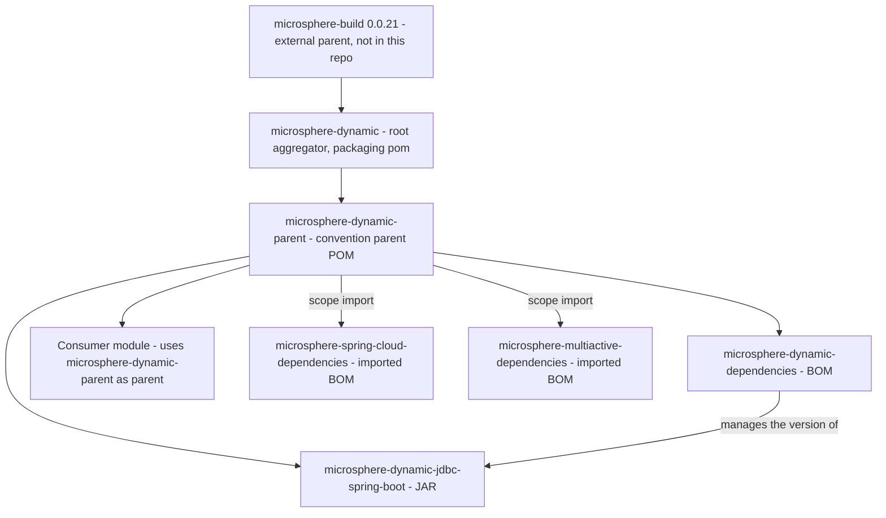

# microsphere-dynamic-parent

[中文](zh/microsphere-dynamic-parent.md)

> **Documentation line: `current`.**
> This repository has no `release` or `release-1.x` branch yet; the `current` documentation line is generated from `main` (revision `0.0.1-SNAPSHOT`).

`microsphere-dynamic-parent` is the **convention parent POM** of the `microsphere-dynamic` project. It is a
`pom`-packaged artifact that publishes no classes and contains no modules: its only job is to tell Maven
*which versions of the third-party libraries this project line is built and tested against*, and to hand that
answer to every module below it — and to you.

If you maintain an application that uses the dynamic JDBC stack, consuming this artifact means you write
`<dependency>` entries **without** `<version>` and let the managed versions below decide them for you.

---

## 1. Maven coordinates

| Coordinate | Value | Notes |
| --- | --- | --- |
| `groupId` | `io.github.microsphere-projects` | Declared in `microsphere-dynamic-parent/pom.xml` |
| `artifactId` | `microsphere-dynamic-parent` | |
| `version` | `${revision}` — default `0.0.1-SNAPSHOT` | `revision` is defined in the **root** POM `pom.xml`, not here |
| `packaging` | `pom` | Parent-only POM: no `<modules>`, no `<build>`, no sources |
| Name | `Microsphere :: Dynamic :: Parent` | |
| Source file | `microsphere-dynamic-parent/pom.xml` | |
| License | Apache License, Version 2.0 | Inherited from the root POM |

Its own parent, verbatim from the source file, is the root aggregator of this repository:

```xml
<parent>
    <groupId>io.github.microsphere-projects</groupId>
    <artifactId>microsphere-dynamic</artifactId>
    <version>${revision}</version>
    <relativePath>../pom.xml</relativePath>
</parent>
```

So the full inheritance chain of this artifact is:

`io.github.microsphere-projects:microsphere-dynamic-parent` → `io.github.microsphere-projects:microsphere-dynamic`
(root aggregator) → `io.github.microsphere-projects:microsphere-build:0.0.21` (**external**, not in this repository).

---

## 2. Where this artifact sits in the build and consumption graph



Reading the diagram: the three reactor modules (`microsphere-dynamic-parent`, `microsphere-dynamic-dependencies`,
`microsphere-dynamic-jdbc-spring-boot`) are all *children* of this parent, and an external consumer plugs in at the
`Consumer module` node, inheriting the same managed versions the project itself uses.

---

## 3. How to consume it

### 3.1 As a `<parent>` (the primary, recommended usage)

Declaring this POM as your parent gives you **both** its `dependencyManagement` and the build conventions inherited
from the chain above it (`microsphere-build`).

```xml
<project xmlns="http://maven.apache.org/POM/4.0.0">
    <modelVersion>4.0.0</modelVersion>

    <parent>
        <groupId>io.github.microsphere-projects</groupId>
        <artifactId>microsphere-dynamic-parent</artifactId>
        <version>0.0.1-SNAPSHOT</version>
        <relativePath/> <!-- lookup parent from repository -->
    </parent>

    <groupId>com.example</groupId>
    <artifactId>my-dynamic-jdbc-app</artifactId>
    <version>1.0.0</version>

    <dependencies>
        <!-- No <version>: supplied by microsphere-dynamic-parent -->
        <dependency>
            <groupId>org.apache.shardingsphere</groupId>
            <artifactId>shardingsphere-jdbc-core-spring-boot-starter</artifactId>
        </dependency>
        <dependency>
            <groupId>org.mybatis.spring.boot</groupId>
            <artifactId>mybatis-spring-boot-starter</artifactId>
        </dependency>
    </dependencies>
</project>
```

The empty `<relativePath/>` element is deliberate: it tells Maven *not* to look for a POM on disk relative to your
project directory and to resolve the parent from the repository instead. Omitting it is a common cause of
"parent not found" failures in unrelated project layouts.

Because this artifact's own version is `${revision}` (`0.0.1-SNAPSHOT` by default), resolving a snapshot from
Maven Central alone will not work: the published POMs of this repository do not carry a `<repositories>` section,
so you must declare the snapshot repository yourself:

```xml
<repositories>
    <repository>
        <id>snapshot</id>
        <url>https://s01.oss.sonatype.org/content/repositories/snapshots</url>
        <snapshots><enabled>true</enabled></snapshots>
        <releases><enabled>false</enabled></releases>
    </repository>
</repositories>
```

### 3.2 As an imported BOM in `<dependencyManagement>`

You can also pull only the *version management* without adopting the parent chain:

```xml
<project xmlns="http://maven.apache.org/POM/4.0.0">
    <modelVersion>4.0.0</modelVersion>

    <groupId>com.example</groupId>
    <artifactId>my-service</artifactId>
    <version>1.0.0</version>

    <dependencyManagement>
        <dependencies>
            <dependency>
                <groupId>io.github.microsphere-projects</groupId>
                <artifactId>microsphere-dynamic-parent</artifactId>
                <version>0.0.1-SNAPSHOT</version>
                <type>pom</type>
                <scope>import</scope>
            </dependency>
        </dependencies>
    </dependencyManagement>
</project>
```

`<type>pom</type>` and `<scope>import</scope>` must appear **together**; see the FAQ below. The two nested BOMs
declared with `import` scope inside this POM (`microsphere-spring-cloud-dependencies`,
`microsphere-multiactive-dependencies`) are processed transitively as part of resolving its effective
`dependencyManagement`; confirm the result for your own project with `mvn help:effective-pom`.

**Parent versus import — what you gain and lose:**

| If you consume it… | Managed versions | JDK/compiler baseline | Plugin configuration | Your own `<parent>` stays free |
| --- | --- | --- | --- | --- |
| …as `<parent>` | Yes | Yes | Yes | No — occupied |
| …as imported BOM | Yes | **No** | **No** | Yes |

The JDK baseline is not a trivial detail: `microsphere-dynamic-parent` does **not** declare a Java level itself.
`<java.version>8</java.version>` and `maven.compiler.source`/`maven.compiler.target` come from the external
`microsphere-build:0.0.21` POM — they are inherited through the chain and are **not** declared anywhere in this
repository. Importing the BOM skips that inheritance, which is exactly why `spring-boot-dependencies`-style BOMs
usually still accompany a parent.

### 3.3 Together with the sibling BOM

`microsphere-dynamic-parent` does **not** manage the version of `microsphere-dynamic-jdbc-spring-boot` — that is the
job of [`microsphere-dynamic-dependencies`](microsphere-dynamic-dependencies.md). Combine the two:

```xml
<parent>
    <groupId>io.github.microsphere-projects</groupId>
    <artifactId>microsphere-dynamic-parent</artifactId>
    <version>0.0.1-SNAPSHOT</version>
    <relativePath/>
</parent>

<dependencyManagement>
    <dependencies>
        <dependency>
            <groupId>io.github.microsphere-projects</groupId>
            <artifactId>microsphere-dynamic-dependencies</artifactId>
            <version>0.0.1-SNAPSHOT</version>
            <type>pom</type>
            <scope>import</scope>
        </dependency>
    </dependencies>
</dependencyManagement>
```

---

## 4. Managed properties

All properties declared in `microsphere-dynamic-parent/pom.xml`, with their values exactly as written in the POM:

| Property | Value in the POM | Resolves to | Purpose |
| --- | --- | --- | --- |
| `microsphere-spring-cloud.version` | `${revision}` | `0.0.1-SNAPSHOT` by default; `0.0.1` in CI | Version of the imported `microsphere-spring-cloud-dependencies` BOM |
| `microsphere-multiactive.version` | `${revision}` | `0.0.1-SNAPSHOT` by default; `0.0.1` in CI | Version of the imported `microsphere-multiactive-dependencies` BOM |
| `mysql-connector-java.version` | `8.0.28` | `8.0.28` | MySQL JDBC driver |
| `mybatis.version` | `3.5.15` | `3.5.15` | MyBatis core |
| `mybatis-starter.version` | `2.3.1` | `2.3.1` | `mybatis-spring-boot-starter` |
| `mybatis-plus.version` | `3.3.0` | `3.3.0` | MyBatis-Plus starter |
| `shardingsphere.version` | `5.1.1` | `5.1.1` | ShardingSphere JDBC starter |
| `mariadb4j.version` | `2.5.3` | `2.5.3` | Embedded MariaDB, used in tests |

Two properties are **not** declared here but still apply to you as a parent consumer: `revision` (defined in the
root POM as `0.0.1-SNAPSHOT`) and `java.version` (defined by the external `microsphere-build:0.0.21`). Overriding a
property in your own `<properties>` section is the supported way to move a single library off the managed version,
because every managed entry below is expressed through these properties.

---

## 5. Managed dependencies

The complete `<dependencyManagement>` of `microsphere-dynamic-parent/pom.xml` — nine entries, in declaration order:

| # | `groupId` | `artifactId` | Managed version | Kind |
| --- | --- | --- | --- | --- |
| 1 | `io.github.microsphere-projects` | `microsphere-spring-cloud-dependencies` | `${microsphere-spring-cloud.version}` → `${revision}` | BOM import, `<type>pom</type> <scope>import</scope>` |
| 2 | `io.github.microsphere-projects` | `microsphere-multiactive-dependencies` | `${microsphere-multiactive.version}` → `${revision}` | BOM import, `<type>pom</type> <scope>import</scope>` |
| 3 | `mysql` | `mysql-connector-java` | `${mysql-connector-java.version}` → `8.0.28` | Direct management |
| 4 | `org.mybatis.spring.boot` | `mybatis-spring-boot-starter` | `${mybatis-starter.version}` → `2.3.1` | Direct management |
| 5 | `org.mybatis` | `mybatis` | `${mybatis.version}` → `3.5.15` | Direct management |
| 6 | `com.baomidou` | `mybatis-plus-boot-starter` | `${mybatis-plus.version}` → `3.3.0` | Direct management |
| 7 | `org.apache.shardingsphere` | `shardingsphere-jdbc-core-spring-boot-starter` | `${shardingsphere.version}` → `5.1.1` | Direct management |
| 8 | `ch.vorburger.mariaDB4j` | `mariaDB4j` | `${mariadb4j.version}` → `2.5.3` | Direct management |
| 9 | `ch.vorburger.mariaDB4j` | `mariaDB4j-springboot` | `${mariadb4j.version}` → `2.5.3` | Direct management |

Entries 1 and 2 are what bring the Spring Boot / Spring Cloud version lines into scope; entries 3–9 are declared
directly in this repository. Nothing here adds a dependency to your project — management only supplies versions.

---

## 6. Version information

### 6.1 The `${revision}` scheme

| Item | Value | Where it is declared |
| --- | --- | --- |
| CI-friendly placeholder property | `revision` | `pom.xml` (root aggregator) |
| Default value | `0.0.1-SNAPSHOT` | `pom.xml` (root aggregator) |
| Version used by this artifact | `${revision}` | `microsphere-dynamic-parent/pom.xml` |
| Version used by CI | `-Drevision=0.0.1` | `.github/workflows/maven.yml` |
| Maven version pinned by the wrapper | `3.9.0` | `.mvn/wrapper/maven-wrapper.properties` |

Every module — including this parent — declares `<version>${revision}</version>`. One property therefore drives the
whole reactor: bump `-Drevision`, and the aggregator, the parent, the BOM and the JAR all move together. CI-friendly
placeholders of this kind require Maven 3.5 or newer; the repository pins 3.9.0 through the Maven wrapper.

`microsphere-spring-cloud.version` and `microsphere-multiactive.version` are also set to `${revision}`, so the
*external* BOM coordinates are tied to this project's version number — see the FAQ.

### 6.2 Continuous integration

`.github/workflows/maven.yml` runs on `ubuntu-latest`, triggered by pushes to and pull requests against `main`,
with a single-entry JDK matrix (`'8'`, Temurin) and this command:

```
mvn --batch-mode --update-snapshots --file pom.xml -Drevision=0.0.1 clean install
```

CI builds `0.0.1` (a release-shaped version, no `-SNAPSHOT` suffix) while a plain local `mvn install` produces
`0.0.1-SNAPSHOT`. CI only runs `install`, not `deploy`.

### 6.3 Where the artifacts are published

`<distributionManagement>` is declared in the **root POM of this repository** (`pom.xml`), server id `ossrh`:

| Artifact type | Target repository |
| --- | --- |
| `*-SNAPSHOT` | `https://s01.oss.sonatype.org/content/repositories/snapshots` |
| Releases | `https://s01.oss.sonatype.org/service/local/staging/deploy/maven2/` |

The same snapshot URL is also declared in the root `<repositories>` section for resolution during this project's own
build. The parent chain additionally references the external `microsphere-build:0.0.21` POM, which is not part of
this repository.

> **Release branch note.** This repository has no `release` or `release-1.x` branch yet; the `current` documentation
> line is generated from `main` (revision `0.0.1-SNAPSHOT`). No released tag exists either (`git tag` is empty), so
> `0.0.1-SNAPSHOT` is the version you will resolve in practice.

---

## 7. Version compatibility

| Aspect | Version | Provenance |
| --- | --- | --- |
| JDK / bytecode baseline | `8` | **Inherited from `microsphere-build` 0.0.21** — an external POM, not declared in this repository |
| Spring Boot | `2.7.18` | **External, inherited**: pinned by `microsphere-spring-cloud-parent` 0.0.1, reached through the `microsphere-spring-cloud-dependencies` BOM import. Not a promise made by this repository |
| Spring Cloud | `2021.0.8` | **External, inherited**: same BOM chain as Spring Boot |
| `mysql-connector-java` | `8.0.28` | **Declared here** — `microsphere-dynamic-parent/pom.xml` |
| `shardingsphere-jdbc-core-spring-boot-starter` | `5.1.1` | **Declared here** |
| `mybatis` | `3.5.15` | **Declared here** |
| `mybatis-spring-boot-starter` | `2.3.1` | **Declared here** |
| `mybatis-plus-boot-starter` | `3.3.0` | **Declared here** |
| `mariaDB4j`, `mariaDB4j-springboot` | `2.5.3` | **Declared here** — test scope in this project |
| `microsphere-spring-cloud-dependencies` | `${revision}` | Imported BOM declared here, content external |
| `microsphere-multiactive-dependencies` | `${revision}` | Imported BOM declared here, content external |
| `microsphere-dynamic-jdbc-spring-boot` | `${revision}` | Managed by the sibling BOM, **not** by this parent |

The Spring Boot row deserves emphasis: if you inherit this parent, you are implicitly pinned to the Spring Boot line
that `microsphere-spring-cloud-dependencies` selects. That line currently resolves to 2.7.18 through the external
artifact, and this repository neither declares nor controls it. If you need a different Spring Boot generation, you
cannot get it by overriding a property in this POM — the version lives in the imported external BOM.

---

## 8. FAQ and pitfalls

**Q. Why does my build fail with `'version' must be a constant value` or an unresolvable `${revision}`?**
Because every POM here uses the CI-friendly `${revision}` placeholder. Maven only substitutes it if `revision` has a
value: define it with `-Drevision=...` (as CI does with `0.0.1`), or rely on the default `0.0.1-SNAPSHOT` declared in
the root POM — which requires the root POM `microsphere-dynamic:${revision}` to be resolvable, because
`microsphere-dynamic-parent` points at it through `<relativePath>../pom.xml</relativePath>`. When building this
repository itself, use `./mvnw` and run from the root so the relative paths line up.

**Q. What actually gets published — my POM or a flattened one?**
A flattened one. The `flatten-maven-plugin` configuration — mode `resolveCiFriendliesOnly`, plugin version 1.6.0,
`updatePomFile=true` — comes from the external `microsphere-build:0.0.21` POM and is not configured in this
repository. That mode substitutes CI-friendly properties in the project and parent `<version>` fields, and leaves the
rest of the model largely intact. Two observable consequences in the installed POMs: properties are kept as written
(so a stray `${revision}` can survive inside `dependencyManagement`), and `<repositories>` plus
`<distributionManagement>` are removed from the published POM. `.flattened-pom.xml` files are generated build output
listed in `.gitignore`; never treat a stale copy as the source of truth.

**Q. Since the published POM drops `<repositories>`, how do I get snapshots?**
Declare the Sonatype OSSRH snapshot repository in your own POM or settings, as shown in section 3.1. Inheriting this
parent does not hand it to you.

**Q. `<scope>import</scope>` without `<type>pom</type>` — what happens?**
It does not work. `import` scope is only meaningful for `dependencyManagement` entries whose artifact is a POM; if
you leave `type` at its default `jar`, Maven resolves a non-existent JAR and the managed versions never appear. The
POM itself writes both elements on every BOM import (see entries 1 and 2 above) — copy that shape exactly.
Also note `import` is only valid inside `<dependencyManagement>`, never inside plain `<dependencies>`.

**Q. Can I override just one managed library?**
Yes — override the property, not the dependency:
`<properties><shardingsphere.version>5.4.1</shardingsphere.version></properties>`. Every managed entry here is
expressed through a property, so the override propagates. If you pin `<version>` directly on your `<dependency>`,
your explicit version wins over management, but you lose the single source of truth and can drift from what this
project was tested with.

**Q. Why is `microsphere-dynamic-jdbc-spring-boot` unmanaged when I inherit this parent?**
By design: the parent manages *third-party* libraries; the project's own module is managed by
[`microsphere-dynamic-dependencies`](microsphere-dynamic-dependencies.md), which manages exactly that one member.
Either import that BOM as in section 3.3 or state the version explicitly.

**Q. What does `-Drevision=0.0.1` in CI imply for the external BOMs?**
`microsphere-spring-cloud.version` and `microsphere-multiactive.version` both default to `${revision}`, so the same
`-Drevision` value selects `microsphere-spring-cloud-dependencies:0.0.1` and
`microsphere-multiactive-dependencies:0.0.1` as well. Passing a revision for which those external artifacts are not
published fails dependency resolution, not compilation. Decouple them with
`-Dmicrosphere-spring-cloud.version=...` / `-Dmicrosphere-multiactive.version=...` if you need to.

**Q. Does inheriting this parent add anything to my classpath?**
No. Packaging `pom`, zero `<dependencies>` of its own — it only supplies management and inherited configuration.

---

## 9. Related documents

- [microsphere-dynamic-dependencies](microsphere-dynamic-dependencies.md) — the sibling BOM
- [microsphere-dynamic-jdbc-spring-boot](microsphere-dynamic-jdbc-spring-boot.md) — the JAR module built on this parent
- [User guide index](README.md)
- [Repository README](../../../README.md)

## 中文

- [中文文档：microsphere-dynamic-parent](zh/microsphere-dynamic-parent.md)
