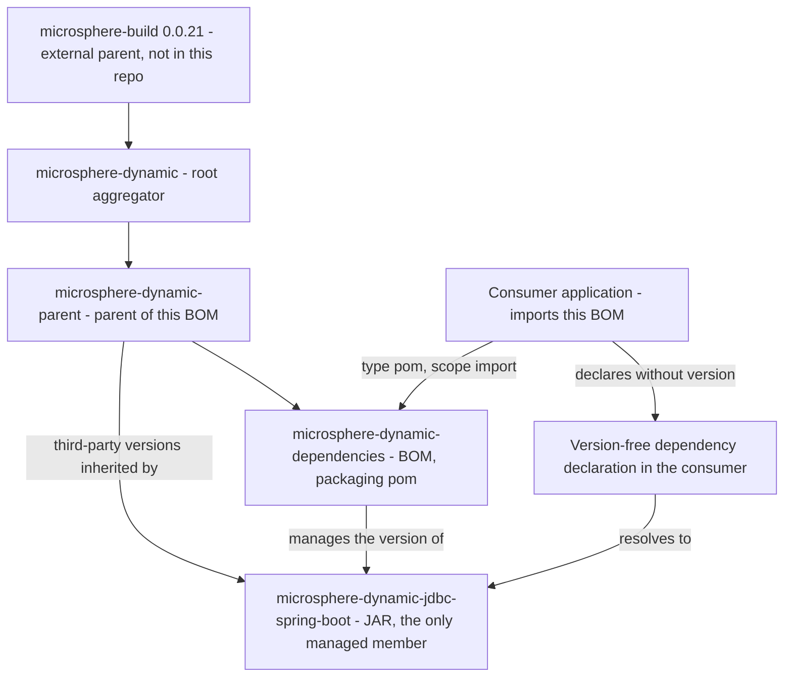

# microsphere-dynamic-dependencies

[English](../microsphere-dynamic-dependencies.md)

> **文档线：`current`。**
> 本仓库目前没有 `release` 或 `release-1.x` 分支；`current` 文档线由 `main` 分支生成（revision 为 `0.0.1-SNAPSHOT`）。

`microsphere-dynamic-dependencies` 是 `microsphere-dynamic` 项目的 **BOM（物料清单）**：一个 `pom` 打包类型的构件，
它的 `<dependencyManagement>` 列出了本项目*自己*的 module 及其版本，从而让消费者在引入这些 module 时既不写版本号、
又能保证彼此之间始终配套。

今天它只管理**一个**成员：`microsphere-dynamic-jdbc-spring-boot`。消费者可能需要的其他一切
（MySQL 驱动、MyBatis、ShardingSphere 等）都由它的父 POM
[`microsphere-dynamic-parent`](../microsphere-dynamic-parent.md) 负责管理。

---

## 1. Maven 坐标

| 坐标项 | 取值 | 说明 |
| --- | --- | --- |
| `groupId` | `io.github.microsphere-projects` | 声明于 `microsphere-dynamic-dependencies/pom.xml` |
| `artifactId` | `microsphere-dynamic-dependencies` | |
| `version` | `${revision}`——默认 `0.0.1-SNAPSHOT` | `revision` 定义在**根** POM `pom.xml` 中 |
| `packaging` | `pom` | BOM：没有 `<modules>`、`<build>`、`<properties>`，也没有源码 |
| Name | `Microsphere :: Dynamic :: Dependencies` | |
| 源文件 | `microsphere-dynamic-dependencies/pom.xml` | |
| 许可证 | Apache License, Version 2.0 | 从根 POM 继承 |

源文件中它对父 POM 的声明逐字如下——注意它的父级是约定式父 POM，而不是根聚合 POM：

```xml
<parent>
    <groupId>io.github.microsphere-projects</groupId>
    <artifactId>microsphere-dynamic-parent</artifactId>
    <version>${revision}</version>
    <relativePath>../microsphere-dynamic-parent/pom.xml</relativePath>
</parent>
```

这一个选择就是本构件最关键的特征：因为它继承自 `microsphere-dynamic-parent`，而后者继承自根聚合 POM，
根聚合 POM 又继承自外部的 `microsphere-build:0.0.21`，所以这个 BOM 呈现的是本项目受管世界的*完整*视图——
而不仅仅是它自己那一个 module。

---

## 2. 本构件在构建与消费图谱中的位置



读图要点：BOM 位于父 POM（提供全部第三方受管版本）与消费者（只写构件名）之间。
在 `LIB` 节点新增一个依赖，正因为只这一条受管记录，它才会在 `JDBC` 节点解析成具体构件。

---

## 3. 如何消费

### 3.1 作为 `<dependencyManagement>` 中导入的 BOM（主要用法）

```xml
<project xmlns="http://maven.apache.org/POM/4.0.0">
    <modelVersion>4.0.0</modelVersion>

    <groupId>com.example</groupId>
    <artifactId>my-dynamic-jdbc-app</artifactId>
    <version>1.0.0</version>

    <dependencyManagement>
        <dependencies>
            <dependency>
                <groupId>io.github.microsphere-projects</groupId>
                <artifactId>microsphere-dynamic-dependencies</artifactId>
                <version>0.0.1-SNAPSHOT</version>
                <type>pom</type>
                <scope>import</scope>
            </dependency>
        </dependencies>
    </dependencyManagement>

    <dependencies>
        <!-- Version comes from the imported BOM -->
        <dependency>
            <groupId>io.github.microsphere-projects</groupId>
            <artifactId>microsphere-dynamic-jdbc-spring-boot</artifactId>
        </dependency>
    </dependencies>
</project>
```

`<type>pom</type>` 与 `<scope>import</scope>` 两者都不可省略，且必须写在 `<dependencyManagement>` 之内。
导入 BOM 永远不会往你的项目里添加依赖：它只是让版本可以被取用，所以上面的 `<dependencies>` 段仍然必须自己点名构件。

由于默认版本是 snapshot，而本仓库发布的 POM 不带 `<repositories>` 段（外部 `microsphere-build` POM 中的 flatten
配置把它移除了），要解析 `0.0.1-SNAPSHOT` 就必须由你自己声明快照仓库：

```xml
<repositories>
    <repository>
        <id>snapshot</id>
        <url>https://s01.oss.sonatype.org/content/repositories/snapshots</url>
        <snapshots><enabled>true</enabled></snapshots>
        <releases><enabled>false</enabled></releases>
    </repository>
</repositories>
```

### 3.2 作为 `<parent>` 使用

BOM 也可以被当作父 POM 来用，这样一来你还会连带拿到它继承来的 `dependencyManagement`。这条路走得通，但会占用你
唯一的 `<parent>` 位置，并把整条链一并拖进来（`microsphere-dynamic-parent` → `microsphere-dynamic` → 外部
`microsphere-build:0.0.21`，JDK 8 基线正是从那里来的）：

```xml
<parent>
    <groupId>io.github.microsphere-projects</groupId>
    <artifactId>microsphere-dynamic-dependencies</artifactId>
    <version>0.0.1-SNAPSHOT</version>
    <relativePath/> <!-- lookup parent from repository -->
</parent>

<groupId>com.example</groupId>
<artifactId>my-internal-bom</artifactId>
<version>1.0.0</version>
<packaging>pom</packaging>
```

只有当你要在本项目之上搭建组织级 BOM 时才建议这么做。对于普通的应用 module，请按 3.1 节导入它，
把 `<parent>` 留给你自己的约定，或者留给 `spring-boot-starter-parent`。

### 3.3 推荐的搭配方式

BOM 与父 POM 是互补的，本仓库自身的 module 就是这种分工的示范：父 POM 提供第三方版本与构建约定，
BOM 提供项目自身 module 的版本。

| 你消费的对象 | 你得到 | 你**不会**得到 |
| --- | --- | --- |
| 把 `microsphere-dynamic-parent` 作为 `<parent>` | 第三方受管版本、继承来的构建配置 | 受管的 `microsphere-dynamic-jdbc-spring-boot` 版本 |
| 把 `microsphere-dynamic-dependencies` 作为导入 BOM | 受管的 `microsphere-dynamic-jdbc-spring-boot` 版本，以及经由其父级链可达的第三方受管版本 | 构建配置、插件版本、JDK 8 基线 |

---

## 4. 完整的受管依赖清单

本 BOM 自身的 `<dependencyManagement>` 只有一条，逐字如下：

| `groupId` | `artifactId` | 受管版本 | 打包类型 | 说明 |
| --- | --- | --- | --- | --- |
| `io.github.microsphere-projects` | `microsphere-dynamic-jdbc-spring-boot` | `${revision}` | `jar` | 本 BOM 声明的唯一成员 |

这个 POM 里没有 `<properties>`：`${revision}` 定义在仓库的根 POM 中（默认 `0.0.1-SNAPSHOT`），
经由父级链传递到这里。

### 通过父级链一并到达的版本

`microsphere-dynamic-dependencies` 继承了 `microsphere-dynamic-parent` 的九条 `dependencyManagement` 记录。
列出它们是为了让这个 BOM 实际覆盖的范围一目了然，但它们**并非声明在本 POM 中**——权威表格见
[`microsphere-dynamic-parent`](../microsphere-dynamic-parent.md)：

| `groupId` | `artifactId` | 受管版本 | 来源 |
| --- | --- | --- | --- |
| `io.github.microsphere-projects` | `microsphere-spring-cloud-dependencies` | `${microsphere-spring-cloud.version}` → `${revision}` | 由父级继承，BOM 导入 |
| `io.github.microsphere-projects` | `microsphere-multiactive-dependencies` | `${microsphere-multiactive.version}` → `${revision}` | 由父级继承，BOM 导入 |
| `mysql` | `mysql-connector-java` | `8.0.28` | 由父级继承，本仓库声明 |
| `org.mybatis.spring.boot` | `mybatis-spring-boot-starter` | `2.3.1` | 由父级继承，本仓库声明 |
| `org.mybatis` | `mybatis` | `3.5.15` | 由父级继承，本仓库声明 |
| `com.baomidou` | `mybatis-plus-boot-starter` | `3.3.0` | 由父级继承，本仓库声明 |
| `org.apache.shardingsphere` | `shardingsphere-jdbc-core-spring-boot-starter` | `5.1.1` | 由父级继承，本仓库声明 |
| `ch.vorburger.mariaDB4j` | `mariaDB4j` | `2.5.3` | 由父级继承，本仓库声明 |
| `ch.vorburger.mariaDB4j` | `mariaDB4j-springboot` | `2.5.3` | 由父级继承，本仓库声明 |

某一条受管记录是否真的到达*你的*项目，取决于 Maven 是否把被导入的 POM 连同其父级链作为一个完整模型来解析。
请以自己的项目为准验证，而不是轻信上表：`mvn help:effective-pom` 加 `mvn dependency:tree` 就够了。

---

## 5. 版本信息

| 条目 | 取值 | 声明位置 |
| --- | --- | --- |
| CI 友好占位符属性 | `revision` | `pom.xml`（根聚合 POM） |
| 默认值 | `0.0.1-SNAPSHOT` | `pom.xml`（根聚合 POM） |
| 本 BOM 的版本 | `${revision}` | `microsphere-dynamic-dependencies/pom.xml` |
| 受管成员的版本 | `${revision}` | 同一个占位符——BOM 与它的成员永远同步升降 |
| CI 使用的版本 | `-Drevision=0.0.1` | `.github/workflows/maven.yml` |
| Wrapper 固定的 Maven 版本 | `3.9.0` | `.mvn/wrapper/maven-wrapper.properties` |

由于 BOM 与它管理的成员都使用 `${revision}`，在同一次 reactor 构建内二者的配套关系是有保证的：
不可能从本仓库发布出一个管理着 `0.0.1` module 的 `0.0.2` BOM。

**持续集成。** `.github/workflows/maven.yml` 运行于 `ubuntu-latest`，针对 `main` 分支，JDK 为 `8`
（Temurin，矩阵只有一个条目），命令是
`mvn --batch-mode --update-snapshots --file pom.xml -Drevision=0.0.1 clean install`。CI 构建 `0.0.1`；
普通的本地 `mvn install` 产出 `0.0.1-SNAPSHOT`。只执行 `install`，不执行 `deploy`。

**发布。** `<distributionManagement>` 位于本仓库的根 POM，server id 为 `ossrh`：

| 构件类型 | 目标仓库 |
| --- | --- |
| `*-SNAPSHOT` | `https://s01.oss.sonatype.org/content/repositories/snapshots` |
| 正式版 | `https://s01.oss.sonatype.org/service/local/staging/deploy/maven2/` |

就本 BOM 而言，这意味着仓库中必须成对存在这些构件：BOM 自身的 POM，以及其父级链的 POM
（`microsphere-dynamic-parent`、`microsphere-dynamic`），因为发布出去的 BOM 保留了 `<parent>` 引用，
而 `${revision}` 只在根 POM 中有定义。

> **关于发布分支。** 本仓库目前没有 `release` 或 `release-1.x` 分支；`current` 文档线由 `main` 分支生成
> （revision 为 `0.0.1-SNAPSHOT`）。`git tag` 为空，也就是说这个 BOM 还没有正式发布版本；你能解析到的就是
> `0.0.1-SNAPSHOT`。

---

## 6. 版本兼容性

本 BOM 自己并不声明任何第三方版本，所以它的兼容性面就是“经由继承可达的版本”加上“它管理的那一个 module”：

| 维度 | 版本 | 来源说明 |
| --- | --- | --- |
| 把本 BOM 作为父 POM 时的 JDK / 字节码基线 | `8` | **继承自 `microsphere-build` 0.0.21**——外部 POM，本仓库并未声明；BOM 导入不会传递它 |
| Spring Boot | `2.7.18` | **外部、继承而来**：通过 `microsphere-spring-cloud-dependencies` 导入到达（由 `microsphere-spring-cloud-parent` 0.0.1 固定）。这不是本仓库做出的承诺 |
| Spring Cloud | `2021.0.8` | **外部、继承而来**：与 Spring Boot 同一条链 |
| `microsphere-dynamic-jdbc-spring-boot` | `${revision}`（默认 `0.0.1-SNAPSHOT`） | **本 BOM 中声明**——它唯一管理的成员 |
| `mysql-connector-java` | `8.0.28` | 由 `microsphere-dynamic-parent` 继承而来，本仓库声明 |
| `shardingsphere-jdbc-core-spring-boot-starter` | `5.1.1` | 由 `microsphere-dynamic-parent` 继承而来，本仓库声明 |
| `mybatis` | `3.5.15` | 由 `microsphere-dynamic-parent` 继承而来，本仓库声明 |
| `mybatis-spring-boot-starter` | `2.3.1` | 由 `microsphere-dynamic-parent` 继承而来，本仓库声明 |
| `mybatis-plus-boot-starter` | `3.3.0` | 由 `microsphere-dynamic-parent` 继承而来，本仓库声明 |
| `mariaDB4j`、`mariaDB4j-springboot` | `2.5.3` | 由 `microsphere-dynamic-parent` 继承而来，本仓库声明；本项目中为 test 作用域 |

---

## 7. 常见问题与坑

**问：构建报 `Could not find artifact io.github.microsphere-projects:microsphere-dynamic-dependencies:pom:0.0.1-SNAPSHOT`。**
这正是 `current` 文档线的必然结果：`main` 上带的是 `0.0.1-SNAPSHOT`，且不存在发布分支或 tag。snapshot 发布到
Sonatype OSSRH 快照仓库，而发布的 POM 中并*没有*声明该仓库，所以请按 3.1 节自己补上 `<repositories>` 段。

**问：我导入了 BOM，Maven 却还是要求我给 `microsphere-dynamic-jdbc-spring-boot` 写版本号。**
检查三件事：导入是否写在 `<dependencyManagement>` 里（不是 `<dependencies>`）、
`<type>pom</type>` 与 `<scope>import</scope>` 是否都在、你依赖的 `groupId`/`artifactId` 是否与受管条目完全一致。
缺少 `type`/`scope` 时，Maven 会把这条目当成普通的 JAR 依赖，版本管理根本不会发生。

**问：已安装的 BOM POM 里 `${revision}` 仍然是字面量，这是 bug 吗？**
这是本项目构建过程中可以观察到的、与该插件模式相符的行为。发布的 POM 由 `flatten-maven-plugin` 生成
（版本 1.6.0、模式 `resolveCiFriendliesOnly`、`updatePomFile=true`），这些配置全部来自**外部**的
`microsphere-build:0.0.21` POM，本仓库并未配置。该模式会重写项目自身 `<version>` 及其 `<parent>` 版本中的 CI 友好
占位符，却不处理 `dependencyManagement` 里的 `${revision}`——随后 Maven 把 BOM 与其父级链一起读取时，由根 POM 中定义的
`<revision>0.0.1-SNAPSHOT</revision>` 把它解析出来。实践上的结论是：**不要**把发布的 BOM POM 拷进你自己的项目并指望
`${revision}` 依然可用；要么保证父级链可解析，要么自己写死具体版本。

**问：发布的 BOM POM 里还留着 `<relativePath>`，需要担心吗？**
扁平化后的 POM 保留了父级的 `<relativePath>../microsphere-dynamic-parent/pom.xml</relativePath>`。当 Maven
从仓库解析该构件时，磁盘上并不存在的相对路径会被忽略，转而使用仓库。只有当那个路径相对于你的项目恰好真有一个 POM 时才会踩坑——
Maven 会去读那个本地文件而不是发布版本。把本项目的任何 POM 用作你自己的父级时，请写 `<relativePath/>`。

**问：这个 BOM 会替我管理 Spring Boot 或 MyBatis 的版本吗？**
只是间接地。它自己什么都没声明；第三方版本来自 [`microsphere-dynamic-parent`](../microsphere-dynamic-parent.md)，
而 Spring Boot / Spring Cloud 版本线来自 `microsphere-spring-cloud-dependencies` 的导入，那部分位于本仓库之外。
请在自己的项目里执行 `mvn help:effective-pom`，看看你的 `dependencyManagement` 里到底落进了什么。

**问：两个 BOM 管理同一个构件，谁的版本生效？**
在*多个被导入的 BOM 之间*，Maven 采用“先声明者优先”；而你自己项目里的 `dependencyManagement` 条目总是压过导入进来的。
所以如果你同时导入 `microsphere-dynamic-dependencies` 和，比如 `spring-boot-dependencies`，那么
`<dependencyManagement>` 段中的书写顺序就决定了结果。对你在意的项，请显式钉死版本，不要依赖顺序。

**问：`revision` 是从哪来的？不装 Maven 能不能构建本仓库？**
`revision` 只是一个普通的 Maven 属性——Maven 3.5+ 才认这个 CI 友好占位符。仓库通过
`.mvn/wrapper/maven-wrapper.properties` 固定 Maven `3.9.0`，所以 `./mvnw` 无需预装 Maven 即可工作。自行构建 reactor 时，
请从根目录执行以保证每个 `<relativePath>` 都能解析：`./mvnw --batch-mode -Drevision=0.0.1 clean install`。

**问：如果我给本项目再加一个 module，它会被自动纳入管理吗？**
不会。`microsphere-dynamic-dependencies` 是手工列出成员的——目前只有
`microsphere-dynamic-jdbc-spring-boot` 这一条。新增 module 必须显式加进那个 `<dependencyManagement>`。

---

## 8. 相关文档

- [microsphere-dynamic-parent](../microsphere-dynamic-parent.md) —— 第三方版本在这里管理
- [microsphere-dynamic-jdbc-spring-boot](../microsphere-dynamic-jdbc-spring-boot.md) —— 本 BOM 管理的 JAR
- [用户指南目录](../README.md)
- [仓库 README](../../../../README.md)

## English

- [English: microsphere-dynamic-dependencies](../microsphere-dynamic-dependencies.md)
