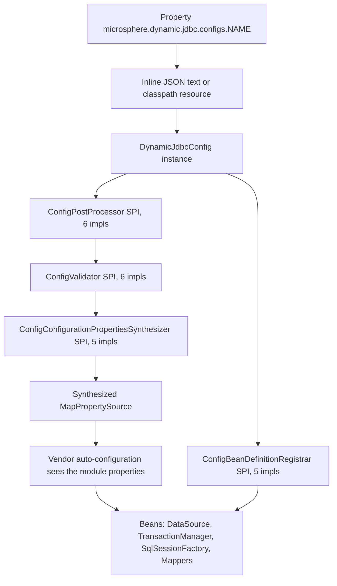
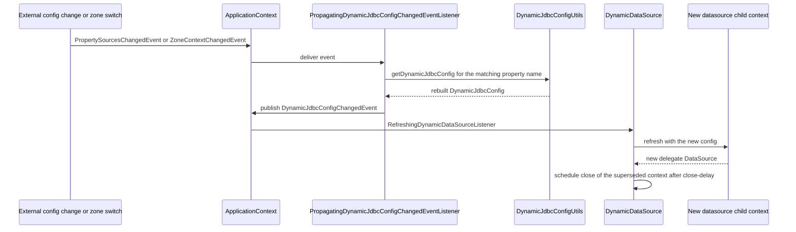

# microsphere-dynamic-jdbc-spring-boot

[English](../microsphere-dynamic-jdbc-spring-boot.md)

> **文档线：`current`。**
> 本仓库目前没有 `release` 或 `release-1.x` 分支；`current` 文档线由 `main` 分支生成（revision 为 `0.0.1-SNAPSHOT`）。

`microsphere-dynamic-jdbc-spring-boot` 是本仓库唯一的代码模块，也是它唯一产出的 JAR。它让一个 Spring Boot 应用把**自己的 JDBC
拓扑表达为数据**——一个或多个具名配置块，每个块包含数据源列表、事务管理器、ShardingSphere 规则以及 MyBatis / MyBatis-Plus 的
Mapper 扫描——然后在运行期把这些拓扑构建为 Spring `ApplicationContext` Bean，并在配置发生变化时**无需重启即可重建**。

源码根目录为
`microsphere-dynamic-jdbc-spring-boot/src/main/java/io/microsphere/dynamic/jdbc/spring/boot/`，包含 **81 个顶层类**，分布在
`autoconfigure`、`config`（以及 `annotation`、`validation`）、`constants`、`context`（以及 `error`）、`datasource`（以及
`config`、`env`、`validation`、`constants`）、`env`、`mybatis`、`mybatisplus`、`shardingsphere`、`transaction`、`util` 包中。

---

## 1. 概览

### 1.1 它解决什么问题

普通的 Spring Boot 只会把一个 `spring.datasource` 装配成一个 `DataSource`、一个 `SqlSessionFactory`、一个
`PlatformTransactionManager`，而且全部在构建/启动期就确定。下面这些场景就会失效：

- 在**同一个 JVM 中运行多套彼此独立的 JDBC 拓扑**——例如一个普通单库、一个分片集群、一个读写分离集群，各自拥有自己的 MyBatis
  Mapper 树；
- 把 ShardingSphere 规则和数据源列表**放在代码之外**（配置中心），并在进程运行期间修改它们；
- 按**可用区**（多活部署）选择数据源，并在运行期切换可用区；
- 让 JDBC URL 只写 `127.0.0.1:3306/demo_ds`，由框架补全驱动、scheme、凭据和查询参数。

本模块的回答方式是为每个配置块创建**自己独立的子 `ApplicationContext`**（`DynamicJdbcChildContext`），该子上下文只装载这个块的
各模块所需的自动配置类，然后再有选择性地把产出的 Bean 重新导出到父上下文。

### 1.2 功能清单（按实际实现列出）

| 能力 | 所在位置 |
| --- | --- |
| 通过 `microsphere.dynamic.jdbc.configs.*` 声明一个或多个具名 JDBC 配置 | `DynamicJdbcConfigUtils.getDynamicJdbcConfigs`、`DynamicJdbcConstants.CONFIGS_PROPERTY_NAME` |
| 配置既可写成内联 JSON，也可写成 `classpath:` 资源位置 | `DynamicJdbcConfigUtils.getDynamicJdbcConfigContent` |
| 六个配置模块：`datasource`、`ha-datasource`、`transaction`、`sharding-sphere`、`mybatis`、`mybatis-plus` | `DynamicJdbcConfig` + `DynamicJdbcConstants` |
| 每个配置一个子上下文，并且并行构建 | `DynamicJdbcContextApplicationListener.processDynamicJdbcChildContexts`、`DynamicJdbcChildContext` |
| 复用厂商真正的自动配置，而不是重新实现一遍 | 各模块的 `auto-configuration.base-packages`、`DynamicJdbcAutoConfigurationImportFilter` |
| 互斥模块之间的排斥（`datasource` 对 `sharding-sphere`，`mybatis` 对 `mybatis-plus`） | `auto-configuration.banned-modules`、`DynamicJdbcPropertyUtils.getModuleExclusionAutoConfigurationClassNames` |
| 选择性地把子上下文 Bean 重新导出到父上下文，并可选标记为 `primary` | `multiple-context.bean-classes.expose` / `.primary`、`DynamicJdbcChildContextRefreshedListener` |
| 热更新：`DynamicDataSource` 在配置变更时重建其委托对象 | `DynamicDataSource.RefreshingDynamicDataSourceListener` |
| 由可用区驱动的数据源切换 | `ha-datasource` + `DynamicJdbcConfig.getDataSourcePropertiesList`、`ZoneContext` |
| JDBC URL 规范化：默认 scheme、默认查询参数、驱动推导 | `JdbcURLAssembler`、`DataSourcePropertiesConfigPostProcessor` |
| 属性名容错：`url` / `jdbcUrl` / `jdbc-url` 互为别名 | `modules.datasource.property-name-aliases.*` |
| 在任何上下文刷新之前，对结构问题快速失败 | `ConfigValidator` SPI、`ValidationErrors`、`ConfigValidationException` |
| 分片池默认值，避免重复书写 Hikari 参数 | `modules.sharding-sphere.default-properties.datasource.*` |

### 1.3 目前还不具备的能力

源码对这个扩展点的说明很诚实：`DynamicJdbcContextProcessor.processDynamic` 带有注释
`// TODO support more dynamic features`，而它唯一的实现路径就是 `processDynamicDataSource`。**今天只有 `DataSource`
能在运行期被替换。** 事务管理器和 `SqlSessionFactory` Bean 只有在整个子上下文被重建时才会重建，动态刷新路径不会替换它们。
`DynamicJdbcConfig.isDynamic()` 的 javadoc 也是同样的说法："For now, it only supports `DataSource` bean was wrapped to be
`DynamicDataSource` instance"。

另外注意 `@EnableDynamicJdbcAutoConfiguration.exclude()` 与 `excludeName()` 在源码中被注释标记为 `// Always empty`——
不要把它们当作可用的过滤 API。

---

## 2. 安装

### 2.1 坐标

| 字段 | 值 | 来源 |
| --- | --- | --- |
| `groupId` | `io.github.microsphere-projects` | 模块 `pom.xml` |
| `artifactId` | `microsphere-dynamic-jdbc-spring-boot` | 模块 `pom.xml` |
| `version` | `${revision}` — 默认 `0.0.1-SNAPSHOT` | 根 `pom.xml` 中的 `<revision>`；CI 以 `-Drevision=0.0.1` 构建 |
| `packaging` | `jar` | 模块 `pom.xml` |
| Name | `Microsphere :: Dynamic :: JDBC :: Spring Boot` | 模块 `pom.xml` |
| Parent | `microsphere-dynamic-parent:${revision}` → 根 `microsphere-dynamic:${revision}` → 外部 `microsphere-build:0.0.21` | POM 继承链 |
| License | Apache License, Version 2.0 | 继承自根 POM |

### 2.2 直接依赖

```xml
<dependency>
    <groupId>io.github.microsphere-projects</groupId>
    <artifactId>microsphere-dynamic-jdbc-spring-boot</artifactId>
    <version>0.0.1-SNAPSHOT</version>
</dependency>
```

### 2.3 通过本项目 BOM 引入

`microsphere-dynamic-dependencies` 恰好只管理这一个构件，因此可以省略版本号：

```xml
<dependencyManagement>
    <dependencies>
        <dependency>
            <groupId>io.github.microsphere-projects</groupId>
            <artifactId>microsphere-dynamic-dependencies</artifactId>
            <version>0.0.1-SNAPSHOT</version>
            <type>pom</type>
            <scope>import</scope>
        </dependency>
    </dependencies>
</dependencyManagement>

<dependencies>
    <dependency>
        <groupId>io.github.microsphere-projects</groupId>
        <artifactId>microsphere-dynamic-jdbc-spring-boot</artifactId>
    </dependency>
</dependencies>
```

BOM 自身的契约见 [microsphere-dynamic-dependencies](../microsphere-dynamic-dependencies.md)，它钉住哪些第三方版本见
[microsphere-dynamic-parent](../microsphere-dynamic-parent.md)。

### 2.4 Snapshot 仓库

`0.0.1-SNAPSHOT` 不在 Maven Central 上。根 `pom.xml` 把 snapshot 发布到 Sonatype OSSRH，并声明了对应的解析仓库；由于发布出去的
POM 会丢掉 `<repositories>`，你需要自己声明：

```xml
<repositories>
    <repository>
        <id>snapshot</id>
        <url>https://s01.oss.sonatype.org/content/repositories/snapshots</url>
        <snapshots>
            <enabled>true</enabled>
        </snapshots>
        <releases>
            <enabled>false</enabled>
        </releases>
    </repository>
</repositories>
```

### 2.5 会进入你 classpath 的东西

来自模块 `pom.xml` — **compile**（传递依赖，你会免费得到）：
`microsphere-spring-boot-core`、`microsphere-multiactive-spring`、`shardingsphere-jdbc-core-spring-boot-starter`、
`HikariCP`、`jackson-datatype-jsr310`。

**optional**（用到哪个加哪个——MyBatis 相关能力正是这样保持可选的）：
`spring-boot`、`spring-boot-actuator`、`spring-boot-configuration-processor`、`mybatis-spring-boot-starter`、
`mybatis-plus-boot-starter`。

**在本仓库中仅 test 作用域**：`mysql-connector-java`、`mariaDB4j-springboot`、`junit`、`spring-boot-starter-test`。
运行期你仍然需要自己的 JDBC 驱动——MySQL 驱动在这里*不是* compile 依赖。

---

## 3. 快速开始

### 3.1 两种开启方式

**A. 什么都不用显式做——`spring.factories` 路径（推荐）。**
`DynamicJdbcContextApplicationListener` 已在 `src/main/resources/META-INF/spring.factories` 中注册为
`org.springframework.context.ApplicationListener`，因此只要把这个 JAR 放进 classpath 并声明
`microsphere.dynamic.jdbc.configs.*` 就够了。标准的 `@SpringBootApplication` / `@EnableAutoConfiguration` 启动会把它带起来；
本模块所有测试正是这样启动的。设置 `microsphere.dynamic.jdbc.enabled=false` 即可针对某个上下文整体关闭该特性。

**B. 显式导入自动配置集合。**
`@EnableDynamicJdbcAutoConfiguration`（位于 `io.microsphere.dynamic.jdbc.spring.boot.autoconfigure`）是
`@Import(DynamicJdbcAutoConfigurationImportSelector.class)`——它会拉入已声明模块 base-packages 对应的自动配置类，并按
`ClassLoader` 缓存进 `DynamicJdbcAutoConfigurationRepository`。子上下文内部就用了它（`DynamicJdbcChildContextConfiguration`
带有该注解）。

```java
@EnableDynamicJdbcAutoConfiguration
@SpringBootApplication
public class Application {
    public static void main(String[] args) {
        SpringApplication.run(Application.class, args);
    }
}
```

### 3.2 最小单数据源示例

下面就是 `SingleDataSourceTest` 加上它的两个 fixture，只保留必要部分。

`src/test/java/io/microsphere/dynamic/jdbc/spring/boot/test/SingleDataSourceTest.java`：

```java
@RunWith(SpringRunner.class)
@SpringBootTest(classes = SingleDataSourceTest.class, webEnvironment = SpringBootTest.WebEnvironment.NONE)
@TestPropertySource(locations = "classpath:/META-INF/sharding-sphere/single-datasource.properties",
        properties = {"spring.shardingsphere.enabled=false", "microsphere.dynamic.jdbc.modules.datasource.dynamic-context.close-delay=3s"})
@ComponentScan(basePackages = "io.microsphere.dynamic.jdbc.spring.boot.shardingsphere.examples.mybatis")
@EnableAutoConfiguration
public class SingleDataSourceTest {

    @Autowired
    private List<ExampleService> exampleServices;

    @Autowired
    @Qualifier("my-tx")
    private DataSourceTransactionManager dataSourceTransactionManager;

    @Test
    public void test() throws Throwable {
        for (ExampleService exampleService : exampleServices) {
            ExampleExecuteTemplate.run(exampleService);
        }
    }
}
```

`src/test/resources/META-INF/sharding-sphere/single-datasource.properties` — 该属性指向一个 JSON *资源文件*：

```properties
microsphere.dynamic.jdbc.configs.single-database = classpath:/META-INF/sharding-sphere/single-datasource.json

microsphere.dynamic.jdbc.modules.datasource.default-user-name = root

microsphere.dynamic.jdbc.modules.datasource.default-password = 123456
```

`src/test/resources/META-INF/sharding-sphere/single-datasource.json` — 配置主体：

```json
{
  "name": "single-database",
  "ha-datasource": {
    "defaultZone": [
      {
        "name": "ds",
        "jdbcUrl": "127.0.0.1:3306/demo_ds",
        "maxLifetime": 10000,
        "connectionTimeout": 1000,
        "validationTimeout": 500,
        "idleTimeout": 2000,
        "maxPoolSize": 10
      }
    ],
    "test-zone": [
      {
        "name": "ds-0",
        "jdbc-url": "127.0.0.1:3306/demo_ds_0"
      }
    ]
  },
  "transaction": {
    "name": "my-tx"
  },
  "mybatis": {
    "base-packages": "io.microsphere.dynamic.jdbc.spring.boot.shardingsphere.examples.mybatis.repository",
    "properties": {
      "checkConfigLocation": true,
      "configLocation": "classpath:/META-INF/mybatis/mybatis-config.xml"
    }
  }
}
```

有三点值得注意：

1. `jdbcUrl: "127.0.0.1:3306/demo_ds"` 没有 `jdbc:` 前缀、没有 scheme、也没有查询串。`JdbcURLAssembler` 会补上配置的默认
   scheme 并追加默认查询参数；随后 `DataSourcePropertiesConfigPostProcessor` 通过 Spring Boot 的 `DatabaseDriver` 从拼装好的
   URL 推导出 `driverClassName`。
2. 该条目没有写 `username` / `password`——它们由 `modules.datasource.default-user-name` / `default-password` 填充。
3. `transaction.name = "my-tx"` 正是测试能够从*父*上下文中 `@Qualifier("my-tx")` 注入 `DataSourceTransactionManager` 的原因，
   尽管这个 Bean 是在子上下文里创建的。

### 3.3 启动流程



`ConfigValidator` 这一关是致命快速失败的：`DynamicJdbcContextProcessor.validateDynamicJdbcConfig` 会收集全部
`ValidationErrors`，并在刷新继续之前抛出 `ConfigValidationException`。

---

## 4. 配置参考

下面所有属性名都逐字取自
`microsphere-dynamic-jdbc-spring-boot/src/main/resources/META-INF/dynamic-jdbc/default.properties`，该文件通过
`DynamicJdbcDefaultPropertiesPostProcessor`（注册为 `io.microsphere.spring.boot.env.DefaultPropertiesPostProcessor`）作为默认属性
装入。你可以用自己的配置覆盖其中任何一项，不必重述它们。

### 4.1 全局开关与配置注册表

| 属性 | 默认值 | 含义 |
| --- | --- | --- |
| `microsphere.dynamic.jdbc.enabled` | `true`（`DEFAULT_DYNAMIC_JDBC_ENABLED_PROPERTY_VALUE`） | 为 `false` 时，`DynamicJdbcContextApplicationListener` 会跳过该上下文整套 Dynamic JDBC 准备工作 |
| `microsphere.dynamic.jdbc.configs.<name>` | 无 | 一个配置块。值可以是 JSON 文档本身，也可以是以 `classpath:` 开头的资源位置 |

`DynamicJdbcConstants.DEFAULT_PROPERTIES_LOCATION` 的值是 `META-INF/dynamic-jdbc/default.properties`。

### 4.2 模块 —— `datasource`

| 属性（逐字） | 默认值 |
| --- | --- |
| `microsphere.dynamic.jdbc.modules.datasource.auto-configuration.base-packages` | `org.springframework.boot.autoconfigure.jdbc.DataSourceAutoConfiguration,org.springframework.boot.autoconfigure.jdbc.DataSourceConfiguration` |
| `microsphere.dynamic.jdbc.modules.datasource.auto-configuration.banned-modules` | `sharding-sphere` |
| `microsphere.dynamic.jdbc.modules.datasource.property-name-aliases.url` | `jdbcUrl,jdbc-url` |
| `microsphere.dynamic.jdbc.modules.datasource.property-name-aliases.jdbcUrl` | `url,jdbc-url` |
| `microsphere.dynamic.jdbc.modules.datasource.property-name-aliases.jdbc-url` | `url,jdbcUrl` |
| `microsphere.dynamic.jdbc.modules.datasource.url.default-scheme` | `mysql://`（文件中写作 `mysql\://` 的转义形式） |
| `microsphere.dynamic.jdbc.modules.datasource.url.default-query-params.characterEncoding` | `utf-8` |
| `microsphere.dynamic.jdbc.modules.datasource.url.default-query-params.useSSL` | `false` |
| `microsphere.dynamic.jdbc.modules.datasource.url.default-query-params.useUnicode` | `true` |

另有三个 `datasource` 属性由代码读取但**没有**默认值，因此必须由你自己设置：

| 属性 | 读取方 | 默认值 | 用途 |
| --- | --- | --- | --- |
| `microsphere.dynamic.jdbc.modules.datasource.default-user-name` | `DynamicJdbcPropertyUtils.getDataSourceDefaultUserName` | 无 | 为省略了 `username` 的数据源条目提供兜底值 |
| `microsphere.dynamic.jdbc.modules.datasource.default-password` | `DynamicJdbcPropertyUtils.getDataSourceDefaultPassword` | 无 | 为省略了 `password` 的数据源条目提供兜值 |
| `microsphere.dynamic.jdbc.modules.datasource.dynamic-context.close-delay` | `DynamicJdbcPropertyUtils.getDynamicDataSourceChildContextCloseDelay` | `60s`（`Duration.ofSeconds(60)`） | 热切换之后，延迟关闭被淘汰的数据源子上下文的时间 |

### 4.3 模块 —— `ha-datasource`、`transaction`

| 属性（逐字） | 默认值 |
| --- | --- |
| `microsphere.dynamic.jdbc.modules.ha-datasource.auto-configuration.banned-modules` | `sharding-sphere` |
| `microsphere.dynamic.jdbc.modules.transaction.auto-configuration.base-packages` | `org.springframework.boot.autoconfigure.transaction.,org.springframework.boot.autoconfigure.jdbc.DataSourceTransactionManagerAutoConfiguration` |

`transaction` 没有声明 `banned-modules`，因此不会为它排除任何东西。

### 4.4 模块 —— `sharding-sphere`

| 属性（逐字） | 默认值 |
| --- | --- |
| `microsphere.dynamic.jdbc.modules.sharding-sphere.dynamic.enabled` | `true` |
| `microsphere.dynamic.jdbc.modules.sharding-sphere.auto-configuration.base-packages` | `org.apache.shardingsphere.` |
| `microsphere.dynamic.jdbc.modules.sharding-sphere.auto-configuration.banned-modules` | `datasource` |
| `microsphere.dynamic.jdbc.modules.sharding-sphere.default-properties.datasource.maxLifetime` | `1800000` |
| `microsphere.dynamic.jdbc.modules.sharding-sphere.default-properties.datasource.idleTimeout` | `600000` |
| `microsphere.dynamic.jdbc.modules.sharding-sphere.default-properties.datasource.connectionTimeout` | `30000` |
| `microsphere.dynamic.jdbc.modules.sharding-sphere.default-properties.datasource.validationTimeout` | `10000` |
| `microsphere.dynamic.jdbc.modules.sharding-sphere.default-properties.datasource.maxPoolSize` | `10` |
| `microsphere.dynamic.jdbc.modules.sharding-sphere.default-properties.datasource.minPoolSize` | `10` |

`minPoolSize` 在文件里带着注释 `# minIdle for Hikari`。这些 `default-properties.datasource.*` 值只有当数据源源条目的 `type` 是
`com.zaxxer.hikari.HikariDataSource` 时才会生效
（`ShardingSphereConfigConfigurationPropertiesSynthesizer.synthesizeShardingSphereDataSourceDefaultProperties`），它们会与由
该配置的数据源名称列表生成的 `spring.shardingsphere.names` 一起，被合并为 `spring.shardingsphere.datasource.<name>.<key>`。

### 4.5 模块 —— `mybatis` 与 `mybatis-plus`

| 属性（逐字） | 默认值 |
| --- | --- |
| `microsphere.dynamic.jdbc.modules.mybatis.auto-configuration.base-packages` | `org.mybatis.spring.boot.` |
| `microsphere.dynamic.jdbc.modules.mybatis.auto-configuration.banned-modules` | `mybatis-plus` |
| `microsphere.dynamic.jdbc.modules.mybatis-plus.auto-configuration.base-packages` | `com.baomidou.` |
| `microsphere.dynamic.jdbc.modules.mybatis-plus.auto-configuration.banned-modules` | `mybatis` |

注意属性中的模块键是 `mybatis-plus`，与 `DynamicJdbcConstants.MYBATIS_PLUS_MODULE` 一致。

### 4.6 一并随附的第三方默认值

| 属性（逐字） | 默认值 | 用途 |
| --- | --- | --- |
| `spring.shardingsphere.mode.type` | `Memory` | 为构建出的子上下文设定 ShardingSphere mode |
| `spring.shardingsphere.rules.sql-parser.sql-comment-parse-enabled` | `false` | 文件内注释："Keep the same behavior from YamlSQLParserRuleConfiguration.sqlCommentParseEnabled" |
| `spring.datasource.dynamic.enabled` | `false` | 文件内注释 "baomidou Dynamic DataSource"——关掉 baomidou 的 dynamic-datasource starter，避免它与本模块冲突 |

### 4.7 多上下文行为

当存在**多个** `microsphere.dynamic.jdbc.configs.*` 配置块时，`DynamicJdbcContextApplicationListener` 会为每个块创建一个
`DynamicJdbcChildContext`，*并且*会从父上下文中剥离 JDBC 相关自动配置，以免父上下文构建出一个与之竞争的 `DataSource`。

| 属性（逐字） | 默认值 |
| --- | --- |
| `microsphere.dynamic.jdbc.multiple-context.auto-configuration.exclude` | 13 个类：`DataSourceAutoConfiguration`、`MybatisAutoConfiguration`、`MybatisLanguageDriverAutoConfiguration`、`MybatisPlusAutoConfiguration`、`MybatisPlusLanguageDriverAutoConfiguration`、`DatabaseDiscoveryRuleSpringbootConfiguration`、`EncryptRuleSpringBootConfiguration`、`SQLParserRuleSpringBootConfiguration`、`ReadwriteSplittingRuleSpringbootConfiguration`、`ShadowRuleSpringBootConfiguration`、`ShardingRuleSpringBootConfiguration`、`ShardingSphereAutoConfiguration`、`DataSourceTransactionManagerAutoConfiguration`（完整 FQCN 见 `default.properties` 第 57–70 行） |
| `microsphere.dynamic.jdbc.multiple-context.bean-classes.expose` | `javax.sql.DataSource`、`org.springframework.transaction.PlatformTransactionManager`、`org.springframework.boot.autoconfigure.transaction.TransactionManagerCustomizers`、`org.apache.ibatis.session.SqlSessionFactory` |
| `microsphere.dynamic.jdbc.multiple-context.bean-classes.primary` | 同上这四个类型 |

以下语义直接来自 `DynamicJdbcChildContextRefreshedListener`：

- **exclude** —— 如果你把它留空，`appendExclusionAutoConfigurationProperty` 会退回到
  `getAllModulesAutoConfigurationClassNames(context)`，即由你的模块 base-packages 匹配到的每一个自动配置类。当你需要的排除范围
  比随附的默认值更窄时，请显式设置它。
- **expose** —— 可赋值给这些类型之一的子 Bean，会以**直接 Bean 实例**的形式注册到父上下文
  （`BeanRegistrar.registerBean`）。任何其他子 Bean 则通过 **FactoryBean** 注册，这样父上下文能看到它，却不会急切地耦合到子
  上下文的生命周期。
- **primary** —— 出现在该列表中只是必要条件，*不是*充分条件。`isPrimaryBean` 要求
  `dynamicJdbcConfig.isPrimary()` **且**存在匹配的 primary 类型。所以你要在某个配置的 JSON 里写上 `"primary": true`，只有该配置的
  `DataSource` / `PlatformTransactionManager` / `SqlSessionFactory` 才会在父上下文中成为 `@Primary`。
- **父侧 Bean 命名** —— 默认的父 Bean 名是 `<childContextId>$<childBeanName>`。
  `ParentContextBeanNameGenerator` 可按类型覆盖它；唯一注册的实现 `PlatformTransactionManagerBeanNameGenerator` 会用
  `transaction.name` 来命名事务管理器。基础设施 Bean 永远不会被重新导出。

### 4.8 模块（Module）概念

`io.microsphere.dynamic.jdbc.spring.boot.config.annotation.Module` 是一个 `@Target({TYPE, METHOD, FIELD})`、`@Inherited`
的运行期注解，只有一个 `String value()` 成员——javadoc 原文："The Configuration module interface"。它用于给持有某个模块名的类打标签。
已核实的用法（5 个被注解的类）：

| 模块名（`DynamicJdbcConstants`） | 被注解的类 |
| --- | --- |
| `datasource` | `DataSourceModuleProperties` |
| `transaction` | `DynamicJdbcConfig.Transaction` |
| `sharding-sphere` | `DynamicJdbcConfig.ShardingSphere` |
| `mybatis` | `DynamicJdbcConfig.Mybatis` |
| `mybatis-plus` | `DynamicJdbcConfig.MybatisPlus` |

`ha-datasource` 有常量和 JSON 键，但**没有带 `@Module` 注解的类**——它由数据源的校验器/后置处理器内部处理，而不是作为一个独立的
被注解模块存在。

对于缺少该注解的 `Config` 子类，`DynamicJdbcConfigUtils.getModule(...)` 会抛出 `IllegalArgumentException`，这正是
`DynamicJdbcConfigUtilsTest` 中 `getModule(DynamicJdbcConfig.Config.class)` 所断言的行为。

### 4.9 配置来源：properties 与 JSON

本模块自己的测试里两种形态都用了。

**properties 文件中内联 JSON** —— `src/test/resources/META-INF/dynamic-jdbc/multiple-configs.properties`（三个配置块，
第 1–106 行）——注意反斜杠续行：

```properties
microsphere.dynamic.jdbc.configs.sharding-databases=\
{ \
    "name": "sharding-databases", \
    "datasource": [ \
        { \
            "name": "ds-0", \
            "jdbcUrl": "127.0.0.1:3306/demo_ds_0", \
            "username": "root", \
            "password": "123456" \
        }, \
        { \
            "name": "ds-1", \
            "jdbcUrl": "127.0.0.1:3306/demo_ds_1" \
        }\
    ],\
    "sharding-sphere": { \
        "config-resource": "classpath:/META-INF/sharding-sphere/config/sharding-databases.yaml" \
    }, \
    "mybatis-plus": { \
        "base-packages": "io.microsphere.dynamic.jdbc.spring.boot.shardingsphere.examples.mybatis.repository", \
        "properties" : { \
            "checkConfigLocation" : true, \
            "configLocation" : "classpath:/META-INF/mybatis/mybatis-config.xml" \
        } \
    } \
}

microsphere.dynamic.jdbc.modules.datasource.default-user-name = root

microsphere.dynamic.jdbc.modules.datasource.default-password = 123456
```

**一个 `classpath:` 指针** —— `src/test/resources/META-INF/sharding-sphere/sharding-databases.properties`：

```properties
microsphere.dynamic.jdbc.configs.sharding-databases=classpath:/META-INF/sharding-sphere/sharding-databases.json
```

`DynamicJdbcConfigUtils.getDynamicJdbcConfigContent` 依据 `ResourceUtils.CLASSPATH_URL_PREFIX` 分支：以 `classpath:` 开头的值会被
当作资源读取；其他内容直接按 JSON 解析。空值会带着告警跳过（"The json content of DynamicJdbcConfig is empty"）。非合法 JSON
文档会抛出 `IllegalArgumentException`，其消息包含属性名以及 Jackson 的原始错误信息。

### 4.10 单个配置块的 JSON 结构

| 键 | Java 类型 | 说明 |
| --- | --- | --- |
| `name` | `String` | 可选。默认为 `configs.<suffix>` 中的 suffix（`DynamicJdbcConfigPostProcessor.processName`） |
| `dynamic` | `boolean` | 默认 `true`。若你设为 `false`，会被**强制改回 `true`**，并打印日志 `Force dynamic true. propertyName: {}`——见 `DynamicJdbcConfigUtils.getDynamicJdbcConfig` |
| `primary` | `boolean` | 默认 `false`。它是 `multiple-context.bean-classes.primary` 重新导出的开关 |
| `datasource` | `List<Map<String,Object>>` | 数据源条目的扁平列表 |
| `ha-datasource` | `Map<String, List<Map<String,Object>>>` | 可用区 → 数据源条目列表 |
| `transaction` | `Transaction` | `name`、`configurations`、`properties`、`customizers` |
| `sharding-sphere` | `ShardingSphere` | `name`、`configurations`、`properties`、`config-resource`（必填） |
| `mybatis` | `Mybatis` | `name`、`configurations`、`properties`、`base-packages` |
| `mybatis-plus` | `MybatisPlus` | `name`、`configurations`、`properties`、`base-packages` |

所有 `Config` 子类都共享基类的 `name`、`configurations`（逗号分隔的类名）与 `properties`（喂给该模块自身
`@ConfigurationProperties` 的映射）。

数据源条目可识别的键（`DataSourceConstants`）：`name`、`type`、`driverClassName`、`username`、`password`，以及 URL 别名
`url` / `jdbcUrl` / `jdbc-url` 中的任意一个。默认值：`type` → `com.zaxxer.hikari.HikariDataSource`
（`DEFAULT_DATASOURCE_TYPE_NAME`）；没有 `name` 的条目会被命名为 `<configPropertyName>-datasource-<index>`。

### 4.11 JDBC URL 拼装

`JdbcURLAssembler.assemble` 的行为就是 `JdbcURLAssemblerTest` 断言的那样：

```java
@Test
public void testAssemble() {
    String rawJdbcURL = "jdbc:mysql://127.0.0.1:3306/demo_ds";
    String jdbcURL = jdbcURLAssembler.assemble(rawJdbcURL);
    assertEquals("jdbc:mysql://127.0.0.1:3306/demo_ds?useSSL=false&useUnicode=true&characterEncoding=utf-8", jdbcURL);
}

@Test
public void testAssembleWithoutScheme() {
    String rawJdbcURL = "127.0.0.1:3306/demo_ds?characterEncoding=UTF-8&ttl=false&useUnicode=false";
    String jdbcURL = jdbcURLAssembler.assemble(rawJdbcURL);
    assertEquals("jdbc:mysql://127.0.0.1:3306/demo_ds?characterEncoding=UTF-8&ttl=false&useUnicode=false&useSSL=false",
            jdbcURL);
}
```

由源码可推出的规则：

- 已经带 `jdbc:<scheme>://` 的 URL 只会被处理查询串，其余保持不变；
- 裸的 `host:port/db` 会被前置 `modules.datasource.url.default-scheme`；
- 默认查询参数**只在缺失时**才追加——`characterEncoding=UTF-8` 与 `useUnicode=false` 会被保留，`useSSL` 被追加
  （`setDefaultQueryParamsIfAbsent`）；
- 空白 URL 原样返回。

对于 Hikari 风格的键，`DataSourceConfigurationPropertiesSynthesizer` 会根据 `type` 把剩余的条目属性映射到某个厂商前缀：
`com.zaxxer.hikari.HikariDataSource` → `spring.datasource.hikari`、`org.apache.tomcat.jdbc.pool.DataSource` →
`spring.datasource.tomcat`、`org.apache.commons.dbcp2.BasicDataSource` → `spring.datasource.dbcp2`。与
`DataSourceProperties` 字段同名的键则会写入 `spring.datasource.*`。注意该合成器只有当配置**恰好只有一个**数据源**且没有**
`sharding-sphere` 模块时才会介入。

---

## 5. 使用场景

下面所有示例都取自本模块自己的测试，位于
`src/test/java/io/microsphere/dynamic/jdbc/spring/boot/test/`，fixture 位于 `src/test/resources/META-INF/`。

### 5.1 单数据源 + MyBatis

已在 3.2 节覆盖。单配置变体 `src/test/resources/META-INF/dynamic-jdbc/single-config.properties` 展示了同样的形态，只是使用了
显式的 `primary` 属性名并把 JSON 内联在文件里：

```properties
microsphere.dynamic.jdbc.configs.primary=\
{ \
    "name": "sharding-tables-config", \
    "ha-datasource" : { \
        "defaultZone" : [ \
            { \
                "name": "ds", \
                "jdbcUrl": "127.0.0.1:3306/demo_ds" \
            } \
        ], \
       "test-zone" : [ \
            { \
                "name": "ds-0", \
                "jdbc-url": "127.0.0.1:3306/demo_ds_0" \
            } \
       ] \
    }, \
    "sharding-sphere": { \
        "config-resource": "classpath:/META-INF/sharding-sphere/config/sharding-tables.yaml" \
    }, \
    "transaction" : { \
        "name" : "myTransaction" \
    }, \
    "mybatis": { \
        "base-packages": "io.microsphere.dynamic.jdbc.spring.boot.shardingsphere.examples.mybatis.repository", \
        "properties" : { \
            "checkConfigLocation" : true, \
            "configLocation" : "classpath:/META-INF/mybatis/mybatis-config.xml" \
        } \
    } \
}

microsphere.dynamic.jdbc.modules.datasource.default-user-name= root
microsphere.dynamic.jdbc.modules.datasource.default-password = 123456
```

`DynamicJdbcContextApplicationListenerTest` 正是加载这个文件启动，并断言可观察到的结果：

```java
@TestPropertySource(locations = "classpath:/META-INF/dynamic-jdbc/single-config.properties")
@EnableAutoConfiguration
public class DynamicJdbcContextApplicationListenerTest {

    @Test
    public void testBeans() throws Throwable {
        assertEquals(1, shardingJdbcConfigs.size());

        DynamicJdbcConfig primaryConfig = shardingJdbcConfigs.get("DynamicJdbcConfigBean[primary].sharding-tables-config");
        assertEquals("sharding-tables-config", primaryConfig.getName());

        assertEquals(1, dataSourceMap.size());
        DataSource dataSource = dataSourceMap.get("DynamicJdbcDynamicDataSource");
        assertNotNull(dataSource);

        DataSource unwrappedDataSource = dataSource.unwrap(DataSource.class);
        assertEquals(ShardingSphereDataSource.class, unwrappedDataSource.getClass());

        Map<String, Object> mappers = context.getBeansWithAnnotation(Mapper.class);
        assertEquals(4, mappers.size());
    }
}
```

这里有两个可以依赖的契约：

- `DynamicJdbcConfig` 的 Bean 名是 `DynamicJdbcConfigBean[<propertySuffix>].<configName>`
  （`DynamicJdbcConfigUtils.generateDynamicJdbcConfigBeanName`）；
- 动态数据源的 Bean 名永远是 **`DynamicJdbcDynamicDataSource`**
  （`DynamicJdbcContextProcessor.processDynamicDataSource`），并且 `unwrap(...)` 可以拿到真正的厂商 `DataSource`。

### 5.2 ShardingSphere：分库

`ShardingSphereShardingDatabasesTest` —— 注意其 JSON 使用了 `"dynamic": false` 以及 **`mybatis-plus`** 模块：

```java
@RunWith(SpringRunner.class)
@SpringBootTest(classes = ShardingSphereShardingDatabasesTest.class, webEnvironment = SpringBootTest.WebEnvironment.NONE)
@TestPropertySource(value = "classpath:/META-INF/sharding-sphere/sharding-databases.properties",
        properties = {"microsphere.dynamic.jdbc.modules.datasource.dynamic-context.close-delay=3s"})
@ComponentScan(basePackages = "io.microsphere.dynamic.jdbc.spring.boot.shardingsphere.examples.mybatis")
@EnableAutoConfiguration
public class ShardingSphereShardingDatabasesTest {

    @Autowired
    @Qualifier("myTransaction")
    private PlatformTransactionManager platformTransactionManager;

    @Autowired
    private List<Interceptor> interceptors;

    @Autowired
    private SqlSessionFactory sqlSessionFactory;

    @Test
    public void test() throws Throwable {
        assertEquals(DataSourceTransactionManager.class, platformTransactionManager.getClass());
        assertEquals(1, interceptors.size());
        assertEquals(PaginationInterceptor.class, interceptors.get(0).getClass());

        for (ExampleService exampleService : exampleServices) {
            ExampleExecuteTemplate.run(exampleService);
        }
    }
}
```

`src/test/resources/META-INF/sharding-sphere/sharding-databases.json`：

```json
{
  "dynamic": false,
  "datasource": [
    {
      "name": "ds-0",
      "jdbcUrl": "127.0.0.1:3306/demo_ds_0",
      "username": "root",
      "password": "123456"
    },
    {
      "name": "ds-1",
      "jdbcUrl": "127.0.0.1:3306/demo_ds_1"
    }
  ],
  "transaction": {
    "name": "myTransaction"
  },
  "sharding-sphere": {
    "config-resource": "classpath:/META-INF/sharding-sphere/config/sharding-databases.yaml"
  },
  "mybatis-plus": {
    "base-packages": "io.microsphere.dynamic.jdbc.spring.boot.shardingsphere.examples.mybatis.repository",
    "properties": {
      "checkConfigLocation": true,
      "configLocation": "classpath:/META-INF/mybatis/mybatis-config.xml"
    }
  }
}
```

`src/test/resources/META-INF/sharding-sphere/config/sharding-databases.yaml` —— 一个标准的 ShardingSphere 5.1.1 YAML 规则文件；
本模块只是通过 `config-resource` 指向它：

```yaml
rules:
- !SHARDING
  tables:
    t_order: 
      actualDataNodes: ds-${0..1}.t_order
      keyGenerateStrategy:
        column: order_id
        keyGeneratorName: snowflake
  defaultDatabaseStrategy:
    standard:
      shardingColumn: user_id
      shardingAlgorithmName: database-inline
  shardingAlgorithms:
    database-inline:
      type: INLINE
      props:
        algorithm-expression: ds-${user_id % 2}
  keyGenerators:
    snowflake:
      type: SNOWFLAKE

props:
  sql-show: false
```

`mybatis-plus.properties.checkConfigLocation` / `configLocation` 这一对，加上 `mybatis-plus.base-packages`，正是父上下文中出现
被断言的 `SqlSessionFactory`、`PaginationInterceptor` 以及 `myTransaction` `PlatformTransactionManager` 的原因。

### 5.3 ShardingSphere：分表

`ShardingSphereShardingTablesTest` 与 5.2 形态一致，只是换成 `sharding-tables.properties` → `sharding-tables.json`
（`config-resource: classpath:/META-INF/sharding-sphere/config/sharding-tables.yaml`，单个 `ds` 数据源配合按表策略
`t_order_${0..1}`），并额外演示了**可用区切换**：

```java
MutablePropertySources propertySources = environment.getPropertySources();

propertySources.addFirst(new MapPropertySource("zone", singletonMap(ZONE_PROPERTY_NAME, "test-zone")));

for (ExampleService exampleService : exampleServices) {
    ExampleExecuteTemplate.run(exampleService);
}

Thread.sleep(5 * 1000);
```

因为该配置使用了 `ha-datasource`，切换可用区这个键就会让
`DynamicJdbcConfig.getDataSourcePropertiesList()` 改取 `test-zone` 列表——而当所请求的可用区没有条目时，`defaultZone`
是文档化的兜底。这里的 `Thread.sleep` 是为了让被淘汰子上下文的延迟关闭有机会执行完（通过测试属性
`dynamic-context.close-delay` 缩短为 `3s`）。

`src/test/resources/META-INF/dynamic-jdbc/sharding-tables-config.json` 是同一份配置体的资源文件形式，而
`src/test/resources/META-INF/dynamic-jdbc/test.properties` 是它的内联形式——如果你偏好一个配置对应一个属性，可以参考它们。

### 5.4 ShardingSphere：读写分离

`ShardingSphereShardingReadWriteSplittingTest` 是最精简的启动方式：

```java
@RunWith(SpringRunner.class)
@SpringBootTest(classes = ShardingSphereShardingReadWriteSplittingTest.class, webEnvironment = SpringBootTest.WebEnvironment.NONE)
@TestPropertySource("classpath:/META-INF/sharding-sphere/sharding-readwrite-splitting.properties")
@ComponentScan(basePackages = "io.microsphere.dynamic.jdbc.spring.boot.shardingsphere.examples.mybatis")
@EnableAutoConfiguration
public class ShardingSphereShardingReadWriteSplittingTest {

    @Autowired
    private List<ExampleService> exampleServices;

    @Test
    public void test() throws Throwable {
        for (ExampleService exampleService : exampleServices) {
            ExampleExecuteTemplate.run(exampleService);
        }
    }
}
```

`sharding-readwrite-splitting.json` 声明了六个数据源（`write-ds-0`、`write-ds-0-read-0`、`write-ds-0-read-1`、
`write-ds-1`、`write-ds-1-read-0`、`write-ds-1-read-1`），并用 `config-resource` 指向
`config/sharding-readwrite-splitting.yaml`，其中的 `!READWRITE_SPLITTING` 规则把它们绑定起来：

```yaml
- !READWRITE_SPLITTING
  dataSources:
    ds-0:
      type: Static
      props:
        write-data-source-name: write-ds-0
        read-data-source-names: write-ds-0-read-0, write-ds-0-read-1
      loadBalancerName: roundRobin
  loadBalancers:
    roundRobin:
      type: ROUND_ROBIN
```

JSON 中的数据源名称**必须**与 YAML 中引用的名称一致：
`ShardingSphereConfigConfigurationPropertiesSynthesizer` 会用
`DynamicJdbcConfig.getDataSourcePropertiesMap()` 的键写出 `spring.shardingsphere.datasource.names`，因此 JSON 里的拼写错误会以
ShardingSphere 规则错误的形式暴露，而不是 Dynamic JDBC 的错误。

### 5.5 在一个应用中并存多套拓扑

`DynamicJdbcContextApplicationListenerMultipleContextTest` 把 5.3 与 5.4 以及一个 primary 标记组合起来，加载
`multiple-configs.properties`：

```java
@SpringBootTest(classes = {DynamicJdbcContextApplicationListenerMultipleContextTest.class, ExampleServiceImpl.class

}, webEnvironment = SpringBootTest.WebEnvironment.NONE)
@TestPropertySource(locations = "classpath:/META-INF/dynamic-jdbc/multiple-configs.properties")
@EnableAutoConfiguration
public class DynamicJdbcContextApplicationListenerMultipleContextTest {

    @Test
    public void testBeans() throws Exception {
        assertEquals(3, shardingJdbcConfigs.size());

        Map<String, Object> mappers = context.getBeansWithAnnotation(Mapper.class);
        assertEquals(12, mappers.size());

        assertEquals(1, platformTransactionManagers.size());
        assertTrue(platformTransactionManagers.containsKey("myTransaction"));

        exampleService.processSuccess();
    }
}
```

三个配置共存；只有被标记为 `"primary": "true"` 的那个配置提供的 `mybatis` Mapper 树会抵达 `ExampleServiceImpl`，而唯一的
`PlatformTransactionManager` 以 `myTransaction` 这个名字在父上下文中可见——那是该配置 `transaction.name` 的值，由
`PlatformTransactionManagerBeanNameGenerator` 完成。另外两个配置贡献了自己的数据源和 Mapper 代理，但不导出事务管理器，因为它们没有
声明 `transaction` 模块。

### 5.6 MyBatis / MyBatis-Plus 集成

Mapper 接口就是普通的 Java 接口，继承一个共享契约——例如
`src/test/java/io/microsphere/dynamic/jdbc/spring/boot/shardingsphere/examples/mybatis/repository/MybatisUserRepository.java`：

```java
package io.microsphere.dynamic.jdbc.spring.boot.shardingsphere.examples.mybatis.repository;

import io.microsphere.dynamic.jdbc.spring.boot.shardingsphere.examples.core.api.repository.UserRepository;

public interface MybatisUserRepository extends UserRepository {
}
```

`mybatis.base-packages`（或 `mybatis-plus.base-packages`）会通过占位符
`${microsphere.dynamic.jdbc.modules.mybatis.auto-configuration.base-packages}` 喂给 `@MapperScan`
（`MybatisConstants.DYNAMIC_JDBC_MYBATIS_BASE_PACKAGES_PLACEHOLDER`，由 `MybatisMapperScanConfiguration` 使用）。Service 则是
普通 Spring Bean，按类型注入 repository——`examples/mybatis/service/UserServiceImpl.java` 是
`@Service("encrypt")` 并带有 `@Resource private UserRepository userRepository;`。

两个扫描配置还会注册一个 `ConfigurationCustomizer`，把 `base-packages` 中找到的枚举类型绑定到 `EnumTypeHandler`，但前提是
`typeHandlersPackage` 包含框架自带的 handler 包
（`io.microsphere.dynamic.jdbc.spring.boot.mybatis.handle` / `...mybatisplus.handle`）。如果你不使用这些 handler 包，这段枚举绑定
根本不会执行。

示例的 mapper XML 位于 `src/test/resources/META-INF/mybatis/mappers/`，同目录还有 `mybatis-config.xml`，在 JSON 中以
`properties.configLocation` 引用。

---

## 6. 动态配置变更

这是本模块面向用户的核心契约。整条链路如下：



你可以依赖的行为：

| 行为 | 来源 |
| --- | --- |
| `DynamicJdbcConfigChangedEvent` 携带新的 `DynamicJdbcConfig`、配置属性名以及发起事件的上下文 | `DynamicJdbcConfigChangedEvent`（`getDynamicJdbcConfig`、`getPropertyName`、`getSource`） |
| 修改 `microsphere.dynamic.jdbc.configs.*` 中已注册的属性会触发重建 | `PropagatingDynamicJdbcConfigChangedEventListener.onPropertySourcesChangedEvent` 会把变更的键与已注册的属性名做匹配 |
| **可用区**变更只对含有 `ha-datasource` 模块的配置触发重建 | `onZoneContextChangedEvent` + `isZoneChanged`（变更的属性必须是 `zone`） |
| `DataSource` 自身的身份始终不变——`DynamicDataSource` 只替换内部委托 | `DynamicDataSource.initializeDataSource`、`getDelegate()` |
| 被淘汰的子上下文会在 `dynamic-context.close-delay`（默认 `60s`）之后异步关闭，以便在途连接自然收敛 | `closeDynamicDataSourceChildContext(..., true)` |
| 对注入的 `DataSource` 调用 `unwrap(...)` 可以得到当前的真实数据源 | `DynamicJdbcContextApplicationListenerTest` 中的断言 |

该监听器是包内私有（package-private）的，并且会替你注册——
`DynamicJdbcContextApplicationListener.registerPropagatingDynamicJdbcConfigChangedEventListener`——所以你无需自己声明它。
如果你有自定义的变更信号，也可以自己从 `context.publishEvent(...)` 发布
`DynamicJdbcConfigChangedEvent`；`DynamicJdbcContextApplicationListenerTest` 演示了经由
`PropertySourcesChangedEvent` 的等价路径。

**目前只有数据源会刷新**（见 1.3 节）。不要把需要就地替换 `SqlSessionFactory` 或 `PlatformTransactionManager` 的热更新特性建立在它之上。

---

## 7. API 汇总

### 7.1 入口

| 类型 | 种类 | 用途 |
| --- | --- | --- |
| `EnableDynamicJdbcAutoConfiguration` | 注解 | `@Import` 动态 JDBC 的自动配置选择器；`exclude`/`excludeName` 被标记为 "Always empty" |
| `DynamicJdbcContextApplicationListener` | `ApplicationListener` | 真正的入口；在 order `200` 上响应 `ApplicationPreparedEvent` |
| `DynamicJdbcAutoConfigurationImportSelector` | `ImportSelector` | 提供/刷新已缓存的自动配置类名 |
| `DynamicJdbcAutoConfigurationRepository` | 缓存 | 按 `ClassLoader` 存放匹配到的自动配置类名 |
| `DynamicJdbcAutoConfigurationImportListener` | 监听器 | 在自动配置导入期间填充该缓存 |
| `DynamicJdbcConstants` | 常量 | 模块名、属性名片段、Bean 名与上下文 id 的前后缀、`DEFAULT_PROPERTIES_LOCATION` |

### 7.2 配置模型

| 类型 | 种类 | 用途 |
| --- | --- | --- |
| `DynamicJdbcConfig` | POJO，实现 `BeanFactoryAware` | 整个配置块：name、`dynamic`、`primary`，以及六个模块槽位 |
| `DynamicJdbcConfig.Config` | 抽象内部类 | 共享的 `name`、`configurations`、`properties` |
| `DynamicJdbcConfig.Transaction` | 内部类 | 增加 `customizers`（`PlatformTransactionManagerCustomizer` 类名） |
| `DynamicJdbcConfig.ShardingSphere` | 内部类 | 增加必填的 `config-resource` |
| `DynamicJdbcConfig.Mybatis` / `.MybatisPlus` | 内部类 | 增加用于 Mapper 扫描的 `base-packages` |
| `Module` | 注解 | 给类打上模块名标签 |
| `ModuleProperties` | 抽象基类 | `dynamic.enabled`、`auto-configuration.base-packages`、`bannedModules` |
| `DataSourceModuleProperties` | `@ConfigurationProperties` | `datasource` 模块：`propertyNameAliases`、`url.defaultQueryParams` |
| `ModuleCapable`、`ConfigurationCapable` | 内部契约 | 向 SPI 基类暴露 `getModule()` / `getConfiguration()` |

### 7.3 上下文与运行期

| 类型 | 种类 | 用途 |
| --- | --- | --- |
| `DynamicJdbcChildContext` | 继承 `AnnotationConfigApplicationContext` | 每个配置一个的子上下文；合并父环境、注册父 Bean、承载一个配置 |
| `DynamicJdbcChildContextConfiguration` | 包内私有 `@Configuration` | 把 `@EnableDynamicJdbcAutoConfiguration` 带进子上下文 |
| `DynamicJdbcChildContextIdGenerator` | 接口 | 子上下文 id = `DynamicJdbcChildContext[<configName>]` |
| `DynamicJdbcContextProcessor` | 包内私有 | 每个上下文的流水线：后置处理 → 校验 → 动态包装 → 合成 → 注册 |
| `DynamicJdbcChildContextRefreshedListener` | 包内私有监听器 | 把子上下文 Bean 以 exposed / primary / FactoryBean 形式重新导出到父上下文 |
| `DynamicJdbcConfigBeanDefinitionRegistrar` | 注册器 | 注册 `DynamicJdbcConfig` 这个 Bean 本身 |
| `ParentContextBeanNameGenerator` | 接口 | 定制某类子 Bean 在父侧的名字 |
| `PlatformTransactionManagerBeanNameGenerator` | 实现 | 用 `transaction.name` 命名父侧事务管理器 |
| `DynamicDataSource` | 实现 `DataSource`、`InitializingBean`、`DisposableBean` | 身份稳定的 `DataSource` 门面，其委托会在 `DynamicJdbcConfigChangedEvent` 时重建 |
| `DynamicJdbcConfigChangedEvent` | `ApplicationContextEvent` | 当某个配置块发生变化时发布 |
| `PropagatingDynamicJdbcConfigChangedEventListener` | 包内私有监听器 | 把 property-source / zone 事件翻译为 `DynamicJdbcConfigChangedEvent` |
| `SyncExecutionShutdownHookApplicationListener` | 监听器 | 在上下文关闭时同步运行被筛选出的 JVM shutdown-hook 线程 |
| `ShardingSphereShutdownHookThreadFilter` | 线程过滤器 | 挑选需要同步执行的 ShardingSphere 关闭钩子 |

### 7.4 SPI 契约 —— 数量已从 `src/main/resources/META-INF/spring.factories` 核实

| 契约（SPI 键） | 注册的实现 |
| --- | --- |
| `org.springframework.context.ApplicationListener` | **1** —— `DynamicJdbcContextApplicationListener` |
| `org.springframework.boot.autoconfigure.AutoConfigurationImportListener` | **1** —— `DynamicJdbcAutoConfigurationImportListener` |
| `io.microsphere.spring.boot.env.DefaultPropertiesPostProcessor` | **1** —— `DynamicJdbcDefaultPropertiesPostProcessor` |
| `io.microsphere.dynamic.jdbc.spring.boot.config.ConfigPostProcessor` | **6** —— `DynamicJdbcConfigPostProcessor`、`DataSourcePropertiesConfigPostProcessor`、`TransactionConfigPostProcessor`、`ShardingSphereConfigPostProcessor`、`MybatisConfigPostProcessor`、`MybatisPlusConfigPostProcessor` |
| `io.microsphere.dynamic.jdbc.spring.boot.config.validation.ConfigValidator` | **6** —— `DynamicJdbcConfigValidator`、`DataSourcePropertiesModuleValidator`、`TransactionConfigValidator`、`ShardingSphereConfigValidator`、`MybatisConfigValidator`、`MybatisPlusConfigValidator` |
| `io.microsphere.dynamic.jdbc.spring.boot.env.ConfigConfigurationPropertiesSynthesizer` | **5** —— `TransactionConfigConfigurationPropertiesSynthesizer`、`ShardingSphereConfigConfigurationPropertiesSynthesizer`、`DataSourceConfigurationPropertiesSynthesizer`、`MybatisConfigConfigurationPropertiesSynthesizer`、`MybatisPlusConfigConfigurationPropertiesSynthesizer` |
| `io.microsphere.dynamic.jdbc.spring.boot.context.ConfigBeanDefinitionRegistrar` | **5** —— `DynamicJdbcConfigBeanDefinitionRegistrar`、`TransactionConfigurationConfigBeanDefinitionRegistrar`、`ShardingSphereConfigurationConfigBeanDefinitionRegistrar`、`MybatisConfigurationConfigBeanDefinitionRegistrar`、`MybatisPlusConfigurationConfigBeanDefinitionRegistrar` |
| `io.microsphere.dynamic.jdbc.spring.boot.context.ParentContextBeanNameGenerator` | **1** —— `PlatformTransactionManagerBeanNameGenerator` |

`DynamicJdbcUtilsTest.testLoadSpringFactories` 对其中三个配置契约断言了相同的数字（`6`、`5`、`5`），所以这些数量是稳定且由测试保障的。
抽象类（`AbstractConfigPostProcessor`、`AbstractModuleConfigPostProcessor`、`AbstractConfigurationConfigPostProcessor`、
`AbstractConfigValidator`、`AbstractConfigurationConfigValidator`、`AbstractConfigBeanDefinitionRegistrar`、
`AbstractModuleConfigBeanDefinitionRegistrar`、`AbstractConfigurationConfigBeanDefinitionRegistrar`、
`AbstractScannedConfigurationConfigBeanDefinitionRegistrar`、`AbstractConfigConfigurationPropertiesSynthesizer`、
`AbstractModuleConfigConfigurationPropertiesSynthesizer`、
`AbstractConfigurationConfigConfigurationPropertiesSynthesizer`）是你可以继承的扩展点；而
`DynamicJdbcAutoConfigurationImportFilter` / `DynamicJdbcChildContextConfiguration` / `DynamicJdbcContextProcessor` /
`PropagatingDynamicJdbcConfigChangedEventListener` / `DynamicJdbcChildContextRefreshedListener` /
`MybatisMapperScanConfiguration` / `MybatisPlusMapperScanConfiguration` 是包内私有的，不面向用户。

### 7.5 工具类

| 类 | 值得注意的成员 |
| --- | --- |
| `DynamicJdbcConfigUtils` | `getDynamicJdbcConfigs`、`getDynamicJdbcConfig`、`readResourceContent`、`parseDynamicJdbcConfig`、`cloneDynamicJdbcConfig`、`getModule`、`generateDynamicJdbcConfigBeanName`、`generateSynthesizedPropertySourceName`、`isDynamicJdbcConfig`、`generateDynamicJdbcChildContextId`、`resolveDynamicJdbcConfigName`、`getDataSourceName/Type/Url/UserName/Password`、`getDriverClassName`、`getDataSourceUrlEntry` |
| `DynamicJdbcPropertyUtils` | `isDynamicJdbcEnabled`、`getModuleProperties`、`getModuleProperty`、`getModulePropertyName`、`getModulePropertyNameAliases`、`getModuleDefaultProperties`、`getModuleAutoConfigurationBasePackages`、`getModuleAutoConfigurationBannedModules`、`getModuleExclusionAutoConfigurationClassNames`、`getAllModulesAutoConfigurationBasePackages/ClassNames`、`getMultipleContextExclusionAutoConfigurationClassNames`、`getMultipleContextExposedBeanClasses`、`getMultipleContextPrimaryBeanClasses`、`getDataSourceUrlDefaultScheme/DefaultQueryParams`、`getDataSourceDefaultUserName/Password`、`getClusterDataSourceUserName/Password`、`getDynamicDataSourceChildContextCloseDelay`、`appendPropertyValue`、`appendCommaDelimitedPropertyValues`、`joinPropertyName`、`getConfigPropertyName` |
| `DynamicJdbcUtils` | `loadShardingSphereYamlRootConfiguration`、`flatProperties`、`flatPropertiesList`、`flatPropertiesMap`、`resolveDatabaseHost`、`resolveDBClusterId` |
| `URLUtils` | `parseQueryParams`、`buildQueryString`、`QUERY_STRING_SEPARATOR`、`QUERY_PARAM_SEPARATOR`、`PARAM_NAME_VALUE_SEPARATOR` |
| `FunctionUtils` | `setIfAbsent`、`setValueIfAbsent` |
| `JdbcURLAssembler` | `assemble` —— 见 4.11 节 |
| `ConfigurationPropertiesFlatter` | `DynamicJdbcUtils.flatProperties` 使用的嵌套属性映射扁平化工具 |

`DynamicJdbcPropertyUtils.getClusterDataSourceUserName/Password` 实现了一种 AWS 风格的凭据查找：
`{spring.application.name}.{db-cluster-id}.username|password`，其中 cluster id 由 `resolveDBClusterId` 从 JDBC 主机名解析得到
（`DynamicJdbcUtils` 的 javadoc 给出的例子是
`jdbc:mysql://bnb-asset1.cluster-ct1wbptr1zqn.ap-northeast-1.rds.amazonaws.com/asset?...` → cluster id `bnb-asset1`）。

---

## 8. 版本与兼容性

| 方面 | 版本 | 出处 —— 在规划升级之前请先读这一列 |
| --- | --- | --- |
| JDK / 字节码基线 | `8` | **继承而来**：来自外部的 `io.github.microsphere-projects:microsphere-build:0.0.21`（`<java.version>8</java.version>`，`maven.compiler.source/target=${java.version}`）。CI 矩阵为 `java: [ '8' ]`（Temurin）。并非在本仓库中声明 |
| Spring Boot | `2.7.18` | **继承而来**：由外部的 `microsphere-spring-cloud-parent:0.0.1` 钉住，经由 `microsphere-dynamic-parent` 导入的 `microsphere-spring-cloud-dependencies` BOM 生效。这不是本仓库作出的承诺 |
| Spring Cloud | `2021.0.8` | **继承而来**：同一个外部 parent 中的 `spring-cloud-dependencies.version` 属性 |
| ShardingSphere | `5.1.1`（`shardingsphere-jdbc-core-spring-boot-starter`） | **在此声明** —— `microsphere-dynamic-parent/pom.xml` |
| MyBatis | `3.5.15`（`org.mybatis:mybatis`） | **在此声明** |
| MyBatis Spring Boot starter | `2.3.1`（`mybatis-spring-boot-starter`） | **在此声明** |
| MyBatis-Plus | `3.3.0`（`mybatis-plus-boot-starter`） | **在此声明** |
| MySQL Connector/J | `8.0.28`（`mysql-connector-java`） | **在此声明**，在本模块中为 test 作用域 |
| HikariCP | 由 Spring Boot BOM 管理 | 本仓库未声明其版本 |
| MariaDB4j | `2.5.3`（`mariaDB4j`、`mariaDB4j-springboot`） | **在此声明** —— 用于在测试期间启动内嵌的 MySQL 兼容服务 |
| `jackson-datatype-jsr310` | 由 Spring Boot BOM 管理 | compile 依赖；启用 (反)序列化 `DynamicJdbcConfig` 时使用的 `JavaTimeModule` |
| 项目 revision | 默认 `0.0.1-SNAPSHOT`；CI 中为 `0.0.1`（`-Drevision=0.0.1`） | 根 `pom.xml`、`.github/workflows/maven.yml` |

实际影响：

- **这是 1.0 之前的版本。** `0.0.1-SNAPSHOT` 加上空的 `git tag` 列表意味着不存在已发布的发行线；请把 API 视为可能变动，并有意地锁定版本。
- 每个类的 javadoc 都写着 `@since 1.0.0`，而构件版本却是 `0.0.1-SNAPSHOT`。javadoc 里的 `1.0.0` 是一个文档标记，不是一个可获取的发行版本。
- **不支持** Spring Boot 3 / Jakarta EE：`DynamicJdbcConfig` 与各校验器导入的是 `javax.sql.DataSource`，且此处的 `spring-boot-starter-test` 位于 2.7 线。
- MyBatis-Plus `3.3.0` 是有意保留的老版本 —— 示例测试断言了 `com.baomidou.mybatisplus.extension.plugins.PaginationInterceptor`，而该类在后续的 3.5.x 中已被不同的插件架构取代。不要随意升级 MyBatis-Plus。
- ShardingSphere `5.1.1` 固定了 5.2 节中展示的 YAML 规则语法；更高的 5.x 版本会改变配置模型。

> 本仓库目前没有 `release` 或 `release-1.x` 分支；`current` 文档线由 `main` 分支生成
> （revision 为 `0.0.1-SNAPSHOT`）。

---

## 9. 故障排查

两个异常族，都是 `RuntimeException` 的子类，都标着 `@since 1.0.0`。

### 9.1 `ConfigValidationException`

`io.microsphere.dynamic.jdbc.spring.boot.config.validation.ConfigValidationException`。由
`DynamicJdbcContextProcessor.validateDynamicJdbcConfig` 在整套 `ConfigValidator` 流程结束后抛出，消息即
`ValidationErrors.toString()`。消息以 `DynamicJdbcConfig[name : <name>] Validation Errors : [` 开头，每个错误占一行。校验器会
**累积**错误，所以通常一次就能看到完整清单，而不是每重启一次才暴露一个失败。

| 消息片段 | 原因 | 处理 |
| --- | --- | --- |
| `DynamicJdbcConfig must contain 'name' attribute` | `name` 为空且无法取默认值 | 给 JSON 一个 `name`，或依赖 `configs.<suffix>` 的默认推导 |
| `DynamicJdbcConfig[name : '{}'] must contain one of modules [...]` | 空配置块——`datasource`、`ha-datasource`、`transaction`、`sharding-sphere`、`mybatis`、`mybatis-plus` 一个都没有 | 至少加一个模块（`DynamicJdbcConfigValidator.validateModules`） |
| `'datasource' or 'ha-datasource' module must be present` | 两种数据源形态都没给（`DataSourcePropertiesModuleValidator.validateDataSource`） | 二选一 |
| `'datasource' and 'ha-datasource' module must not be present at the same time` | 同一个块里出现了两个键 | 拆成两个配置 |
| `'ha-datasource' module must configure 2 or above datasource properties , actual : '1'` | `ha-datasource` 映射中的**可用区**少于两个 | 多活至少需要 2 个可用区 |
| `'ha-datasource' module must configure default zone 'defaultZone'` | 没有 `defaultZone` 键 | 加上它——它是当前可用区无条目时的兜底 |
| `<info> must have 'name' property`（同样适用于 `type`、`driverClassName`、`username`、`password`） | 必填的数据源字段缺失 | 补上，或设置 `modules.datasource.default-user-name` / `default-password` |
| `<info> 'type' property -> class 'X' can't be found` | `type` / `driverClassName` 对应的类不在 classpath 上 | 补依赖——例如 MySQL 驱动在本模块不是 compile 作用域 |
| `<info> '[url, jdbc-url, jdbcUrl]' property must be present` | 三个别名之下都没有 URL | 补上三者中的任意一个 |
| `The duplicated property [name : 'ds-0', value : ...] appears between ... and ...` | 两个条目共用同一个 `name` 或同一个 `jdbc-url` | 名称是 `spring.shardingsphere.datasource.names` 的映射键，重复会破坏 ShardingSphere |
| `'{}' module and 'mybatis-plus' module must not be present at the same time` | 同一个配置里两套 Mapper 栈都有 | 每个配置只保留一种 MyBatis；需要两套就使用两个配置 |
| `'sharding-sphere' modules' 'config-resource' attribute must not be blank` | `config-resource` 缺失或为空 | 指向你的 YAML |
| `'sharding-sphere' modules' 'config-resource'['X'] can't be found` | 资源无法解析 | 检查 `classpath:` 位置 |
| `'{}' modules' bean name['X'] is already registered in the BeanFactory[...]` | `transaction.name` 与既有定义冲突 | 改个名字 |
| `'{}' modules' 'customizers' property class 'X' can't be found` / `is not the target type '...'` | `transaction.customizers` 中的项不存在，或不是 `PlatformTransactionManagerCustomizer` | 修正类名/类型。`configurations` 的校验形态相同 |

其中 `<info>` 渲染为 `datasource module [index : 0 , name : 'ds-0']`；若该条目来自 HA 映射，则渲染为
`ha-datasource module [index : 0 , name : 'ds' , zone : 'defaultZone']`。

### 9.2 `DynamicJdbcInitializeException`

`io.microsphere.dynamic.jdbc.spring.boot.context.error.DynamicJdbcInitializeException`。只有在**多配置**路径上才会遇到：每个子上下文
都在固定线程池中自己的线程上构建，异常按配置属性名被捕获进 `InitializeErrors`，等线程池排空后由监听器统一抛出一个
`DynamicJdbcInitializeException`。消息形态：

```
DynamicJdbcConfig[name : {}] Initialize Error : [{property-name}: {ExceptionSimpleName}: {message}]
```

实践提示：

- 由于子上下文是并行创建的，日志里最先看到的失败未必是根因；聚合消息会为每个失败配置输出一行。
- `InitializeErrors.addError` 使用 `putIfAbsent`，因此每个配置只保留第一个错误。
- 在子上下文内部抛出的 `ConfigValidationException` 会被**包裹**在这里，校验文本作为嵌套消息出现。
- 单配置路径**不使用** `InitializeErrors`——校验失败会直接以 `ConfigValidationException` 传播出来。

### 9.3 你可能遇到的其他失败

| 症状 | 解释 |
| --- | --- |
| `IllegalArgumentException: The json content of DynamicJdbcConfig is not well-formed, please check it. The property name is X. The error is ...` | 配置值中的 JSON 格式错误 |
| `IllegalArgumentException: The resource location['X'] of DynamicJdbcConfig can't be read` | 某个 `classpath:` 值指向的位置不存在 |
| `IllegalArgumentException: <class> must annotate @io.microsphere...Module` | 自定义的 `Config` 子类没有 `@Module` |
| `IllegalStateException: There are {} DataSource Beans[...] in the {}` | 数据源子上下文产出了多于一个 `DataSource` Bean；`DynamicDataSource.getDataSource` 要求恰好一个 |
| `IllegalArgumentException: ShardingSpheres' YAML Config Resource[location : X] can't read` | `config-resource` 无法被 `DynamicJdbcUtils.loadShardingSphereYamlRootConfiguration` 读取 |
| 日志 `No DynamicJdbcConfig configuration property[prefix : 'microsphere.dynamic.jdbc.configs'] from Environment` | 没有任何声明——模块在 classpath 上但处于闲置状态 |
| 日志 `Force dynamic true. propertyName: X` | 你设置了 `"dynamic": false`；按设计它会被覆盖 |
| 日志 `No DynamicJdbcConfig was configured, The process of Dynamic JDBC Context will be ignored` | 同上，出现在监听器层面 |
| 配置变更后旧连接似乎还残留 | 符合预期：被淘汰的子上下文会在 `dynamic-context.close-delay`（默认 `60s`）之后才关闭。测试中可以像本模块自己的测试那样调小（`=3s`） |
| 在多配置应用中注入 `DataSource` 出现歧义 | 没有任何配置带 `"primary": true`；见 4.7 节 |

### 9.4 本仓库中一处已知的不一致

`src/test/java/.../util/DynamicJdbcPropertyUtilsTest.java` 断言
`defaultQueryParams.get("socketTimeout") == "3000"`，但随附的
`src/main/resources/META-INF/dynamic-jdbc/default.properties` 在 `modules.datasource.url.default-query-params` 下只定义了
`characterEncoding`、`useSSL`、`useUnicode` 三项——整个主源码里都没有 `socketTimeout` 这个键。请以文档中这三项默认值为准，如果你需要
`socketTimeout` 请显式设置；上述断言不应被理解为一种承诺。

---

## 10. 相关文档

- [开发者指南：microsphere-dynamic-jdbc-spring-boot](../../developer-guide/zh/microsphere-dynamic-jdbc-spring-boot.md) —— 内部实现：registrar 层次、synthesizer 流水线、为何选择子上下文模型
- [用户指南：microsphere-dynamic-parent](../microsphere-dynamic-parent.md) —— 你可以改为继承的版本管理 parent
- [用户指南：microsphere-dynamic-dependencies](../microsphere-dynamic-dependencies.md) —— 本项目 BOM
- [用户指南索引](../README.md)
- [仓库 README](../../../../README.md)

## English

- [English document: microsphere-dynamic-jdbc-spring-boot](../microsphere-dynamic-jdbc-spring-boot.md)
