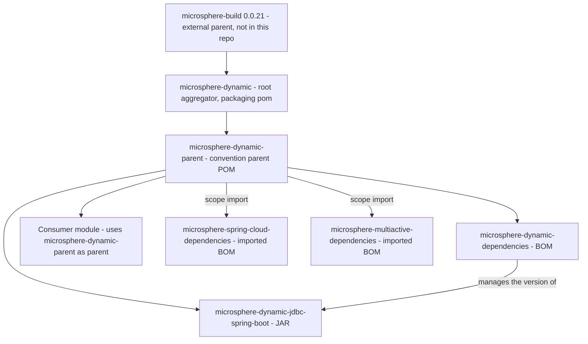

# microsphere-dynamic-parent

[English](../microsphere-dynamic-parent.md)

> **文档线：`current`。**
> 本仓库目前没有 `release` 或 `release-1.x` 分支；`current` 文档线由 `main` 分支生成（revision 为 `0.0.1-SNAPSHOT`）。

`microsphere-dynamic-parent` 是 `microsphere-dynamic` 项目的**约定式父 POM（convention parent POM）**。它是一个
`pom` 打包类型的构件：不发布任何 class，也不包含任何 module。它唯一的职责是告诉 Maven
*本项目线在构建与测试时使用的是哪些第三方库版本*，并把这一答案交给它下面的每一个 module——同时也交给你。

如果你维护的应用要用动态 JDBC 技术栈，消费这个构件的含义就是：你写 `<dependency>` 时**不写** `<version>`，
由下文的受管版本替你决定。

---

## 1. Maven 坐标

| 坐标项 | 取值 | 说明 |
| --- | --- | --- |
| `groupId` | `io.github.microsphere-projects` | 声明于 `microsphere-dynamic-parent/pom.xml` |
| `artifactId` | `microsphere-dynamic-parent` | |
| `version` | `${revision}`——默认 `0.0.1-SNAPSHOT` | `revision` 定义在**根** POM `pom.xml` 中，不在这里 |
| `packaging` | `pom` | 纯父 POM：没有 `<modules>`、没有 `<build>`、没有源码 |
| Name | `Microsphere :: Dynamic :: Parent` | |
| 源文件 | `microsphere-dynamic-parent/pom.xml` | |
| 许可证 | Apache License, Version 2.0 | 从根 POM 继承 |

源文件中它对自身父 POM 的声明，逐字如下：

```xml
<parent>
    <groupId>io.github.microsphere-projects</groupId>
    <artifactId>microsphere-dynamic</artifactId>
    <version>${revision}</version>
    <relativePath>../pom.xml</relativePath>
</parent>
```

因此本构件完整的继承链是：

`io.github.microsphere-projects:microsphere-dynamic-parent` → `io.github.microsphere-projects:microsphere-dynamic`
（根聚合 POM）→ `io.github.microsphere-projects:microsphere-build:0.0.21`（**外部构件**，不在本仓库中）。

---

## 2. 本构件在构建与消费图谱中的位置



读图要点：本仓库的三个 module（`microsphere-dynamic-parent`、`microsphere-dynamic-dependencies`、
`microsphere-dynamic-jdbc-spring-boot`）都是这个父 POM 的**子级**；而外部消费者接在 `Consumer module` 节点上，
继承到与项目自身完全相同的受管版本。

---

## 3. 如何消费

### 3.1 作为 `<parent>` 使用（主要、推荐的用法）

把这个 POM 声明为你的父 POM，会**同时**获得它的 `dependencyManagement` 以及从上层链继承来的构建约定
（来自 `microsphere-build`）。

```xml
<project xmlns="http://maven.apache.org/POM/4.0.0">
    <modelVersion>4.0.0</modelVersion>

    <parent>
        <groupId>io.github.microsphere-projects</groupId>
        <artifactId>microsphere-dynamic-parent</artifactId>
        <version>0.0.1-SNAPSHOT</version>
        <relativePath/> <!-- lookup parent from repository -->
    </parent>

    <groupId>com.example</groupId>
    <artifactId>my-dynamic-jdbc-app</artifactId>
    <version>1.0.0</version>

    <dependencies>
        <!-- No <version>: supplied by microsphere-dynamic-parent -->
        <dependency>
            <groupId>org.apache.shardingsphere</groupId>
            <artifactId>shardingsphere-jdbc-core-spring-boot-starter</artifactId>
        </dependency>
        <dependency>
            <groupId>org.mybatis.spring.boot</groupId>
            <artifactId>mybatis-spring-boot-starter</artifactId>
        </dependency>
    </dependencies>
</project>
```

这里的空 `<relativePath/>` 是刻意写的：它告诉 Maven **不要**按相对于你项目目录的路径去磁盘上找父 POM，而是从仓库解析。
省略它是各种奇怪目录结构下“找不到父 POM”的常见原因。

由于本构件自身的版本是 `${revision}`（默认 `0.0.1-SNAPSHOT`），仅靠 Maven Central 是解析不到 snapshot 的；
而且本仓库发布出去的 POM 并不带 `<repositories>` 段（被 flatten 配置移除了），所以快照仓库必须由你自己声明：

```xml
<repositories>
    <repository>
        <id>snapshot</id>
        <url>https://s01.oss.sonatype.org/content/repositories/snapshots</url>
        <snapshots><enabled>true</enabled></snapshots>
        <releases><enabled>false</enabled></releases>
    </repository>
</repositories>
```

### 3.2 作为 `<dependencyManagement>` 中导入的 BOM

你也可以只要*版本管理*，而不接管整条父级链：

```xml
<project xmlns="http://maven.apache.org/POM/4.0.0">
    <modelVersion>4.0.0</modelVersion>

    <groupId>com.example</groupId>
    <artifactId>my-service</artifactId>
    <version>1.0.0</version>

    <dependencyManagement>
        <dependencies>
            <dependency>
                <groupId>io.github.microsphere-projects</groupId>
                <artifactId>microsphere-dynamic-parent</artifactId>
                <version>0.0.1-SNAPSHOT</version>
                <type>pom</type>
                <scope>import</scope>
            </dependency>
        </dependencies>
    </dependencyManagement>
</project>
```

`<type>pom</type>` 与 `<scope>import</scope>` 必须**成对出现**，原因见下文 FAQ。该 POM 内部以 `import` 作用域声明的
两个嵌套 BOM（`microsphere-spring-cloud-dependencies`、`microsphere-multiactive-dependencies`）在解析其有效
`dependencyManagement` 时会被递归处理；请在你自己的项目里用 `mvn help:effective-pom` 确认最终结果。

**作为父 POM 与作为导入 BOM 的得与失：**

| 消费方式 | 受管版本 | JDK/编译基线 | 插件配置 | 你自己的 `<parent>` 是否仍可占用 |
| --- | --- | --- | --- | --- |
| …作为 `<parent>` | 有 | 有 | 有 | 否——已被占用 |
| …作为导入 BOM | 有 | **没有** | **没有** | 是 |

JDK 基线不是可有可无的细节：`microsphere-dynamic-parent` **本身并不声明** Java 版本。
`<java.version>8</java.version>` 以及 `maven.compiler.source`/`maven.compiler.target` 来自外部的
`microsphere-build:0.0.21` POM——它们是通过继承链得来的，本仓库的任何 POM 中**都没有声明**。
导入 BOM 会跳过这条继承链，这正是为什么 `spring-boot-dependencies` 这类 BOM 通常仍需搭配一个父 POM 使用。

### 3.3 与同级 BOM 配合使用

`microsphere-dynamic-parent` 并**不**管理 `microsphere-dynamic-jdbc-spring-boot` 的版本——那是
[`microsphere-dynamic-dependencies`](../microsphere-dynamic-dependencies.md) 的职责。二者组合如下：

```xml
<parent>
    <groupId>io.github.microsphere-projects</groupId>
    <artifactId>microsphere-dynamic-parent</artifactId>
    <version>0.0.1-SNAPSHOT</version>
    <relativePath/>
</parent>

<dependencyManagement>
    <dependencies>
        <dependency>
            <groupId>io.github.microsphere-projects</groupId>
            <artifactId>microsphere-dynamic-dependencies</artifactId>
            <version>0.0.1-SNAPSHOT</version>
            <type>pom</type>
            <scope>import</scope>
        </dependency>
    </dependencies>
</dependencyManagement>
```

---

## 4. 受管属性

`microsphere-dynamic-parent/pom.xml` 中声明的全部属性，取值与 POM 中书写的内容完全一致：

| 属性 | POM 中的取值 | 解析结果 | 用途 |
| --- | --- | --- | --- |
| `microsphere-spring-cloud.version` | `${revision}` | 默认 `0.0.1-SNAPSHOT`；CI 下为 `0.0.1` | 被导入的 `microsphere-spring-cloud-dependencies` BOM 的版本 |
| `microsphere-multiactive.version` | `${revision}` | 默认 `0.0.1-SNAPSHOT`；CI 下为 `0.0.1` | 被导入的 `microsphere-multiactive-dependencies` BOM 的版本 |
| `mysql-connector-java.version` | `8.0.28` | `8.0.28` | MySQL JDBC 驱动 |
| `mybatis.version` | `3.5.15` | `3.5.15` | MyBatis 核心 |
| `mybatis-starter.version` | `2.3.1` | `2.3.1` | `mybatis-spring-boot-starter` |
| `mybatis-plus.version` | `3.3.0` | `3.3.0` | MyBatis-Plus starter |
| `shardingsphere.version` | `5.1.1` | `5.1.1` | ShardingSphere JDBC starter |
| `mariadb4j.version` | `2.5.3` | `2.5.3` | 内嵌 MariaDB，本项目中用于测试 |

有两个属性**不在**这里声明，但作为父 POM 消费者依然对你生效：`revision`（在根 POM 中定义为 `0.0.1-SNAPSHOT`）
以及 `java.version`（由外部的 `microsphere-build:0.0.21` 定义）。想单独改动某个库的版本，受支持的方式是在你自己的
`<properties>` 段里覆盖对应属性，因为下文的每一条受管项都是通过属性来表达的。

---

## 5. 受管依赖

`microsphere-dynamic-parent/pom.xml` 中 `<dependencyManagement>` 的全部内容——共九条，按声明顺序：

| 序号 | `groupId` | `artifactId` | 受管版本 | 类别 |
| --- | --- | --- | --- | --- |
| 1 | `io.github.microsphere-projects` | `microsphere-spring-cloud-dependencies` | `${microsphere-spring-cloud.version}` → `${revision}` | BOM 导入，`<type>pom</type> <scope>import</scope>` |
| 2 | `io.github.microsphere-projects` | `microsphere-multiactive-dependencies` | `${microsphere-multiactive.version}` → `${revision}` | BOM 导入，`<type>pom</type> <scope>import</scope>` |
| 3 | `mysql` | `mysql-connector-java` | `${mysql-connector-java.version}` → `8.0.28` | 直接管理 |
| 4 | `org.mybatis.spring.boot` | `mybatis-spring-boot-starter` | `${mybatis-starter.version}` → `2.3.1` | 直接管理 |
| 5 | `org.mybatis` | `mybatis` | `${mybatis.version}` → `3.5.15` | 直接管理 |
| 6 | `com.baomidou` | `mybatis-plus-boot-starter` | `${mybatis-plus.version}` → `3.3.0` | 直接管理 |
| 7 | `org.apache.shardingsphere` | `shardingsphere-jdbc-core-spring-boot-starter` | `${shardingsphere.version}` → `5.1.1` | 直接管理 |
| 8 | `ch.vorburger.mariaDB4j` | `mariaDB4j` | `${mariadb4j.version}` → `2.5.3` | 直接管理 |
| 9 | `ch.vorburger.mariaDB4j` | `mariaDB4j-springboot` | `${mariadb4j.version}` → `2.5.3` | 直接管理 |

第 1、2 条正是 Spring Boot / Spring Cloud 版本线进入作用域的入口；第 3–9 条由本仓库直接声明。
这里的内容不会往你的项目里添加任何依赖——管理只提供版本。

---

## 6. 版本信息

### 6.1 `${revision}` 方案

| 条目 | 取值 | 声明位置 |
| --- | --- | --- |
| CI 友好占位符属性 | `revision` | `pom.xml`（根聚合 POM） |
| 默认值 | `0.0.1-SNAPSHOT` | `pom.xml`（根聚合 POM） |
| 本构件使用的版本 | `${revision}` | `microsphere-dynamic-parent/pom.xml` |
| CI 使用的版本 | `-Drevision=0.0.1` | `.github/workflows/maven.yml` |
| Wrapper 固定的 Maven 版本 | `3.9.0` | `.mvn/wrapper/maven-wrapper.properties` |

本仓库每个 module——包括这个父 POM——都写的是 `<version>${revision}</version>`。因此一个属性就驱动了整个 reactor：
改一下 `-Drevision`，聚合 POM、父 POM、BOM 与 JAR 会一起升降。这类 CI 友好占位符需要 Maven 3.5 或更高版本；
本仓库通过 Maven Wrapper 固定为 3.9.0。

`microsphere-spring-cloud.version` 与 `microsphere-multiactive.version` 同样等于 `${revision}`，也就是说
*外部* BOM 的坐标被绑定到了本项目的项目号上——详见 FAQ。

### 6.2 持续集成

`.github/workflows/maven.yml` 运行于 `ubuntu-latest`，由 `main` 分支的 push 与针对 `main` 的 pull request 触发，
JDK 矩阵只有一个条目（`'8'`，Temurin），构建命令为：

```
mvn --batch-mode --update-snapshots --file pom.xml -Drevision=0.0.1 clean install
```

CI 构建出的是 `0.0.1`（形如发布版本，不带 `-SNAPSHOT` 后缀），而普通的本地 `mvn install` 产出的是
`0.0.1-SNAPSHOT`。CI 只执行 `install`，不执行 `deploy`。

### 6.3 构件发布到哪里

`<distributionManagement>` 声明在**本仓库的根 POM**（`pom.xml`）中，server id 为 `ossrh`：

| 构件类型 | 目标仓库 |
| --- | --- |
| `*-SNAPSHOT` | `https://s01.oss.sonatype.org/content/repositories/snapshots` |
| 正式版 | `https://s01.oss.sonatype.org/service/local/staging/deploy/maven2/` |

同样的 snapshot URL 也出现在根 POM 的 `<repositories>` 段中，用于本项目自身构建期间的解析。
此外继承链上还引用了外部的 `microsphere-build:0.0.21` POM，它不属于本仓库。

> **关于发布分支。** 本仓库目前没有 `release` 或 `release-1.x` 分支；`current` 文档线由 `main` 分支生成
> （revision 为 `0.0.1-SNAPSHOT`）。也不存在任何已发布的 tag（`git tag` 为空），因此实际能解析到的版本就是
> `0.0.1-SNAPSHOT`。

---

## 7. 版本兼容性

| 维度 | 版本 | 来源说明 |
| --- | --- | --- |
| JDK / 字节码基线 | `8` | **继承自 `microsphere-build` 0.0.21**——外部 POM，本仓库中并未声明 |
| Spring Boot | `2.7.18` | **外部、继承而来**：由 `microsphere-spring-cloud-parent` 0.0.1 固定，经由 `microsphere-spring-cloud-dependencies` BOM 导入进入。这不是本仓库做出的承诺 |
| Spring Cloud | `2021.0.8` | **外部、继承而来**：与 Spring Boot 同一条 BOM 链 |
| `mysql-connector-java` | `8.0.28` | **本仓库声明**——`microsphere-dynamic-parent/pom.xml` |
| `shardingsphere-jdbc-core-spring-boot-starter` | `5.1.1` | **本仓库声明** |
| `mybatis` | `3.5.15` | **本仓库声明** |
| `mybatis-spring-boot-starter` | `2.3.1` | **本仓库声明** |
| `mybatis-plus-boot-starter` | `3.3.0` | **本仓库声明** |
| `mariaDB4j`、`mariaDB4j-springboot` | `2.5.3` | **本仓库声明**——本项目中为 test 作用域 |
| `microsphere-spring-cloud-dependencies` | `${revision}` | 本仓库声明的导入 BOM，其内容由外部维护 |
| `microsphere-multiactive-dependencies` | `${revision}` | 本仓库声明的导入 BOM，其内容由外部维护 |
| `microsphere-dynamic-jdbc-spring-boot` | `${revision}` | 由同级 BOM 管理，**不是**由本父 POM 管理 |

Spring Boot 这一行值得强调：一旦继承本父 POM，你就被隐式绑定到 `microsphere-spring-cloud-dependencies` 所选定的
Spring Boot 版本线上。该版本线目前通过外部构件解析为 2.7.18，而本仓库既不声明它、也不控制它。如果你需要另一个
Spring Boot 大版本，靠在本 POM 里覆盖属性是得不到的——那个版本位于被导入的外部 BOM 中。

---

## 8. 常见问题与坑

**问：为什么我的构建报 `'version' must be a constant value`，或者 `${revision}` 无法解析？**
因为这里每个 POM 都使用了 CI 友好的 `${revision}` 占位符。Maven 只有在 `revision` 有值时才会替换它：要么用
`-Drevision=...` 显式指定（CI 就是这么传 `0.0.1` 的），要么依赖根 POM 中声明的默认值 `0.0.1-SNAPSHOT`——而后者要求
根 POM `microsphere-dynamic:${revision}` 可被解析，因为 `microsphere-dynamic-parent` 通过
`<relativePath>../pom.xml</relativePath>` 指向它。自行构建本仓库时，请使用 `./mvnw` 并从根目录执行，以保证相对路径成立。

**问：最终发布出去的到底是我的 POM 还是扁平化后的 POM？**
发布的是扁平化后的。`flatten-maven-plugin` 的配置——模式 `resolveCiFriendliesOnly`、插件版本 1.6.0、
`updatePomFile=true`——全部来自外部的 `microsphere-build:0.0.21` POM，本仓库中并未做这些配置。该模式只会把 CI 友好属性
替换到项目自身和父级的 `<version>` 字段上，模型其余部分基本保持原样。从已安装的 POM 中可以观察到两个后果：属性按原样保留
（于是 `dependencyManagement` 里可能残留 `${revision}`），而 `<repositories>` 与 `<distributionManagement>` 会从发布的
POM 中被移除。`.flattened-pom.xml` 是生成的构建产物，已列入 `.gitignore`；切勿把一份过期副本当作事实来源。

**问：既然发布的 POM 去掉了 `<repositories>`，我该怎么拿到 snapshot？**
在你自己的 POM 或 settings 里声明 Sonatype OSSRH 快照仓库，写法见 3.1 节。继承本父 POM 并不会替你带上它。

**问：只写了 `<scope>import</scope>` 而没写 `<type>pom</type>`，会怎样？**
不生效。`import` 作用域只对 `dependencyManagement` 中那些构件本身是 POM 的条目有意义；如果 `type` 保持默认的 `jar`，
Maven 会去解析一个并不存在的 JAR，受管版本也就不会出现。本 POM 里每一次 BOM 导入都同时写了这两个元素（见上文第 1、2 条）——
请照抄这个写法。另外，`import` 只能出现在 `<dependencyManagement>` 里，绝不能出现在普通的 `<dependencies>` 中。

**问：我只想覆盖其中一个库，可以吗？**
可以——覆盖属性而不是覆盖依赖：
`<properties><shardingsphere.version>5.4.1</shardingsphere.version></properties>`。这里每一条受管项都由属性表达，
所以覆盖会传递下去。若你直接在 `<dependency>` 上写死 `<version>`，你的显式版本确实会赢过管理规则，但你就失去了单一事实来源，
并可能偏离本项目实际测试过的组合。

**问：为什么继承了本父 POM 却管不到 `microsphere-dynamic-jdbc-spring-boot`？**
这是刻意的设计：本父 POM 管理*第三方*库；项目自身 module 的版本由
[`microsphere-dynamic-dependencies`](../microsphere-dynamic-dependencies.md) 管理，那个 BOM 只管这一个成员。
要么按 3.3 节导入该 BOM，要么自己写明版本。

**问：CI 里的 `-Drevision=0.0.1` 对外部 BOM 意味着什么？**
`microsphere-spring-cloud.version` 与 `microsphere-multiactive.version` 的默认值都是 `${revision}`，因此同一个
`-Drevision` 取值也会选定 `microsphere-spring-cloud-dependencies:0.0.1` 和 `microsphere-multiactive-dependencies:0.0.1`。
如果为这些外部构件传了一个并未发布的版本号，失败的是依赖解析而不是编译。需要解耦时，请用
`-Dmicrosphere-spring-cloud.version=...` / `-Dmicrosphere-multiactive.version=...` 单独指定。

**问：继承本父 POM 会往我的 classpath 上加东西吗？**
不会。它是 `pom` 打包，自身没有任何 `<dependencies>`——只提供版本管理与继承的配置。

---

## 9. 相关文档

- [microsphere-dynamic-dependencies](../microsphere-dynamic-dependencies.md) —— 同级 BOM
- [microsphere-dynamic-jdbc-spring-boot](../microsphere-dynamic-jdbc-spring-boot.md) —— 基于本父 POM 构建的 JAR module
- [用户指南目录](../README.md)
- [仓库 README](../../../../README.md)

## English

- [English: microsphere-dynamic-parent](../microsphere-dynamic-parent.md)
